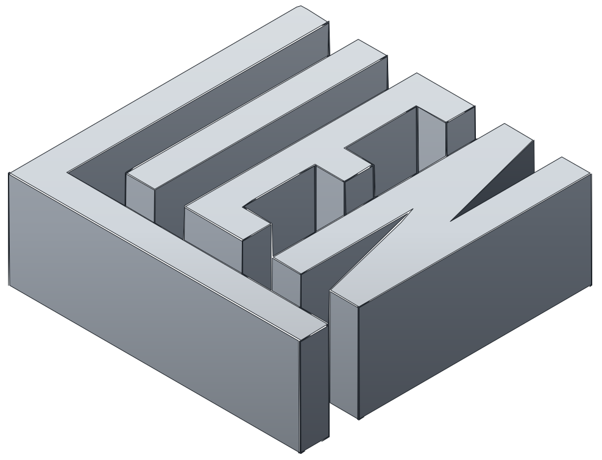
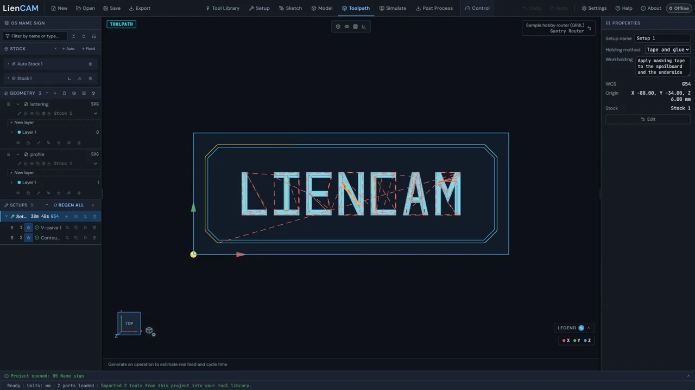

  
  

  
  
  
  

  

LienCAM takes a part from a sketch to a running CNC machine in one program: draw it, model it, make the toolpaths, watch the simulated cut, post the G-code and run the machine. It runs on your own computer with no account and no cloud, and it is free and open source. It is in alpha: it works, and it has rough edges.

## Try it

- [Download](https://eclsnowman.github.io/LienCAM/download.html)
- [Try it in your browser](https://eclsnowman.github.io/LienCAM/app/)
- [Read the docs](https://github.com/eclsnowman/LienCAM/wiki)

## What it does

| Capability | Status |
|---|---|
| Sketch (constraints, dimensions, text, SVG/DXF import) | SUPPORTED |
| Model: extrude, revolve, sweep, loft, fillet, chamfer, shell, draft, hole, booleans; STEP/IGES/STL import; STEP/STL export | SUPPORTED |
| Form (SubD organic modelling) | ALPHA |
| Relief from an image (raise / emboss / engrave) | ALPHA |
| Mesh lab (STL/OBJ/3MF edit, mesh booleans) | EXPERIMENTAL |
| 2.5D ops: face, contour, pocket, adaptive, drill, bore, thread mill, engrave, V-carve, chamfer | SUPPORTED |
| 3D ops: adaptive rough, parallel, waterline, scallop, steep/shallow, pencil | ALPHA |
| Nesting | EXPERIMENTAL |
| Simulate (stock removal) | SUPPORTED |
| Post: UCCNC, GRBL, grblHAL, LinuxCNC and Generic dialects | SUPPORTED |
| Control on the built-in simulator | SUPPORTED |
| Control on AXBB-E / UC100 (Windows bridge; needs the controller's own software installed for its DLL) | ALPHA - one machine proven |
| Control on LinuxCNC (gateway) | EXPERIMENTAL - simulator only |
| Control on GRBL / grblHAL (Web Serial) | EXPERIMENTAL - not hardware-verified |
| Probing routines, tool setter, guided M6, Z surface map, rotated work offsets, pause-move-resume | ALPHA |
| Phone pendant | ALPHA - tested on one machine |

See [Features](https://eclsnowman.github.io/LienCAM/features.html) for the full list and [ROADMAP.md](ROADMAP.md) for planned work.

## Open by design

**Open by design.** Everything you make in LienCAM is yours, and it leaves with you. Models export as STEP and STL, sketches as DXF and SVG, programs as plain G-code, and your tools, machines, post-processors, macros, settings and projects as documented JSON. Inside, LienCAM uses whatever formats work best for it - but the way out is always an open, standard format that other software can read. No account, no cloud, no lock-in.

## Machines and controllers

| Machine or controller | Status |
|---|---|
| UCCNC with a UC100 or AXBB-E controller (Windows) | ALPHA - proven on one machine |
| GRBL over Web Serial | EXPERIMENTAL - not hardware-verified |
| grblHAL over Web Serial | EXPERIMENTAL - not hardware-verified |
| LinuxCNC (gateway) | EXPERIMENTAL - simulator only |
| Built-in simulator | SUPPORTED |

> **What has been tested on real hardware.** I've tested LienCAM on my own router, which runs UCCNC with an
> AXBB-E controller. I don't own a GRBL, grblHAL or LinuxCNC machine, so those routes have only been tested
> against simulators (grbl-sim and the LinuxCNC simulator), not on real hardware yet. If you run one of those
> machines, your test reports are exactly what we need - and once people have confirmed them on real machines,
> this note comes off.

## Quick start

Open **Full Suite**, the first entry in **Try an example**. Check the stock, tools and machine in Setup, generate toolpaths with **REGEN ALL**, then simulate and post the G-code. Follow [First part in 15 minutes](https://github.com/eclsnowman/LienCAM/wiki/First-part-in-15-minutes) for a walkthrough, or [Set up your machine](https://github.com/eclsnowman/LienCAM/wiki/Set-Up-Your-Machine) to connect a controller.

## Why I built this

I'm a hobbyist. I've been designing and building 3D printers and CNC machines since 2013 - never for money,
just because I love building things and sharing them with other people.

LienCAM started the same way. I wanted software for my machine that I actually own, from the sketch to the
G-code to running the job - where no company can later decide that features I rely on, like rapid moves or a
multi-tool job posted as one program, aren't mine to use anymore. I've been working on it since the end of
April 2026 - well over 1,000 hours of my own time - and I held the first release back
until I could run real jobs with it on my own machine, because I wanted it to be genuinely useful to you from
day one.

I'm sharing it under the Apache-2.0 licence, so anyone can use it, change it, fork it and make it fit their
own machine - the same way I've always shared my printer and CNC designs, native source files included.

It was built with a lot of help from AI coding assistants. I set the direction, made the design decisions,
judged the results and tested it on real hardware; the AI wrote much of the code.

This is a passion project. I have a day job and a family, so I can't be a full-time developer on it. If it
turns out to be as useful to you as I hope, and you're able to help, I'd love to build it with you.

[More about LienCAM and why](https://eclsnowman.github.io/LienCAM/about.html)

## Built with help

Much of LienCAM's code was written with AI coding assistants. A person set the direction, made the design decisions, judged the results and tested it on a real machine. The assistants are credited in [CREDITS.md](CREDITS.md) alongside everything else it stands on.

## Credits

LienCAM stands on the shoulders of a great many open-source projects, and it exists because their authors chose to share their work. The ones it leans on most are Open CASCADE Technology, occt-wasm, brepjs, PlaneGCS, Manifold, Clipper2, FreeCAD's Adaptive2d and three.js. Every project, font and paper, with its licence and a thank-you, is in [CREDITS.md](CREDITS.md).

## Contributing

Bug reports, ideas and test reports from real machines are all welcome: see [CONTRIBUTING.md](CONTRIBUTING.md), and join the conversation in [Discussions](https://github.com/eclsnowman/LienCAM/discussions). Contributions are accepted under the Developer Certificate of Origin: sign off each commit with `git commit -s` (a `Signed-off-by:` line). Developer setup is in [Build from source](https://github.com/eclsnowman/LienCAM/wiki/Build-from-source) and in CONTRIBUTING.md.

## Licence

LienCAM is free software under the Apache License 2.0 ([LICENSE](LICENSE)); third-party components and their licences are listed in [THIRD_PARTY_LICENSES.md](THIRD_PARTY_LICENSES.md). There is no warranty; keep a hand near the E-STOP.
