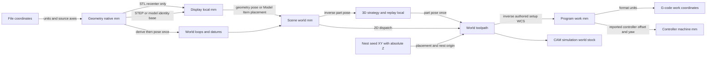

# WO-2945: Shared coordinate-frame contract

Status: contract v1 selected by architect 2026-10-18; bounded implementation
complete with 31 focused tests and the standard build passing. Independent source/contract audit is required before landing. Source baseline: `ff0db68d9584ee1b89bca4f37e452bb041a64b04`.
The current WO grants the pure facade, the existing store ring helper and two
named tests as well as this document/evidence. Architect release below settles
the desk checkpoint; remaining families and stock readiness are not implemented.

## Plan before implementation

1. Trace geometry/import, modeled placement, operation dispatch, setup/WCS,
   stock/rest, simulation, posting, controller display, and persistence routes.
   Read incident comments and existing assertions before proposing semantics.
2. Record the current transform graph and the callers of each authority; separate
   observed behavior from proposed boundaries and unresolved integration gates.
3. Specify typed points, vectors, lengths, frame identities, revisions, and
   transform direction. Reuse existing placement and program-coordinate math.
4. Publish the stock/frame interface for WO-2953 and the kernel boundary for
   WO-2944. Select one small future migration with exact source/test paths.
5. Review counterexamples and a geometric-equivalence validation matrix. Verify
   all source references against the branch, capture evidence, and commit the
   bounded design plus the worker result. The declared test slice is empty;
   no product build or test suite is planned.

## Decision and authority

The owner approved "Give all CAM operations one shared coordinate system" in trusted
owner export P4, revision 1.0, 2026-10-18. The WO records the exact answer,
"Approve", and report content SHA-256
`c3b0c4e28a2a676ca583f9edec2f55887d15fef2a42e1852950281ecb55ee4ce`.
This document is the worker's proposed contract, not another owner decision.

Use one explicit, typed transform authority across CAM boundaries. Preserve
distinct geometry, scene, setup, strategy, stock-grid and controller frames.
Do not recenter every source, store geometry relative to its stock, equate an
authored setup with a live controller offset, or change any machining method.
No motion/card change: this phase documents existing behavior and future seams.
No application drawing, machining result, board readback or measured toolpath
quality is claimed. Evidence is source inspection and reference verification.

## Current transform graph

Notation: `T[B <- A]` maps a point expressed in A into B; rightmost map applies
first. W is project/scene world; C is physical controller machine space. Current
comments often call W "machine". That historical convention does not establish
the controller's actual work zero or calibration.



The diagram summarizes routes, not a claim that derived loops are fed through
every intermediate node. Specific storage exceptions are listed below.

### Observed frame and caller inventory

All paths below are read-only in this phase. The evidence inventory records
direct call sites as well as definitions; line numbers are pinned to the source
baseline, and the manifest hashes each referenced source/test file.

| Family / frame | Current owner and actual callers | Units, axes and transform ownership |
| --- | --- | --- |
| Import normalization | `src/lib/import/importGeometryFile.ts`, `src/lib/import/dxfImporter.ts`, `src/lib/import/svgImporter.ts`, `src/cam3d/input/stl.ts`, `src/cam3d/input/step.ts` | DXF scales `$INSUNITS` to mm (unset/unitless remains mm); SVG composes element transforms then root viewBox/mm mapping then Y-down to Y-up. STL is unitless, interpreted as mm. STEP goes through OCCT tessellation; do not infer another scale from project display units. OBJ is converted to STL and IGES uses its import adapter; later migration must retain those import routes too. |
| Native vs display-local solid | `src/cam3d/integration/adaptive3dPartSource.ts:resolveAdaptive3dPartSource`, `src/lib/viewport/CNCViewport.ts:addSTL`, `src/lib/import/seatGeometry.ts:seatedPositionFromBounds` | STL base is translated by `(-cx,-cy,-minZ)` before applying its group pose. STEP retains native mesh coordinates and seats using group position. Model tessellation stays body-local. 3D planning uses this display-local mesh, not arbitrary raw-file vertices. |
| Imported part pose | `src/store/partTransform.ts:partWorldTransform`, `src/store/dispatchGeo.ts:transformLoopPoints`, `src/lib/viewport/restoreScene.ts`, `src/components/viewport/Viewport.tsx` | Stored imported pose is already world-absolute even for stock members. Stock membership does not add a parent transform. Euler degrees, three.js XYZ (`Rx * Ry * Rz`), shared `src/lib/geometry/rotationMatrixXYZ.ts`. XY-only routes require Z-preserving orientation; effective yaw is not always `rotation.z`. |
| Model placement | `src/lib/cam/modelReferenceFrame.ts:resolveModelReferenceFrame`, `src/lib/cam/modelItemPlacement.ts:resolveModelItemPlacement`; consumers include `modelBodyDerive.ts`, `dispatchGeo.ts`, `toolReachInputs.ts`, `adaptive3dPartSource.ts`, viewport/restore, properties and workholding resolution | Model row pose remains identity; Placement registry is the source. Resolver throws on missing placement. Some legacy scalar/display adapters catch and fall back; that is not a resolved machining frame. Fingerprint quantizes mm/degrees to 1e-5, for staleness, not geometric equality. |
| Local and baked 2D layers | `src/types/index.ts:Layer2D`, `src/store/dispatchGeo.ts:isWorldBakedLayer/layerPlaneWorldZ/holeBottomWorldZ`, `src/store/index.ts` dispatch around 19946 | `geometry_local` B-rep layers need pose; projection-plane layers without that tag are world-baked. Plain DXF/SVG/sketch loops without a projection plane still need their geometry pose: absence of `frame` alone does not mean world. Model derives can already bake world placement. Preserve loop identity, closed/open state, winding and hole role. |
| Reposed STEP / projection plane | `src/store/index.ts:rederiveStepLayersForPose/posedFaceDatum`, `src/lib/cam/geometry/occt/model/derive.ts:flattenToPlaneUV`, `src/lib/sketch/bake.ts`, `src/components/panels/DesignTree.tsx` projection production | STEP level-plane flips can convert local layers into world form and back using full matrices. A scalar local Z is only meaningful for a horizontal plane, not a tilted plane. Projection UV requires origin, two basis axes and normal. Stock-relative `zAnchor` is a semantic reference re-resolved on stock changes, not an extra rigid parent. |
| Setup/WCS | `src/types/index.ts:WCS`, `src/store/dispatchGeo.ts:effectiveWcsOriginZ/safeEffectiveWcsOriginZ`, `src/lib/post/workOffsets.ts`, store setup/snap/corner update routes | Authored WCS basis columns are world directions; origin is in W. World to work is `R^T * (p-origin)`. Fixture slot is controller metadata, not frame identity. Model-stock corner pins may use an effective origin differing from stored raw Z; manual and snapped origins must retain their semantics. |
| Height resolution | `src/store/dispatchGeo.ts:resolveGeometryZToFrames* / resolveTopZ / resolveModelBottomZ`, `src/lib/cam/heights.ts:resolveHeights`, `src/lib/cam/smartHeights/types.ts`, `src/lib/cam/smartHeights/resolve.ts` | Legacy selected-face Z is local; reference resolvers supply WCS-relative mm; `resolveHeights` adds WCS Z once to produce world planes. SmartHeight already names local/world/wcs/machine frames and dependency fingerprints; family adapters output strategy-local heights for 3D. Its machine labels currently follow the scene convention. Preserve intent/physical datum separately from numeric results. |
| Initial stock | `src/store/stockAssignment.ts:stockWorldBounds/deriveStockBounds/effectiveStockIdForCompute`, `src/store/dispatchGeo.ts:resolveOwningStock/owningStockWorldBounds`, `src/store/dispatchSeam.ts:writeFixedStockTwins` | Explicit PhysicalStock uses position plus size; derived bounds are already world, so position must not be re-added. FixedStockItem/PhysicalStock twins must remain synchronized. SceneStock, Setup.stock and PhysicalStock coexist; neither this design nor StockState completes their reconciliation. |
| 2D operations | `src/store/index.ts:computeOperationToolpath` resolves loops, model-backed derives, stock footprint and five planes; `src/lib/cam/toolpathWorker.ts` dispatches families | `face`, `contour_2d`, `pocket_2d`, `adaptive_clearing_2d`, `drill`, `bore`, `thread_mill`, `chamfer`, `engrave`, `vcarve` use resolved XY/world planes, except nest seed XY. Stock-rest boundaries and per-hole/per-cylinder/per-loop height refinements also convert frames. `operationGeometry.ts` describes selection consumption, not a transform authority. |
| 3D operations | `src/store/index.ts:computeParallel3dToolpath/computeWaterline3dToolpath/computeAdaptive3dToolpath`, `src/cam3d/integration/*3dOperation.ts` | Parallel route also selects steep/shallow, scallop and pencil. Mesh, boundaries, workholding, crash block, heights and removed stock must all share display-local. `worldPlaceParallel3dMoves` returns endpoints AND absolute arc centers to W. `worldMovesToLocalFrame` performs the inverse on predecessor moves; `worldRingsToLocalFrame` inverses boundary XY. Current x/y-rotation refusals are not changed here. |
| Remaining stock / rest | `src/store/toolReachInputs.ts:remainingStockBefore`, `src/store/index.ts:earlierMaterialInPartFrame/lowerFinishLinksAfterEarlierOperations`, `src/lib/cam/stockState.ts`, `src/cam3d/integration/adaptive3dOperation.ts:restStartStockFor`, `src/cam3d/worker/dispatcher.ts:startingStockFor` | 2D replay stock is world; 3D finish replay transforms predecessor world paths to consumer-local first (WO-1387). Retained rough field is worker/display-local with client, setup, geometry, predecessor, bounds, resolution and chain checks. StockState has grid bounds/resolution but no frame/revision identity. `computeRest3dMoves` exists in `rest3dOperation.ts` but has no production call site at this baseline; do not mistake it for the active finish route. |
| Nesting | `src/lib/cam/nesting/instanceToolpath.ts:instanceMove/expandNest`, `src/store/index.ts` seed dispatch and explode, `src/lib/post/buildPostInput.ts` | Seed moves store local XY with already-resolved absolute Z. Instance transform applies placement yaw/XY then nest origin to endpoints and centers; Z, feed and handedness are retained. The expander owns inter-copy travel and cut ordering. Explode bakes pose into points and resets the part pose. This mixed legacy frame requires an explicit adapter, not a fake all-local Vec3 brand. |
| Workholding / collision | `src/lib/workholding/pose.ts`, `src/lib/workholding/resolveWorkholding.ts`, `src/lib/cam/workholdingSeat.ts`, `src/store/fixtureObstacles.ts`, `src/store/toolReachInputs.ts` | Assembly matrices compose `instance * joint * component` in column-major order. Obstacle meshes are W, then converted to strategy-local where needed. Normals/directions rotate without translation; an AABB must be rebuilt from corners/vertices after rotation. Shape and clearance allowances remain lengths. |
| Simulation / viewport | `src/components/simulation/SimulationPanel.tsx`, `src/lib/simulation/HeightmapSimulator.ts`, `src/lib/simulation/VoxelSimulator.ts`, `src/lib/viewport/stockSimMesh.ts`, `src/lib/viewport/stockRemovalDisplayAuthority.ts` | CAM simulation consumes world-expanded paths and world stock. Marker readout calls `toWork`. Adaptive carved preview is local and rides the part group. Grid index-to-metric conversion is separate from scene pose. Display authority selects visible bodies; it does not establish stock freshness for planning. Camera up is Z. |
| Program / post | `src/lib/program/coords.ts:toWork/toWorld`, `src/lib/program/buildMachineProgram.ts`, `src/lib/program/multiSetupProgram.ts`, `src/lib/post/emit.ts`, `src/lib/post/coords.ts`, `src/lib/post/format.ts`, `src/lib/post/setupSheet.ts` | Shared inverse WCS transform; live MachineProgram is work/mm; post formats G20/G21 at export only. Arc center is a point; emitted I/J are deltas rotated without origin. `detectRotatedWcs` currently accepts orthonormal right-handed yaw, rejects tilt/mirror/malformed bases. Older identity-only comments are stale. Multi-setup clearance is compared in W then expressed in outgoing work frame; boundaries/actions remain owned by program logic. |
| Controller / operator position | `src/lib/machine/machineEnvelope.ts:turnWorkPoint`, `src/lib/machine/transferCheck.ts`, `src/lib/machine/pathFidelity.ts`, `src/lib/machine/machineSession.ts`, `src/lib/machine/positionFrames.ts:formatPosition` | Live C = reported origin + reported XY yaw applied to controller-work. Authored setup yaw and live yaw are distinct transforms. `formatPosition` is a sentence formatter; its optional offset completion is translation-only, so rotated callers must pass correctly resolved work/machine values. Never promote it to CAM arithmetic or infer offset from machine minus work under rotation. |
| Flip and reopen | `src/lib/cam/flipSetup.ts:flipPointToSecondSide/planSecondSideSetup`, `src/store/migrateHierarchy.ts`, `src/store/migrations/projectMigrations.ts`, `src/store/persistenceRegistry.ts`, `src/store/index.ts:loadProjectFromFile` | Flip is explicit X or Y about the block, same stock corner/origin and resolved offset; it is not simple negation or a mirrored basis. File-open, persisted rehydrate, undo/redo and scene restore must resolve placement/bindings again and reject stale derived results. No stored-coordinate schema rewrite in the pilot. |
| Kernel boundary | `src/kernel/planning.ts`, `src/kernel/headless.ts`, `src/kernel/geometry/contracts.ts`, `src/kernel/geometry/adapters.ts`, `src/cam3d/kernel/types.ts` | Geometry services accept planar mm with backend-specific winding/precision; PartMesh uses mm/Z-up arrays. Neither carries frame identity today. Current headless planner calls the existing resolver; kernel planner registrations are empty. V3 capabilities remain unknown; no private kernel access is needed for the proposed envelope. |

The operation census is the complete current `OperationType` union (16 types).
The frame-boundary census is bounded by the current source baseline, with raw
consumer searches retained in evidence. It does not assert there are no other
ad-hoc arithmetic expressions: each later family migration must repeat discovery
for its conditions, events and invalidation routes before changing them.

## Transform authority and typed boundary

Implemented pilot module: `src/lib/geometry/coordinateFrames.ts`.
It is a pure, dependency-light facade: no store, UI, controller, worker singleton
or hidden active setup. It owns composition, direction and input-frame checking.
Existing domain resolvers keep authority over *which pose/binding is correct*;
the facade alone applies conversions at migrated CAM boundaries.

Reuse `rotationMatrixXYZ` and the existing pure matrix functions in
`src/lib/workholding/pose.ts` (`multiplyMat4`, `invertRigidMat4`,
`transformPoint`, `transformDirection`); do not introduce another trig/matrix
implementation. For authored WCS conversions delegate to the existing
`program/coords.ts` math while that remains the compatibility owner. A later
separate migration can move primitives beneath both facades without a cycle;
never have program/coords import a module that imports program/coords.
Legacy helpers remain compatibility entry points until their family migrates,
not competing definitions of frame meaning.

Suggested API shape (contract notation, not compiled or installed code):

```typescript
type FrameKind = 'geometry-native' | 'display-local' | 'world' | 'setup-work'
  | 'strategy' | 'stock-grid' | 'nest-sheet' | 'controller-work' | 'machine'
interface FrameRef {
  kind: FrameKind
  projectEpoch: string
  entityId: string // body/geometry/setup/stock/instance/controller identity
  revision: string // resolved basis + pose + relevant source revision
}
// Opaque constructors; Point and Vector are distinct invariant brands in F.
type Point<F> = FramedPointMm<F>
type Vector<F> = FramedVectorMm<F>
type RigidMap<A, B> = CheckedRigidMap<A, B> // includes exact from/to FrameRef
mapPoint<A, B>(map: RigidMap<A, B>, p: Point<A>): Point<B>
mapVector<A, B>(map: RigidMap<A, B>, v: Vector<A>): Vector<B>
inverse<A, B>(map: RigidMap<A, B>): RigidMap<B, A>
compose<A, B, C>(bc: RigidMap<B, C>, ab: RigidMap<A, B>): RigidMap<A, C>
```

Runtime serialization must carry from/to frame identities and revisions. Brands
alone cannot detect two setups with the same TS type or a result from before a
project reload. Check actual tokens at both worker ingress and result publish.
Revision comparison is exact; geometric comparison uses tolerances. Frame
fingerprint quantization alone cannot identify an operation/stock revision.

Rules for every migrated boundary:

1. Canonical internal lengths are mm, feeds mm/min, angles explicitly degrees
   (Euler XYZ) or radians in private trig. Grid indices, unit directions and
   dimensionless ratios have separate types. Unit normalization occurs once at
   import; inch conversion once at export/display. No scale in a rigid map.
   A stock-grid frame here means metric grid-local coordinates; integer cell
   indices cross a separately typed index-to-metric map using cell size/origin.
2. Canonical spatial frames are right-handed, +Z tool-up; positive yaw is CCW
   viewed from +Z. SVG Y reflection and arbitrary import scaling belong to the
   import adapter, which retains/normalizes winding as its geometry contract
   requires. A flip is a proper 180-degree rotation, not reflection.
3. `T[B <- A] = inverse(T[W <- B]) * T[W <- A]`. Map points with translation;
   vectors/directions with rotation only. Normal transformation uses the rigid
   rotation; nonrigid import normal handling remains an import responsibility.
   Validate finiteness and rigid basis at the new typed ingress; do not alter
   persisted-file compatibility or broaden unrelated refusal conditions.
4. A scalar height carries frame identity and horizontal-plane provenance.
   `worldZ = localZ + pose.z` is valid only when its producer has established
   the relevant level-plane convention (including reposed STEP datums). A
   tilted plane needs full origin/axes/normal or a named unsupported outcome.
   No converter chooses a replacement machining method or adds operator steps.
5. An arc has point endpoints and absolute point center, plus plane/handedness.
   I/J is a vector computed from center minus start, transformed without origin.
   Yaw preserves CW/CCW. Do not silently enable tilted arc planes.
6. A bounds object is tagged AABB, oriented box, polygon or grid extent in a
   named frame. Rotating min/max alone is invalid. An enclosing AABB may be
   used for broad-phase bounds, never silently as exact removable material.
7. Missing placement, unsupported tilt, stale revision and unavailable stock
   are explicit outcomes. A display fallback cannot be branded as valid planner
   evidence. Preserve current approved behavior; any proposed change to a
   legacy fallback needs its own inspected caller/approval scope and tests.
8. Resolve an immutable context at compute start; copy numeric matrix values.
   Include geometry content, placement, import normalization, setup binding,
   stock origin/grid and operation generation in dependency keys. At completion
   compare against the current context before publishing moves or stock. A late
   result cannot replace a newer frame. Reopen gives a new project epoch;
   durable content fingerprints can validate reuse but worker handles cannot.

### Boundary with WO-2953: frame ownership vs material ownership

Proposal for checkpoint acceptance, not a claim of agreement. No WO-2953 PLAN
existed in this checkout at inspection. WO-2953 owns initial material identity,
enabled-prefix selection, representation/fidelity, revisions, availability,
invalidation/recompute and queries. WO-2945 owns frame descriptors and conversion.
Neither computes an independent second stock truth.

Use W/mm as the canonical material-query frame for the first shared stock
authority, matching physical stock bounds and stored ordinary toolpaths. A
representation may retain another storage grid frame, but its immutable result
must expose `T[W <- grid]` and revision. Operations cannot infer the grid's frame
from its bounds or translate it by the stock position a second time.

Required envelope fields and behavior:

| Field / boundary | Owner and contract |
| --- | --- |
| `projectEpoch`, `stockId`, `initialStockRevision` | Stock authority supplies identity of the actual block and starting shape; frame service supplies the W token. Same-sized blocks are not interchangeable. |
| `beforeOperationId`, ordered enabled prefix, `materialRevision` | WO-2953 derives from authoritative authored order and enabled operations, with geometry/tool/parameter/posted-result dependencies. Bounds and cell size alone do not establish currency. Frame/setup revisions participate even if the AABB is unchanged. |
| `frame`, `gridToWorld`, `representation`, `resolutionMm`, error bounds | Representation owner supplies metrics and provenance; frame facade checks direction and converts query primitives. Convert a query into grid space when possible instead of resampling stock. Z-dexel cannot represent arbitrary tilted/undercut stock merely by relabeling its frame. |
| Ready result / unavailable / recomputing / error | Stock owner supplies a discriminated result keyed to requested revision. A stale preview may remain visible with its existing status, but cannot answer a ready planning query. No full-box or reference-tool substitution is introduced under this contract. |
| Request and publish | Query includes requested material revision and frame token; ready reply repeats both. Suppress/unsuppress, reorder, delete/insert, edits, setup/flip, cancel/fail and reload invalidate the appropriate suffix. Old async completions are rejected before publish. |
| Conversion fidelity | Query/result adapter declares supported query geometry and conservative error bound. Unsupported conversion returns a named unavailable result with no planner moves. A rotated envelope is not a transformed stock field. |

An optimization may reuse an unchanged snapshot only when the full material and
frame keys match. Preservation hashes identify artifacts, not equivalent
geometry. Cross-setup/second-side stock reuse needs an explicit flip mapping
and representation proof; sharing `stockId` or G54 is insufficient.

### Boundary with WO-2944: kernel pilot

Publish this contract to the next staged WO-2944 design/review through this
artifact; no external message or edit to its files was made. Its first adapter
must receive a resolved immutable planning-frame token, framed loops/mesh,
heights, tool lengths and optional revision-bound stock query. Return moves in
that same planning frame; the existing app adapter converts to world exactly
once before ordinary toolpath publication (nest seeds use their explicit legacy
adapter). For planar services the caller specifies its plane origin/basis;
`kernel/geometry` must not assume raw loops already mean W.

Current and kernel/shadow comparison consume the same frozen context. Compare
outputs in one metric frame, with residual/gouge and clearance error bounded
by the measured input representation and strategy tolerance. Engine routing
cannot change frame normalization, consume a preview as authoritative stock,
or hide unsupported input behind another machining method. The future V3 seam
is this data contract; no unpublished API or capability is assumed.

Checkpoint exit: architect/judges record the selected frame/envelope version and
WO-2953/WO-2944 compatibility against their actual designs before consumer
implementation. This is a technical staging checkpoint under existing approval,
not a wait for the whole coordinate/stock migration and not a new owner gate.

## First bounded caller migration (released pilot)

Select `worldRingsToLocalFrame` in `src/store/index.ts`, not a whole CAM family.
It is a small existing inverse-yaw/translation seam used by real 3D boundaries
and preview. Add the typed facade and change only this helper to delegate its
ring mapping. Keep its signature and identity fast path; its planar conversion
does not depend on position.z. Keep Float64Array rings, order, winding and all
current feature/refusal decisions. Do not change world move placement, stock
selection, height resolution, or any automatic motion in this pilot.

Exact source ownership released by the architect on 2026-10-18:

- New `src/lib/geometry/coordinateFrames.ts` for typed pure conversion.
- `src/store/index.ts`, limited diff to import and `worldRingsToLocalFrame`.
- New `src/tests/cam/coordinateFrames.wo2945.test.ts` for type/runtime identity,
  points/vectors, composition, yaw and planar rings.
- New `src/tests/store/coordinateBoundaryRoutes.wo2945.test.ts` for the actual
  compute/preview boundary ingress, avoiding tests of a hand-built engine payload.
- This WO document and `src/tests/evidence/WO-2945/` for results/proof.

The architect must reconcile the shared store file lease before dispatch. The
existing matrix/rotation/program modules are read-only dependencies in this
pilot; if implementation needs to edit them, widen the exact grant first.
Proposed focused test slice: the two new named files, plus existing
`src/tests/cam3d/restPredecessorFrame.wo1387.test.ts` as a neighbor regression.
That existing test covers translated replay, not every boundary or rotation;
the new production-entry tests must supply the missing coverage. Product code
changes require the standard build in the future implementation phase. No such
test or build ran in this documentation phase.

Every direct consumer of the selected helper was searched (five call sites):

| Route at baseline | Why the wrapper applies / what remains unchanged |
| --- | --- |
| Store around 3587: parallel/steep-shallow/scallop/pencil stock boundary | All four select through the parallel orchestrator; transform the proven world footprint to this part's local XY. No strategy selection or height change. |
| Store around 4159: waterline boundary | Same inverse XY mapping; preserve its own worker and plane handling. |
| Store around 4864: adaptive SmartHeight preview | Same footprint as compute; cannot retain an independent preview formula. |
| Store around 7499: adaptive part-box stock equivalence | Called with yaw 0 deliberately; preserve that condition and its tolerance/full-clear decision. |
| Store around 7506: adaptive clear-whole-stock footprint | Converts ring even with yaw; downstream `resolveStockOutlineMode` still owns capability decisions. Do not silently enable rotated full-clear. |

Adjacent conditions and incident comments read: WO-1387 world/local predecessor
replay, WO-1954/1956 solid normalization, WO-1271 proven stock boundary, WO-2145
part-box equivalence/rest rough, WO-2489 workholding exclusion, CAM-DRILL-FIX3
effective origin, and STEP repose comments. `worldMovesToLocalFrame` and
`worldPlaceParallel3dMoves` are neighbors that need no pilot change. Keep their
behavior covered, then migrate them in separately allocated slices. On the
actual next-phase base repeat this search; this list is not a completeness proof
for source that has changed since the baseline.

Rollback is to restore this caller's delegation and remove the unused facade
in one branch change. No project schema/data migration means no user data
rollback. Compare before/after geometry in W; do not require identical floating
path bytes. If a behavior or risk-relevant sequence is intentionally fixed, keep
the same assertion failing on old source and passing on new source, with the
source-bound JSON proof the worker protocol requires. This plan itself is text
and requires no negative-control run.

### Remaining migration families (no leases reserved)

1. Geometry normalization/placement: imports (including OBJ/IGES), model native
   vs display bases, `partWorldTransform`, model placement resolver, body derives,
   projected layers and sketch bake. Keep placement resolver as data authority.
2. 2D geometry selection and heights: local/world-baked/STEP-reposed paths,
   per-hole/boss/loop refinements, SmartHeight evidence and preview/properties.
   Discover all 16 operation routes, not only the modal's acceptance list.
3. 3D publication and predecessor replay: world move/arc-center placement,
   finish/local workholding, crash blocks and retained adaptive fields. Coordinate
   with WO-2953 before replacing any local stock reconstruction.
4. Nest mixed XY/Z adapter, expansion, common edges and explode; preserve the
   expander's travel/order semantics and legitimate seed-local storage.
5. Shared stock adapters and grid queries under WO-2953, then CAM simulation
   and local carved previews; rendering authority is not material authority.
6. Program/post typed wrappers and vector I/J; setup-sheet/readout consumers;
   multi-setup outgoing-frame clearance. Retain the shared `program/coords` seam.
7. Controller preview/operator formatting is a separate later boundary: reported
   origin/yaw, G53/work/rotary distinctions, phone/simulator/controller routes.
   Read approved pins before any condition change; board readback required for
   controller claims. No hardware or controller migration is part of this pilot.
8. Persist/reopen/undo and project epochs across all migrated families; preserve
   existing file migrations instead of reinterpreting old saved numbers in place.

## Validation matrix and adversarial counterexamples

These are specified acceptance checks, not tests claimed run. Existing test
files are read-only analogs with evidence of intent, not proof of new coverage.
New tests run through production store/adapter entry points where the assertion
describes app output. Pure facade tests are controls, not application truth.

| Case / counterexample | Expected metric or invariant | Existing analog / future gap |
| --- | --- | --- |
| Translate geometry `(100,-30,12)`, local point `(2,3,4)` | W point `(102,-27,16)`; inverse returns local. A second pose would be detectable. | `src/tests/store/resolveGeometryZToFrames.test.ts`; new point/ring and production-entry checks. |
| Pose yaw +90, translation `(10,20,3)`, local `(2,0,4)` | W `(10,22,7)`; inverse returns `(2,0,4)`. Include generic 37-degree yaw, negative origin, empty ring and identity path. XY mapping independent of position.z. | New pilot files; test all five call sites above, with all parallel-route variants. |
| Setup origin `(10,20,3)`, yaw +90, W `(10,22,7)` | Work `(2,0,4)`; same through post and live builder. Generic yaw too. | `src/tests/post/coords.test.ts`, `src/tests/post/rotatedWcs.wo299.test.ts`. |
| Absolute arc center vs I/J vector under translated/yawed setup | Endpoints and center inverse-map to same circle; radii and sweep agree, I/J receives no origin subtraction. CW/CCW preserved for proper yaw. | `src/tests/post/rotatedWcs.wo299.test.ts`; later program/post migration checks. |
| Euler `(0,0,theta)` vs `(180,180,theta-180)` | Equal resolved basis/points within tolerance; do not use raw rotation.z as a universal predicate. True tilt remains unsupported where currently unsupported. | `src/lib/geometry/rotationMatrixXYZ.ts`, `src/store/dispatchGeo.ts:effectiveZRotationDeg`; later 2D family proof. |
| Raw STL vs same displayed STEP/model with nonzero source bounds | Import normalization plus pose gives same surface; recenter STL exactly once, never recenter STEP again. | `src/tests/cam/modelReferenceFrame.camBindingStage2.test.ts`, `src/cam3d/integration/adaptive3dPartSource.ts`; source-specific fixture comparisons still owed. |
| Local B-rep layer vs world-baked projection; plain DXF without frame tag | First gets pose, second stays fixed/baked, third still gets pose. Flipped STEP pose/reopen cannot bake twice. | `src/tests/store/typedZTransform.test.ts`, STEP repose code; later layer matrix. |
| Inch DXF or SVG physical units vs equivalent mm shape; inch post | Normalize to same mm extent; post decoded metric path agrees within formatting tolerance. Feeds scale, RPM/dwell/direction do not. | `src/tests/post/units-matrix.test.ts`, import parsers; source-unit normalization fixtures owed. |
| Explicit stock vs derived stock at same world box | Equivalent world bounds; no derived-position double add. A different stock id with same box cannot reuse stock result. | `src/tests/store/partTransform.test.ts`, `src/tests/store/int8cWcsStockCorrectness.test.ts`. |
| Model row identity pose, nonzero Placement and corner-pinned WCS | Placement supplies world frame; effective stock corner supplies origin. Missing placement never receives a ready planning token from a display fallback. | `src/tests/store/camDrillD3.wcsOriginParity.test.ts`, `src/tests/store/openKeepsStockBoundOrigin.wo1386.test.ts`. |
| Translated/rotated preceding cuts replayed into 3D consumer local | Same removed material after inverse placement; no world sweeps in local stock. Grid orientation/resolution recorded. | `src/tests/cam3d/restPredecessorFrame.wo1387.test.ts` covers translation; rotation and revision tests remain owed. |
| Suppress/unsuppress/reorder/delete/edit, then old compute finishes | Material/frame revision mismatch prevents ready publication/query; only ordered enabled prefix contributes removal. Exact unchanged key may reuse. | WO-2953 future sequence matrix; retained rough gates are partial existing protection, not complete shared-stock proof. |
| X/Y flip of `100x50x20` block, zero `(0,0,20)` | About X: `(x,5,-3)` becomes `(x,45,-17)`; twice returns original. About Y is different. Same stock corner and parent-resolved offset. | `src/tests/lib/flipSetup.wo288.test.ts`. |
| Two setups both labelled G54, different origins or stock ids | Frame identities remain distinct; no cache keyed only by slot/label. Inter-setup retract uses world maximum then outgoing frame. | `src/tests/post/combined-global-safez.test.ts`, `src/lib/program/multiSetupProgram.ts`. |
| Save/open twice, browser rehydrate, undo/redo during compute | Preserve physical geometry/bindings; new epoch rejects old workers; rebuild placement frame without accumulating offsets. | `src/tests/store/openKeepsStockBoundOrigin.wo1386.test.ts`, migration/restore code; future late-result tests. |
| Authored yaw and different live controller yaw | W -> authored work -> reported controller machine uses both transforms once, never collapses them. Formatter supplied both resolved values. | `src/tests/machine/programFitStagedAndTravelUnderRotation.wo2219.test.ts`, `src/tests/machine/positionFrames.wo1667.test.ts`; no board claim. |

Numeric comparisons: for Float64 rigid-transform controls use error
`max(1e-9 mm, 64 * Number.EPSILON * coordinateMagnitudeMm)` per component and
dot/determinant error <= 1e-10 for a deliberately valid basis. These are proposed
arithmetic tolerances, not machining allowances. For Float32 meshes use an
explicit quantization bound based on coordinate magnitude (at least four Float32
ULPs) plus the source tessellation/normalization tolerance; compare transformed
surfaces/bounds, not raw vertex order or bytes. For posted coordinates include
half the output-unit decimal quantum converted to mm, plus arc linearization
error where applicable. For discretized stock compare occupied/removed volume,
residual and clearance against the representation's cell/error bound. If an
upper error bound cannot establish required clearance, report unavailable;
do not hide uncertainty by increasing an unrelated tolerance.

Adversarial design review:

- A frame tag without identity/revision still accepts stale or wrong-part data:
  require runtime tokens and immutable dependency snapshots.
- A correct matrix with the wrong pose source still cuts the wrong place:
  preserve Model Item placement and effective origin resolvers, not row identity.
- A stock id is not a pose, and an AABB is not remaining stock: keep ownership,
  transform and representation contracts separate.
- Old comments are not current behavior: yaw is accepted by the post validator;
  current 3D tilt guards and adaptive full-clear restrictions remain in force.
- Five call sites reach more than five behaviors: parallel includes four
  strategies and adaptive includes preview and part-box tests. Enumerate them.
- Existing passing evidence is not new proof: no tests were rerun under the
  empty declared slice, and checkpoint agreement is not fabricated.

## Design-phase verification record (historical)

Evidence directory: `src/tests/evidence/WO-2945/`. It contains baseline-bound
consumer searches, source hashes/anchors, verification output and a record of
inspection limits. Referenced tests were read, not executed. No product/config
change requires a build. The completion check's dry-run plan unconditionally
includes a repository typecheck; executing that exceeds this WO's empty slice,
so only its dry-run is permitted here. Counts and final command exits are in
the worker result and evidence; no passing test or board receipt is invented.

## Released implementation plan and route audit (2026-10-18)

Authority: latest architect IMPLEMENTATION RELEASE and Exactsourcephase in the
work order. Main merged into preserved branch at 45b04eb67b. The existing design
and peer snapshot are retained. Plan: add pure checked FrameRef/point/vector/rigid
map API reusing existing matrix primitives; delegate only the existing ring helper;
prove arithmetic equivalence and real compute/preview boundary inputs using the
two named new tests plus WO-1387; run the standard product build. No red or motion
change is being repaired, so no failing-old sequence-fix proof is applicable.

Before editing, re-read the five consumers and neighboring incident comments:
parallel orchestrator covers parallel/steep-shallow/scallop/pencil; waterline
shares the resolved display pose; adaptive preview and compute must use identical
footprints; adaptive part-box comparison deliberately supplies zero yaw. Each
needs only the helper delegation, no condition changes. Preserved WO-1271 stock
provenance, WO-1387 predecessor replay, WO-1954/1956 STL normalization/Model Item
placement, WO-2145 part-box/rest/full-clear, and WO-2489 neighbor exclusion.
Search: `rg -n 'worldRingsToLocalFrame|worldMovesToLocalFrame|worldPlaceParallel3dMoves' src/store/index.ts`.
Move placement, arc centers, rest replay, stock ownership, WCS and heights remain
with their existing owners. tools/proven.json pins probing paths, none edited.

Desk contract selected by architect: W/mm canonical query space; common
FrameRef{kind,projectEpoch,entityId,revision}. WO-2953's proposed StockFrameRef
field names are superseded by this shared FrameRef; do not implement a competing
type. Units/right-handedness are part of the mm API contract, not mutable flags.
Stock owns material/order/readiness/fidelity; frame service owns conversions.
Frame identity checking does not prove that a supplied revision is current.
SmartHeight world-to-controller-machine mapping is still a future explicit
adapter, not inferred from historical names. No stock authority is implemented.

The legacy synchronous ring signature lacks epoch/entity/revision. Keep it as a
pose-only compatibility adapter inside the facade instead of fabricating stock
or project identities or widening the store edit. It reuses rotationMatrixXYZ,
preserves subtract-before-rotate and the XY-only identity return (even nonzero Z).
New typed boundaries validate rigidity/finiteness and exact identities; this
legacy adapter adds no new refusal/tilt/capability checks. Independent source
audit must review this distinction and stock compatibility before landing.

## Implemented boundary and adversarial review

Source commits: 41d2f29294 (facade and store helper) and aea6dd4942 (runtime
validation/signed-zero parity, focused production tests and main capture).
Exports: FrameKind/FrameRef, immutable pointMm/vectorMm constructors,
rigidMap/rigidMapFromPose, mapPoint/mapVector, inverse/compose and sameFrame.
Checked maps are opaque in-process objects; wire adapters must explicitly
reconstruct them from from/to identities and matrices, not JSON-cast them.
Exact identity/revision checks are not a material readiness or staleness service.
No async ingress/publish guards, stock authority, units importer, setup resolver
or additional family migration are claimed by this implementation.

The store diff is one import plus delegation of worldRingsToLocalFrame.
Its compatibility entry worldRingsToDisplayLocalMm preserves Float64Array,
ring order, winding, XY-only identity including nonzero Z and signed-zero math.
Existing placement resolution selects the effective Model Item pose, source
normalization recenters STL once, and caller capability checks stay in place.

Adversarial checks: wrong-part same-kind frame, same-ID reopened project, edited
revision, mutated matrix/point inputs, reversed composition, scale/shear/mirror,
nonfinite coordinates, offset origins at 1e12 mm and very small/large yaw.
All five helper consumers are reached through store actions (parallel's four
strategies, waterline, adaptive preview, rotated footprint and part-box/full-clear).
Adapter spies assert application ingress and one-time output placement; canned
paths are not engine evidence. The separate real BvhKernel parallel test compares
application output with main captures at identity and translated/90-degree poses.

Oracle corrections and every failed test are recorded in implementation-gate.txt.
Initial safety planes were invalid; production correctly refused. The false
sideEntry field is omitted. A proposed cross-pose exact-path invariant is not
true of the current engine: main reproduces the same discrepancy even with
symmetric stock. The correct pilot criterion is geometric preservation against
the SAME pose on main, not introducing rotational covariance to an untouched
strategy. The baseline is captured through computeOperationToolpath with main's
store source d03d4ee103715188d3629c00267ea6a782e6b39c, then source is restored.
Both poses match main with zero coordinate/arc-center deviation (bound 1e-9 mm),
identical feed/role/type/move count and identical heights. This is baseline
preservation proof, not a newly fixed fault or physical machine proof.
Independent source/contract review remains owed through the normal lane.

## Implementation verification

Declared slice: coordinateFrames.wo2945 (18 tests), coordinateBoundaryRoutes.wo2945
(12 tests), restPredecessorFrame.wo1387 (1 test). All 31 pass, 3 files, 0 failed/
skipped, exit 0 at committed source aea6dd494235d33f129250bdd2513d289e133c6a.
Standard npm run build passes (tsc -b and Vite), exit 0. Named-file ESLint passes
with zero errors; store retains 14 warnings outside this edit. The three new
source/test files lint with no warnings. Ownership check passes; only declared
paths plus the explicitly requested work-order result.

Completion check: npm run check -- --dry-run passes, exit 0. Actual npm run check
is not executed: related-test discovery for store/index.ts exceeds the three
named tests. Required build, focused tests and named lint are executed directly.
No .check-receipt.json is generated or fabricated. implementation-verification.json,
focused-committed.json/.txt, build-final.txt, lint-committed.txt and
implementation-gate.txt contain the command/results and accountable red closures.
Text logs normalize terminal whitespace only. No broad suite, hardware action,
board readback, public send, push, landing or worktree/node_modules operation.
