<!-- Generated from the in-app Help by tools/release/help-to-wiki.mjs. Do not edit by hand. -->

# Control

- [The Control tab](#control-tab-overview)
- [Connecting to the machine](#control-connect)
- [Moving LienCAM to a new or rebuilt PC](#moving-to-a-new-pc)
- [Connecting to LinuxCNC](#connect-linuxcnc)
- [Jogging and setting zero](#control-jog-zero)
- [Running a job](#control-run-job)
- [The machine prompt when opening a project](#machine-choice)
- [The Machine definition page](#machine-definition-catalog)
- [Setup information on a loaded program](#program-context)
- [The in-app machine simulator](#control-simulator)
- [The fixed tool setter](#control-tool-setter)

## The Control tab

Control turns the app into a machine sender: the toolpath preview stays the biggest element, surrounded by connection, jog, program, and safety panels.

The Control tab drives your machine through a USB serial connection to a GRBL-family board, the native UCCNC bridge for a UC100 or AXBB-E controller, or the LinuxCNC gateway. The center shows the program preview and listing. The highlighted line and current move follow the move the controller is executing, rather than the last line it accepted. The progress count and section header follow that same move and stay at the stopped program position during a kept pause, commands in that pause, and the return.

1. Connect to the machine at the top (see "Connecting to the machine").
2. Load a program: post the selected setup straight into the sender, or open a G-code file from disk.
3. The safety bar is always visible: E-STOP, Feed Hold (decelerate to a controlled stop), CYCLE START (start or resume), and Stop/Reset (end the cycle). CYCLE START, Feed Hold and Stop/Reset fit side by side at the default panel width. Follow the status sentence for the next action; a tool-change card has its own Continue button.

> **Warning:** The E-STOP button in the app depends on a working controller link. Keep your physical E-stop in reach.

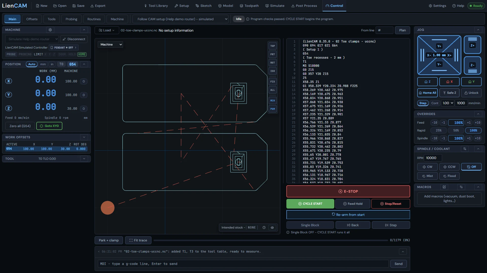

See also: [Connecting to the machine](Control#control-connect), [Running a job](Control#control-run-job), [Machine library](Settings#machine-library).

## Connecting to the machine

The sender connects over Web Serial for a GRBL-family board, through the local UCCNC/UC100 bridge, or to LinuxCNC through its gateway: pick the port, keep the default baud unless your controller differs, and watch the status readout.

1. Choose the connection for your controller, then click Connect. For GRBL, pick the serial port from the browser prompt; permitted ports are remembered. UCCNC uses its local bridge, and LinuxCNC uses its gateway instead of a serial port.
2. For a serial GRBL-family controller the Baud rate defaults to the standard GRBL speed - change it only if your controller is configured differently.
3. Watch the status readout: Idle means ready, Alarm means the controller is locked (fresh power-up or a limit hit), Hold means a feed hold is active.
4. From an Alarm state: press Home All if your machine has home switches, or press Unlock to clear the alarm lock after confirming the position is safe. (On GRBL these are $H and $X.)
5. Right after you connect, the E-STOP button reads CLEAR and the status says "The software stop is latched. Press CLEAR to reset it." This is normal on every connect: nothing has confirmed the stop since the link opened, so jog, macros and CYCLE START wait. Press CLEAR. It asks the controller for its state; once the controller reports it is stopped, CLEAR returns it to idle, releases the stop, and the button reads E-STOP again. CLEAR moves nothing. If it is refused, the line under it says why - for example, the physical E-stop is still pressed.

> **Tip:** Running LinuxCNC? It connects through its own gateway program, not a serial port - see "Connecting to LinuxCNC".

> **Tip:** Web Serial needs a Chromium-based browser. If Connect is unavailable, the browser itself is the limitation - the app will say so rather than fail silently.

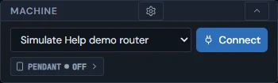

See also: [The Control tab](Control#control-tab-overview), [Jogging and setting zero](Control#control-jog-zero), [Connecting to LinuxCNC](Control#connect-linuxcnc).

## Moving LienCAM to a new or rebuilt PC

Install LienCAM and UCCNC, copy your UCCNC profile, then use Settings \> User Data \> Inspect backup... \> Confirm restore: your shop data and this machine's connection settings come back from the backup, with no file to hand-edit. Two things a backup cannot carry are listed here, with why.

Everything LienCAM keeps travels in one backup file: your active project, machines, tool libraries, preferences, and this computer's machine connection settings - the UCCNC install folder, profile, board, spindle definition file and Bridge port. Nothing needs hand-editing: no .bat file and no environment variable. Make the backup on the old PC first with Settings \> User Data \> Download backup (see "Backing up your data"), and keep it on another drive.

1. On the new PC, run the LienCAM installer. It adds LienCAM to the desktop and the Start menu; always open LienCAM from one of those.
2. Install UCCNC 1.2115 with its own installer. That puts the controller's driver files where LienCAM's machine connection finds them.
3. Copy your UCCNC profile (.pro file) from the old PC's UCCNC Profiles folder, for example C:\\UCCNC12115\\Profiles, into the same folder on the new PC.
4. Open LienCAM and go to Settings \> User Data. Click Inspect backup... and pick your backup file, check the list of changes, then click Confirm restore. LienCAM reloads with your data and your machine connection settings.
5. On the Control tab, click Connect. The first time, LienCAM builds its machine connection from the UCCNC files on this PC, which takes a few seconds.
6. If UCCNC or your profile is in a different folder than on the old PC, open Machine \> Definition \> Controller and choose the Install folder or Profile there, then connect again.

### What a backup cannot carry, and why

UCCNC itself, its controller driver files, and its .pro profile. They are another company's licensed software, put in place by its own installer in its own folder; LienCAM uses them but cannot install them. The backup remembers which folder, profile and board you chose, but it does not keep a copy of the .pro file, so copy that yourself. If the old .pro is lost, select the restored machine in the Machine Library and click Export .pro to write it as a UCCNC profile.

An antivirus exclusion. A Windows Security (Defender) exclusion is an administrator setting of Windows itself, and no app can grant itself one. If Windows Security removes LienCAM's machine connection - the Machine page then says its executable is missing - add a folder exclusion for %APPDATA%\\LienCAM\\machine-bridge in Windows Security \> Virus & threat protection \> Manage settings \> Add or remove exclusions \> Add an exclusion \> Folder, then click Connect again.

> **Tip:** A shortcut or .bat file of your own that sets LIENCAM\_BRIDGE\_EXECUTABLE or LIENCAM\_BRIDGE\_ARGS\_JSON is a developer override: it replaces the connection settings saved on the Machine page. Remove it and open LienCAM from the shortcut its installer made.

See also: [Backing up your data](Settings#settings-user-data), [Connecting to the machine](Control#control-connect), [Machine library](Settings#machine-library).

## Connecting to LinuxCNC

Run the small LienCAM gateway on the LinuxCNC PC, type that PC's address on Machine \> Definition \> Controller, then Connect - on the same PC or across your network.

LienCAM does not talk to LinuxCNC directly. A small program called the gateway runs on the LinuxCNC PC and passes messages between the two. Your LinuxCNC setup (INI and HAL files) stays exactly as it is, and LinuxCNC keeps running with its own screen (Axis, gmoccapy and so on).

### 1. On the LinuxCNC PC

1. Get the gateway: gateway.py, from the LienCAM release download (or from pendant/linuxcnc-gateway in the repository). Copy it to the LinuxCNC PC.
2. It needs nothing else installed. It uses only Python 3.9 or newer (the python3 that ships with LinuxCNC) and LinuxCNC's own Python module.

### 2. Start LinuxCNC, then the gateway

1. Start LinuxCNC first. The gateway needs it running.
2. LienCAM on the same PC: open a terminal and run  python3 gateway.py
3. LienCAM on another PC: run  python3 gateway.py --host 0.0.0.0  so the gateway accepts connections from your network.
4. The gateway listens on port 8327. Use --port to change it, and --program-dir to choose where it writes programs (the default is ~/liencam-programs).
5. It prints one line when it is listening. Leave that terminal open.
6. On a network: both PCs must be on the same network, and port 8327 must be open in the LinuxCNC PC's firewall if it has one. Note the LinuxCNC PC's address - you type it into LienCAM next.

> **Tip:** Optional: to start the gateway at login, add a desktop autostart entry on the LinuxCNC PC (for example a file in ~/.config/autostart that runs python3 /path/to/gateway.py --host 0.0.0.0). Start LinuxCNC before it needs to answer.

### 3. In LienCAM

Use the LienCAM desktop app, or LienCAM opened on the LinuxCNC PC itself. The hosted browser demo cannot reach the gateway: it is an https page, the gateway is a plain ws:// connection, and the gateway refuses web pages from other addresses.

1. Pick or add your machine in the Machine Library and set its Controller to LinuxCNC. (On the Control tab, Machine \> Definition has the same Controller choice in its top bar.)
2. On Control \> Machine \> Definition, open the Controller tab. In "LinuxCNC PC address" type the LinuxCNC PC's address as host or host:port (for example 192.0.2.10 or 192.0.2.10:8327). Leave it blank when LinuxCNC is on this PC.
3. Go to Control \> Main, choose "LinuxCNC gateway" as the connection, and click Connect.
4. When it is connected, the Controller area stops saying "Not connected to LinuxCNC" and shows what LinuxCNC reported: its version, the INI file, the joints, the spindle and whether the link is read-only. Those come from LinuxCNC itself - LienCAM stores nothing to show instead.

### 4. What is different from UCCNC and GRBL

1. LinuxCNC owns the spindle, homing and tool changes. A tool change is LinuxCNC's own M6.
2. At a program tool change, LienCAM shows the tool-change card when LinuxCNC reports the stop. Follow the card to fit the requested tool and continue; Stop program ends the program.
3. Probing runs through LinuxCNC's G38 probe move.
4. If a network session goes silent (a pulled cable, a sleeping PC), the gateway drops it and the program stops.

### 5. What has been tested

> **Warning:** What has been tested on real hardware. I've tested LienCAM on my own router, which runs UCCNC with an AXBB-E controller. I don't own a GRBL, grblHAL or LinuxCNC machine, so those routes have only been tested against simulators (grbl-sim and the LinuxCNC simulator), not on real hardware yet. If you run one of those machines, your test reports are exactly what we need - and once people have confirmed them on real machines, this note comes off.

See also: [Connecting to the machine](Control#control-connect), [The Control tab](Control#control-tab-overview), [Running a job](Control#control-run-job).

## Jogging and setting zero

The Jog panel moves the machine in steps or continuously, and the Work offsets panel sets X0/Y0/Z0 - by button, or through the probe pad for Z.

1. Jog with the axis cluster: pick a step size, then click the direction buttons. The DRO shows both work and machine coordinates live.
2. Home All homes the machine; the individual axis home buttons request that axis when the controller supports it. A controller that only offers a whole-machine homing cycle says so. The Console reports the homing result.
3. Position the tool over your work zero and use the Zero buttons in the Work offsets panel to set X0, Y0, or Z0 for the active work coordinate system.
4. "Goto XY0" moves the tool over work X0 Y0 without moving Z.
5. For Z with a touch pad: pick "A plate held against it" beside Probe work Z0, jog the tool over the pad, then run the probe - it probes down and sets work Z0 through the pad thickness. With "The probe touches the part" it sets work Z0 at the contact.

> **Warning:** Park moves first raise Z to a machine-coordinate height you set yourself. Where Z zero sits differs per machine, so there is no safe default - park refuses to run until you have set that height.

Control's Offsets tab shows the quick work offsets beside the Work offset setup table. The table keeps, for this machine, a fixture name and X, Y and Z for each of G54 to G59. A value typed there is stored with an amber border (not sent yet) - it reaches the controller only when you press Push on its row. Push changed (N) sends every row whose stored values differ from the controller; N is how many rows that is. Set from position makes the machine's current position that row's zero and sends it. Rotation is held in the controller and is sent as you type it. Push and Set from position wait while a program runs or is held, and until the machine is idle.

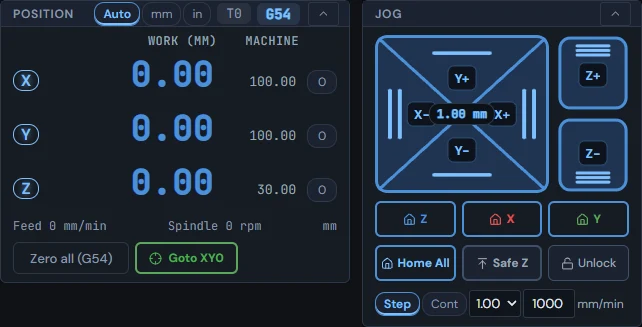

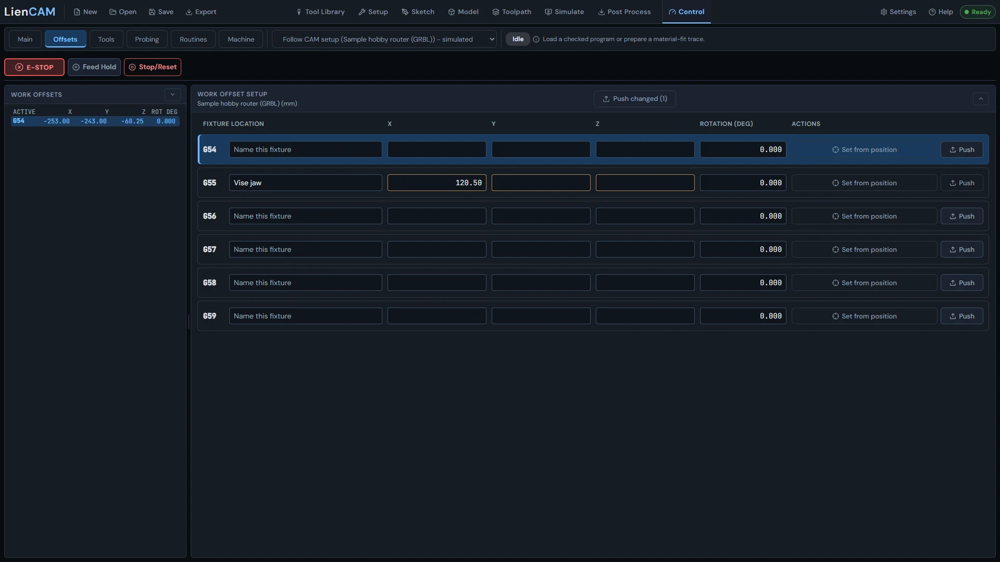

See also: [Connecting to the machine](Control#control-connect), [Running a job](Control#control-run-job), [Work offsets G54-G59](Setup-Stock-and-Workholding#work-offsets).

## Running a job

Post a setup straight into the sender or load a file, trace the job outline first if you want, then run with hold, resume, and live overrides.

1. In the Program panel, post the selected setup (the active machine's controller dialect) directly into the sender, or load a G-code file from disk. Recent programs are kept in the browser.
2. Before cutting, the material-fit trace outlines the job at safe Z so you can confirm the stock and clamps are where the program thinks they are.
3. Press CYCLE START to run. Feed Hold decelerates to a controlled stop; CYCLE START resumes. The Overrides panel adjusts feed, rapid, and spindle speed live.
4. To start at a chosen file line, enter its number in From line and press Plan. This also works for a setup posted to UCCNC. Review the tool, resume position, preparation moves and cautions. The plan tells you to press CYCLE START to run from the chosen line, or Cancel to go back. Plan arms the run without moving the machine; line 1 arms it from the top. Cancel restores the whole program.
5. Every M0 in a file holds, including one beside or after a tool change or before a macro. CYCLE START releases the M0; an M6 tool-change card is a separate stop. While held at an M0, MDI stays locked until the hold ends or you press Stop/Reset. A GRBL post has no M6: it writes a tool change as a "( change tool to T2 )" comment and an M0. Held there, the status reads "Held for a tool change - fit T2, then press CYCLE START."
6. At a program tool-change card, follow the instructions and press Continue. If LienCAM cannot switch the spindle, the same card tells you to start it by hand, including on a run from a line. Stop program ends the program; a manual tool change outside a program still has Cancel.
7. Stop/Reset at an M0 or a program tool-change hold ends the program. CYCLE START then starts from the top; From line and Plan let you choose another starting line. After a completed run, CYCLE START arms the loaded program from line 1 and runs it again. The Console reports the program finished once per run.
8. The top-right chip reads amber Held at an M0, during controller Feed Hold, and while waiting at a stationary tool-change card. Feed Hold pressed between program parts is a separate case: that chip indication is not yet updated.
9. A plain MDI move or a probing routine is not a program. Its status names the move or routine, without a Cycle complete program message. An MDI move leaves a loaded program header in place; with no loaded program it creates no program header or progress bar.
10. The listing numbers are the original file line numbers. A loaded file shows every source line exactly as written, including comments and output words such as M7 and M9. At an M0 hold, the highlight sits on the M0 line. A stop-only section adds no motion row or move count, and a kept pause does not show a program-end row. A plain file header leads with the file name; a posted setup program names its sections. Earlier section-start announcements remain in the Console.
11. When a kept pause lets you jog or send MDI, the header and progress keep the stopped program position. The status names the command running in the pause, then the return to the stopped line. A typed T number selects the tool for a later bare M6; a typed M6 opens the guided tool-change card, even with no loaded program. On the built-in simulator, typing T19 M6 also runs the guided change.
12. After a connected MDI command is handed to the controller, the input clears. The Console retains the command and its result.
13. The Cycle log records every run with its outcome; the Console shows the raw controller conversation.

> **Warning:** Stop/Reset ends the current run. Use Feed Hold when you intend to resume it; restarting from a line is a new run whose plan you must review.

Re-arm from start appears in the transport bar when a text file is loaded. It arms the program from line 1, exactly as if you had just opened it: the controller is first brought back to a known idle, and nothing moves until you press CYCLE START. You can use it to prepare a fresh run without starting motion. After a completed run, after resolving a failed run, or whenever the loaded program is not armed, CYCLE START itself arms the program from line 1 and runs it; the Console says "Armed from line 1." You do not need to press Re-arm first. From line and Plan preserve your chosen starting line instead. Re-arm is greyed while the program runs or is held (press Feed Hold, then Stop/Reset first) and during an alarm; the reason shows under it. A setup posted from the project or a file the controller takes as moves has no Re-arm button: CYCLE START also arms that loaded program from line 1 when it can; the status names any problem that needs resolving.

When Control \> Load posts a setup from the open project, the console and tool-change card name the tool that uses each number in that program, including numbers chosen in Post Process. A file opened from disk uses the library lookup for its tool names; the open project's per-program choices do not rename that file's tools.

A freshly posted setup loaded from the same project reads current, with its Intended stock tied to that project. If Load refuses another program, the accepted program, its starting line and its progress stay in place. The Console prints that Load's refusal reason once; a later CYCLE START or Re-arm attempt reports its own result. After resolving a refused start, reconnecting or clearing E-STOP, CYCLE START can arm the loaded program from line 1. If a connection lost your chosen starting line or kept stop, choose the line again, load or Re-arm before starting.

Est. remaining is a time estimate, not a count of moves. While held at an M0, a tool change or Feed Hold, it uses the time to execute the moves still left: their lengths at their feeds, the machine rapid rate for rapids, and any remaining dwell. While running, a current post's estimate counts down; if it runs out with motion still to come, the moves left decide. Without a current post, the estimate follows the remaining motion. If no estimate can be made, it reads unavailable.

Single Block ON means each CYCLE START or Step runs one line. Single Block OFF means CYCLE START runs the whole program. The short hint under the transport buttons shows the current mode.

After Stop/Reset during a macro or MDI move, Control follows the controller's reported state. When the controller is idle, Control returns to Ready/Idle and MDI, jog and macros are available after that one press.

Type a feed or spindle override percentage and press Enter to request that value. UCCNC sends the exact percentage in one command; GRBL uses its reset and steps. Quick feed override clicks that reach their requested values print no clamp warning; a confirmed different value still gets a clamp message.

The Vacuum button lights from the controller's reported output state, whether a button, MDI, a program or a macro switched it. It goes dark when the reported output is off. Macro buttons do not yet share this indicator behavior. A program output line in the Console names the configured output and its M word, for example "Line 5: Vacuum on (M7, port 3 pin 16)."

The Control 3D view keeps your zoom and pan through MDI moves, work offset changes (including probing Confirm) and WCS changes. Load re-fits the program, even for the same file; Fit trace and the view buttons still fit on demand. Before you adjust the view, automatic framing continues.

The built-in simulator can load and run a plain X/Y/Z file on the shipped sample GRBL router. Its path check uses a nonzero tolerance and follows the commanded path, including the approach to the first move. A genuinely unavailable axis is still reported.

For posts that support canned drilling, including UCCNC and LinuxCNC, the built-in simulator runs G81, G82 dwell and G83 peck cycles, modal X/Y hole repeats and G80 cancel. G98 retracts to the initial Z for that hole; G99 retracts to the R plane. The position, progress and path check follow the expanded moves. Incremental G91 or rotary canned cycles are not modelled. The simulator follows the program's G54-G59 changes, and Path check names the program's work offset, for example G56, even if you had selected G54 before the run.

At the end of a run, Path check reports matched positions within the threshold as stayed on the commanded path. A brief jump over the threshold gets a warning with its size, position and duration; a sustained departure gets the red left-the-path message. If too few positions can be matched, the check says it cannot assess the run.

If an axis has no stated travel limits, the load note says travel was not checked. Enter both limits on the Definition page to check it. If the simulator refuses a program outside declared travel and its work zero is unset, the message names that work offset (for example G57). Set its zero on the Offsets tab, then press CYCLE START.

To change the loaded program, right-click a line in the program listing. Run from here plans a start at that line - the same plan the From line box makes. Insert line opens a field under the line; what you type is staged and marked in the listing, and nothing reaches the machine until you press Apply (Discard drops it). Find / Replace and Go to line open the editor over the preview at that line, with Ctrl+F, Ctrl+H, Ctrl+G, Ctrl+Z and Ctrl+Y. Apply loads the edited text exactly as opening a file does: the listing, 3D view, tool list, run-from-line and tool-change stops all follow it, and the console says what changed. Save to file writes the edited program to disk. While a program runs or is held at a stop or tool change, the editor is read-only - press Stop/Reset first.

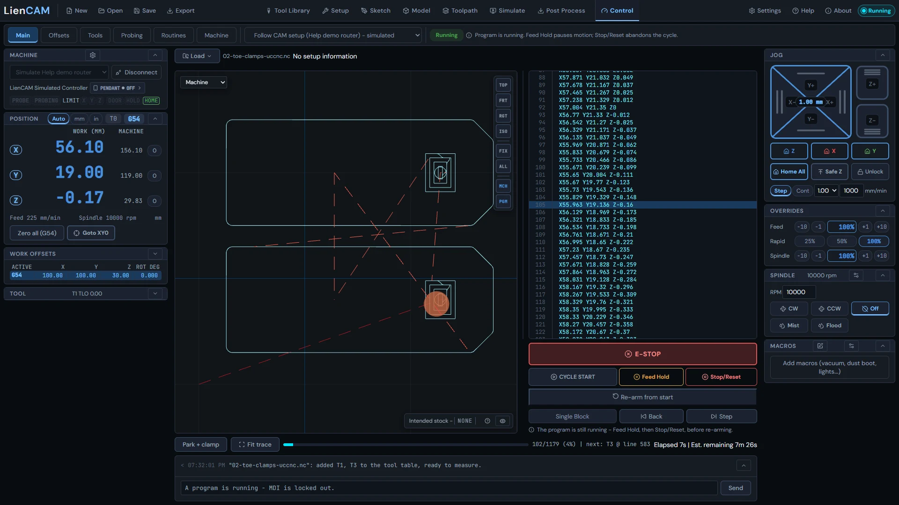

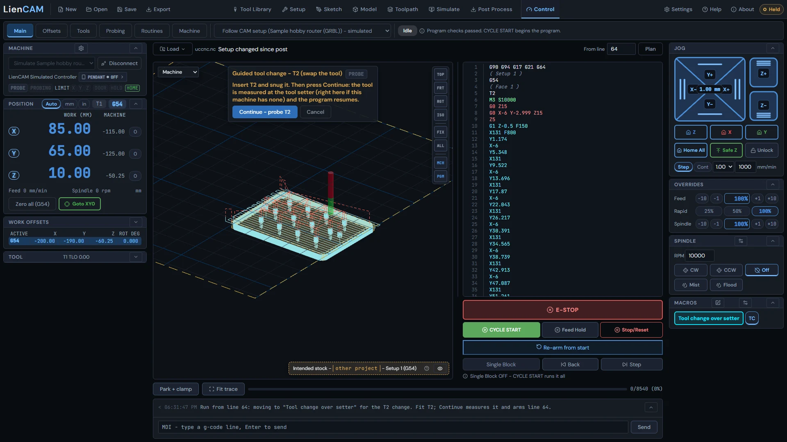

See also: [The Control tab](Control#control-tab-overview), [Posting G-code](Post-Process#post-basics), [Jogging and setting zero](Control#control-jog-zero).

## The machine prompt when opening a project

A project saved with a machine this installation does not have asks you to choose - the app never switches your machine silently.

When a project has no machine, uses the sample placeholder, or references a machine that is not in your library, the prompt lists your available machines. Your Default machine is first and already selected; choose another if needed, then press Use this machine. No machine-change announcement is made before you confirm. A project using a known library machine keeps it without this prompt. On a fresh install with only the sample machine, there is no choice to make and no prompt. Feeds, travel limits and the posting dialect follow the chosen machine.

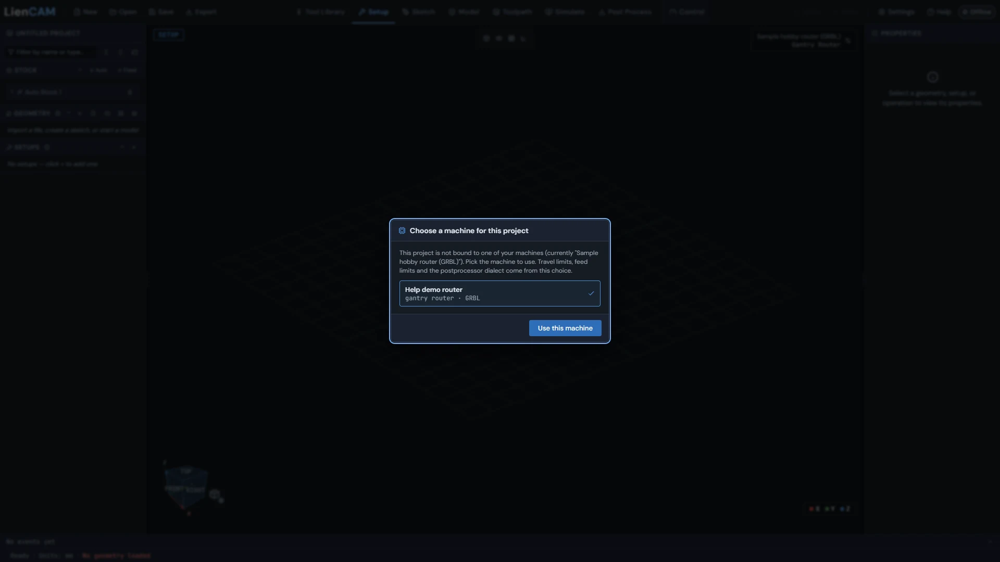

See also: [Machine library](Settings#machine-library), [Posting G-code](Post-Process#post-basics).

## The Machine definition page

Control \> Machine \> Machine definition holds the wiring, homing and controller-specific settings a homebuilt machine needs - grouped into catalog sections you can filter down to only what you use.

This page is the CONTROL half of a machine record - pin assignments, steps per unit, homing direction and speeds, backlash, and every setting your controller catalogues - separate from the CAM half (travel, spindle, feed caps) edited in the Machine Library modal. Both write the same machine record, so nothing here disturbs the other.

The All settings section lists every setting the machine carries. Its Show list (Everything, Stated by the profile, Changed by me) and the "Only settings LienCAM uses" box narrow the list.

> **Tip:** Named machine hardware (an axis you have wired, a spindle you have configured) has its own controls and is never filtered. The Show list and the box only narrow the All settings table; set Show back to Everything and clear the box to see every setting again.

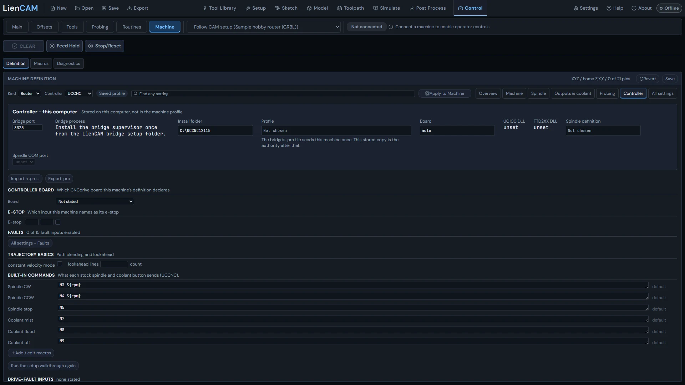

See also: [Machine library](Settings#machine-library), [The Control tab](Control#control-tab-overview).

## Setup information on a loaded program

The chip next to the program name and the Intended stock card say which setup a program was posted from, and whether that is still true.

### When the preview refuses to draw

A loaded program is drawn only if every word in it can be read. If the file uses something the preview cannot model - a tool length offset it has no tool table for, a machine-frame move, a plane it does not support, or flow control - it refuses the whole program by name, saying which line and which word stopped it, and draws nothing. It does not draw the parts it understood and skip the rest. The reason is that a partly drawn program is a confident picture of a DIFFERENT program, and you would be judging whether to cut from it.

A word that cannot move the tool never causes a refusal. Vacuum, coolant, spindle and vendor-specific M-codes are noted and passed over, because reading one wrongly cannot put the tool anywhere unexpected. So a refusal always names something that could have changed the path.

A refused program is not an empty one. The travel and soft-limit checks are told that the program could not be read, rather than being handed nothing to check - they say they cannot judge instead of going quiet.

When you post a setup straight into the sender, or open a file LienCAM exported with its context block, the program carries a frozen snapshot of the setup it came from: the setup name, the stock and its size and material, the work coordinate system (G54-G59), and the list of operations in emitted order. Control shows it in two places - the chip beside the program name in the Program panel, and the Intended stock card on the preview - and keeps comparing it with the open project. It is advisory: it explains, it never changes a line, arms, starts or stops anything.

### What the chip says

| Chip | Meaning |
| --- | --- |
| Setup: X (G54) | The program is bound to the setup it was posted from and the project still matches it. X is the setup name, G54 its work offset. CURRENT on the stock card. |
| Setup changed since post | The project changed after this program was posted (stock, WCS, operations). The card shows the stock AS POSTED, not the live setup. Reload from the setup to refresh. STALE on the card for an edit to the same project. If the unchanged program came from a different project, the Intended stock badge says "other project" and its details explain that the stock is from that project as posted. The program chip keeps saying "Setup changed since post". |
| Program changed since post | The program text no longer matches its posted context. STALE on the card; reload from the setup. |
| No setup information | The program was loaded from a file with no LienCAM context block (a foreign file, or one exported with the block switched off). The app cannot tell which project or setup it came from. NONE on the card. |
| Cannot verify against project | The comparison itself failed (an internal error, written to the console). The card shows the stock AS POSTED; do not trust it as current. UNVERIFIED on the card. |

### The context block that travels with an exported file

Post Process can write the same snapshot after M30 as comment lines (the "Include LienCAM context" toggle). A file opened later in Control is checked - the block must match the program bytes and its own digest - before the setup information is trusted; anything that does not verify is treated as "No setup information", never guessed.

> **Tip:** The stock drawn on the preview comes from the snapshot, not from the live project, so a later edit to the project can never move it under a running program.

See also: [Running a job](Control#control-run-job), [Include LienCAM context](Post-Process#post-include-context), [The Control tab](Control#control-tab-overview).

## The in-app machine simulator

Choose Simulate followed by your machine name in Control to practice running programs, jogging and probing against a virtual machine using the selected machine settings.

1. Open Control with the machine you want to practice on selected. Choose Simulate followed by your machine name in the connection selector and click Connect. This connection runs inside LienCAM and moves no physical machine.
2. Press CLEAR to release the software stop after connecting, then home or set the datum as the status sentence asks. Load a G-code file or post your setup into Control, and use CYCLE START, Feed Hold and Stop/Reset as you would for a connected machine.
3. For probing practice, open Diagnostics and find Simulated part. Place under probe moves the virtual part beneath the current probe position; Reset restores its default placement. Neither action moves the tool.

The simulator takes its travel, enabled axes, homing convention, motion, spindle and output settings from the selected machine. It interprets the program using that machine's declared controller dialect. G81, G82 and G83 drilling cycles use their R and Z levels, dwell or pecks, and G98/G99 return heights. The Control program preview and live position follow the simulated moves.

A machine with a stated fixed tool setter also has a virtual setter at that machine XY position. Its contact height uses the measured reference-tool contact when it is below the stated setter Z, otherwise the stated Z. A machine with no stated setter has none. Measure tool can touch this virtual setter; see "The fixed tool setter" for the measurement and reference workflow.

> **Tip:** The Control simulator practices the machine sender and probing. The Simulate tab is a separate toolpath and stock preview. Simulator results do not verify physical wiring, clearances or a real tool setter.

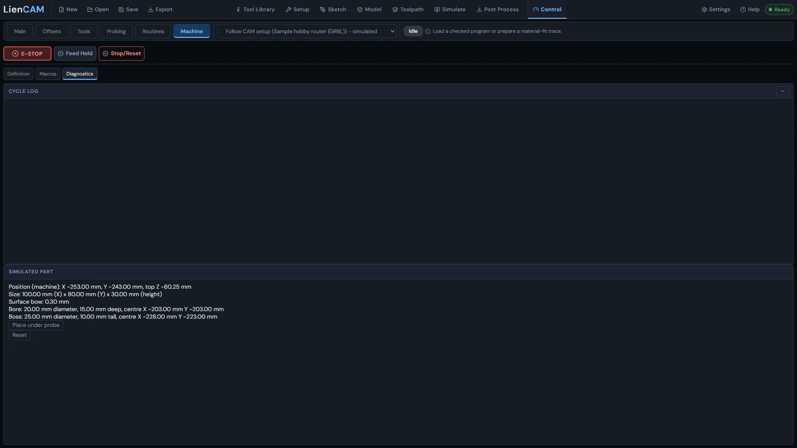

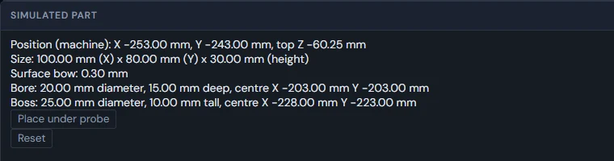

See also: [Connecting to the machine](Control#control-connect), [Running a job](Control#control-run-job), [The Probing tab](Probing#probing-tab), [The fixed tool setter](Control#control-tool-setter).

## The fixed tool setter

A fixed setter measures a tool at a known machine position; the tool table keeps the contact and compares it with a measured reference tool to apply length.

The fixed tool setter is separate from the touch plate or part surface used for work Z0. Its machine X/Y/Z position and probing settings belong to the selected machine under Control \> Machine \> Definition \> Probing. The setter routine uses those settings for the approach, search, back-off and fine contact.

1. On Control \> Tools, use the tool table to select the tool you have loaded. Measure Tn probes the setter and records its fine contact as machine Z for that tool on this machine. Measure tool also works without a numbered tool when a setter is stated: the contact is retained as an available measurement that can be attached to a tool row.
2. Choose a reference tool with Ref and measure it on the same setter. Setting work Z0 on a plate or part does not supply the reference tool's setter reading.
3. After measuring the current tool, Apply length compares its setter contact with the reference tool's setter contact. The status shows the difference and the controller command applied. A missing reference measurement tells you which tool to measure.
4. During a guided tool change, follow the card to fit and measure the requested tool, then Continue when the card offers it. Retry measure repeats the measurement without visiting the park again.

With Simulator connected, the selected machine's fixed setter is a virtual contact surface. Measure tool touches it using the same routine. If the stored reference contact is below the stated setter Z, that contact supplies the simulated top height. This lets you practice the workflow without a physical controller.

> **Tip:** Keep the approach and setter position clear on the real machine, and inspect the routine preview before running it. A simulated touch is practice, not a calibration of the physical setter.

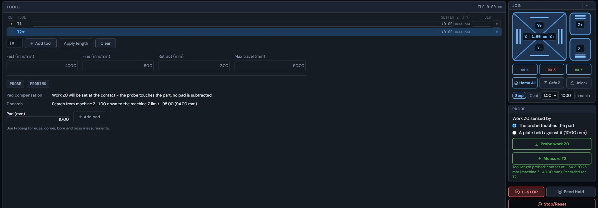

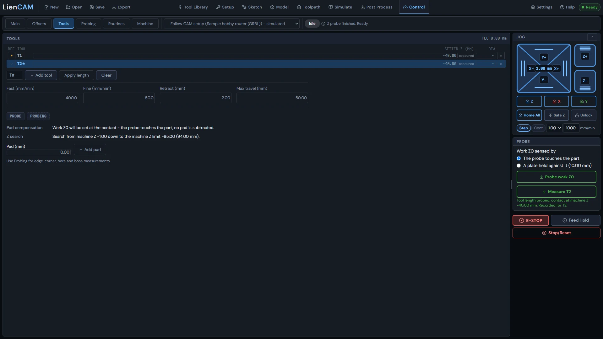

See also: [The Probing tab](Probing#probing-tab), [Probe routines](Probing#probe-routines), [Jogging and setting zero](Control#control-jog-zero), [The in-app machine simulator](Control#control-simulator).
