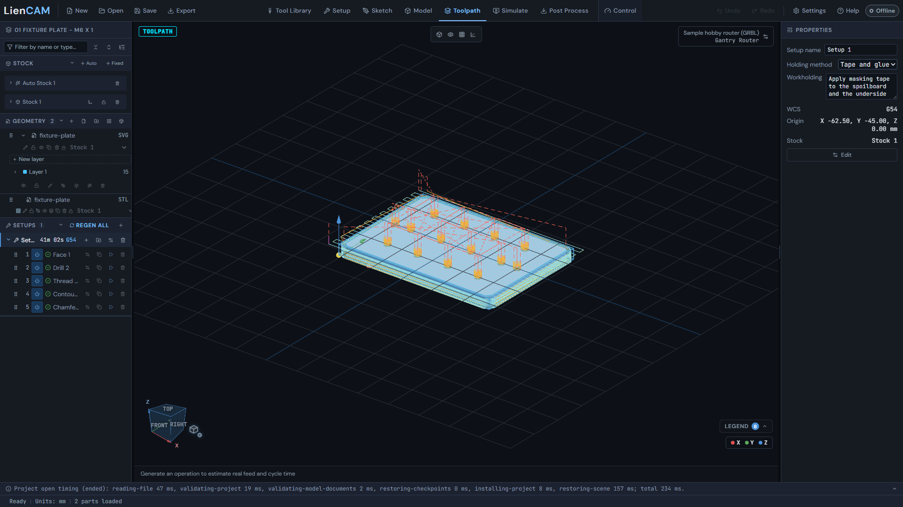
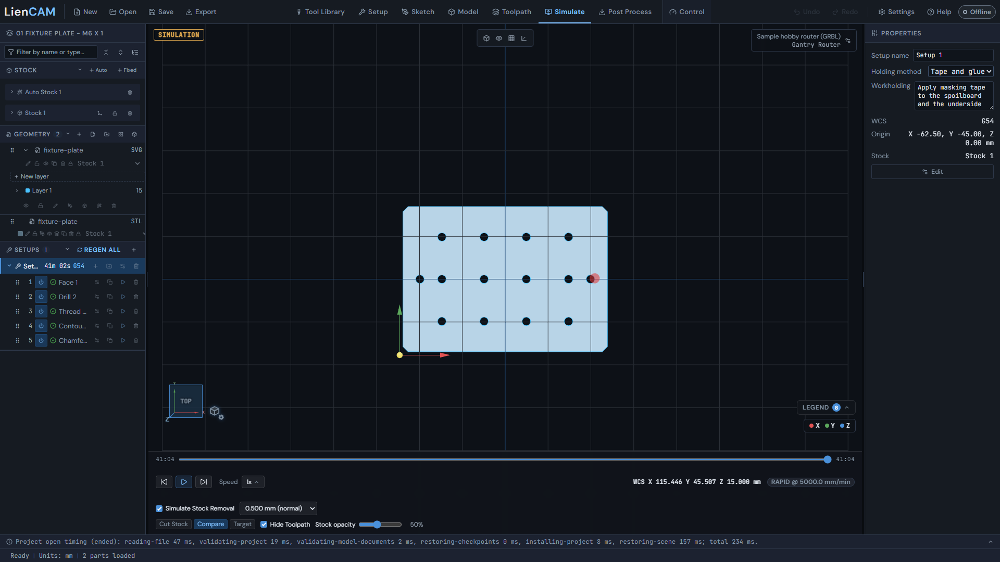
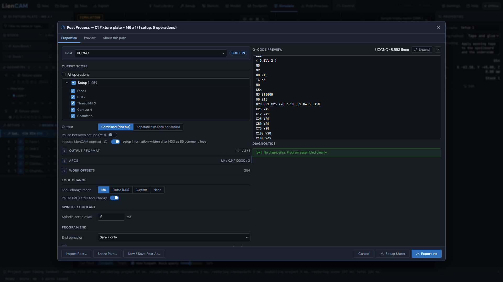

# First part in 15 minutes

You will open an example part that ships with LienCAM, make its toolpaths, watch the simulated cut, and post G-code. No machine is needed. Install first if you have not: [Install on Windows](Install-on-Windows), or use [the browser version](Run-in-your-browser).

The examples live in the `examples/` folder of the repository. This page uses `examples/01-fixture-plate`, a plate with a facing pass, a grid of drilled and thread-milled holes, chamfers and an outline cut - four tools in one program - set up for the Sample hobby router (GRBL), the starter machine every fresh install has.

## Steps

1. **Get the example.** The first time you start LienCAM it offers **Try an example**: choose **Fixture Plate**. (Already past that screen? The same file is `examples/01-fixture-plate/fixture-plate.camproject` in the download.)
2. **Open it.** Fixture Plate opens straight from the picker; for the file, use **Open project** and choose `fixture-plate.camproject`. The part, the stock block, the tools and the operations are all inside the file.
3. **Look around.** The design tree lists the setup and its operations; see [Getting around](Getting-around). Click an operation to see its settings.
4. **Generate.** Click REGEN ALL on the Setups header in the design tree (or press Shift+G). Each operation draws its path in the viewport when it is ready. See [Toolpaths 2.5D](Toolpaths-2.5D).

   

5. **Simulate.** Open the **Simulate** tab and press play to watch the cutter remove the stock. See [Simulate](Simulate).

   

6. **Post.** Open the **Post Process** tab, choose the dialect that matches your controller (UCCNC, GRBL, grblHAL, LinuxCNC or Generic), review the output and save the file. See [Post-Process](Post-Process).

   

## What the G-code looks like

The first lines of the posted file for this example (UCCNC dialect, `examples/01-fixture-plate/uccnc.nc`) are:

```
G90 G94 G17 G21 G64
( Setup 1 )
G54
( Face 1 )
T2
M3 S10000
G0 Z15
G0 X-6 Y-2.999 Z15
Z5
G1 Z-0.5 F150
```

`G21` means millimetres, `G54` is the work offset, `T2` is the tool, `M3 S10000` starts the spindle at 10000 rpm, and `G1 Z-0.5 F150` is the first cut, plunging 0.5 mm. Your own numbers depend on your tools and settings.

Always read posted G-code before you run it on a real machine, and keep a hand near the E-STOP.

## Next

Change a setting (a feed rate, a depth), generate again, and compare the simulation. Then try your own file: see [Importing files](Importing-files). If something goes wrong, see [Reporting a bug](Reporting-a-Bug).
