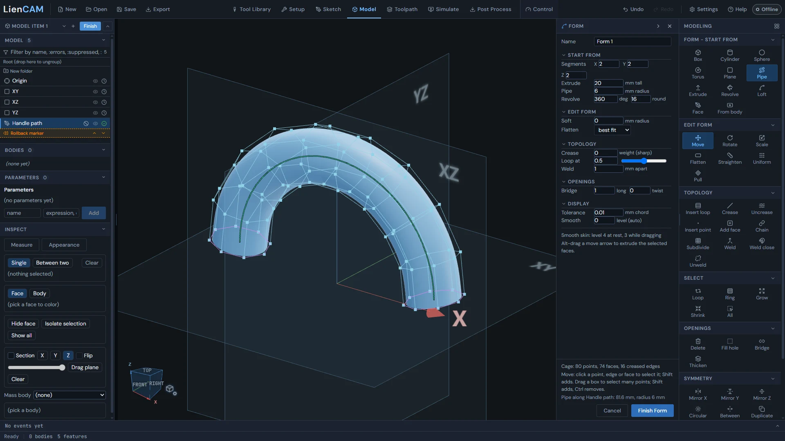
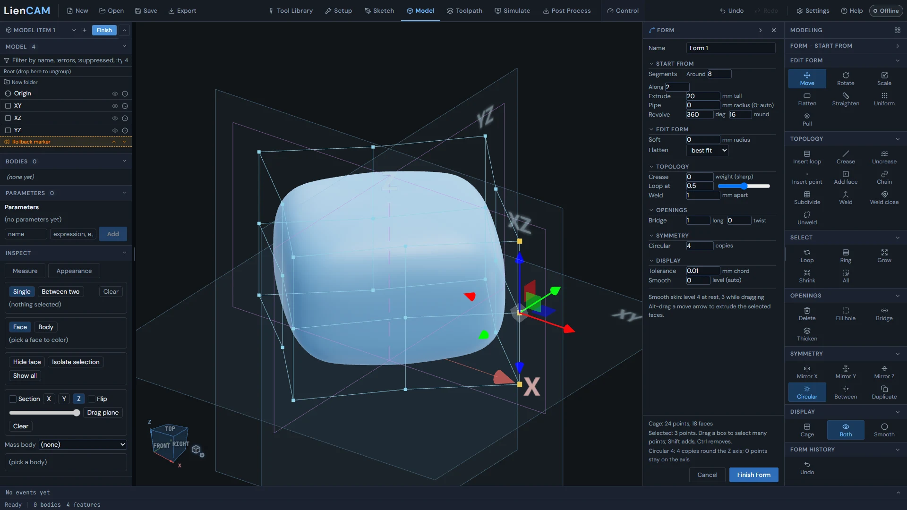
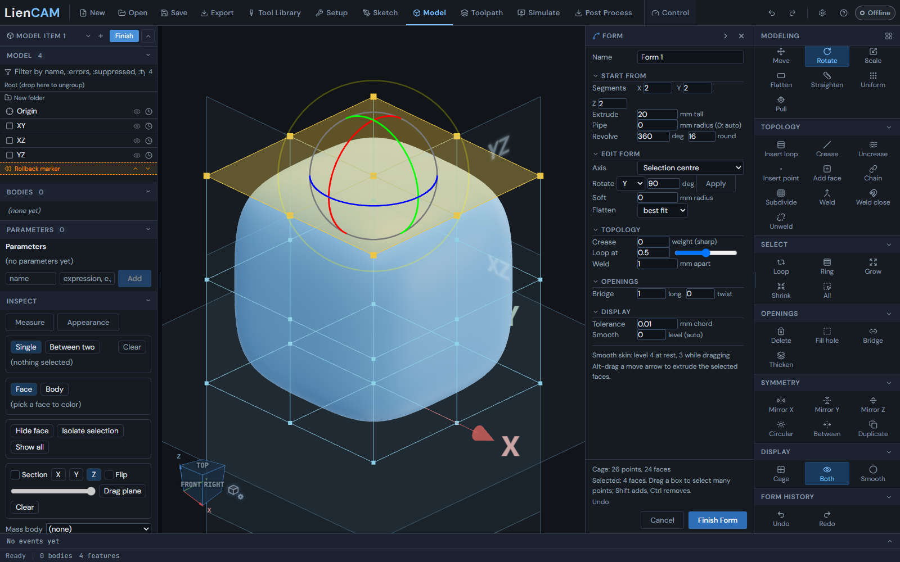
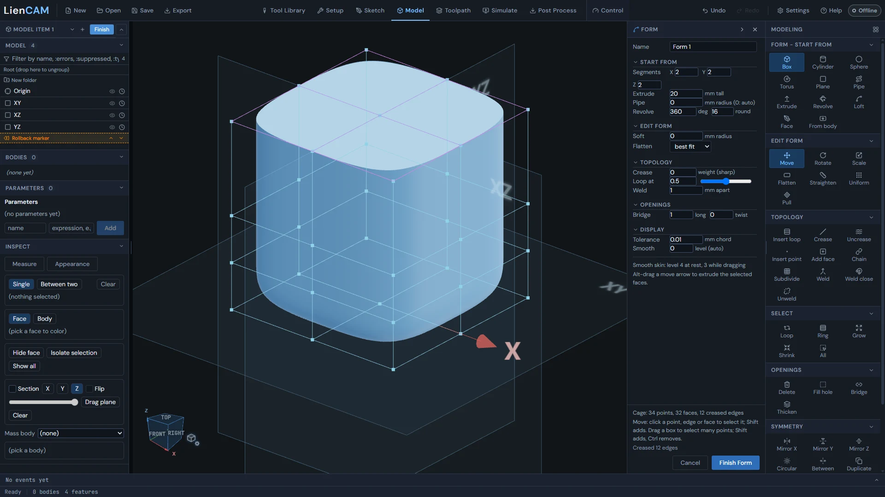
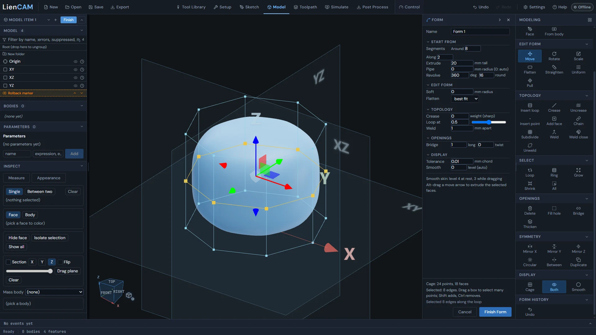
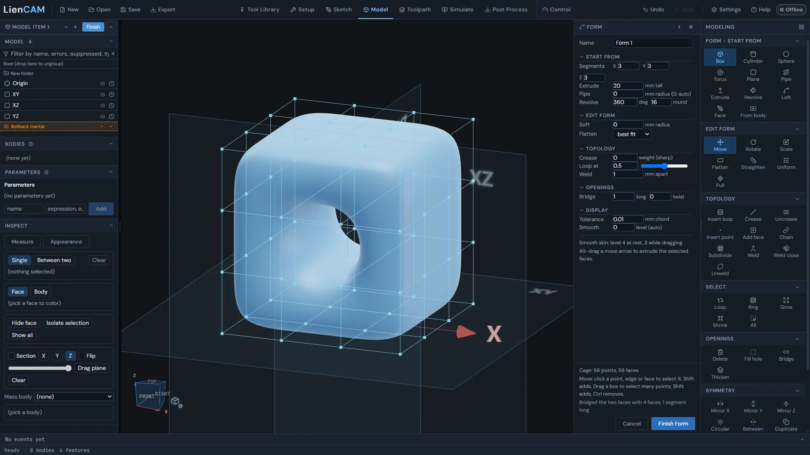
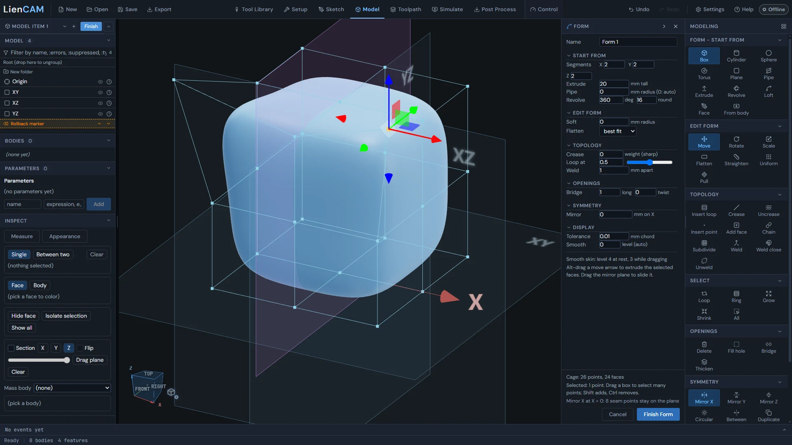
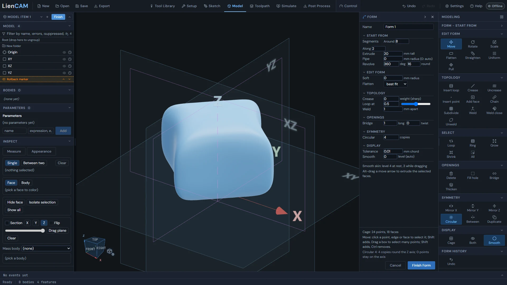

<!-- Generated from the in-app Help by tools/release/help-to-wiki.mjs. Do not edit by hand. -->

# Form

- [Form (smooth organic shapes in the Model tab)](#form-workspace)
- [Form example: lobed knob](#form-walkthrough-lobed-knob)
- [Form example: grip handle](#form-walkthrough-grip-handle)

## Form (smooth organic shapes in the Model tab)

Form shapes smooth organic parts - knobs, handles, grips - by moving a coarse control cage; a smooth surface follows it, and Finish Form makes it an exact solid in the design tree.

Form works on a cage: the dark lines and points drawn round the part. The smooth skin inside the cage follows it - move a cage point, edge or face and the skin moves smoothly with it. A few cage points shape a whole handle, which is why Form is the quick way to make shapes that would take many lofts and blends with the standard tools.

1. In the Model tab, click Form in the Create group of the rail. Form opens in the same view: the rail shows the Form tools and the Form palette docks beside it.
2. Pick a start under Start from (Cylinder, Box and so on), or select a sketch or body in the tree first and start from it.
3. Shape it: click a point, edge or face and drag the arrows. Add loops, creases and symmetry as you go.
4. Type a Name at the top of the palette and press Finish Form. The part becomes one Form row in the design tree, and standard features (holes, fillets, cuts) work on it like on any other body.

The palette holds the settings for the tools, in groups named after the rail groups they belong to: Start from, Edit form, Topology, Openings, Symmetry (while a symmetry is on) and Display. Click a group's name to fold it; the folds are remembered. When the rows are taller than the window the palette scrolls, with a scrollbar you can see. The chevron in the palette's header folds the whole palette to a strip at the side, so the view gets its whole width back; click the strip to bring it back. The bottom of the palette shows the cage size, what is selected, and the last thing a tool did.

Finish Form writes the form into the model and leaves Form. Cancel (or the X in the palette header) leaves the tree as it was. Undo and Redo in the Form history group (Ctrl+Z, Ctrl+Shift+Z) step through the cage edits; they show once there is something to undo.

### Start from

Box, Cylinder, Sphere, Torus and Plane start a new cage with the counts on the palette's Segments row (Around, Along, X, Y, Z - up to 32). Every starter sits on the table (Z = 0), centred on the Z axis. Clicking a starter again starts over, as one undo step.

The other starters use what is selected in the design tree. Pipe makes a tube along the selected sketch's curve (lines, arcs, circles, splines; pieces joined end to end are followed in order): a ring round a closed curve, flat ends on an open one. The palette's Pipe radius sets its size (0 picks one from the path). Select a next sketch that starts where the pipe ends and click Pipe again to carry it on, onto other planes too. Extrude takes the sketch's profile along its plane's normal by the palette's Extrude height. Revolve turns it round the sketch's construction line (else a sketch axis it does not cross) by the palette's Revolve angle, with the number of cage spans round it set in the Revolve row's round field. Loft passes the skin through two or three sketch profiles, one Loft click per sketch; an open curve from the first profile to the last, added the same way, is a rail the sides follow. Face builds a cage by clicking 4 corners per face on the selected plane (Enter makes a triangle of 3, Esc stops). From body starts from the STEP or STL body selected in the tree: flat faces and sharp edges are kept, and curved fillets, pocket blends and domes retain their shape within the Form reconstruction tolerance. The source STL is hidden while its Form feature is active; Undo or rollback before the Form restores it.

### Edit form: select and move

Click a cage point, edge or face to select it; Shift+click adds to the selection and a click on empty space clears it. A face can be clicked on the smooth skin, inside the cage. Move, Rotate and Scale choose the handles the gizmo shows: drag an arrow to move along X (red), Y (green) or Z (blue). Alt+drag a face's arrow to extrude new faces from it. Left-drag on empty space orbits the view as usual.

Soft (palette) makes points near the selection follow a move part of the way, fading out at the radius you type (0: only the selection moves). Flatten puts the selected points on a plane - their best fit, or the one chosen in the palette (an X, Y or Z plane, the selected face's plane, or the mirror plane). Straighten puts each selected edge chain on the line between its ends. Uniform evens out the spacing of the points (the whole form when nothing is selected); points on an open border or a crease stay. Pull moves the cage so the smooth skin passes through the selected points where they are now.

With Rotate selected, the palette's Axis list starts at Selection centre. Choose X, Y or Z beside Rotate, enter an angle in degrees and press Apply. Pick cage edge uses an edge as the axis; X through point, Y through point and Z through point ask for a cage point without replacing your selection. The marked axis also works with the rotation ring. Esc or Selection centre returns to centre rotation. Changing the selection or leaving Rotate clears the picked axis.

### Topology: loops, creases, faces and welds

Insert loop adds a loop of edges across the ring through the selected edge, at the palette's Loop at position (0.5 is the middle; right after Insert loop the slider moves the new loop). Crease makes the selected edges sharp, at the palette's Crease weight (0 fully sharp; 0.5 to 3 soft to firm); Uncrease makes them smooth again. A face whose edges are all creased comes out flat, so other features can use it. Insert point splits each selected edge in the middle. Subdivide splits the selected faces into quads round their centres.

Add face adds faces by clicking 4 corners each - on the work plane, or on the form's own points to join them; Chain starts each next face on the last one's edge, 2 clicks a face. Weld merges the selected points into one. Weld close joins points closer than the palette's Weld distance (among the selection, or across the form). Unweld cuts the form open along the selected edges, or round the selected faces.

### Select

These widen what is selected without clicking every piece. Loop adds the edge loop of each selected edge (straight on through the points round it). Ring adds the edge ring (across the faces beside it). Grow widens the selection by one ring, Shrink narrows it by one. All selects every face - or every edge or point when edges or points are selected.

### Openings: delete, fill, bridge, thicken

Delete removes the selected faces, leaving the form open there; with only edges selected it removes those edges (the faces either side merge), with only points selected those points. Fill hole caps the opening through the selected rim edge with one face. Bridge joins two selected faces or face sets, or the edges of two openings, with a band of faces: a handle, a hole straight through, or two pieces joined. The palette sets how many rings long the band is and its twist. Thicken closes an open form with an inner skin, the palette's wall thickness inside it (the row shows while the form has an opening).

### Symmetry

Mirror X, Mirror Y and Mirror Z keep the two halves the same: paired points move together and points on the plane stay on it. The palette's Mirror row moves the plane, and so does dragging the plane in the view. Circular keeps copies round the Z axis in step - as many as the form fits, or the palette's Circular copies (the copies must fit the segments: an 8-segment cylinder takes 8, 4 or 2). Between places a mirror plane from the selection: two points go halfway between them, three or more lie on it. Duplicate mirrors a copy of the form across the plane and joins the halves: model half, get the whole. Clicking an active Mirror or Circular button turns symmetry off.

### Display

Cage shows only the control cage, Smooth only the smooth skin (the surface you will get), Both the cage over the skin. The palette's Smooth row (level) sets how finely the skin is drawn (0: automatic) - display only, the finished body is exact either way. Tolerance sets how far the finished body's display facets may stray from the smooth surface. Zebra stripes and Curvature in the view's Display Mode menu help judge the surface.

### What Finish makes, and the limits

Finish Form puts one Form feature in the design tree with its body: an exact solid of the smooth surface (B-spline faces, flat regions as planes), so holes, fillets, chamfers, booleans and cuts work on it and a STEP export carries the smooth surfaces. Where three, or five or more, edges meet at a cage point, the faces round it still meet smoothly. Edit on the tree row reopens the cage where you left it, and every feature after it rebuilds when you Finish again. The tree does not record the edits made inside Form one by one - they all live in that one row.

Limits: a cage edit the cage cannot hold (for example a weld that pinches the surface) is not applied, and the palette's notice says why. Bridge cannot join a closed opening to an open one, and Face cannot use a repeated corner or corners on one line; the palette says what to select instead. Not every Form part shells: a Form body with a slot cut across it may not; Shell the Form body first, then cut. Circular symmetry takes only a number of copies the cage divides into.

> **Tip:** The walkthroughs "Form example: lobed knob" and "Form example: grip handle" play a whole part being made, step by step, and open the finished project.

See also: [Form example: lobed knob](Form#form-walkthrough-lobed-knob), [Form example: grip handle](Form#form-walkthrough-grip-handle), [The Model workspace](Model#model-workspace-tour), [The feature tree](Model#feature-tree-history).

## Form example: lobed knob

A video of a four-lobed control knob made in Form and finished with a shaft, a bore and a fillet - with the steps beside it and an Open this example button for the finished project.

The lobes and finger valleys are one smooth Form surface; the shaft, the bore and the rim fillet are standard features, so they are exact and dimensioned. The video is one continuous take in the app, about a minute and a half, with the mouse drawn as an orange dot (it shrinks while the button is held).

[Video: The lobed knob made in Form, then its shaft, bore and rim fillet (about a minute and a half)](../blob/main/public/help/form-walkthrough-lobed-knob/lobed-knob.mp4) - Watch in the app: open Help and search for "Form example: lobed knob".

1. Model tab: click Form on the rail, then Start from: Cylinder.
2. Symmetry: Circular, and set 4 copies in the palette.
3. Click a point on the middle ring, then Shift+click the points above and below it. Drag the red X arrow out 10 mm: all four lobes pull out together.
4. Click empty space. Select the column between two lobes the same way. Drag X in 6 mm, then Y in 6 mm: the finger valleys.
5. Left-drag down on empty space to look from above. Click the top face and drag the blue Z arrow down 8 mm: a lower crown.
6. Left-drag up to orbit underneath. Click the bottom face, then Topology: Crease. The base comes out flat.
7. Display: Smooth. Name it and press Finish Form.
8. Sketch a 4 mm diameter circle on XY and Extrude it Blind 10 mm, Direction Down, Result Add: the shaft, joined to the knob.
9. Hole: 3 mm, 12 deep, in the shaft end.
10. Fillet 1.5 mm on the base rim - a standard fillet on an edge Form made.
11. Orbit back over the top and tick Zebra stripes in Display Mode to check the surface.

The design tree of the example reads: Lobed knob (Form), Shaft profile (sketch), Shaft (extrude), Bore (hole), Rim fillet. Open it with Open this example beside the video (in the repository it is public/help/form-walkthrough-lobed-knob/lobed-knob.camproject), click Edit on the Lobed knob row, move a point and Finish: the shaft, bore and fillet rebuild on the new shape.

See also: [Form (smooth organic shapes in the Model tab)](Form#form-workspace), [Form example: grip handle](Form#form-walkthrough-grip-handle).

## Form example: grip handle

A video of a pull handle made as a Form pipe along a sketch, shaped by hand and joined to a machined mounting plate - with the steps beside it and an Open this example button for the finished project.

The handle is a Form pipe along a sketched arch, with a palm swell pulled up by hand; the plate, its corner fillets and the mounting holes are standard features. The pipe's ends sit inside the plate, so handle and plate are one solid. The video is one continuous take in the app, under a minute.

[Video: The grip handle made as a Form pipe, then joined to a plate with fillets and mounting holes (under a minute)](../blob/main/public/help/form-walkthrough-grip-handle/grip-handle.mp4) - Watch in the app: open Help and search for "Form example: grip handle".

1. Sketch on XZ: an arc of radius 26 mm whose ends dip 3 mm below the XY plane, where the plate will be.
2. Select the sketch in the tree, then click Form.
3. Set the palette's Pipe radius to 6 mm, then click Pipe: a tube follows the sketch.
4. Symmetry: Mirror X, so the two halves stay the same.
5. Edit form: Soft radius 22 mm.
6. Click the top of the arch and drag the Z arrow up 5 mm: a palm swell. The neighbouring points follow part of the way.
7. Display: Smooth. Name it and press Finish Form.
8. Sketch an 80 x 30 mm rectangle on XY and Extrude it Blind 6 mm, Direction Up, Result Add: the plate, joined to the grip.
9. Fillet the plate's four corners, 5 mm.
10. Construct: Offset plane 6 mm above XY (the plate top). Sketch four 5 mm diameter circles on it and Extrude them with End Through all, Direction Down, Result Remove: the mounting holes.
11. Orbit underneath to see the holes go through, then back over the top and tick Zebra stripes in Display Mode.

The design tree of the example reads: Handle path (sketch), Grip (Form), Plate (sketch), Plate (extrude), Corner fillets, Plate top (offset plane), Mounting holes (sketch), Mounting holes (extrude cut). Open this example beside the video opens it (in the repository it is public/help/form-walkthrough-grip-handle/grip-handle.camproject).

See also: [Form (smooth organic shapes in the Model tab)](Form#form-workspace), [Form example: lobed knob](Form#form-walkthrough-lobed-knob).
