<!-- Generated from the in-app Help by tools/release/help-to-wiki.mjs. Do not edit by hand. -->

# Getting around

- [What LienCAM is](#welcome-overview)
- [Your first toolpath](#first-toolpath)
- [Saving and opening projects](#projects-save-open)
- [mm and inch](#units)
- [Undo and history](#undo)
- [Keyboard shortcuts](#keyboard-shortcuts)
- [The five screen regions](#ui-tour)
- [CAM and Model workspaces](#cam-vs-model-workspace)
- [New Model](#new-model)
- [Setup, Sketch, Toolpath, Simulate](#viewer-modes)
- [Orbit, pan, zoom, view cube](#viewport-navigation)
- [Shading and display modes](#display-modes)
- [The design tree](#design-tree)
- [The properties panel](#properties-panel)
- [Where error details live](#error-details)
- [Reading the toolpath view](#toolpath-view)
- [What the eye toggles control](#visibility-toggles)
- [Recovering from a crash](#blank-or-crashed)
- [GPU capability fallbacks](#gpu-limits)

## What LienCAM is

A CAM and CAD app that turns drawings and models into G-code and saves self-contained project files.

LienCAM turns 2D drawings and 3D models into G-code for a CNC router or mill. It runs in your web browser. Projects are ordinary .camproject files you save to and open from your own computer.

The tabs across the top of the window take you through the job in order: Tool Library, Setup, Sketch, Model, Toolpath, Simulate, Post Process, and Control. Setup, Sketch, Toolpath, and Simulate are views of the CAM workspace, where you bring in parts, set up stock, create operations, and check the toolpaths. Model opens the Model workspace, a solid modeler for building 3D parts. Post Process writes the G-code, and Control runs it on your machine.

The CAM screen has five regions: the header along the top, the design tree on the left, the 3D view in the middle, the properties panel on the right, and the console and status bar along the bottom. See "The five screen regions" for a tour, and "Your first toolpath" for the shortest path to cutting a part.

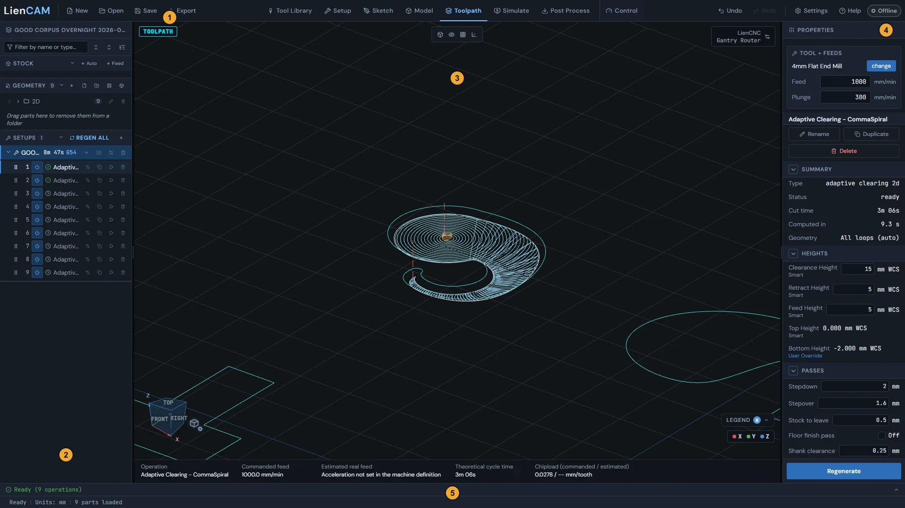

See also: [The five screen regions](Getting-around#ui-tour), [Your first toolpath](Getting-around#first-toolpath), [Saving and opening projects](Getting-around#projects-save-open).

## Your first toolpath

Import a part, add a setup, create an operation, check the toolpath, and post G-code.

1. Import a part: in the design tree on the left, click the + (Import geometry) button on the Geometry section header and pick a DXF, SVG, STL, OBJ, or STEP file.
2. Add a setup: click the + button on the Setups section header ("Add setup"). In the New Setup window, choose the stock and place the work origin, then click Create Setup. The setup decides where your machine's zero point sits on the stock.
3. Create an operation: click the + button on the setup row ("Add operation (N)"), or press N. Pick an operation type, a tool, and the geometry to cut, then click Create Operation. The toolpath is computed as soon as the operation is created.
4. Check the result: click the Toolpath tab in the header to see the cutting moves. If you change something later, press G to regenerate the selected operation, Shift+G to regenerate all of them, or click REGEN ALL on the Setups section header.
5. Post the G-code: click the Post Process tab in the header, review the output, and save the file for your machine.

> **Tip:** Watch the left end of the status bar at the bottom of the window: it reads "Computing..." while toolpaths are being calculated, "Compute pending" when an operation needs regenerating, a count such as "1 operation failed" when one could not be generated, and "Ready" when there is nothing to do.

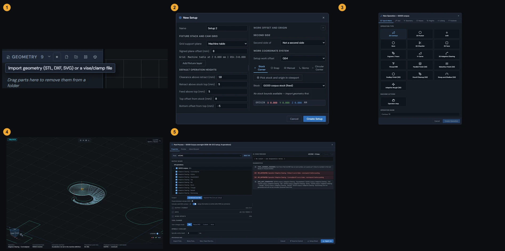

See also: [What LienCAM is](Getting-around#welcome-overview), [Setup and WCS](Setup-Stock-and-Workholding#setup-wcs), [Operation generation failures](Toolpaths-2.5D#generation-failures), [Saving and opening projects](Getting-around#projects-save-open).

## Saving and opening projects

Projects save as self-contained .camproject files that carry your parts, tools, models, and toolpaths inside them.

1. Click Save in the header. The project is saved as a .camproject file named after the project, with spaces turned into underscores. In a browser it goes to your normal download folder; when LienCAM runs as a desktop program, a Save window asks where to put it.
2. Click Open in the header to open the project picker. Choose an example, a recent project in the desktop app, or Browse... to pick a .camproject file. While it opens, the header and the status bar show "Opening" with what is being loaded.
3. Click New in the header to start a fresh project. Your machines, tool library, and settings stay as they are - only the project is replaced.

A .camproject file is self-contained. It carries the imported STL and STEP parts, the tools your operations use (with their libraries and holders), and any models built in the Model workspace. You can move the file to another computer or send it to someone else and it opens complete - the original import files are not needed again.

Computed toolpaths are saved in the file too, so a saved project reopens with its operations ready. When a project uses tools your tool library does not have, opening it adds them to your library and the status bar says how many were added; tools you already have are never replaced. Settings and your machine library belong to this computer, not to the file.

The desktop picker shows recent projects with their folder and last-opened time. Remove from list removes only the recent entry; a moved or missing file stays listed but cannot be opened from that entry. Examples show part previews and open with the sample hobby router. Help \> Open an example project opens the Examples section again. Tick Always go straight to the file browser in the picker or Settings \> Opening projects to make Open go straight to Browse instead.

When the project is empty, the picker offers Start with an empty project. Choose it to close the picker and begin drawing; it does not replace a project that already has work in it.

See also: [Your first toolpath](Getting-around#first-toolpath), [Operation generation failures](Toolpaths-2.5D#generation-failures), [The machine prompt when opening a project](Control#machine-choice).

## mm and inch

Display units change what you see and type; export units set whether posted G-code uses G21 or G20.

1. Click Settings in the header and find the Units section below STL Projection.
2. Set Display units to mm or in. This changes the units shown and typed everywhere in the app, and the status bar shows the current choice. Values are kept in millimeters inside the app, so switching back and forth never changes your part.
3. Set Export units to mm or in. This controls the posted G-code only: G21 for millimeters, G20 for inches.

The two settings are independent, so you can design in one unit system and post in the other - for example, work in millimeters on screen while posting inch G-code for your machine.

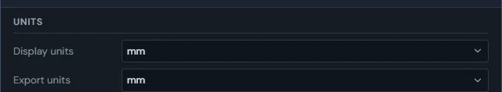

See also: [What LienCAM is](Getting-around#welcome-overview), [The Settings window](Settings#settings-tour).

## Undo and history

Ctrl+Z undoes the last change, Ctrl+Y redoes it, and the app keeps the last 50 changes.

Press Ctrl+Z to undo and Ctrl+Y (or Ctrl+Shift+Z) to redo, or use the Undo and Redo buttons at the right of the header. The app keeps the last 50 changes. Making a new edit after undoing discards the redo steps, as in most programs.

The buttons act on whichever workspace is active: in the CAM workspace they step through project changes, and in the Model workspace they step through modeling changes. The Control tab has no Undo or Redo. While you are typing in a text or number field, Ctrl+Z is the normal text undo for that field.

> **Tip:** Toolpaths are not kept in the undo history, so an operation that was ready comes back from an undo marked outdated. Press G to regenerate the selected operation or Shift+G to regenerate all of them.

See also: [Keyboard shortcuts](Getting-around#keyboard-shortcuts), [Operation generation failures](Toolpaths-2.5D#generation-failures).

## Keyboard shortcuts

Shortcuts follow the active workspace and stay out of the way while you are typing.

1. CAM: N opens a new operation on the active setup; G regenerates the selected operation; Shift+G regenerates all; Delete or Backspace deletes the selected part, operation, or setup after you confirm; F2 renames the selected tree row.
2. Setup: while dragging a selected part by a plane or center handle, hold Shift to lock the move to the axis you are moving along most. The single-axis arrow handles always move along their own axis.
3. Sketch drawing tools: L line, R rectangle, C circle, A arc, S spline, G text, D dimension. Sketch editing tools: T trim, K split, E extend, O offset, M mirror, F fillet, H chamfer, V move, W rotate, X scale; 1, 2, and 3 make linear, circular, and along-a-path patterns. I shows or hides the Measure readout and Q switches construction on or off. Tab turns a rectangle into an angled rectangle while drawing it. Enter finishes the current chain; Escape cancels or returns to Select; Delete removes the selected sketch items.
4. Everywhere: Ctrl+Z undoes and Ctrl+Y or Ctrl+Shift+Z redoes in the active workspace. Single-key shortcuts do nothing while a text field, dropdown, or window has the keyboard.

See also: [Where error details live](Getting-around#error-details), [Undo and history](Getting-around#undo), [Drawing entities](Sketch#sketch-draw-tools).

## The five screen regions

The header, design tree, 3D view, properties panel, and console with status bar each have one job.

The CAM screen is divided into five regions. The left and right panels can be resized by dragging their inner edges.

1. Header (top): New, Open, and Save on the left; the tabs in the middle (Tool Library, Setup, Sketch, Model, Toolpath, Simulate, Post Process, Control); Undo, Redo, Settings, Help, About, and the machine status (Offline, Not homed, Ready, Running, or Alarm) on the right. In a narrow window the buttons show only their icons - hover over one to see its name.
2. Design tree (left panel): everything in the project, in three sections - Stock, Geometry, and Setups. The buttons on each section header add new items, and right-clicking a row opens its menu.
3. 3D view (center): your parts, stock, and toolpaths. The badge in its top-left corner names the current view, the machine name in its top-right corner opens the Machine Library, the buttons at its top show or hide things, and the view cube sits in its bottom-left corner.
4. Properties panel (right panel): the details of whatever is selected - a part, stock, setup, or operation - with most values editable in place.
5. Console and status bar (bottom): the console line shows the latest event and opens into the full list of events, warnings, and errors; the status bar below it shows the project state (Ready, Computing..., Compute pending), the display units, and how many parts are loaded.

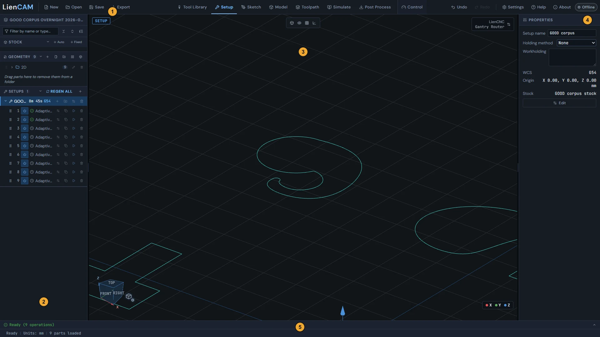

See also: [What LienCAM is](Getting-around#welcome-overview), [Your first toolpath](Getting-around#first-toolpath), [Where error details live](Getting-around#error-details), [Keyboard shortcuts](Getting-around#keyboard-shortcuts).

## CAM and Model workspaces

The tabs in the header switch between the CAM workspace, the Model workspace, and Control, and bodies you model flow into CAM as geometry.

The header holds eight tabs: Tool Library, Setup, Sketch, Model, Toolpath, Simulate, Post Process, and Control. Setup, Sketch, Toolpath, and Simulate are views of the CAM workspace, where you arrange parts and stock and machine them. Model switches to the Model workspace, a separate solid-modeling screen for building and editing 3D bodies. Control switches to the machine control screen for running jobs on the real machine. Tool Library and Post Process open their own windows. Any of the four CAM tabs brings you back to CAM.

Bodies made in the Model workspace appear in the CAM design tree as model rows under Geometry, so operations can cut them like any imported part. To edit one of them, use Edit model on its row in the design tree; the Model tab itself always offers a new model. Select a body in the Model workspace and a CAM tab selects its row in the design tree.

> **Tip:** To turn work you already have into a model, use the design tree: Edit as model on an imported STEP or STL part opens it as an editable model, and Convert to model on a sketch layer moves that sketch into a new model.

Clicking the Model tab opens the New Model window: Create Model starts a new model, or choose one of the models in the project below it to open it. Closing the window keeps you where you were. You can also open a model with Edit model on its row in the design tree.

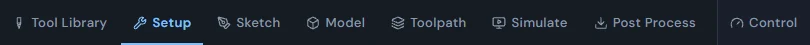

See also: [Model-to-CAM flow](Model#model-to-cam), [Setup, Sketch, Toolpath, Simulate](Getting-around#viewer-modes), [Editing an import as a model](Importing-files#edit-import-as-model), [The Control tab](Control#control-tab-overview).

## New Model

The Model tab opens the New Model window: Create Model starts a new, empty model, or choose an existing model to open it in the Model workspace.

Click the Model tab and the New Model window opens. Create Model adds a new model to the project and opens it in the Model workspace, ready to build. Below it, Or choose an existing model lists the models in the project; click one to open it. An imported STEP or STL part in that list opens as a model, the same as Edit as model in the design tree. Cancel, the X or Escape closes the window and leaves you where you were; nothing is added.

To change a model you already have, use its Edit model button (the pen) in the design tree, or right-click its row under Geometry and choose Edit model. That opens the existing model, not a new one.

See also: [CAM and Model workspaces](Getting-around#cam-vs-model-workspace), [Model-to-CAM flow](Model#model-to-cam).

## Setup, Sketch, Toolpath, Simulate

The four CAM tabs are four views of the same project: arrange in Setup, draw in Sketch, inspect paths in Toolpath, and play them back in Simulate.

1. Setup: the arranging view. Import and position parts, size stock, and place setups and their work origins.
2. Sketch: with a sketch layer selected it opens that layer for editing. Otherwise the Enter Sketch Mode window offers New sketch, Pick existing in viewport, or a list of the existing layers to choose from.
3. Toolpath: draws the computed toolpaths of the active setup, colored by move type, with the Legend chip to show or hide each type. A strip along the bottom of the view shows the selected operation's commanded feed, estimated real feed, chip load, and cycle time.
4. Simulate: plays the toolpaths back move by move, with play, step, speed, and a timeline along the bottom of the view. Tick Simulate Stock Removal to watch the material being cut away.

A colored badge in the top-left corner of the 3D view names the current view (SETUP, SKETCH, TOOLPATH, or SIMULATION). Switching views never changes your project - each tab shows the same data for a different job.

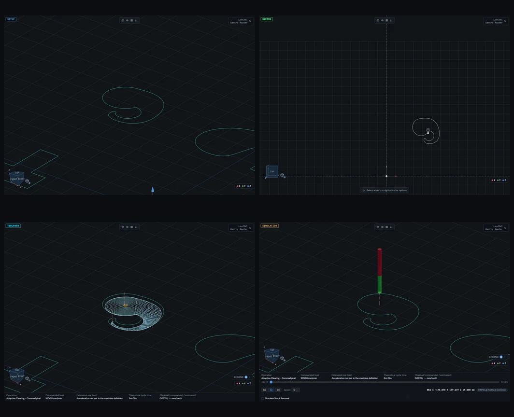

See also: [CAM and Model workspaces](Getting-around#cam-vs-model-workspace), [Reading the toolpath view](Getting-around#toolpath-view), [Stock simulation](Simulate#stock-simulation), [Starting a sketch](Sketch#sketch-entry).

## Orbit, pan, zoom, view cube

The mouse orbits, pans, and zooms the 3D view under a scheme you pick in Settings, and the view cube or the right-click menu snaps to standard views.

With the default mouse scheme, LienCAM default (left-orbit), left-drag orbits, right-drag pans, and the wheel or middle-drag zooms. Settings \> Navigation offers six other schemes; most keep the left button free for selecting and put orbit, pan, and zoom on the middle or right button, some with Shift or Ctrl held. Two checkboxes there reverse the zoom and pan directions. A plain right-click opens the view menu. If your browser opens it as you press the right button, dragging more than 10 pixels dismisses it while the pan continues; the menu does not stay over the moving view. On a touch screen, one finger orbits and two fingers pinch-zoom and pan. The same scheme applies in the CAM 3D view and in the Model workspace.

1. Click a face of the view cube in the bottom-left corner (TOP, FRONT, RIGHT, BACK, LEFT, BOT) to turn the view to that side. The X, Y, and Z arrows on the cube show which way the axes point.
2. Or right-click an empty spot in the 3D view: Fit all zooms to fit the imported 3D parts (STL and STEP) in view, Isometric view gives the three-quarter overview, and Top view looks straight down.

> **Tip:** The CAM view uses a flat (orthographic) projection, so parallel edges stay parallel and lengths on screen do not shrink with distance.

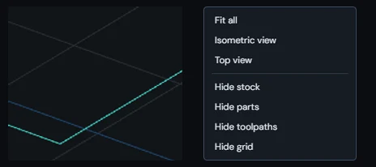

See also: [Setup, Sketch, Toolpath, Simulate](Getting-around#viewer-modes), [Shading and display modes](Getting-around#display-modes), [Projection, DXF import, nesting, and navigation](Settings#settings-defaults).

## Shading and display modes

The Display Mode flyout beside the view cube picks how bodies are shaded and holds the grid, height-plane, and section-view controls.

1. Click the Display mode button (a small cube with a gear) beside the view cube in the bottom-left corner of the 3D view to open the Display Mode flyout.
2. Pick a shading mode: Shaded with edges, Shaded, no edges, Unshaded (wireframe), or Translucent - useful for seeing pockets and toolpaths through the part.
3. Below that: Grid spacing sets the spacing of the floor grid, Nest seed outline shows or hides the outline box drawn around each nest's seed part, and Height planes shows the operation height planes, with a checkbox for each one (Clearance, Retract, Feed Height, Top of Stock, Bottom of Cut).

At the bottom sits Section view: a checkbox that slices the scene with a cutting plane. Choose the Axis (X, Y, or Z), move the Pos slider, or click Drag plane and drag up or down in the 3D view. Flip side keeps the other half instead, and Clear turns section view off and resets its controls. The slice is for looking inside only - it never changes your geometry.

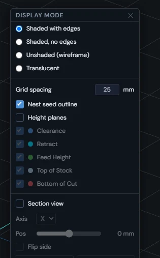

See also: [Seeing height planes](Setup-Stock-and-Workholding#height-planes-viewport), [What the eye toggles control](Getting-around#visibility-toggles), [Orbit, pan, zoom, view cube](Getting-around#viewport-navigation).

## The design tree

The left panel lists everything in the project under three sections - Stock, Geometry, and Setups - with folders, renaming, visibility eyes, and status badges.

The top row shows the project name - double-click it to rename the project. Below it, the filter box ("Filter by name or type...") narrows every section at once, and three buttons collapse everything, expand everything, or show just the top level. The three sections follow how a job is built: Stock holds the material blocks (+ Auto and + Fixed add one), Geometry holds parts, sketches, and models (its header buttons import a file or add a new layer, folder, nest, or model), and Setups holds each setup with its operations (+ adds a setup, REGEN ALL regenerates every operation). Right-click a row for its menu.

1. Rename any named row by double-clicking its name, or select it and press F2. Double-clicking an operation opens it for editing.
2. Organize with folders: parts and operations can be grouped into folders, and rows drag by their handle to reorder or drop into a folder. Whether a folder is open or closed is remembered.
3. Use the eye buttons to show or hide a whole part or a single layer in the 3D view without deleting anything. The lock button on a part locks it in place so it cannot be moved.
4. Each operation row has buttons to suppress it (the power button - a suppressed operation is skipped by REGEN ALL, posting, and simulation), edit, duplicate, compute (G), and delete it.

Operation rows carry a status badge: a green check means the toolpath is ready; a spinner or a filling ring means it is computing; a gray clock means it has not been computed yet; an amber clock means it is outdated (hover for why, then regenerate it); a red circle means it could not be generated (hover over it for the reason); and a red triangle means the model geometry it cuts is gone. A small down-arrow beside the badge means the tool could not reach the full depth. A collapsed folder, nest, or setup shows a red or amber badge when something hidden inside it needs attention.

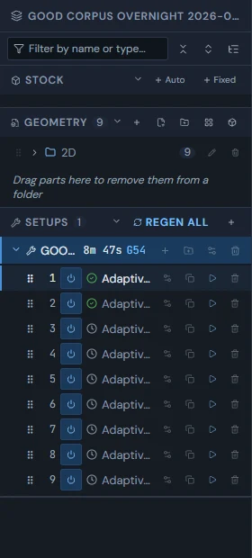

See also: [Operation folders and suppression](Toolpaths-2.5D#operation-folders), [Which stock owns a part](Setup-Stock-and-Workholding#stock-membership), [The properties panel](Getting-around#properties-panel), [Edited, stale and approx badges](Importing-files#provenance-badges).

## The properties panel

The right panel shows the properties of whatever is selected - stock, nest, layer, folder, part, operation, or setup - and most values edit in place.

There is one Properties panel and it follows your selection: select a stock and you get its size and position, a part gives its placement and layers, an operation gives its tool, feeds, summary, heights, and passes, and with nothing selected the active setup shows. An outdated operation names the reason in its Summary Status row. A toolpath move you click in the Toolpath view comes first and shows that one move's numbers. In Sketch mode the panel becomes the sketch toolbox instead.

Values here are edited in place: changing an operation value in the panel - a height, a pass setting, a feed - updates the operation, and its badge in the tree turns to a clock until you click Regenerate at the bottom of the panel (or press G). Long panels are split into groups you can fold open and closed; the app remembers which ones you folded.

> **Tip:** The Heights group shows each height with where it came from underneath: Smart when the app worked it out, User Override when you typed it.

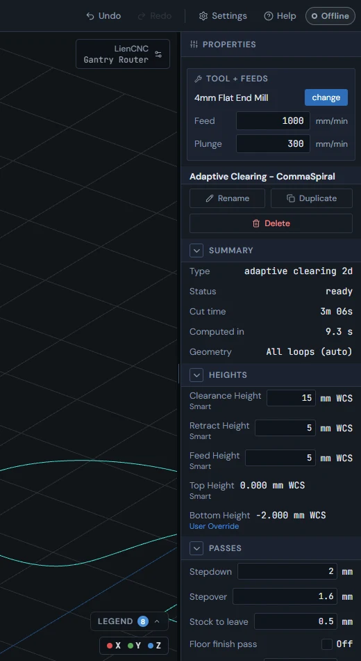

See also: [The design tree](Getting-around#design-tree), [Operation generation failures](Toolpaths-2.5D#generation-failures), [Generated-plane truth](Setup-Stock-and-Workholding#height-truthfulness).

## Where error details live

The bottom console is the in-app list of events, warnings, and errors for the current session.

1. The console line above the status bar always shows the latest event; a red number on it counts errors you have not looked at yet. Click the line to open the full list, and click it again to close it.
2. Use the All, Info, Success, Warning, and Error buttons to narrow the list. Newest events appear first. Clear empties the list; Troubleshoot opens the help on errors.
3. When an event is linked to an operation, a part, or a setup, click the row to select that item and look at it in context.

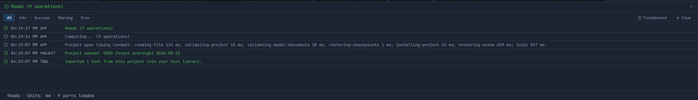

See also: [Operation generation failures](Toolpaths-2.5D#generation-failures).

## Reading the toolpath view

Toolpath moves are colored by type, and the Legend chip opens a list where each type can be hidden or shown on its own.

Every drawn move has a type, and each type has its own color: Cut, Rapid (drawn dashed), Helix, Ramp, Plunge, Stepover, Fast Traverse, Wall Follow, Finish, Lead-in, and Lead-out. The legend uses the same colors as the lines in the 3D view.

1. Click the Legend chip in the bottom-right corner of the Toolpath or Simulate view. The number on it counts how many move types are showing.
2. The list shows only the move types the toolpaths on screen actually use. Click a row to hide or show that type - the eye icon changes and the lines disappear or come back.
3. In the Toolpath view the legend also holds the Roughing stock preview checkbox, which shades the material a roughing pass leaves behind.
4. Click a single move in the 3D view to see its numbers in the Properties panel.

> **Tip:** Hiding Rapid is the quickest way to declutter a busy path and look at just the cutting moves; showing only Lead-in and Lead-out is a quick check of your entry moves.

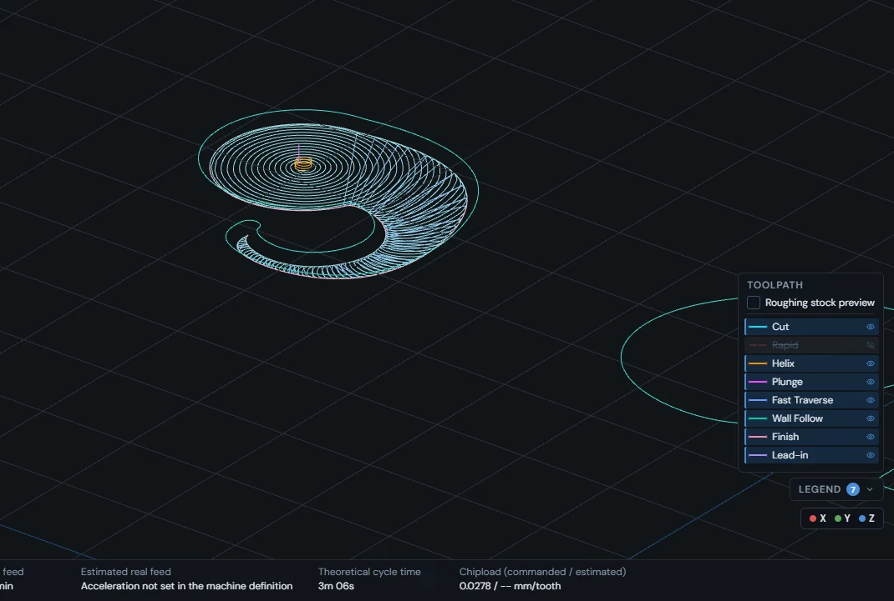

See also: [Setup, Sketch, Toolpath, Simulate](Getting-around#viewer-modes), [Creating an operation](Toolpaths-2.5D#creating-operations), [Stock simulation](Simulate#stock-simulation), [Cut-time estimates](Toolpaths-2.5D#cut-time).

## What the eye toggles control

Four buttons at the top of the 3D view show or hide the stock, parts, grid, and WCS marker, and finer eyes live in the Display Mode flyout, the design tree, and the toolpath legend.

1. The four buttons at the top of the 3D view: Toggle stock, Toggle geometry (all parts at once), Toggle grid, and Toggle WCS (the work-origin axis marker). A lit button means the item is showing.
2. Right-clicking an empty spot in the 3D view offers the same switches as words - Hide stock, Hide parts, Hide toolpaths, Hide grid (or Show ..., when hidden).
3. The Display Mode flyout by the view cube holds the height planes, with a checkbox for each one, and the nest seed outline.
4. Each part and each layer in the design tree has its own eye, and each move type has its own eye in the toolpath legend.

All of these only change what you see. Hiding something never removes it from the project or from toolpath generation, posting, or simulation.

See also: [Shading and display modes](Getting-around#display-modes), [Reading the toolpath view](Getting-around#toolpath-view), [The design tree](Getting-around#design-tree).

## Recovering from a crash

A drawing error shows an error screen with the real error message; Reload opens the same saved project, and a failure in the 3D view alone leaves the rest of the app working.

If the whole window is replaced by a screen titled "LienCAM encountered an error", something stopped the app from drawing. The screen says "Something went wrong while rendering. Your saved project has not been touched -- reloading is usually all that is needed.", shows the error message itself in a red box, and offers two buttons. Reload reloads the page and opens the same saved project. Below it, "Reset Project Data & Reload (last resort)" clears everything the app has saved in this browser - the current project, your tool library, holder library, machine library, app settings and imported fonts - and reloads.

If only the 3D view shows "This view failed to render", the design tree, the properties panel and the other tabs keep working, and the error message is shown under the heading. Press "Retry this view", or click another tab (Setup, Sketch, Toolpath, Simulate) - changing tabs clears the error and draws the view again.

1. Whole window: press Reload.
2. Only the 3D view: press "Retry this view", or click another tab.
3. If Reload brings the same error back every time, "Reset Project Data & Reload (last resort)" clears the saved data and reloads.

> **Warning:** Reset Project Data & Reload cannot be undone: the project, tool library, holder library, machine library, app settings and imported fonts saved in this browser are cleared. A .camproject file saved to disk is not touched and can be opened again afterwards.

See also: [Where error details live](Getting-around#error-details), [Saving and opening projects](Getting-around#projects-save-open).

## GPU capability fallbacks

The 3D stock simulation needs a GPU feature not every computer has; without it the app runs the 2.5D simulation and says so in the console.

Stock removal simulation has two engines. The 3D engine ("3D - smooth, true undercuts") shows true material removal, including undercuts, and needs WebGL2 with linear filtering of floating-point 3D textures. The 2.5D engine ("2.5D - fast (low-end GPUs)") follows only the top surface of the stock and runs on any GPU. The choice is in Settings, under Stock Simulation, "Simulation engine"; the default is "Auto (3D, falls back to 2.5D)".

When the 3D engine cannot run - on Auto, or with 3D picked on a computer that lacks the feature - the simulation runs on the 2.5D engine and the bottom console shows a warning: "Voxel simulation unavailable (GPU lacks WebGL2 + float-3D-texture linear filtering); using 2.5D heightmap." If the carved stock never shows undercuts, that line says why.

See also: [Stock simulation](Simulate#stock-simulation).
