<!-- Generated from the in-app Help by tools/release/help-to-wiki.mjs. Do not edit by hand. -->

# Importing files

- [Importing DXF and SVG](#import-dxf-svg)
- [Importing STL and OBJ meshes](#import-stl)
- [Importing STEP and IGES solids](#import-step)
- [Multi-body STEP files](#multi-body-step)
- [Picking faces and edges on a solid](#face-edge-selection)
- [Slicing a solid at a height](#section-at-z)
- [Fit arcs and merge lines](#geometry-cleanup)
- [Editing an import as a model](#edit-import-as-model)
- [Converting a sketch layer to a model](#convert-to-model)
- [Boolean an imported mesh with a model body](#boolean-mesh-model)
- [Edited, stale and approx badges](#provenance-badges)
- [Why an import or derive was refused](#import-refusals)

## Importing DXF and SVG

DXF and SVG files import as 2D layers of loops you can machine, edit in Sketch, clean up, or turn into a model.

1. In the design tree, click the + button on the Geometry header (its tooltip begins "Import geometry") and choose a .dxf or .svg file. The same button opens STL, OBJ, STEP and IGES files.
2. The drawing appears as one row in the Geometry list with its layers under it. A DXF keeps the layer names and colors from the file. Layers whose names mark drawing-sheet extras (border, title block, notes, dims, center lines and similar) start hidden - click their eye button to show them. An SVG is split into layers by its own layers, or by color when it has none ("Layer 1", "Layer 2" ...).
3. The console at the bottom says what was imported. For a DXF it also says what it fixed or left out: gaps it closed, chains it left open, entity types it did not import, and the unit it converted from when the file is not in millimeters.
4. A DXF lands centered on the origin. To keep the drawing's own origin instead, turn on Keep drawing origin under DXF import in Settings.
5. If the project has a stock other than the automatic one, a dialog asks which stock the new part joins: one of your stocks, Auto (default), or None.

Each layer row has buttons to hide, lock, rename, Edit in Sketch, Convert to model, Fit arcs & merge lines, and delete the layer. Click the arrow on a layer to list its loops. Operations pick from these loops on their Geometry tab.

> **Tip:** Edit in Sketch opens the layer in the sketcher. The imported drawing arrives as one fixed block, so a stray click cannot bend it - select the block and explode it when you want to change single lines. After you finish an edited sketch, the drawing's row shows an "edited" badge.

You can also bring a DXF or SVG straight into the sketch you are working in: in the sketcher's Create section, click Import... to open the Import window, then choose a DXF / SVG / PNG / JPG file. The Picture width and Picture threshold choices in that window apply to PNG / JPG tracing and are remembered while the sketch stays open. Export / Print... opens the separate Export window for paper, orientation, scale, Export SVG... and Print... .

DXF block inserts import as ordinary geometry in both CAM and Import into sketch. Each placed copy keeps its position, scale, mirror and rotation, including nested inserts and arrays. Entities on layer 0 use the placed block's layer. Paper-space sheet and title-block inserts are left out.

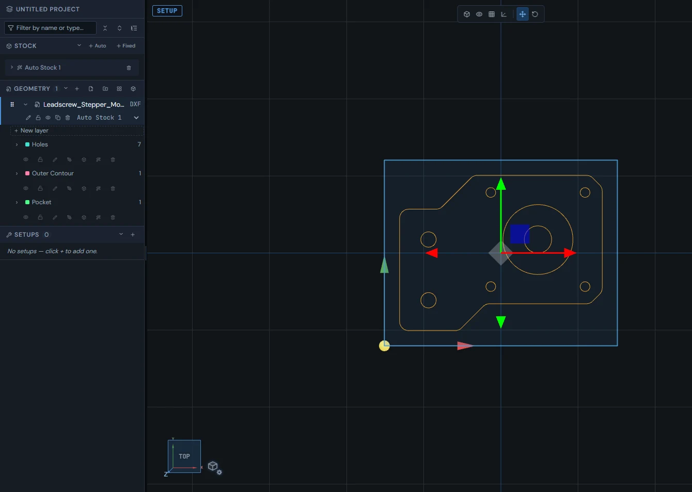

See also: [Importing STL and OBJ meshes](Importing-files#import-stl), [Fit arcs and merge lines](Importing-files#geometry-cleanup), [Edited, stale and approx badges](Importing-files#provenance-badges), [What an operation cuts](Toolpaths-2.5D#operation-sources).

## Importing STL and OBJ meshes

An STL or OBJ mesh shows in 3D. Slice an STL into 2D loops in two steps: pick the slice height, then pick where the loops land.

Import a mesh with the + (Import geometry) button on the Geometry header. An STL or OBJ appears in the viewport seated on the floor. An OBJ is read the same way as an STL; its row offers color, rename, lock, duplicate and remove.

An STL row also has Edit as model, Hide model, and Slice to 2D loops (the layers icon). A mesh has no curves an operation can follow directly, so most 2D operations need loops sliced from it.

1. Click Slice to 2D loops on the STL row.
2. Step 1 (Slice Plane): drag the orange handle, or type a Z, to the height where the outline is taken. The panel shows the valid range. Click Confirm or press Enter; Esc cancels.
3. Step 2 (Select Target Plane): choose where the loops land - Stock top, Stock bottom, Floor (Z = 0), or click a highlighted face on the part.
4. The loops land on a new layer named "STL Projection 1", "STL Projection 2", and so on. The row shows how many 2D loops it has (for example "2D:6").

> **Tip:** How closely the traced loops follow the mesh is set under STL Projection in Settings: a Quality preset (Draft, Standard, Fine) or your own STL projection tolerance. Projection layers cannot be opened in Sketch, but Fit arcs & merge lines works on them.

2D Contour and 2D Pocket can also use an STL directly: pick the STL as the source geometry and the operation finds the part's edge chains itself.

> **Warning:** If you move or rotate the STL after slicing, the slice button is highlighted and its tooltip reads "Rotation changed — re-slice to 2D loops". The old loops stay where they were taken.

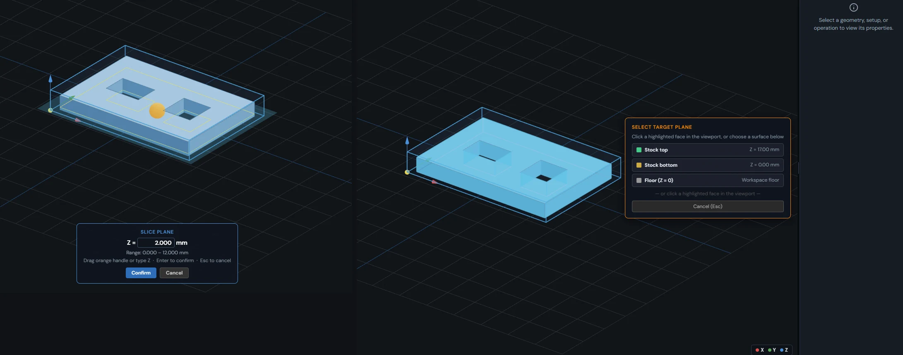

See also: [Importing DXF and SVG](Importing-files#import-dxf-svg), [Slicing a solid at a height](Importing-files#section-at-z), [Editing an import as a model](Importing-files#edit-import-as-model), [Fit arcs and merge lines](Importing-files#geometry-cleanup).

## Importing STEP and IGES solids

STEP and IGES files import as true solids that keep their exact shape for face picks, sections, and editing as a model.

Import a .step or .stp file with the + (Import geometry) button on the Geometry header. While it loads, the Geometry section shows "Importing \<file name\> ..." with the current stage. The part lands seated on the floor and centered over the origin. It takes the part name stored in the file when there is one (otherwise the file name) - double-click the name to rename it.

An IGES file (.igs or .iges) imports through the same button and lands as the same kind of solid row. The file dialog lists both extensions alongside STEP, STL, OBJ, DXF and SVG. The console says what the IGES file held, for example "IGES -- 1 solid"; a file with only surfaces still imports and says so.

Unlike a mesh, the part keeps its exact solid shape. That is what lets you pick faces and edges in the operation editor, take exact sections at any height, and edit the import as a model. How smooth curved surfaces look on screen is set by Model render fidelity under Performance in Settings (Performance, Balanced, High); it does not change the real shape.

The row has buttons for color, rename, lock, Edit as model, Hide model, Slice to 2D loops, duplicate and remove. If an import fails, a red message in the Geometry section names the file and the reason; click it to dismiss it.

Turning the part over keeps its operations. When you rotate a STEP part about X or Y, LienCAM re-derives the faces, holes and sections you took from it once, when the rotation is set (at the end of the gizmo drag, or when you enter the value), never while you drag. Turned upside down, each face, hole and section lands where it now is - a drill finds each hole at its new place and depth - and a face or hole you take on the turned part lands the same way.

Tilted part way, those faces and holes no longer face straight up, so they cannot be cut from above: the operations that use them turn red and the message names the tilt, for example "turned 30 deg off upright (rotation X=30 deg, Y=0 deg)". Turn the part back upright or upside down and they compute again.

> **Tip:** LienCAM keeps a copy of the imported file in this browser, so the part comes back after a reload without importing it again. If a file holds more than one body, a dialog asks how they should land - see Multi-body STEP files.

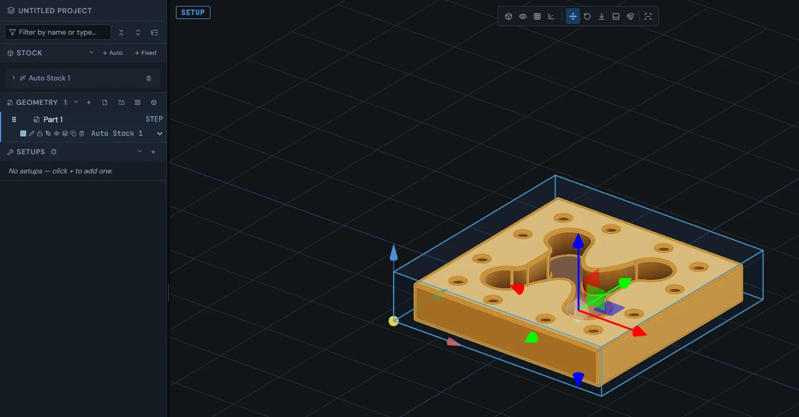

See also: [Multi-body STEP files](Importing-files#multi-body-step), [Picking faces and edges on a solid](Importing-files#face-edge-selection), [Slicing a solid at a height](Importing-files#section-at-z), [Editing an import as a model](Importing-files#edit-import-as-model).

## Multi-body STEP files

When a STEP file holds more than one body, you choose whether it lands as one row or as one row per body.

When a STEP file holds several separate bodies, a dialog titled "This file has N separate bodies" asks how they should appear in the Geometry list. Files with one body never show it.

1. Keep as one item (default): all bodies stay together as one row that selects, hides and moves as one.
2. One item per body: each body becomes its own model row, named after the file ("two-boxes", "two-boxes (2)" ...). You stay on the screen you were on.
3. Escape, Enter, the X button, or a click outside the dialog keeps the highlighted choice.

> **Tip:** While the file is still one row, right-click it and choose Choose body split... to bring the dialog back, with your earlier choice highlighted.

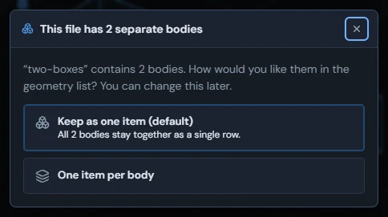

Those choices belong to the Geometry list in Setup. Import in the Model tab brings each solid into its own model body automatically and reports the count; Cancel during import drops it.

See also: [Importing STEP and IGES solids](Importing-files#import-step), [Editing an import as a model](Importing-files#edit-import-as-model), [Which stock owns a part](Setup-Stock-and-Workholding#stock-membership).

## Picking faces and edges on a solid

The operation editor can take its cutting geometry straight from an imported solid: pick faces, pick edges, or detect holes.

When an operation's source geometry is an imported STEP or IGES part, the Geometry tab shows a "From 3D model" group. Which buttons appear depends on the operation: Pick face (2D Pocket, 2D Adaptive Clearing, 2D Face, 2D Contour, Drill, Bore, Thread Mill), Pick edges (2D Contour, Engrave / Trace, V-Carve, 2D Chamfer, Thread Mill), Detect holes (Drill), and Section at Z (the Pick face operations except Drill - see Slicing a solid at a height). Each one puts the loops on a new layer of the part and selects them for the operation.

1. Pick face: click faces on the part in the viewport. Each click selects or deselects a face, and the banner at the bottom counts them and says what a click does in this operation. Click Done to use them, or Cancel.
2. A flat face gives its outline as loops, and the deepest picked face sets the bottom of cut. A round wall is used by what it is: Drill and Bore take the hole to its depth, Thread Mill reads the thread's kind, size and depth, 2D Contour profiles it down to its base, and 2D Pocket avoids a boss as an island or uses a bore as the boundary.
3. Pick edges: click edges on the part, then Done. The picked edges are chained into the contour.
4. Detect holes (Drill): the part is searched for holes and each one is added to the loop list with its diameter and selected.

A body built in the Model workspace offers Pick edges for the profile operations and a typed Section at Z; Drill gets Detect holes.

> **Warning:** Pick face on model on the Heights tab (a datum plane) needs a flat face on an imported solid. A curved face is refused with "That surface is curved - pick a FLAT (planar) face as the datum." and you can pick again.

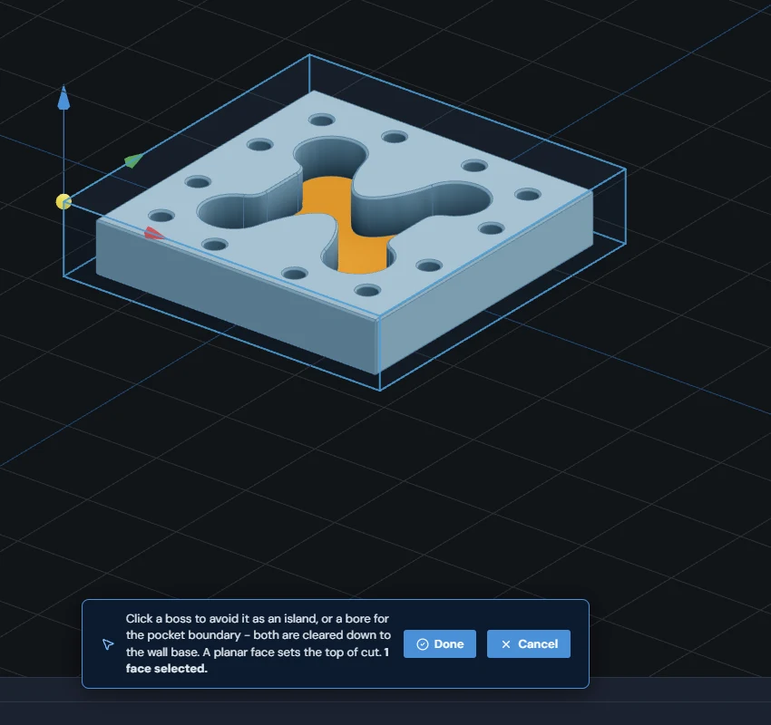

See also: [Importing STEP and IGES solids](Importing-files#import-step), [Slicing a solid at a height](Importing-files#section-at-z), [Heights explained](Setup-Stock-and-Workholding#height-references), [What an operation cuts](Toolpaths-2.5D#operation-sources), [Drilling](Toolpaths-2.5D#drill).

## Slicing a solid at a height

An imported solid can be cut at any height to give exact 2D loops, from the design tree or from the operation editor.

A section is an exact cross-section of the solid at one height - not a trace of a mesh - so the loops are as accurate as the file. There are two places to take one.

1. From the design tree: click Slice to 2D loops (the layers icon) on the STEP row. Step 1 - drag the orange handle or type the height; the section outline previews on the part as you go. Click Confirm. Step 2 - choose where the loops land (Stock top, Stock bottom, Floor, or a clicked face). The loops land on a new layer named "Section 1", "Section 2", and so on.
2. From the operation editor: on the Geometry tab, type a height in the box next to Section at Z and click Section at Z. The hint beside it shows the Z range and says "Exact solid cross-section at this height". Set in viewport lets you drag the height with the same live preview. The loops land on a layer named after the height (for example "Section z=-7") and are selected for the operation.

For a body built in the Model workspace, the operation editor offers the typed Section at Z only, and the hint says the section is mesh-derived. Set in viewport refuses a part rotated off the Z axis and names its X and Y rotation.

A section taken from a modeled body shows a "stale" badge after the model changes. When an operation that uses it computes, LienCAM takes the section again at the same height from the current model.

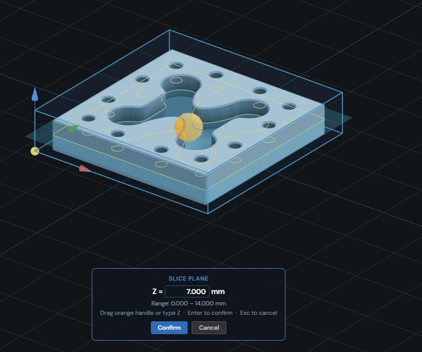

See also: [Importing STEP and IGES solids](Importing-files#import-step), [Importing STL and OBJ meshes](Importing-files#import-stl), [Picking faces and edges on a solid](Importing-files#face-edge-selection), [Edited, stale and approx badges](Importing-files#provenance-badges).

## Fit arcs and merge lines

Rebuild an imported layer with true arcs and merged lines, compare before and after, then keep it or cancel.

Imported curves often arrive as many short line segments where the original drawing had arcs. The wand button (Fit arcs & merge lines) on an imported 2D layer - DXF, SVG, STL projections, sections and picked-face loops - rebuilds its loops with arcs and merged straight lines. It works on open chains as well as closed loops. Sketch layers are edited in Sketch instead and have no wand button.

1. Click the wand button on the layer row in the design tree.
2. The Optimization Preview dialog opens with After selected. On STL projection and section layers the viewport draws the proposal with node markers - blue for Before, orange for After.
3. Click Before or After to switch between the two and compare the node points.
4. Click Apply to keep the result, or Cancel to keep the layer as it was.

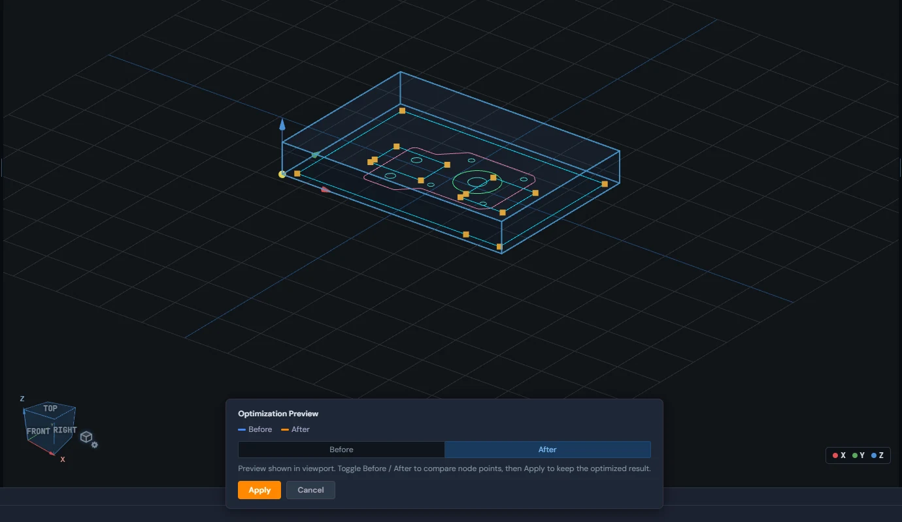

See also: [Importing DXF and SVG](Importing-files#import-dxf-svg), [Importing STL and OBJ meshes](Importing-files#import-stl), [Slicing a solid at a height](Importing-files#section-at-z).

## Editing an import as a model

Open an imported STEP part or STL in the Model workspace to change it, even though you did not draw it here.

Click Edit as model (the pen button) on an imported STEP or STL row in the design tree, or right-click the row and choose Edit as model. The Model workspace opens on the part, where the Modify tools (Push/Pull, Fillet, Chamfer, Shell, Draft, Hole, Resize hole, Defeature) work on it.

1. A STEP part becomes the base of a new model. The same Geometry row turns into a model row (tagged MODEL) once the model builds, and follows your edits. Its pen button then reads Edit model. A multi-body STEP gives each body its own row.
2. A flat-sided STL (a plate, block or bracket) is turned into a real solid the same way.
3. An STL with round holes, bosses or fillets opens in the Model workspace as a mesh and stays an STL. The console says how many features it recognised; click a feature to select it whole.
4. When it cannot open the part, you get a named message: a mesh that is open or broken, a copy placed by a nest (see Nesting; edit its source part instead), or a part whose stored file is missing (import it again).

> **Tip:** Edit as model starts from a 3D import. To start from a 2D layer, use Convert to model on the layer instead.

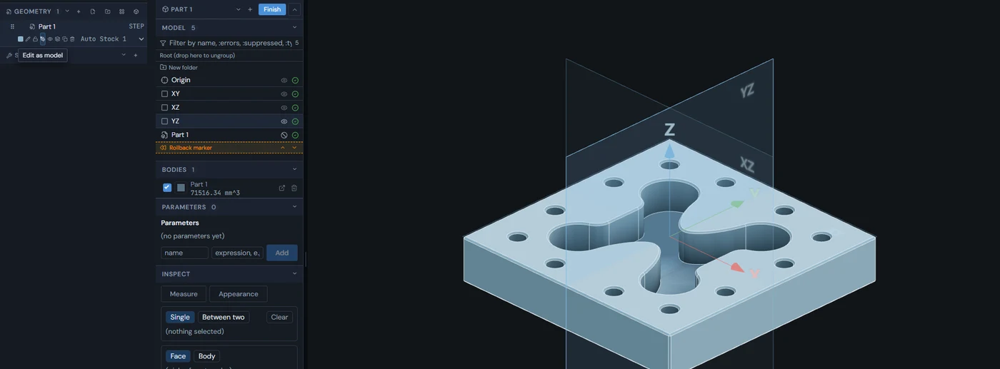

See also: [Importing STEP and IGES solids](Importing-files#import-step), [Converting a sketch layer to a model](Importing-files#convert-to-model), [Model-to-CAM flow](Model#model-to-cam), [Multi-body STEP files](Importing-files#multi-body-step).

## Converting a sketch layer to a model

A 2D layer can move into a new model as its base sketch; operations that used it are marked outdated until you pick again.

The box button (Convert to model) sits on DXF, SVG and sketch layer rows that are not locked; right-click a layer for Convert to model... as well. It moves the layer into a new model as its base sketch and opens the Model workspace, where you can extrude it and add features. This is a move, not a copy: the layer leaves its Geometry row, and the new model takes the layer's name.

1. Click Convert to model on the layer row.
2. The "Convert sketch to model?" dialog opens. If operations use the layer, it names them.
3. Click Convert to model. The Model workspace opens on the new model.
4. Operations that used the layer are marked outdated. Pick their geometry again on the model, then regenerate.

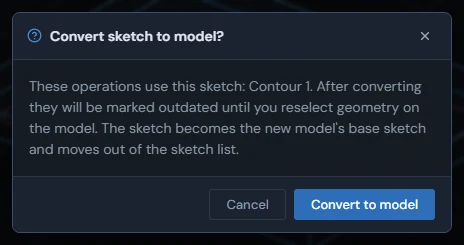

See also: [Editing an import as a model](Importing-files#edit-import-as-model), [Model-to-CAM flow](Model#model-to-cam), [Operation generation failures](Toolpaths-2.5D#generation-failures).

## Boolean an imported mesh with a model body

Subtract, union, or intersect an imported STL with a body built in the Model workspace to get a new row, marked exact or approx.

Once the project has a body built in the Model workspace, an imported STL row gets a Boolean with model body button (right-click also offers Boolean with model body...). It opens the "Boolean: mesh vs model body" panel at the top right. The viewport stays clickable, so you can pick both parts by clicking them.

1. Mesh operand and Model body: the panel fills in what it can. To change one, click its Pick in viewport button (it reads "Click a mesh..." or "Click a body..." while it waits) and click the part. Choose from lists offers the same choice as drop-downs.
2. Operation: Subtract, Union, or Intersect.
3. The panel says whether the result will be EXACT (the body has only flat faces) or APPROXIMATE (curved surfaces use the body's display mesh).
4. Click Run boolean. The result lands as a new row named after the mesh and the operation, for example "plate (subtract)". The original parts are not changed.

The result row carries an "exact" or "approx" badge. It is a snapshot: if either part changes, click Edit boolean (re-run) on the result row to run it again with the same inputs filled in.

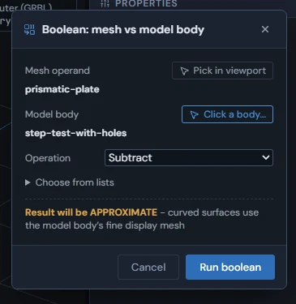

See also: [Importing STL and OBJ meshes](Importing-files#import-stl), [Model-to-CAM flow](Model#model-to-cam), [Edited, stale and approx badges](Importing-files#provenance-badges).

## Edited, stale and approx badges

Small badges and highlights on geometry rows tell you when a part or layer may no longer match where it came from.

The design tree marks geometry that has moved away from its source. Hover a badge to read the full note.

1. "edited" (on a DXF or SVG row): a layer was changed in Sketch, so the geometry may no longer match its source file.
2. "stale" (on a section layer of a modeled body): the model changed after the section was taken. An operation that uses it takes the section again when it computes.
3. Highlighted slice button (on an STL row): the part was moved or rotated after it was sliced; the tooltip reads "Rotation changed — re-slice to 2D loops".
4. "exact" / "approx" (on a boolean result row): whether the boolean kept exact flat geometry or used the model body's display mesh for curved surfaces.
5. Hovering a STEP row with no closed solid reads "Open shell: no closed solid. Mass, volume and center of mass are unavailable."

> **Tip:** Badges do not lock anything - the geometry still works as it is.

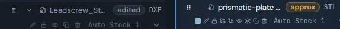

See also: [Importing DXF and SVG](Importing-files#import-dxf-svg), [Slicing a solid at a height](Importing-files#section-at-z), [Boolean an imported mesh with a model body](Importing-files#boolean-mesh-model), [Importing STL and OBJ meshes](Importing-files#import-stl).

## Why an import or derive was refused

When a file cannot be read or a shape cannot be used, the app names the reason in the design tree, the bottom console, or on the operation.

A refusal shows where the action ran: as a red line at the top of the Geometry section of the design tree (click it to dismiss), in the bottom console, or on the operation that could not be computed.

Files the app cannot read: a STEP file the reader cannot read shows a red line in the design tree such as "STEP import failed for "part.step" \[step-read\]: STEP read failed for "part.step": IFSelect status is not RetDone". Other files that fail to import write "Import failed for "\<file name\>": \<reason\>" in the bottom console.

Edit as model on an STL: right-click an imported STL and choose "Edit as model". A flat-faced mesh becomes an editable solid. A curved mesh (round holes, bosses, fillets) opens on the Model tab as a mesh and stays an STL; the console says so, for example: ""cylinder" is open as a mesh (kept as an STL): 2 feature(s) recognised across 192 facets in 241 ms. Click a feature to select it whole."

A mesh with holes or loose edges is refused: "The mesh is not watertight (4 open edge(s) across 1 hole(s), 0 non-manifold edge(s)); a solid cannot be built from it. Repair it first." A mesh with zero-area triangles, or one whose surface has no inside and outside, is refused the same way with its own message. A mesh boolean on a shape that is not closed reports "Boolean failed: one of the shapes is not a closed, watertight solid, so the boolean cannot run reliably. Repair or close the mesh first (Mesh tools), then try again." LienCAM has no mesh repair tools you can open yet: repair the mesh in your modelling program and import it again, or keep working with it as an STL.

Turned STEP parts: when you rotate a STEP part about X or Y, LienCAM re-derives its faces, holes and sections once, when the rotation is set, rather than during the drag. Turned upside down, level features can still be cut and their positions and depths follow the part. Tilted part way, features that no longer face straight up cannot be cut from above: the operations that use them turn red and the message names the tilt, for example "turned 30 deg off upright (rotation X=30 deg, Y=0 deg)". Turn the part upright or upside down to cut those features again.

Face picks: a picked face must be flat and level to drive a 2D operation or to serve as a height datum. A curved datum pick shows "That surface is curved - pick a FLAT (planar) face as the datum. Cylinder walls cannot be a datum plane."; a flat face that is not level is refused by name too.

See also: [Where error details live](Getting-around#error-details), [What an operation cuts](Toolpaths-2.5D#operation-sources).
