<!-- Generated from the in-app Help by tools/release/help-to-wiki.mjs. Do not edit by hand. -->

# Model

- [Model-to-CAM flow](#model-to-cam)
- [The Model workspace](#model-workspace-tour)
- [Sketching on a plane or face](#model-sketch-plane-face)
- [Extrude](#extrude)
- [Revolve, sweep, loft](#revolve-sweep-loft)
- [3D fillet and chamfer](#fillet-chamfer-3d)
- [Shell, draft, hole](#shell-draft-hole)
- [Push/pull direct editing](#push-pull)
- [Defeature, resize hole and hole depth](#defeature-resize-hole)
- [Model booleans](#booleans-3d)
- [The feature tree](#feature-tree-history)
- [Named parameters](#model-parameters)
- [Appearance, visibility, isolate, section](#appearance-visibility)
- [Measure and mass properties](#measure-mass)
- [Exporting STEP and STL](#model-stl-export)
- [Editing imported STEP and STL parts](#model-imported-parts)
- [Moving modeled bodies](#model-placement)

## Model-to-CAM flow

Bodies built or edited in the Model tab show up in Setup as parts marked MODEL, ready for stock, setups and operations.

1. Build or edit the part in the Model tab. The name at the top of the left panel (Project Model to start with) is the model you are working on.
2. Press Finish at the top of the left panel to go back to Setup, or click any other tab. Every body of the model is a row in the Geometry list, marked MODEL.
3. Build stock, setups and operations on those rows like any other part. When the model changes, its parts in Setup change with it.

On a MODEL row, the pen button (Edit model) opens the Model tab on that model, the eye hides it, and the trash button (Delete model) deletes the whole model and every part it makes - it asks first and names them, and Undo brings them back. To remove only one body, delete it in the Model tab. The row's right-click menu has Edit model, Rename model..., Delete model, Rename (this row's own name) and Hide. Selecting the row shows the model in the Properties panel: its body count, Edit, Rename and Delete buttons, and its Position and Rotation.

At the top of the Model tab's left panel, double-click the model's name to rename it, use the arrow to switch to another model, and press + for a new model.

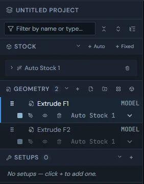

See also: [Setup and WCS](Setup-Stock-and-Workholding#setup-wcs), [Moving modeled bodies](Model#model-placement), [Editing an import as a model](Importing-files#edit-import-as-model).

## The Model workspace

The Model tab builds and edits solid parts: feature tree, bodies, parameters and inspect tools on the left, the 3D view in the middle, and the modeling tools on the right.

The left panel starts with the model's name, a switch-model arrow, + (New model) and Finish (back to Setup). Below that are four sections you can fold: Model (the feature tree with its filter bar), Bodies (one row per solid with a show checkbox, a colour swatch and its volume), Parameters (named values), and Inspect (Measure, Appearance, hide and isolate, Section, and mass properties).

The right rail holds the modeling tools in five groups: Sketch (New sketch), Create (Extrude, Revolve, Sweep, Loft, Form, Relief, Boolean), Construct (Offset plane, Midplane, At angle, Axis, Plane through, Tangent plane, Point), Modify (Push/Pull, Fillet, Chamfer, Shell, Draft, Hole, Resize hole, Move Hole, Defeature, Edit...) and Document (Undo, Redo, Import, Export, STL, Debug export). Click a group's name to fold it, and the button at the top of the rail switches to compact icons (hover a tool for its name); both are remembered. While a sketch is open the rail shows the sketch tools instead, and in Form it shows the Form tools.

### Docked palettes

Form and Relief open a palette docked beside the rail: a column of the screen, so the view narrows for it instead of being covered. Its groups fold by their names, and when the rows are taller than the window the palette scrolls, with a scrollbar you can see. The chevron in the palette's header folds the whole palette to a slim strip at the side, giving the view its whole width back; click the strip to bring it back. The Cancel and Finish (or Apply) buttons stay at the bottom while the rows scroll.

### Construct: planes, axes and points

The Construct group makes reference geometry for sketches and features: Offset plane, Midplane and At angle make planes from a plane or flat face; Plane through makes one through three points or two edges, and Tangent plane touches a cylinder where you click; Axis runs through a cylinder or hole, along an edge or through two points; Point marks a vertex, a circle's centre, or where an edge meets a plane. Each gets its own row in the tree and follows the model when it changes. "Sketching on a plane or face" has the details of each.

### What the tree shows

The Model section lists the part's history in order: Origin and the XY, XZ and YZ planes at the top, then a row for every sketch (pen icon), every construction plane, axis and point, every imported STEP or STL part, and every feature - Extrude, Revolve, Sweep, Loft, Form, Relief, Boolean, Push/Pull, Fillet, Chamfer, Shell, Draft, Hole, Resize hole, Move Hole and Defeature - each under the name you gave it. A Form row holds everything done inside Form; Edit on it reopens the cage. Every row has its status mark, a suppress button and a right-click menu, and sketch rows an eye to show or hide them ("The feature tree"); the bodies the features make are shown, hidden and isolated from the Bodies list below.

The view cube sits in the bottom-left corner of the 3D view: click a face (TOP, FRONT, RIGHT and so on) to look from that side. The small cube button beside it opens Display mode: Shaded with edges, Shaded, no edges, Unshaded (wireframe) or Translucent, Perspective or Orthographic, and the Zebra stripes and Curvature checks for judging smooth surfaces. Press N, then click a face or plane, to look straight at it.

Along the bottom, the message line shows what the tool in use wants or what it just did, and the status bar counts the bodies and features. At 1440- and 1680-pixel window widths, the left panel scrolls within its split panes: scroll down to reach the Inspect and Section controls below the fold.

> **Tip:** When a tool waits for a click in the view, a bar at the bottom of the view says what to click and has a Cancel button. The other tools grey out until you finish or cancel.

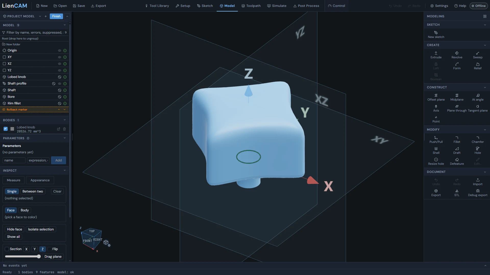

See also: [Model-to-CAM flow](Model#model-to-cam), [The feature tree](Model#feature-tree-history), [Sketching on a plane or face](Model#model-sketch-plane-face), [Form (smooth organic shapes in the Model tab)](Form#form-workspace), [Relief (a picture raised or cut into a face)](Relief#model-relief).

## Sketching on a plane or face

New sketch waits for one click in the view: a base plane (XY, XZ, YZ), a visible offset plane, or any flat face of a body - and the sketch opens there.

1. Click New sketch in the Sketch group of the rail. The bar at the bottom of the view reads "Click a base plane, visible construction plane, or flat face to start the sketch".
2. Click the XY, XZ or YZ plane, an offset plane you made, or a flat face on a body. The sketch opens on it.
3. Draw, then press Finish at the top of the sketch tools (or Cancel to throw the sketch away). The sketch is added to the feature tree, and Extrude, Revolve and Sweep turn on once a sketch exists.

A sketch on a face starts empty - nothing from the face is copied into it. If a later change removes that face, the sketch's plane row shows Degraded; select that row and a Reattach button appears in the Sketch group, so you can pick a new flat face for it without losing the sketch.

> **Warning:** A curved face cannot hold a sketch. Clicking one says "That face is not flat - pick a flat face or a base plane." and the pick stays on so you can try again.

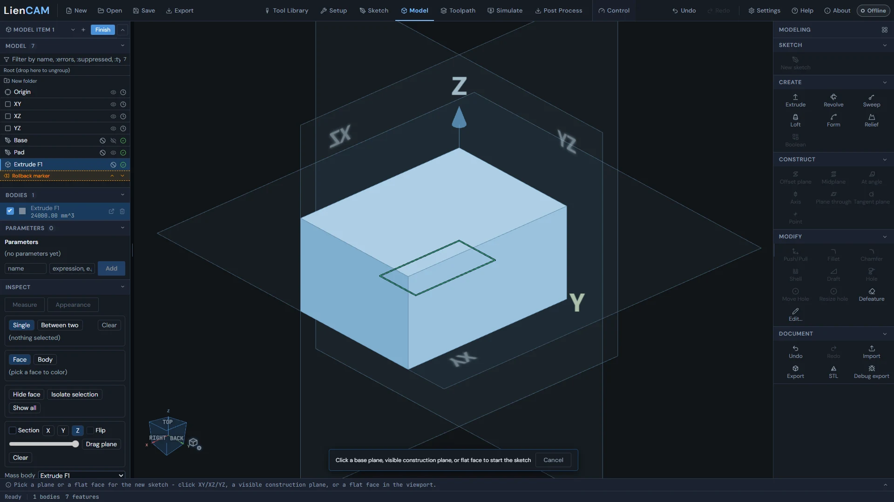

### Offset planes

Offset plane (Construct group) makes a flat construction plane parallel to another one. Choose the Source plane (XY, XZ or YZ plane) or click a flat face or plane in the view, give it a Name and a Signed distance (mm), tick Flip plane orientation if you need the other side, then Apply. The plane gets its own row in the feature tree. New sketch can start on it, and Extrude can stop at it with Up to face / plane.

Midplane makes the plane halfway between two planes or flat faces: pick the First plane, then the Second plane (or click two in the view, one after the other). Two parallel faces give the plane halfway across; two that meet give the plane through their shared line that halves the angle between them.

At angle (Plane at angle) turns a plane or flat face about its own X or Y axis, or about an axis you made with Axis, by the Angle (deg) you type (choose it under Turn about). A positive angle turns right-handed about that axis. About an axis, the new plane holds the axis and at 0 deg faces the way the source plane does. Both new planes get their own tree rows and work everywhere an offset plane does.

Axis (Construct group) makes a straight axis line. Choose the Type, then click in the view: Through a cylinder or hole - click the round face (a flat face gives the axis square to it, through its centre); Along an edge - click a straight edge (a round edge gives its centre axis); Through two points - click two corners, first then second. Name it, tick Flip direction to run it the other way, then Apply. The axis gets its own tree row and follows the faces it came from when the model changes. Revolve can spin about it and At angle can turn a plane about it.

Plane through (Construct group) makes a plane from picks. Choose the Type, then click in the view: Through three points - click three corners (X runs from the first to the second); Through two edges - click two edges (a round edge counts as its centre line; edges that do not meet give the plane through the first, parallel to the second). Tangent plane touches a cylinder or shaft where you click it, facing out (a flat face gives its own plane). Name it, tick Flip normal to face it the other way, then Apply. These planes follow the faces they came from when the model changes and work everywhere an offset plane does - New sketch, Extrude, Offset plane.

Point (Construct group) marks a point in space: At a vertex - click a corner; At a circle's centre - click a round edge (a round face gives its axis at its middle, a flat face its centre); Where an edge meets a plane - click an edge, then choose the plane in the list (XY, XZ, YZ or any construction plane) or click a flat face. The point gets its own tree row and follows the model when it changes.

See also: [Extrude](Model#extrude), [Starting a sketch](Sketch#sketch-entry), [The Model workspace](Model#model-workspace-tour).

## Extrude

Extrude pulls a closed sketch profile into a solid: pick the profile, choose how far it goes (End), and whether the result is a new body or adds to, cuts or intersects a body you already have.

1. Select the sketch in the feature tree, then click Extrude in the Create group (it turns on once a sketch exists). The panel opens beside the view with that whole sketch as the profile, and the view shows a live preview.
2. To use only some closed areas of the sketch, press "Pick profile in viewport" and click the areas - each click adds or removes one. Press Enter or Done picking to keep them; Escape cancels. "Use whole sketch" goes back to every area.
3. Choose End: Blind (a Distance in mm), Symmetric (the Distance split both sides of the sketch), Up to next (the next face it meets), Up to face / plane, Up to part / body, Up to vertex / point, or Through all. The three "Up to" choices add a pick button - click the face, plane, body or point in the view or the tree. Up to next and the "Up to" choices also take an Offset in mm.
4. Set Direction (Up or Down), then Result: New body, Add, Remove or Intersect. For anything but New body, press "Pick body in viewport" and click the body to change. Press Apply.

> **Tip:** The fx field under Distance takes a driving expression such as 2\*base+5 using names from the Parameters table. While an expression is in the field the Distance box is greyed out, and changing the parameter later rebuilds the extrude.

Each picker also has a fallback list: "Choose profile by name fallback" (the sketch and its areas by number) and "Choose target by name fallback" (the body).

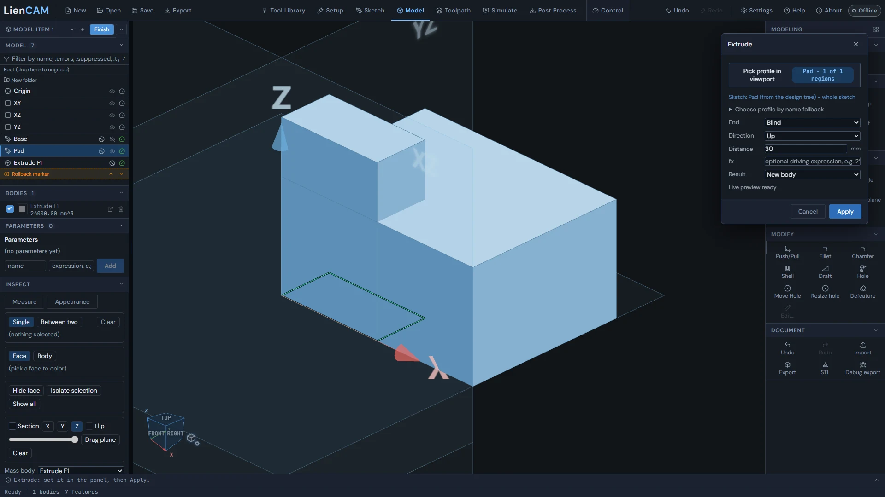

See also: [Sketching on a plane or face](Model#model-sketch-plane-face), [Revolve, sweep, loft](Model#revolve-sweep-loft), [Named parameters](Model#model-parameters).

## Revolve, sweep, loft

Three more ways to turn sketches into solids: spin a profile around an axis, run it along a straight path, or blend two sketches into one shape.

Revolve spins one closed sketch profile around an axis: World Z (through origin) by default, or any axis made with Construct \> Axis, chosen in the panel's Axis list. Pick the profile the same way as Extrude, then set the Angle from 1 to 360 deg. The Angle has an fx field for a driving expression too. A revolve about an axis follows the axis when the model changes.

Sweep runs a closed profile along a straight path set by three fields: Path axis (World X, World Y or World Z), Length in mm, and Orientation (Fixed or Frenet).

Loft blends exactly two sketches. The button turns on once two sketches exist. Press "Pick sections in viewport" and click the first section, then the second - the order matters (the panel shows First and Second). Spacing moves the second section along world Z, and the Ruled box switches between straight and smooth blending. Picking the same sketch twice shows "Sections must be different sketches."

> **Tip:** The panel stays open while you pick in the view, so your typed values stay in sight; its Cancel button reads Stop picking until you finish.

See also: [Extrude](Model#extrude), [Sketching on a plane or face](Model#model-sketch-plane-face).

## 3D fillet and chamfer

Fillet and Chamfer each open one slim bar at the bottom of the view: click edges and type the size, with a live preview - and Fillet can also change the radius of a fillet already on an imported part.

1. Click Fillet in the Modify group. A slim bar appears at the bottom of the view with the edge count, the Radius field, and Apply and Cancel, with nothing covering the part.
2. Click edges in the view to add or remove them. The preview updates as the edges and the radius change.
3. Type a radius at any time - the digits go straight into the Radius field. Press Enter or Apply when the preview looks right; Escape or Cancel puts the part back as it was.
4. Chamfer works the same way in its own bar: click edges, type the Distance, watch the preview, then Enter or Apply.

Apply stays greyed out until the preview is ready, so you always see the shape before you commit it. A size that does not fit shows why in the bar and the part stays as it was. One fillet or chamfer works on one body: once the first edge is picked, clicks on other bodies are ignored.

On an imported STEP part, turn on Fillet and click a fillet that is already on the part: the bar opens with its current radius. Type the new radius and Apply - the recognized fillet or its tangent chain changes. On an STL opened in the Model tab, Fillet changes the radius of a rounded edge the same way, and Chamfer puts a chamfer on the sharp edges you click.

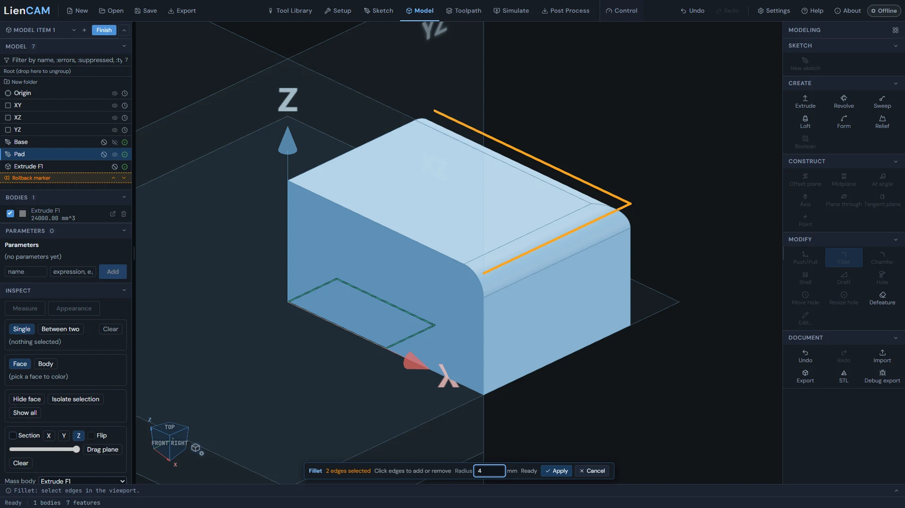

On imported STEP and STL parts, a tangent-connected fillet or chamfer chain is one feature. With Fillet or Chamfer active, click an existing blend to change its radius or distance for the whole chain. Defeature removes the recognized chain as a whole; removing a boss takes its foot fillet with it. A size that cannot be built leaves the part unchanged and gives the reason.

Chamfer picks real sharp edges. The seam used to draw a cylinder is not a sharp edge and is not offered for Chamfer.

See also: [Shell, draft, hole](Model#shell-draft-hole), [The feature tree](Model#feature-tree-history), [Editing imported STEP and STL parts](Model#model-imported-parts).

## Shell, draft, hole

Shell hollows a body and opens the faces you pick, Draft tilts faces about a neutral face, and Hole places simple, counterbore or countersink holes - one at a time or in a pattern.

Shell: click Shell and a slim bar appears at the bottom of the view. Click the faces to open (click again to keep one closed) and type the Thickness; the hollowed body previews as either changes. Enter or Apply commits; Escape or Cancel puts the part back. While the shell is being applied the bar reads Applying... and Cancel is greyed out.

Draft works in two steps on a small card (Draft faces). Step 1: click the neutral face - the face that keeps its size - and press "Confirm neutral face" ("Reselect neutral face" goes back). Step 2: click each face to draft. Set the Angle (0.1 to 89.9 deg), use Flip to reverse the pull direction, and an Offset in mm moves the neutral plane. A line under the fields spells out the pull direction and the neutral-plane offset. Apply turns on when the card reads "Preview ready".

Hole: click Hole, then click a face - the panel opens with the Seed point (X, Y, Z) where you clicked. If the face has sketch points, they light up and a Snap to list appears ("Pick a highlighted sketch point in the viewport, or use Snap to below"). Choose the Style (Simple, Counterbore with CB diameter and CB depth, or Countersink with CS diameter and CS angle), the Diameter, and the Depth (Blind with a Depth in mm, or Through all). Under Placement, Pattern repeats the hole: Linear adds Count and Spacing, Circular adds Count, Bolt radius and Start angle.

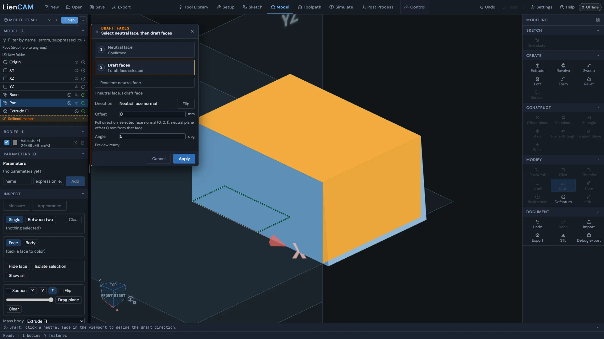

Draft beside existing fillets keeps their radii when the edit can be built. Shell can work on filleted parts too; opening a pocketed part can leave separate pieces rather than one connected body.

After Shell succeeds, the Console reports any information about the resulting pieces once, including when you edit an existing Shell.

On a curved STEP face, Hole uses the surface normal at the point you click as its drilling direction. The seed point still comes from that click.

See also: [3D fillet and chamfer](Model#fillet-chamfer-3d), [Defeature, resize hole and hole depth](Model#defeature-resize-hole), [Editing imported STEP and STL parts](Model#model-imported-parts).

## Push/pull direct editing

Push/Pull moves a flat face along its normal, or offsets a cylindrical or conical hole face on a STEP body, with a drag arrow or a typed distance. The result is a feature row you can edit later.

1. Click Push/Pull in the Modify group, then click a flat face, or a cylindrical or conical hole face on a STEP body.
2. Drag the arrow, or type a distance in the small card next to the face (+ pulls, - pushes). Letting go of the drag does not commit - you can keep adjusting.
3. Press Enter to preview a typed value, then Enter again or Apply to commit. Esc or Cancel stops.

The commit adds a Push/Pull row to the feature tree like any other feature, so it rebuilds with the model. To change it later, select the row and press Edit... - the arrow and the distance card come back on the same face with the distance you used.

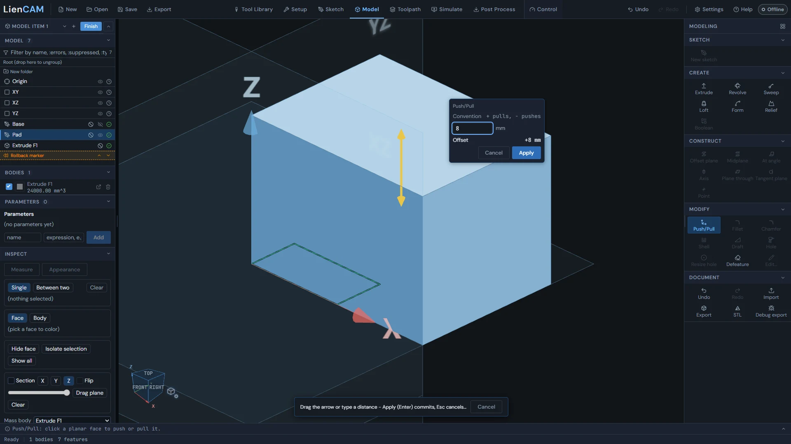

Push/Pull and pocket-depth edits can carry neighboring fillet and chamfer chains with the face, keeping their size, including supported drafted walls and cone feet. On STL parts, a flat face meeting fillets can move with those fillets, and a counterbore floor can be picked for Push/Pull. An edit that cannot be built reports why and leaves the body unchanged.

On a STEP hole, a cylindrical face changes radius by the typed offset; a cone moves parallel to itself and keeps its angle. A positive offset enlarges the hole. On an STL, a flat face beside a curved rim can move while staying joined to that rim.

On an STL, Edit on the Push/Pull tree row brings back its stored distance. Apply replaces that edit; Undo and Redo step through the replacement, including when you press Undo quickly after Apply.

See also: [Defeature, resize hole and hole depth](Model#defeature-resize-hole), [The feature tree](Model#feature-tree-history), [Editing imported STEP and STL parts](Model#model-imported-parts).

## Defeature, resize hole and hole depth

Defeature deletes recognized features - holes, pockets, bosses, fillets, chamfers, engravings - and heals the body; Resize hole changes a recognized hole's diameter, or its depth, right in the view.

Defeature (Modify group) opens a small Delete faces card. Click faces in the view: a recognized hole, pocket, boss, fillet, chamfer or engraving is picked as one whole group, and faces to be deleted turn orange. The card counts what is picked, and "Recognized face groups" lists every group by kind and size (for example "Through hole - diameter 6 mm"); tick a group there or hover a row to light its faces. A healed preview builds as you pick ("Healed preview ready for 1 feature(s)."), and "Apply removal" deletes the groups as one feature row.

1. Resize hole: click Resize hole in the Modify group. It finds the through, blind and counterbore holes on every body.
2. Click a hole in the view, or press List to pick it from "Recognized holes". A small card appears at the hole with its Current diameter.
3. Type the New diameter and press Enter or Apply - or click a different hole to move the card there.

Hole depth: while Resize hole is waiting for a hole, press Depth on its bar (Diameter switches back). The card then shows the Current depth ("(through)" for a through hole); type a New depth, or press Through, then Apply. The hole's floor moves and its diameter stays.

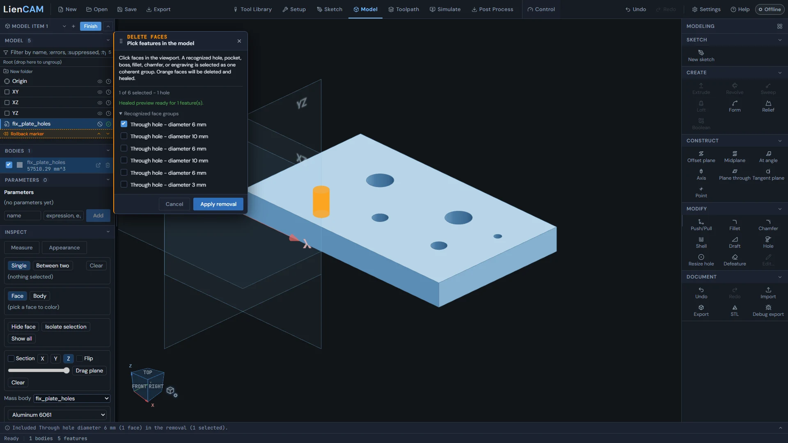

Move Hole in the Modify group relocates a recognized hole on STEP or STL. Click the hole and type an XYZ delta in mm on the same face, then Apply. Every counterbore or countersink step moves together with its diameters and depths preserved. An overlap or wall breakthrough reports why the move cannot be built. Edit on the Move Hole tree row reopens it; Undo restores the old position.

On an STL, Defeature can remove a recognized round boss with its foot fillet, or a dome, leaving the plate face. Stepped-hole recognition includes connected cylindrical and conical bands, so moving a hole carries the whole stack.

A resized stepped hole keeps its remaining steps selectable for later edits and CAM face picks.

To change an imported-hole resize again, select its Resize hole row in the feature tree and choose Edit. The card reopens at the diameter you last applied; enter the next diameter and Apply to replace that edit. If an upstream change removed the hole, the console says why it cannot reopen.

See also: [Push/pull direct editing](Model#push-pull), [Shell, draft, hole](Model#shell-draft-hole), [Editing imported STEP and STL parts](Model#model-imported-parts).

## Model booleans

Boolean combine joins two bodies with Union, Subtract or Intersect - click the body to keep, then the body to combine, right in the view.

1. Click Boolean in the Create group (it turns on once two bodies exist). The Boolean combine panel opens ready for clicks in the view.
2. Click the target - the bar reads "TARGET: click the body to keep" - then the tool ("TOOL: click the body to combine"). The panel shows "Target: ... \| Tool: ...".
3. Choose the Op: Union, Subtract or Intersect (Subtract is the default), then Apply.

The result replaces both bodies, and the boolean is a row in the feature tree you can edit. "Restart viewport pick" starts the clicks over, and "Choose from lists" gives Target and Tool lists instead. Choosing the same body twice shows "Target and tool must be different bodies."

If Subtract would remove the whole target, it says that nothing would remain and leaves the model unchanged.

Import in the Document group can add an STL as another body. Boolean can use an STL and a STEP body, or two STLs, with either body as target or tool. Select the bodies in the view or from the lists; a mesh target also offers a Box or Cylinder tool sized in the panel. An STL used by a Boolean is hidden while that feature is active; Undo or rollback before it shows the STL again. An STL added through Model Import becomes a faceted solid that can later be exported as STEP.

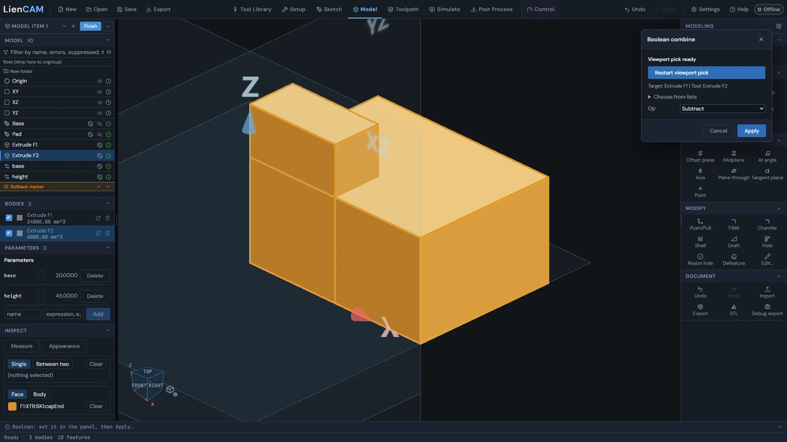

See also: [Boolean an imported mesh with a model body](Importing-files#boolean-mesh-model), [The feature tree](Model#feature-tree-history), [Editing imported STEP and STL parts](Model#model-imported-parts).

## The feature tree

The Model section of the left panel is the part's history: every sketch, feature, plane and parameter is a row with a status mark, a right-click menu, and an Edit that reopens the tool it was made with.

Origin and the XY, XZ and YZ planes stay at the top; below them the rows rebuild in order. Changing a feature rebuilds only what depends on it. Each row shows its status: OK, Pending regeneration, Regenerating..., Failed, Degraded (something it uses failed or is gone), Suppressed, or Rolled back. The filter bar narrows the tree by name, or with :errors, :suppressed, or :type followed by a kind.

1. Right-click a row and choose Edit... (or select it and press Edit... on the rail). The feature reopens in the same tool with its values loaded; Push/Pull and Resize hole bring back their card in the view.
2. Delete... warns when other features use the row and names everything that goes with it. Suppress (the circle-slash button on the row, or the menu) skips a feature without deleting it. Sketch rows have an eye button to show or hide them.
3. Drag rows to reorder; a move that cannot work is refused with the reason (for example, a feature cannot move above something it uses). Drag the Rollback marker, or use its up and down arrows, to rebuild the model only up to that point.
4. New folder groups rows; drag rows into a folder or use Move to folder in the right-click menu, and drop them on "Root (drop here to ungroup)" to take them out.

> **Tip:** Ctrl+Z undoes and Ctrl+Y (or Ctrl+Shift+Z) redoes in the Model tab - the Undo and Redo buttons in the Document group do the same.

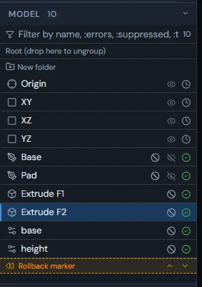

See also: [The Model workspace](Model#model-workspace-tour), [Push/pull direct editing](Model#push-pull), [Model-to-CAM flow](Model#model-to-cam).

## Named parameters

The Parameters table holds named values with expressions, and features driven by a name rebuild when the value changes.

The Parameters section of the left panel lists each parameter with its name, its expression (changes take effect on Enter or when you click away), the value it works out to, and a Delete button. The bottom row adds one: type a name and an expression such as 2\*base+5 or 10mm and press Add. Each parameter is also a row in the feature tree. Deleting a parameter a feature still uses is refused and names that feature.

To drive a feature with a parameter, type an expression in the fx field of the Extrude panel (Distance) or the Revolve panel (Angle). While an expression is in the field the number box is greyed out, and changing the parameter rebuilds every feature that uses it. Sketch dimensions take the same arithmetic and unit suffixes in their equation field, but not parameter names.

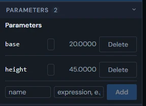

See also: [Extrude](Model#extrude), [Smart dimensions](Sketch#sketch-dimensions).

## Appearance, visibility, isolate, section

Colour bodies or single faces from the Inspect section, hide bodies from the Bodies list, isolate what you picked, and cut the view with a section plane.

Appearance in the Inspect section colours things: choose Face or Body, click the face or body in the view, then click the colour swatch to pick a colour. Clear removes it. Each row in the Bodies list also has its own colour swatch for the whole body.

1. Hide or show a whole body with the checkbox on its Bodies row (Undo takes it back). Sketch rows in the feature tree have their own eye button.
2. With faces picked in Measure or Appearance, press "Hide face" (or "Hide faces") to hide just those faces.
3. Press "Isolate selection" to show only what is picked; "Exit isolate" or "Show all" brings everything back.

Section cuts the view with a plane: tick Section, choose X, Y or Z, and move the slider to move the cut. Flip shows the other side, "Drag plane" lets you drag the cut in the view, and Clear resets it.

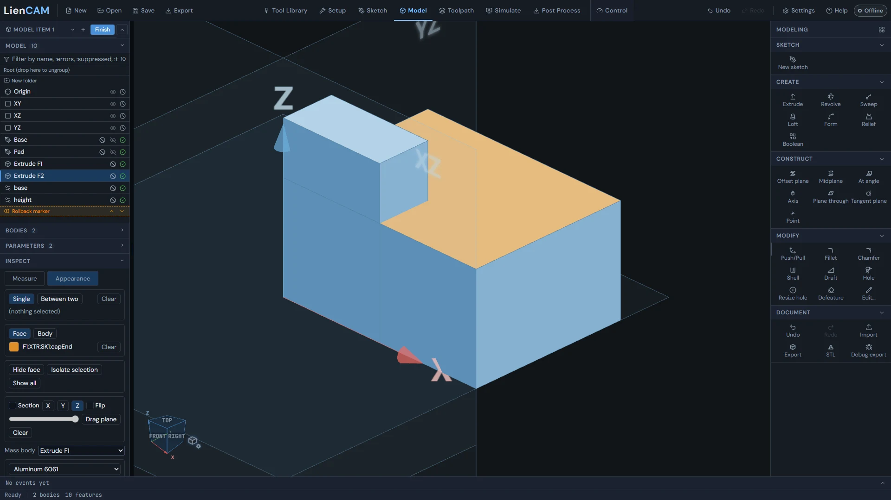

See also: [Measure and mass properties](Model#measure-mass), [Exporting STEP and STL](Model#model-stl-export).

## Measure and mass properties

The Inspect section measures faces, edges, vertices and bodies - one pick, or the distance and angle between two - and gives a body's mass for a chosen material.

1. Click Measure in the Inspect section and choose what to pick with the Face, Edge, Vertex and Body buttons.
2. Single reads one pick: a body gives Volume, a face gives Area (plus Radius and Diameter on a round face), an edge gives Length, a vertex gives its position.
3. Between two reads a pair: the Distance between any two picks, and the Angle between two flat faces or two straight edges. Clear starts over.

Numbers come from the exact part where possible; a number worked out from the displayed mesh is marked (approx). Below the section tools, choose a body in Mass body and a material (Aluminum 6061, Steel 1018 (mild), Stainless Steel 304, Brass (C360), Copper (C110), Titanium (Grade 5), ABS, PLA, Nylon (PA6), or Custom... with your own density in g/cm^3) to read its Mass in grams, Volume in mm^3, and centre of mass (CoM).

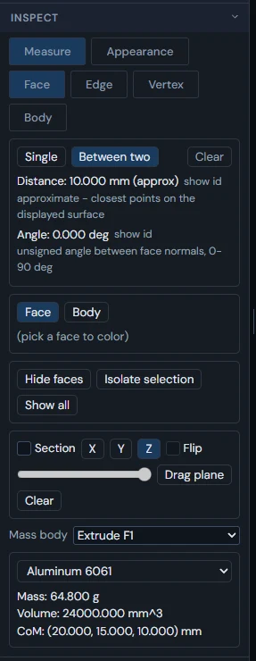

See also: [Appearance, visibility, isolate, section](Model#appearance-visibility), [The Model workspace](Model#model-workspace-tour).

## Exporting STEP and STL

The Document group of the rail saves the shown bodies as a STEP or STL file in one click - no dialog.

1. Click Export (STEP) or STL in the Document group of the rail. Both turn on once a body exists.
2. The file is named after the project (for example My part.step or My part.stl; an unnamed project gives Untitled project.step). In a browser it downloads; in the desktop app you choose where to save it. STL is made fresh from the exact part.
3. If the export cannot be made, the reason shows in red on the status bar at the bottom.

Every body that is not hidden is exported - the Bodies checkbox and the tree decide. Isolate and hidden faces do not change what is exported. With every body hidden there is nothing to export, and the status bar says so.

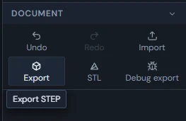

See also: [Appearance, visibility, isolate, section](Model#appearance-visibility), [Importing STEP and IGES solids](Importing-files#import-step), [Model-to-CAM flow](Model#model-to-cam).

## Editing imported STEP and STL parts

An imported STEP or STL part opens in the Model tab as a body you can edit directly - push faces, change fillets and holes, remove features, add holes and chamfers - without redrawing it.

Import in the Model rail accepts STEP and STL files. A closed STL imported here becomes a faceted solid for further modeling and STEP export; curved surfaces keep their facets. This lets you combine imported bodies in one model.

A STEP part gets here two ways: Import in the Document group brings a STEP file into the model as a body named after the file, or the pen button (Edit as model) on an imported STEP row in Setup opens it in the Model tab. It is then a body like any other: Push/Pull, Fillet, Chamfer, Shell, Draft, Hole, Resize hole (diameter or depth) and Defeature all work on it, and Fillet also changes the radius of a fillet already on the part.

An STL opened with the pen button (Edit as model) on its row in Setup can remain a mesh body and stay an STL; the message line says how many features it recognised ("Click a feature to select it whole"). A click picks a whole feature - a hole, a rounded edge, a flat face - never a single triangle.

| Tool | On an STL |
| --- | --- |
| Push/Pull | Moves a flat face - the same card as on any body. |
| Fillet | Changes the radius of a rounded edge. |
| Chamfer | Adds a chamfer on the sharp edges you click. |
| Shell | Hollows the part and opens the flat faces you click. |
| Draft | Tilts the flat faces you click about a neutral face. |
| Hole | Drills a hole square to the face you click, with the usual Hole panel. |
| Resize hole | Changes a recognized hole's diameter, or its depth with Depth. |
| Defeature | Removes recognized features and heals the part. |
| Boolean | Combines with another STL or STEP body in either direction, or with a Box or Cylinder sized in the panel. |

Move Hole relocates a complete recognized hole stack on STEP or STL. From body in Form also accepts the open STL; the source mesh is hidden while its Form feature is active. Relief is not available on a mesh body yet; hover its disabled button to read why.

Each Apply is one step for Undo. Finish (top of the left panel) goes back to Setup with the edited part.

Import in the Model rail brings every solid of a multi-solid STEP into the model as its own body and reports the body count in the console. Cancel while the import is counting solids drops the import.

See also: [Editing an import as a model](Importing-files#edit-import-as-model), [Defeature, resize hole and hole depth](Model#defeature-resize-hole), [3D fillet and chamfer](Model#fillet-chamfer-3d), [Model booleans](Model#booleans-3d).

## Moving modeled bodies

A model is placed in Setup with the Position and Rotation fields in the Properties panel - or the move gizmo in the view - and stock and operations follow the moment it moves.

Select a MODEL row in Setup's Geometry list and the Properties panel shows the model with a Position (mm) group (X, Y, Z) and a Rotation (deg) group. Typing here and dragging the move gizmo in the view are the same edit, and every body of the same model moves together. One finished move is one undo step.

When a body moves, auto stock around it resizes at once. Operations that cut the body turn Outdated with the note "The modeled part this operation cuts changed - recompute before posting."; their last toolpath stays on screen until you compute again.

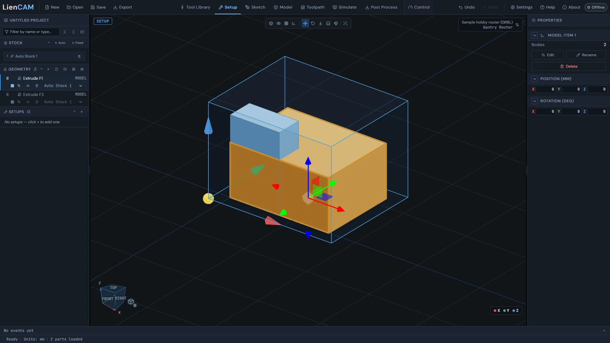

See also: [Model-to-CAM flow](Model#model-to-cam), [Auto and fixed stocks](Setup-Stock-and-Workholding#stocks-auto-fixed), [Setup and WCS](Setup-Stock-and-Workholding#setup-wcs).
