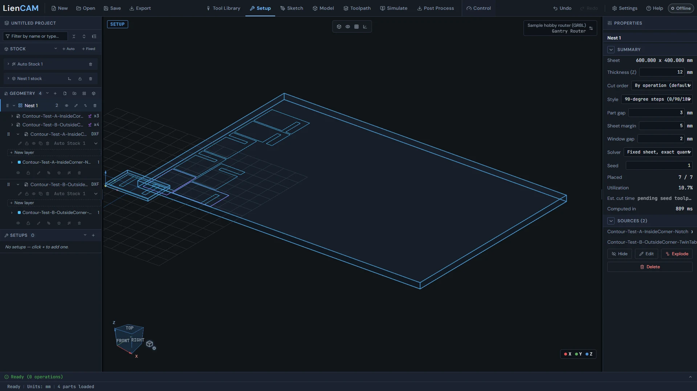
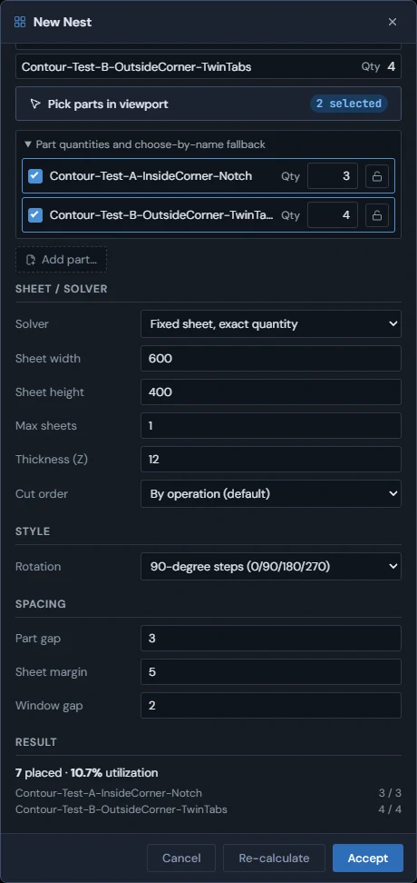
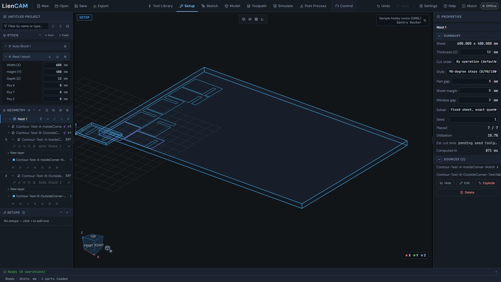
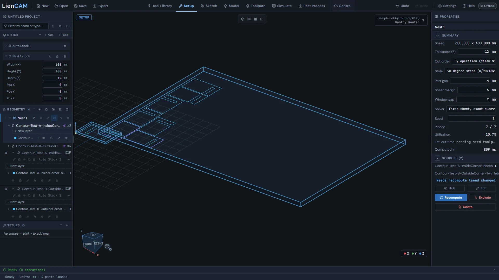

<!-- Generated from the in-app Help by tools/release/help-to-wiki.mjs. Do not edit by hand. -->

# Nesting

- [Nesting basics](#nesting-overview)
- [Creating a nest](#nest-create)
- [The nest sheet as stock](#nest-sheet-stock)
- [Editing a nest](#nest-edit-explode)
- [Nested toolpaths and cut order](#nest-toolpaths)

## Nesting basics

A nest packs copies of your 2D parts onto a sheet and lives in the design tree as a single node that owns its own seed copies of each part.

A nest appears in the Geometry section of the design tree as a folder-like row with a grid icon. Expand it to see one child row per source part - the nest's seeds - each with its copy count (for example x8). Clicking the nest row selects it and the Properties panel shows its Summary: Sheet size, Thickness (Z), the pack settings, Placed (placed versus requested), Utilization, and Est. cut time for all copies, then a Sources list and the Hide, Edit, Explode and Delete buttons.

When a nest is created it makes a deep copy of each picked part and keeps that copy as its seed - marked with a violet sprout badge on the seed row. The seed is fully independent of the original workspace part: you can move, edit, or delete the original and the nest is unaffected. Everything about the nest - its layout, its edits, and its toolpaths - works from the seeds, and the placed copies in the viewport are all instances of them.

> **Tip:** The viewport draws a violet outline box around each seed's slot so you can tell the seed apart from its placed copies. Turn it on or off with the "Nest seed outline" checkbox in the viewport's Display Mode flyout (on by default).

See also: [Creating a nest](Nesting#nest-create), [Nested toolpaths and cut order](Nesting#nest-toolpaths), [Importing DXF and SVG](Importing-files#import-dxf-svg).

## Creating a nest

The New Nest dialog picks parts and quantities, sets the sheet, solver, rotation, and spacing, then packs with Calculate and keeps the result with Accept - onto more sheets when one is not enough.

1. Press the "New nest" grid button on the Geometry section header of the design tree.
2. Pick parts in the viewport - the picker starts by itself; click parts to add or remove them (selected parts glow blue), then press Done. The "Part quantities and choose-by-name fallback" list sets each part's Qty and an orientation lock (a locked part is never rotated by the solver), and lets you tick parts by name. "Add part..." imports a file straight into the nest.
3. Choose a Solver: "Fixed sheet, exact quantity", "Fill sheet (max quantity, by ratio)" (quantities become a ratio and the sheet is filled with as many as fit), "Exact quantity (auto-size sheet)", or an exact quantity with one side of the sheet locked ("lock width (solve height)" or "lock height (solve width)"). Set the Sheet width and Sheet height, Thickness (Z), and the Cut order.
4. Under Style, set the Rotation - "90-degree steps (0/90/180/270)" or "Arbitrary angle" with a number of Orientation samples - and under Spacing the Part gap between neighboring parts, the Sheet margin from the sheet edge, and the Window gap for parts packed inside another part's cutout.
5. Press Calculate. The Result section shows "Packing..." with a running timer, then how many parts placed, any left over, and the sheet utilization, with a count for each part. Adjust and Re-calculate as often as you like; press Accept to keep the nest, or Cancel to discard it.

### More than one sheet

With "Fixed sheet, exact quantity", a Max sheets field sets how many sheets the nest may use (1 by default). Above 1, tick "Auto (fill as many sheets as needed, up to the max)" or type a sheet count. The parts that do not fit one sheet go onto the next: each extra sheet becomes its own nest, named for example "Nest 1 (sheet 2)", with its own sheet stock, so each sheet is set up and posted as its own program. The Result lists every sheet with its size and placed count, and names any part that fits on no sheet ("Does not fit on any sheet").

> **Warning:** In an exact-quantity mode, a pack that cannot fit every part shows "Couldn't fit all parts - N didn't fit. Increase the sheet size or reduce the quantity." You can still Accept the partial layout, or change the sheet or quantities and Re-calculate.

> **Tip:** The settings you Calculate with are remembered and prefill the next New Nest. Part picks are not remembered - they depend on the current project. A whole New Nest session, however many times you Re-calculate, is one step for Undo.

See also: [Nesting basics](Nesting#nesting-overview), [The nest sheet as stock](Nesting#nest-sheet-stock), [Importing DXF and SVG](Importing-files#import-dxf-svg).

## The nest sheet as stock

Accepting a nest creates a fixed stock sized to the sheet, with the nest's Thickness (Z) as its depth - and moving that stock moves the whole nest.

Every 2D part needs a cut depth, so the nest dialog always shows a Thickness (Z) field (seeded from the default in Settings). When a nest is packed, the app creates a fixed stock named after the nest (for example "Nest 1 stock"), sized to the sheet plus the default padding, with its depth set to the thickness. It appears in the Stock section of the design tree like any other fixed stock.

Thickness is a material property stored once: the dialog's Thickness (Z), the nest Properties panel's Thickness (Z) field, and the bound stock's depth in the tree all edit the same value. Re-packing the nest regenerates the sheet's width and height but never touches the depth. Moving the bound stock - with its gizmo or its position fields - carries the whole nest along: sheet, seed, and every placed copy.

Deleting the nest also removes its bound stock (one Undo restores both). Exploding the nest keeps the stock and assigns the newly independent parts to it.

> **Tip:** When you create a Setup to machine the nest, choose the nest's bound stock so stock top and Z zero come from the real sheet. If only one stock can apply the Setup dialog picks it for you; when more than one can, it asks you to choose.

See also: [Creating a nest](Nesting#nest-create), [Auto and fixed stocks](Setup-Stock-and-Workholding#stocks-auto-fixed), [Setup and WCS](Setup-Stock-and-Workholding#setup-wcs).

## Editing a nest

Edit reopens the nest dialog prefilled, seed layers are editable in place with a Recompute step, and Explode bakes every copy into independent parts.

1. Edit the pack: press the pencil on the nest's tree row (or the Edit button in its Properties panel). The nest dialog reopens prefilled with the nest's parts, quantities, and every setting. Accept replaces the nest with the new pack - one step for Undo; Cancel keeps the original untouched.
2. Edit a seed part: expand the nest node, then expand a seed row to its layer rows. Each layer has the same visibility eye, lock, edit-sketch pencil, and delete as a normal part, plus a New layer button - so a seed can be redrawn in the sketcher without leaving the nest.
3. After a seed edit, or a change to the style, spacing, solver or seed in the Properties panel, the layout is out of date: the refresh icon on the tree row lights up and the Properties panel shows "Needs recompute (seed changed)" with a Recompute button. Nothing repacks by itself - press Recompute to re-pack from the current seeds and settings.
4. Explode (the ungroup icon on the tree row, or the Explode button in the Properties panel): every placed copy becomes an independent geometry and the nest itself is removed. It happens at once; Undo brings the nest back.

The Properties panel is a full editor too: with the nest selected you can change the Cut order, Style, Part gap, Sheet margin, Window gap, Solver, Seed, and Thickness (Z) directly, hide or show the whole nest, rename it (double-click the tree name), and drag nests to reorder them.

After Explode the seed, the layout, and the pack settings are gone. The bound sheet stock stays and the baked parts are assigned to it.

See also: [Nesting basics](Nesting#nesting-overview), [Creating a nest](Nesting#nest-create), [Starting a sketch](Sketch#sketch-entry).

## Nested toolpaths and cut order

Operations are computed once against the seed and expanded to every placed copy - in the toolpath view, the simulation, the cut-time estimate, and the posted G-code.

Create operations on the nest's seed part exactly as you would on any geometry. In the operation's source list a seed's entry ends in -- seed of "Nest 1", so it is never confused with the original part. Each operation stores one copy of its toolpath; the Toolpath view, the Simulation, the cut-time estimate, and the posted program all expand that single copy to every placement in the nest. Between copies the tool retracts and rapids across at the operations' clearance height - it never travels low over the sheet.

Cut order controls how the copies are machined, and is editable both in the nest dialog and in the nest's Properties panel. "By operation" runs each operation across all copies before the next operation (fewer tool changes). "By part" finishes every operation on one copy before moving to the next (frees parts as you go).

The Properties panel's "Est. cut time" covers the whole job: it times the full expanded stream and reads "(N copies, incl. inter-copy travel)". Post the setup from the Post Process dialog as usual; the file contains the fully expanded multi-copy program. A nest spread over several sheets is several nests, so each sheet is its own program.

If the nest's layout goes out of date after its toolpaths were generated, its operations are marked out of date too. Press Recompute on the nest, then regenerate them.

See also: [Creating an operation](Toolpaths-2.5D#creating-operations), [Cut-time estimates](Toolpaths-2.5D#cut-time), [Editing a nest](Nesting#nest-edit-explode), [Operation generation failures](Toolpaths-2.5D#generation-failures).
