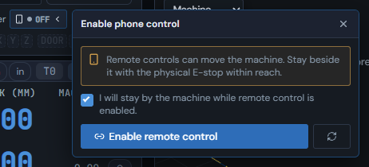
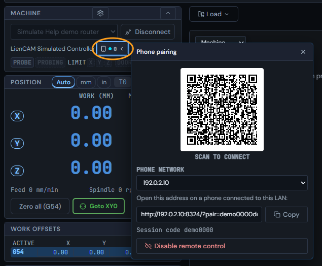
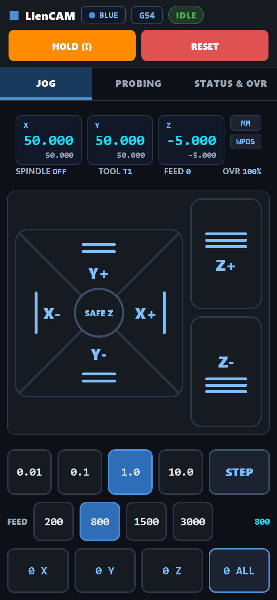
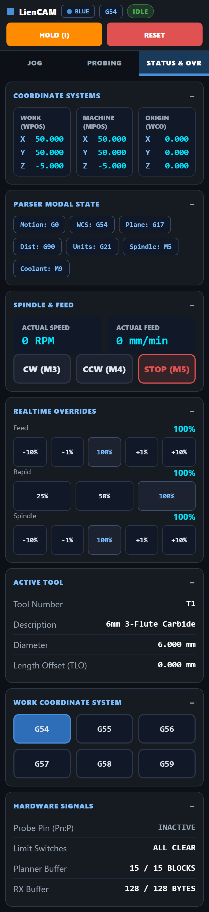
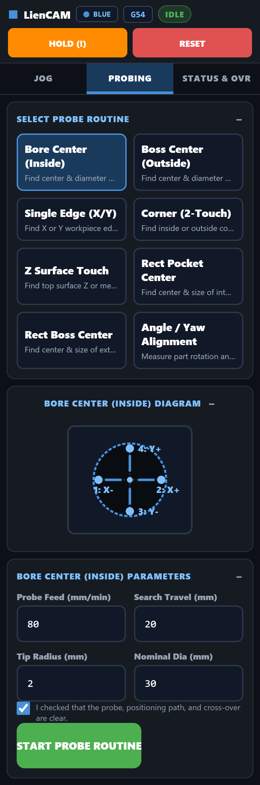
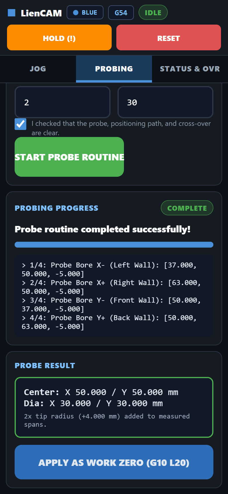

# Phone pendant

**Status: ALPHA - tested on one machine.** The phone pendant works, and it has been used on one real machine. Expect rough edges, and keep the physical E-stop within reach.

The phone pendant turns a phone into a hand-held jog and probing pad for your machine. The phone does not talk to the controller. Every button on the phone is sent to the LienCAM desktop, and the desktop carries the command out. So the pendant works with whatever controller the desktop is connected to, including the built-in simulator.

## What you need

- LienCAM running in the desktop app, connected to your machine or to the simulator.
- A phone on the same network (Wi-Fi) as the PC.

## Set it up

1. Connect the machine or the simulator on the Control page. The pendant stays off until something is connected.
2. On the Control page, open **Pendant** and choose **Enable remote control**.
3. On a real machine, read the note ("Remote controls can move the machine. Stay beside it with the physical E-stop within reach."), tick **I will stay by the machine while remote control is enabled.**, then enable. On the simulator there is no tick box.
4. Scan the QR code with the phone, or press **Copy** and open the address on the phone. The phone connects to this PC on port 8324; if the address does not open on the phone, allow LienCAM through the PC's firewall (Windows asks the first time) on the network the phone uses.
5. The panel shows a **Session code**. The phone must come in through the address that carries that code; pressing the circular-arrow button before enabling makes a new code.
6. To stop, choose **Disable remote control**. Closing the connection to the desktop also ends the phone session.

If your PC has more than one network (Wi-Fi and Ethernet, or a VPN), a **Phone network** list appears under the QR code. Pick the address your phone can reach, and the QR code and address change to match.

## What the phone can do

- **Jog.** Step jogging (0.01, 0.1, 1.0 and 10.0 mm) or press-and-hold continuous jogging, a feed choice, and a **SAFE Z** button. Letting go stops the move.
- **HOLD and RESET.** Always at the top of the screen.
- **Read the machine.** Work and machine position, the active work offset, spindle, tool and feed.
- **Zero.** Zero X, Y, Z or all three (only while the machine is idle).
- **Overrides.** Feed, rapid and spindle overrides.
- **Spindle.** Clockwise, counter-clockwise and stop.
- **Work offsets.** Choose G54 to G59.
- **Probing routines.** Bore, boss, single edge, corner, Z surface, rectangular pocket and boss, and angle. After a successful routine you can apply the result as the work zero.
- **Quick moves.** Raise Z, park and go to XY zero.

The phone pictures below were taken in the pendant's own demo mode (no machine connected). Connected to LienCAM the tabs, labels and controls are the same; the tool name and some override readouts come from the machine, and the theme switch is greyed out.

The desktop refuses a command when the machine is busy, alarmed or not ready, and the phone shows the reason.

## Known limits

- Tested on one machine. Other controllers work through the desktop but have not been tried with the phone.
- The phone and the PC must be on the same network.
