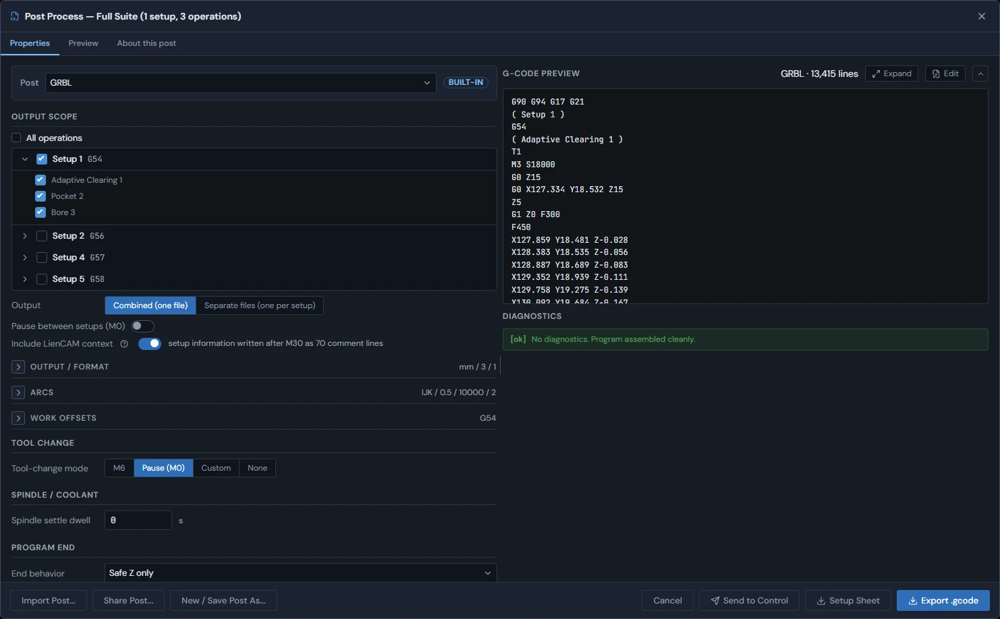
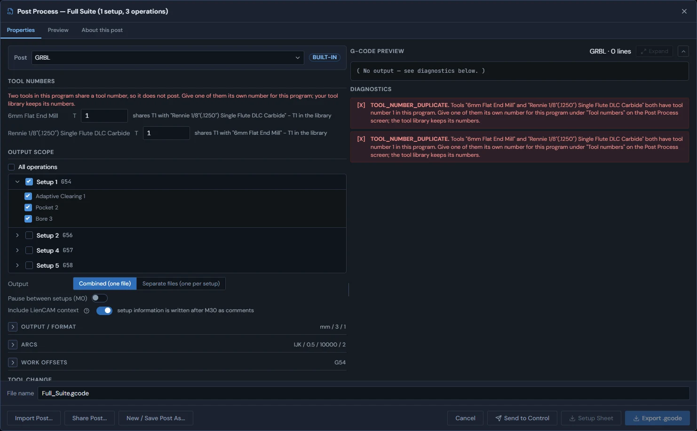
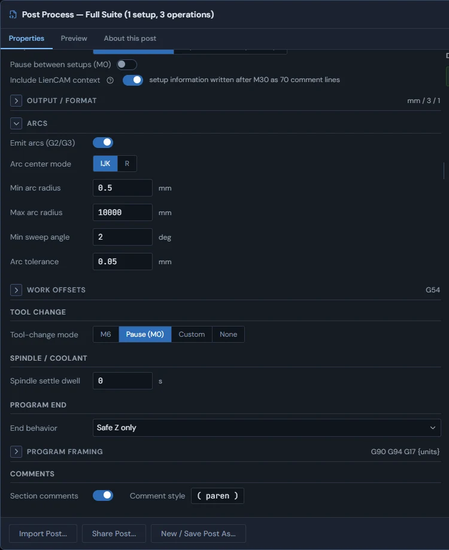
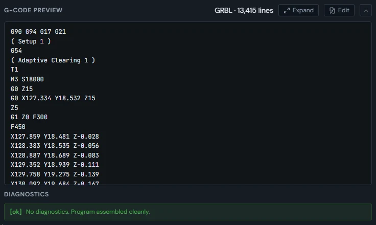

<!-- Generated from the in-app Help by tools/release/help-to-wiki.mjs. Do not edit by hand. -->

# Post Process

- [Posting G-code](#post-basics)
- [Why posting refuses](#post-safety)
- [Post options](#post-options)
- [Checking the output](#gcode-preview)
- [Include LienCAM context](#post-include-context)

## Posting G-code

The Post Process dialog turns computed toolpaths into G-code files for your controller, with a live preview of exactly what will be written.

Press Post Process in the top bar. The dialog opens on the setup you are working in, with its enabled operations ticked, ready to export. Its title names the project and what is in scope, for example "Post Process - My Part (1 setup, 3 operations)".

The Post dropdown at the top of the Properties tab picks the post definition. It starts on the post for the controller your machine is set to - UCCNC, GRBL, grblHAL, LinuxCNC, or Generic (writes G2/G3 arcs unless you turn off Emit arcs) - and lists that built-in template under Built-in templates, plus any posts you saved under Saved posts. A badge next to the dropdown marks the selection BUILT-IN or CUSTOM. Edits in this dialog change a working copy, never the built-in template itself.

grblHAL posts the same motion GRBL does - it is GRBL-compatible firmware, and its template inherits GRBL's dialect byte for byte except for one extra identifying comment at the top of the file. Pick grblHAL on the machine definition so the exported program records which firmware it targets.

1. Choose the scope under Output scope: tick or untick setups and single operations in the tree. Tick "All operations" to export every setup and every enabled operation instead. An operation that has never been generated is left out, and a diagnostics row names it ("... not generated and will not be included. Generate them first.").
2. Choose the Output: Combined (one file), with a section per setup, or Separate files (one per setup), each named with its work offset, for example My\_Part-G54.nc. Combined output can add "Pause between setups (M0)", which inserts an M5 + M0 operator pause between setups.
3. Check the Export units under Output / Format: mm posts G21, in posts G20. It starts on your global export-units setting; coordinates and feeds are converted for this one export.
4. Type the file name beside Export before saving; Separate files gives each file its own name field, and a name without an extension gets the post extension.
5. Press Export (it reads "Export .nc", or "Export 3 files" for separate files). In the browser the file downloads; in the desktop app a Save dialog asks where to put it. The button stays disabled while any error in the Diagnostics list blocks the program.

The file extension follows the post: .nc for UCCNC, grblHAL and Generic, .gcode for GRBL, and .ngc for LinuxCNC. Setup Sheet, next to Export, downloads a plain-text setup sheet and a PDF beside it for the same program: units, the work offset and origin of each setup, the stock size, and for each operation its tool, speeds and feeds, Z range and the NC lines it occupies, ending with the file's size and checksum. The PDF adds a top-view picture of each operation's posted moves beside its rows: feeds are solid and shaded by depth, rapids are dashed, and the start is marked. Combined output gets one text/PDF pair; Separate files gets a pair for each program. Print the PDF on Letter or A4.

> **Tip:** To keep an edited configuration, press "New / Save Post As..." - it stores a named copy in this browser and adds it to the dropdown under Saved posts. "Share Post..." downloads the current definition as a portable .lienpost.json file, and "Import Post..." loads one back in on any machine. Import Post also reads post files from other CAM programs (.pp, Fusion .cps, .scpost, .pst) as text, without running them. The new saved post is selected at once; the console lists what carried over, what kept the default, and what has no LienCAM equivalent. When a saved custom post is selected, "Delete Post" asks first, then removes it from this browser. Undo does not bring it back.

Open the "About this post" tab to inspect the selected definition before editing or exporting: it lists the label and id, whether it is built in, and its arcs, tool change, comment style, dwell units, work offsets, and feed mode.

See also: [Post options](Post-Process#post-options), [Why posting refuses](Post-Process#post-safety), [Checking the output](Post-Process#gcode-preview), [Work offsets G54-G59](Setup-Stock-and-Workholding#work-offsets), [Your first toolpath](Getting-around#first-toolpath), [Machine library](Settings#machine-library).

## Why posting refuses

Posting refuses to write G-code only when it cannot build a program it can trust, and every refusal names the problem and the fix. An out-of-date operation is recomputed, not refused.

The Export button stays disabled while an error in the Diagnostics list blocks the program, and each row states the problem with its code and a plain-language fix. A refusal always produces no file at all - never a partial or best-guess program.

An out-of-date operation does not block. When Post Process opens, or the scope takes one in, it recomputes the out-of-date operations it is about to post, each after the ones it builds on (the order Regenerate All keeps), says so in one console line ("Post Process recomputed 2 out-of-date operations before posting: "Drill 1", "Contour 2"."), and the preview shows the program. This is what you see after restarting LienCAM: the restored project keeps its operations but not their toolpaths, so they read out of date until Post or Regenerate All recomputes them. An operation that cannot be computed shows its own error instead and blocks Export. An operation that was never generated is not computed here: it stays left out of the program, as the preview says. Export also recomputes anything still out of date before it writes the file. The same happens when you leave an operation out of the scope: later operations that assumed its cut are recomputed for the stock that is really there.

1. Operations that cannot be posted as they are: one that has an error, is still computing, or lost the model geometry it was cut from. Fix, wait for, or regenerate the named operation.
2. Work-offset conflicts: two different stocks (or unbound setups) resolving to the same G54-G59 offset, or one stock resolving to two different offsets, block the export until each physical stock owns exactly one offset. Conflicting setups are also flagged inline in the scope tree.
3. Multi-stock setups: a setup whose operations cut more than one stock has no single safe clearance plane, so it is refused - give each stock its own setup.
4. Tool numbers: two different tools with the same tool number in one program do not post. A Tool numbers section appears at the top of the Properties tab naming both tools ("shares T3 with ..."); type a number into one of them and press Enter or click away. That number is for this program only: every tool change, H offset and the tool list in the file use it, your tool library keeps its own number, and it is saved with the project, so Control \> Load, the setup sheet and the next post use it too. The row stays ("posts as T7 in this program - T3 in the library"); clear the field to post with the library number again. A combined program checks its numbers across all its setups; separate files are separate programs. A tool with no number is not refused - it is given a free number, and an info row says which ("Tool "..." has no tool number, so it posts as T3.").
5. Model-backed geometry: operations cut from modeled bodies are refused until their references have been re-checked against the live model this session - opening each referenced model once re-verifies it. A work coordinate system rotated about Z is posted with the rotation applied to the coordinates; one that is tilted, mirrored or not a true rotation is refused.
6. Settings the post needs to write the program: a Custom tool change with no g-code, a Custom program end with no lines, or a Machine coords (G53) end with no coordinates.

Some rows are warnings or information and never block: the program is larger than the machine travel in the machine definition (or the travel was never entered), or a tool's spindle speed was limited to the machine's range.

Between work offsets the program lifts to a global safe height computed across all exported setups, expressed in work coordinates. The post never emits a "G53 Z0" retract.

See also: [Posting G-code](Post-Process#post-basics), [Checking the output](Post-Process#gcode-preview), [Operation generation failures](Toolpaths-2.5D#generation-failures), [Work offsets G54-G59](Setup-Stock-and-Workholding#work-offsets), [Generated-plane truth](Setup-Stock-and-Workholding#height-truthfulness).

## Post options

The Properties form tunes how the program is written: number formatting, arc output, tool changes, spindle dwell, program end, and framing lines.

1. Output / Format: Export units (mm or in), XYZ decimals, Feed decimals, and optional N line numbers ("Line / sequence numbers") with a chosen Increment.
2. Arcs: an "Emit arcs (G2/G3)" toggle - on, dense runs of small moves are collapsed into clean arcs; off, everything posts as straight G1 segments. When on, you can pick the Arc center mode (IJK offsets or R radius) and tune the limits: Min arc radius, Max arc radius, Min sweep angle, and Arc tolerance (the largest deviation, in mm, the arc fit may introduce). Moves outside the limits stay as lines.
3. Work offsets: the "Fixture offset (from WCS)" is read-only here - it comes from the setup. "Write offsets via G10 L2" is off by default so the operator's touch-off on the machine wins; turning it on writes the stored origin numerically into the program.
4. Tool change: the Tool-change mode is M6, Pause (M0), Custom (your own g-code, with {tool} replaced by the tool number), or None.
5. The post adds no extra M0 after an M6 tool change. A UCCNC operator stop uses its M2001 macro without an extra M0; posts without that macro use M0. The shipped examples follow the same rule. If your file contains an M0 beside or after either stop, Control still holds at that M0 separately.
6. Spindle / Coolant: "Spindle settle dwell" adds an optional G4 wait after the spindle starts, in the post's dwell units. Automatic tool-change, operator-stop and program-end sequences lift a tool left below their safe retract height before M5 stops the spindle. A Custom program end remains verbatim; include the lift before spindle-off yourself.
7. Program end: the End behavior is Safe Z only, Machine coords (G53) - a G53 move to the machine X/Y/Z you type, Home (a home command such as G28), or Custom (verbatim) - lines that replace the entire automatic end block, so include spindle-off and M30 yourself.
8. Program framing and Comments: the preamble and postamble are literal lines written around the program (the WCS-select line follows the preamble), and "Section comments" labels each setup and operation in the post's Comment style.

Two things are not post options. Drill operations post as native canned cycles (G81/G82/G83) automatically whenever the post supports them, instead of long expanded plunge-retract sequences. And spindle direction (M3/M4) and coolant (M7/M8/M9) come from each operation's tool and the machine, not from this form.

A machine's configured vacuum word is carried only when posting in that machine's own controller format. Choosing another format leaves that machine's vacuum word out: a UCCNC machine's vacuum M7 is not mist coolant for a GRBL post. Tool coolant still follows the selected post's coolant support.

> **Tip:** Output / Format, Arcs, Work offsets and Program framing fold away, and each shows a one-line summary of its values in the header (for example "mm / 3 / 1" or "IJK / 0.5 / 10000 / 2"), so you can check a post at a glance without opening them.

See also: [Posting G-code](Post-Process#post-basics), [Checking the output](Post-Process#gcode-preview), [Drilling](Toolpaths-2.5D#drill), [Feeds and speeds hierarchy](Toolpaths-2.5D#feeds-speeds).

## Checking the output

The preview pane shows the exact G-code the export will write, rebuilt live on every change, with the diagnostics list right beneath it.

The preview is the same engine run the export uses, re-run on every option or scope change, so what you read is what is written - unless an operation is out of date, which Export recomputes first. The header shows the post and total line count. In Separate files mode, a "Preview file" dropdown pages through each per-setup file. The Preview tab shows the same output full-width.

1. Check the start: the units word (G21 for mm, G20 for inch) and your preamble lines, followed by the work-offset select (G54-G59).
2. Check the first motion: the program should rapid at a safe height before any plunge, and each tool change should show the expected T number and your chosen tool-change style.
3. Skim the section comments to confirm every setup and operation you selected is present - and nothing you excluded.
4. Check the end of the program: the retract and end behavior you chose under Program end, ending in M30.

> **Tip:** Press Expand for a full-screen viewer with line numbers and a "Go to line" box. Right-click the preview for "Copy all G-code" or "Open full preview". When a ready operation has no toolpath, a "Recompute all" button appears to regenerate everything in scope and refresh the preview.

To change the program by hand - for example to add an M0 pause after a line - press Edit above the preview. The editor has line numbers, G-code colouring and undo/redo (Ctrl+Z / Ctrl+Y); right-click any line (or press Ctrl+F, Ctrl+H or Ctrl+G) for Insert line, Find / Replace and Go to line. A line the reader cannot run is marked with its reason, but nothing you type is refused. Export and Send to Control carry the edited text, and the line above the editor says the program is hand-edited and what changed. If a post setting changes while you have edits, that line offers "Keep my edits" or "Re-post" - edits are never replaced silently.

See also: [Posting G-code](Post-Process#post-basics), [Why posting refuses](Post-Process#post-safety), [Post options](Post-Process#post-options), [Your first toolpath](Getting-around#first-toolpath).

## Include LienCAM context

With the toggle on, the exported file ends in a comment block after M30 that lets Control recognise which setup and stock the program was posted from.

"Include LienCAM context" writes the setup information - setup name, stock and its size and material, work offset, the operations in emitted order - after M30 as ordinary comment lines, followed by a digest. A combined program of several setups carries one block listing every setup. A controller ignores comments, so the program that runs is the same with the toggle on or off.

1. ON by default for a post that is certified for the block; the hint beside the toggle says how many comment lines were written, for example "setup information written after M30 as 70 comment lines" (or "setup information for 3 setups ..." for a combined program).
2. In Separate files mode the hint reads "each file carries its own setup information after M30 as comments".
3. OFF, and disabled, for a post that is not certified - the hint says so.
4. Not written when some of a setup's operations are unticked, because the setup information describes the whole setup; the hint gives that reason.

When Control opens such a file later it verifies the block against the program bytes before trusting it, and then shows "Setup: X (G54)" beside the program name (for several setups, "Setup: A -\> B (G54, G55)") and the Intended stock card on the preview. See "Setup information on a loaded program".

See also: [Setup information on a loaded program](Control#program-context), [Post options](Post-Process#post-options), [Checking the output](Post-Process#gcode-preview).
