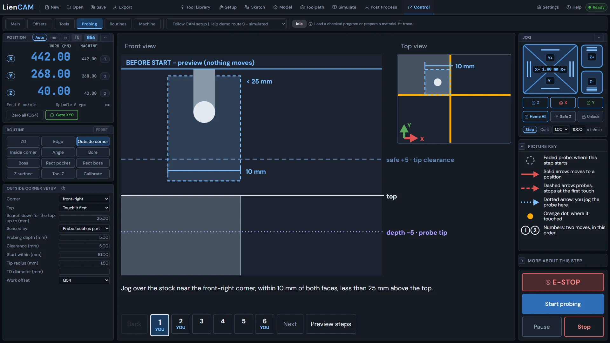
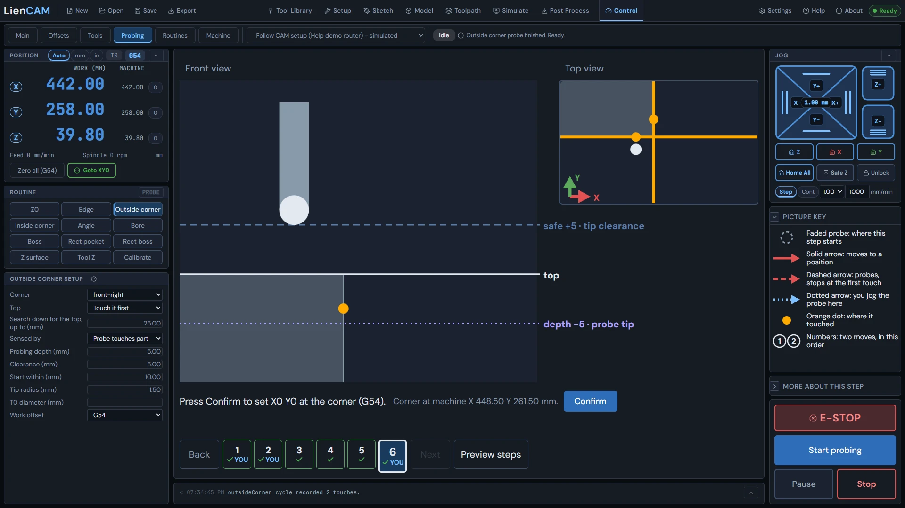
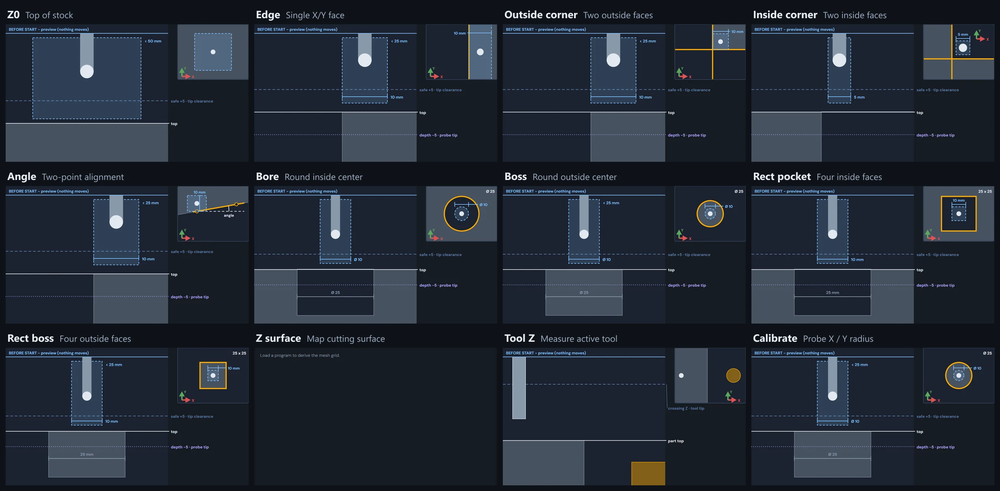
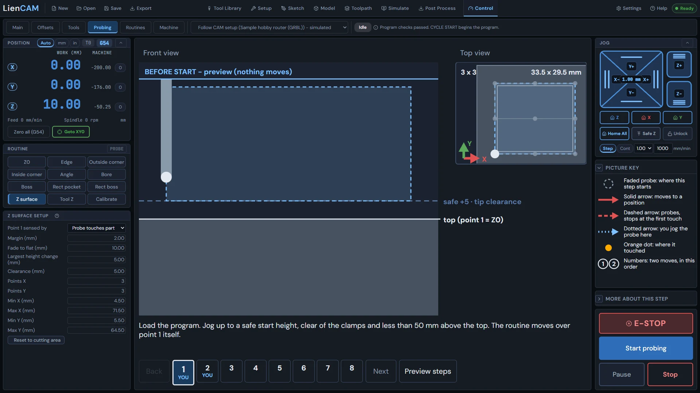
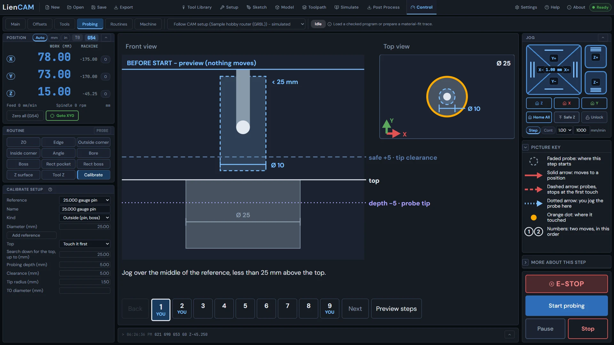

<!-- Generated from the in-app Help by tools/release/help-to-wiki.mjs. Do not edit by hand. -->

# Probing

- [The Probing tab](#probing-tab)
- [Probe routines](#probe-routines)
- [Surface mesh flatness viewer](#mesh-viewer)

## The Probing tab

Probing finds edges, corners, bores, bosses, surfaces and tool lengths with a touch probe and shows the plan on a diagram. Z0 writes immediately; Tool Z records its measurement immediately. Review other results before applying them.

The Probing tab is the workpiece probing station. Pick what you are measuring in the Routine panel (Z0, Edge, Outside corner, Inside corner, Angle, Bore, Boss, Rect pocket, Rect boss, Z surface, Tool Z, Calibrate), fill in its setup panel (for example "Outside corner setup": which work offset, the approach side, the rough size), and the picture beside it draws the moves and touches in order before anything moves.

The Console below the picture is shared with Main. Its compact view shows the latest line; expand it for history and MDI. Switching between Main and Probing keeps the same history and unsent MDI text. The picture gives brief step guidance; open More about this step for the detail.

An early tool-setter touch shows no separate warning. After a successful fine touch, the short result gives the early contact, its difference from the tool-table prediction, the retract and the measured tool length that replaces the table value. An early contact by itself is not a completed measurement; a failed fine touch or retract leaves the previous tool length in place.

On connection, the built-in simulator places a fixed tool setter at the machine record's stated X/Y. If the reference tool has a recorded measured contact below the stated setter Z, that contact sets the simulated surface; otherwise the stated Z is used. A downward probe can touch it during Measure tool or a guided tool change, alongside any simulated part or probe pad. A machine with no stated setter gets none. This models the setter in the simulator only; real-controller measurement stays the same.

1. Setup panel: define the feature - work offset, axis and side, approximate size, search distance. The picture updates as you type; nothing moves.
2. Run: jog to the labeled start shown in the picture, read the motion plan and feeds, make sure the path is clear, then press Start probing - it moves straight away, with no further confirmation. An approach toward a face to be touched is itself a probe seek at Search speed, followed by a back-off and a slow touch at Probe speed. Clear-area moves use the Clear positioning setting. A missed seek stops where it is, without an automatic retract.
3. Result: Z0 writes the active work Z0 during the successful cycle. Tool Z immediately records the measured Setter Z for the active tool, or holds it as the active tool length if no tool number is active. Neither has a separate Confirm. Feature offsets show "Would write G54 ... after confirmation" and use Confirm to apply them. Z surface and Calibrate also use Confirm. Angle reports the measured angle and offers Rotate to apply a nonzero change to the work offset rotation.
4. While probing runs, Pause stops the current move and becomes Resume. Resume continues toward the same endpoint. Stop ends only probing, from running or paused, and a stopped routine writes no result. Start probing starts it afresh. These buttons preserve a loaded program; probing cannot start while that program is running or held.
5. When paused with the probing screen's Pause, the status line points to that screen's Resume and Stop. Other held routines, such as Measure tool, still use CYCLE START and Stop/Reset as their status sentence says.
6. Save probing settings under Control \> Machine \> Definition \> Probing and the next routine uses them without reconnecting, including Search speed, Probe speed, clearance and search bounds. Settings that must be written to the controller still need its receipt; this change applies to probing values used by LienCAM.
7. The diagram keeps the probe in its labeled start zone before Start. When the reported probe position is within the pictured feature and its margin, Front and Right show its reported depth; its sideways place stays tied to the plan. Outside that area, or without a known position, the diagram keeps the planned picture.
8. PROBE shows the touch input; PROBING shows that a probe cycle is in process. The Control, Probing, Tools and tool-change surfaces share the same probe reading. If the controller does not report it, the lamp says so; PROBE is not read while the spindle turns.
9. A refused probe start keeps the current preview. A failed or stopped probe cycle shows Stopped (and the failed step when known); a refused start shows Did not start. The picture gives a brief reason; expand the Console to read the full diagnostic. A new stop or refused start replaces the previous reason. The message states what happened, without guessing a cause. If a tool-setter measurement fails on a tool-change card, Retry measure repeats the measurement without visiting the park again. The failure names the setter and the touch result; Cancel on a manual tool change reports the cancellation and keeps the recorded spindle tool.
10. When the reference tool is measured again, the Console reports its reading change and the actual work Z offset change sent to the controller. Those can differ on a controller that stores tool length in the work offset.

Top tells you where a feature routine gets its top reference. Edge, Outside corner and Angle use "Touch it first". Bore, Rect pocket and Inside corner use "Use work Z0": set work Z0 at the stock top before running them. Boss and Rect boss let you choose either, starting with "Touch it first"; set work Z0 first if you choose "Use work Z0". Calibrate touches the top for an outside reference and uses work Z0 for an inside reference.

The Routines tab on Control (next to Probing) holds the probing sequences as data - factory ones, yours, imported ones - with an editor and a Check that previews a routine on THIS machine before anything runs. See "Probe routines".

> **Warning:** A probe move needs a homed machine and a valid probe setup (feeds, travel limit, tip radius). If the banner at the top says the machine is not ready, the buttons say why and stay disabled.

Feature probing on the simulator with a UCCNC machine definition follows the same plan as native UCCNC: approach from above, then step out and down as pictured. A controller that cannot run that plan says what it lacks and moves nothing. Tool Z and custom probe routines on that simulator also include the native route's guarded steps. These route corrections are simulator/desk proven; they are not new hardware verification.

The built-in simulator touches the part with the probe tip radius of the tool in the spindle, resolved the same way as the Probing screen. Bore, Boss, Edge and Corner compensation then reads the simulated part size. This changes simulated part contact only; tool-setter contact and real-controller probing keep their existing behavior.

See also: [Probe routines](Probing#probe-routines), [Jogging and setting zero](Control#control-jog-zero), [Work offsets G54-G59](Setup-Stock-and-Workholding#work-offsets).

## Probe routines

A probe routine is a small data file - inputs, moves, touches, arithmetic and proposals - that LienCAM previews with real machine numbers before anything moves.

### What a routine is

The Routines tab on Control (next to Probing) holds every probing sequence the app knows: the factory ones that ship inside LienCAM, your own, and any you imported from a file. A routine is NOT a program. It is a short description, in a closed vocabulary, of what the user must type in first (inputs), the moves and touches in order (steps), the arithmetic over what was measured (calculations), and what the routine would LIKE to happen with the answer (proposals). LienCAM reads it, places it on your machine, shows you the whole plan with real numbers, and only then - after you have looked and ticked that the path is clear - does the same probing runner the Probing tab already uses move anything.

A routine can never reset, home, unlock, start, hold, stop, pick a tool, run the spindle, write an offset or a tool length, or carry G-code of its own. It can only ask; the buttons that act are outside the routine, and every endpoint it would drive to is checked against the machine envelope before the first command is sent.

### Inputs

Inputs are the numbers and choices you type before a routine runs: a bore diameter "about", which side of the part, how far to search. Every length, angle and count input carries a min, a max and a default; a choice input lists its options. Bounds are compulsory so the preview can promise where the machine will go. Type the values in the Value column; a blank uses the default.

### Steps - move, touch, calc, check, branch

| Step | What it does |
| --- | --- |
| move | Go to a point (X, Y and/or Z) at the profile positioning feed. Positions are written relative to where you parked the probe (or, for experts, as absolute machine coordinates). A rapid is allowed only at or above the routine safe Z. |
| touch | Probe along one axis in one direction until contact: a search pass, a retract, a slow final pass, read the contact, back off. Feeds come from the machine profile; a routine may only ask for a FRACTION of them. |
| calc | Name a number computed from inputs and touches, for example centre = (left + right) / 2. No motion. |
| check | Stop the routine with a plain sentence if a condition is false. No motion. |
| branch | Run one list of steps or another depending on a condition. No loops; at most two levels deep. |

Each step reads as a sentence in the editor (Probe toward X- up to 20 mm), and expressions are typed as text like input.diameter / 2 or touch.left.x. A step result is referred to by kind and name - touch.left, calc.centre - so step names must be unique and can only be used AFTER their step.

### Check, and the preview

Check does two things. First it validates the routine itself - every problem is listed as a sentence that names the step, and is also shown inline under the field it belongs to. Then it EXPANDS the routine against the live machine: it binds your input values, turns every position into an absolute machine coordinate, looks up every feed in the machine profile and clamps it, and checks every endpoint - including the far end of every search - against the signed machine envelope and the probe travel limit. The Preview column then lists the numbered steps with real numbers ("4. move to machine X -303.5 at 1000 mm/min") and the diagram draws the path. Any edit, input change or move of the machine makes the preview stale; press Check again.

> **Warning:** Run stays disabled until the preview is current, has no problems, and you have ticked that the path is clear. Clear the path for real - the preview is the plan, not a guarantee that nothing is in the way.

### Proposals and the Confirm button

A routine can PROPOSE three things and perform none of them: a work offset ("Would write G54 X= Y= after confirmation"), a tool length ("Would record T3 length"), or a report (a measured diameter, position or angle, read-only). When a routine on the Routines tab finishes, its proposals appear under the result with a Confirm button. Nothing is written until you press it; Cancel discards the proposal and the machine keeps its offsets. The Probing tab's Z0 and Tool Z cycles are separate: they write or record their results immediately.

### Where routines come from - factory, yours, imported

| Badge | Meaning |
| --- | --- |
| FACTORY | Shipped inside LienCAM as data. Read-only - Duplicate makes a copy you can edit. Always available: Restore factory routines cannot fail because it reads nothing from disk. |
| USER | A copy of a factory routine, or one you made with New, edited here. Saved in this browser with your other machine settings. |
| IMPORTED | Loaded from a file. It can be previewed at once but runs only after you have reviewed its expanded preview once for that exact file content ("reviewed" badge). Editing it makes it yours. |

A stored routine that no longer validates (for example after a format change) is QUARANTINED: listed with its reasons, not runnable, and removable. Nothing is silently dropped, and the factory set is always underneath.

### Import and export

Export writes the selected routine to a \<name\>.liencam-probe.json file; Import reads such a file. Only the routine definition travels - id, name, version, description, requirements, inputs, steps, outputs. Feeds in mm/min, machine profile values, envelopes, offsets, tool tables, measured results and start positions never travel; a file that carries them is refused by name. On import every routine becomes IMPORTED regardless of what the file claims; an id that collides with a factory routine is refused, and one that collides with a routine of yours asks Replace / Keep both / Skip.

### Restore factory routines

Restore factory routines brings back every factory routine exactly as shipped and un-hides any you hid. It never touches your own or imported routines, so it is always safe to press. If you broke a copy of a factory routine, either Duplicate the original again or delete your copy.

### What the errors mean

Every problem is one sentence that names where it lives - "Step 4 (touch 'right'): ..." or "Routine 'bore': ..." - with numbers in your display units. The code on each row below is the part in the error list; click the ? next to a sentence to land on its row here.

| Code | Where | In plain words |
| --- | --- | --- |
| E\_SCHEMA\_MISSING | Routine file | The file does not say which routine format it uses (schemaVersion is missing or not a whole number). Add "schemaVersion": 1 at the top level. |
| E\_SCHEMA\_NEWER | Routine file | The file was saved by a newer LienCAM than this one and is refused whole - nothing is half-loaded. Update LienCAM, or ask for the routine in format 1. |
| E\_UNKNOWN\_FIELD | Routine file | The file carries a key LienCAM does not know. Unknown keys are never ignored - typos and smuggled settings (feeds, offsets, tool tables) both land here. Remove the key. |
| E\_ID\_RESERVED | Routine file | The id begins with "factory.", which only the routines shipped inside LienCAM may use. Pick another id. |
| E\_INPUT\_UNBOUNDED | Input | A number input has no min and max (or min is above max). Without bounds the preview cannot promise where the machine will go. Give every length, angle and count input a min and a max. |
| E\_INPUT\_DEFAULT\_OUT\_OF\_RANGE | Input | An input default is missing, not a number, or outside its own min and max (for a choice input: not one of its options). |
| E\_STEP\_KIND | Step | A step has no kind, or a kind outside the closed vocabulary (move, touch, calc, check, branch). Unknown steps are refused, never skipped. |
| E\_STEP\_NAME\_DUPLICATE | Step | Two steps share a name. Names are how later steps refer to a result (touch.left, calc.centre), so they must be unique. |
| E\_TOUCH\_DIRECTION | Step | A touch names an axis or direction that is not X, Y, Z with + or -, or uses a direction the probe cannot take. Check the axis and direction fields. |
| E\_FEED\_ABOVE\_PROFILE | Step | A touch asks for a feed fraction above 1. A routine can only SLOW DOWN relative to the machine profile, never speed up. |
| E\_EXPR\_UNBOUNDED | Expression | An expression uses something whose range cannot be known before running (an unbounded function such as abs, a name without bounds), so the preview cannot promise a safe path. Use bounded inputs and measured results only. |
| E\_EXPR\_UNKNOWN\_NAME | Expression | An expression refers to a name that does not exist: an input this routine does not declare, or a step that is not in the routine. Check the spelling against the inputs and step names. |
| E\_EXPR\_FORWARD\_REFERENCE | Expression | An expression uses the result of a step that comes LATER. Results only exist once their step has run; reorder the steps. |
| E\_EXPR\_ENUM\_IN\_ARITHMETIC | Expression | A choice (enum) input is used in arithmetic. A choice is a word, not a number; compare it (== "left") in a check or branch instead. |
| E\_BRANCH\_DEPTH | Step | Branches nest deeper than two levels. A routine has no loops and at most two nested if/else levels so the preview can show every path. |
| E\_REQUIRES\_HOMED | Routine file | The requires block is missing or wrong, or a routine that moves claims it does not need homing. Every routine that moves or touches must require a homed machine. |
| E\_GCODE\_IN\_ROUTINE | Routine file | A text field contains G-code or a controller command. A routine is data: it cannot carry G-code, $-commands, or realtime characters anywhere, not even in a label. |
| E\_OUTPUT\_KIND | Output | An output proposal has no kind, or a kind other than workOffset, toolLength or report. A routine can only PROPOSE these three things. |
| E\_TOO\_MANY\_STEPS | Routine file | The routine has more steps than the limit allows. Split it into two routines. |
| E\_CALC\_NOT\_FINITE | Calculation | A calculation cannot produce a number: at Check time it divides by something that is always zero; at preview time the real numbers produced infinity or not-a-number. Look at the divisor. |
| E\_FIELD\_INVALID | Routine file | A required field is missing, has the wrong type, or is outside its allowed shape (a bad name, a version that is not "1.0.0"-style, a list where an object belongs). The sentence names the field. |
| E\_ENVELOPE\_INCOMPLETE | Check / preview | The machine envelope is not fully known (the machine has no datum, or its declaration has no travel or home convention), so no position can be proved safe. With home switches, home the machine first; without them, set the machine position. Complete its declaration in the Machine library. |
| E\_ENDPOINT\_OUTSIDE\_ENVELOPE | Check / preview | A move, or the far end of a touch search, lands outside the table. The sentence names the step and the machine coordinate that leaves the envelope. Move the probe, change the input, or shorten the search. |
| E\_SEARCH\_OVER\_MAX\_TRAVEL | Check / preview | A touch searches further than the probe travel limit in the machine profile allows. Shorten the search distance or raise the limit in the profile (not in the routine). |
| E\_RAPID\_NOT\_AT\_SAFE\_Z | Check / preview | A step asks for a rapid move below the routine safe Z. Rapids are allowed only at or above safe Z; everything lower moves at the positioning feed. |
| E\_INPUT\_OUT\_OF\_RANGE | Check / preview | A value you typed for an input is below its min or above its max (or is not one of the choices). Fix the value in the input field. |
| E\_PROBE\_CONFIG\_INVALID | Check / preview | The probe settings in the machine profile are not usable (a feed of zero, a missing travel limit, a tip radius that is not a number). Fix them on the Probing tab / machine profile, not in the routine. |
| E\_NOT\_HOMED | Run | The machine is not homed. A routine that moves never runs against an unhomed machine - home first. |
| E\_NOT\_IDLE | Run | The controller is not idle (running, held, in alarm or jogging). Wait for Idle, or clear the alarm, then Run. |
| E\_ESTOP | Run | The emergency stop is active. Nothing runs until it is released and the controller reset. |
| E\_PATH\_NOT\_CONFIRMED | Run | The "path is clear" box is not ticked. Look at the numbered preview on the diagram, clear the path, then tick it. |
| E\_PREVIEW\_STALE | Run | The routine, an input or the start position changed since the preview was made. Press Check again and look at the new numbers. |
| E\_IMPORTED\_NOT\_REVIEWED | Run | An imported routine has not yet been reviewed: its expanded preview must be looked at once for this exact file content before it may run. Press Check, read the steps, then Run. |
| E\_TOUCH\_MISSED | Run | A probe search reached its distance without touching anything. The routine stops where it is; jog closer and run again from the start. |
| E\_CONTROLLER\_REFUSED | Run | The controller rejected a line. The routine stops at that step and names it; the machine stays put. |

See also: [The Probing tab](Probing#probing-tab), [Jogging and setting zero](Control#control-jog-zero), [The Control tab](Control#control-tab-overview).

## Surface mesh flatness viewer

Click the Mesh chip in Control to see the probed surface as a turnable shape, colored low to high, with the flatness range in numbers.

After a surface mesh grid has been probed, a small Mesh chip appears in the Control program row (for example "Mesh 3x3"). Click it and this viewer opens: the probed surface drawn as a shape you can turn with the mouse (drag to orbit, wheel to zoom), colored from low to high across the measured range. The up-and-down of the surface is exaggerated so a bow of a few hundredths of a millimetre is visible; the factor is labeled in the readouts (for example 20x).

### The numbers

Points is the probed grid size. Min Z and Max Z are the lowest and highest measured machine heights. Range (flatness) is the difference between them - how far from flat the surface really is. Reference Z is the height of the first probed point, which the mesh compensation treats as zero. Closing the viewer changes nothing; it is a picture of the measurement, not a control.

See also: [The Probing tab](Probing#probing-tab).
