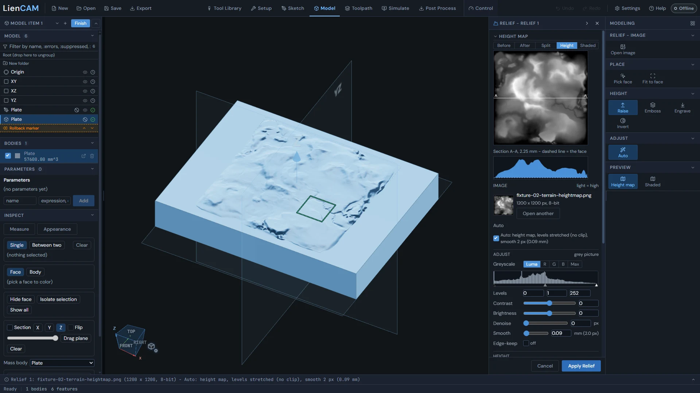

<!-- Generated from the in-app Help by tools/release/help-to-wiki.mjs. Do not edit by hand. -->

# Relief

- [Relief (a picture raised or cut into a face)](#model-relief)

## Relief (a picture raised or cut into a face)

Relief turns a picture into heights on a flat face of the part - Raise, Emboss or Engrave - with a live 3D preview and a height map, and Apply makes it one row in the design tree.

1. In the Model tab, click Relief in the Create group of the rail (it needs a body). The rail shows the Relief tools and the Relief palette docks beside it.
2. Click a flat face on the part to lay the picture on (a face you selected before clicking Relief is used straight away).
3. Open image: a PNG or JPG, 8- or 16-bit. Light is high. Auto adjusts the picture and fits it inside the face, centred, and the part shows the relief live.
4. Set the Depth and pick Raise, Emboss or Engrave, then Apply Relief. The relief is one row in the design tree; Edit on it reopens the palette with the picture and every value.

Relief is not available on an STL mesh body yet. Hover its disabled button for the reason; a flat face on a modelled solid can use Relief.

### Height: Raise, Emboss, Engrave

Raise makes the subject stand proud of the face by the Depth. Emboss keeps the subject at the face and cuts everything round it down to the depth. Engrave cuts the subject into the face and leaves everything round it at the face. Invert makes dark high instead of light, for a picture whose subject reads the wrong way round. Zero plane sits everything darker than that share of the picture flat on the face; Base puts a plinth under the whole picture. Step-downs turn the heights into flat floors (Steps: Levels, or Fixed step with a Step in mm) with Walls at the angle you set.

### The height map and the picture adjustments

The Height map at the top of the palette shows the picture as the relief will be cut: Before (the picture), After (adjusted), Split, Height (light is high) or Shaded, with the section A-A below it (the dashed line is the face). Click its name to fold it. Adjust holds the picture adjustments Auto set - Greyscale, Levels with its histogram, contrast, brightness, denoise, smooth and edge-keep smooth. Moving one switches Auto off; one click on Auto puts its values back.

Place sets the Size on the face (keep proportions ticked by default), Rotate and Move; Fit to face on the rail puts it back inside the face. A very large relief is built as a mesh, and its row says (mesh relief).

See also: [The Model workspace](Model#model-workspace-tour), [The feature tree](Model#feature-tree-history).
