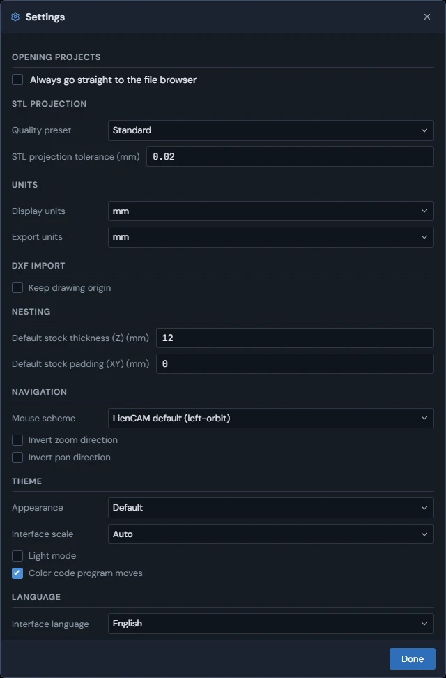
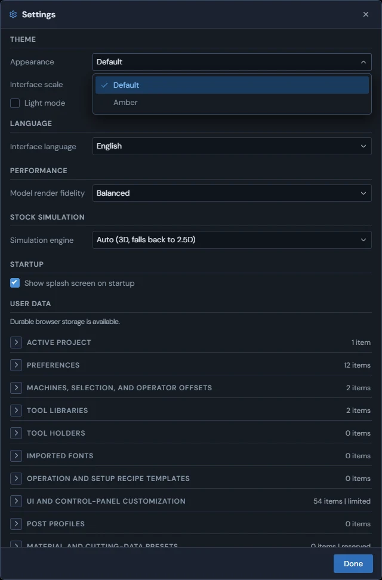
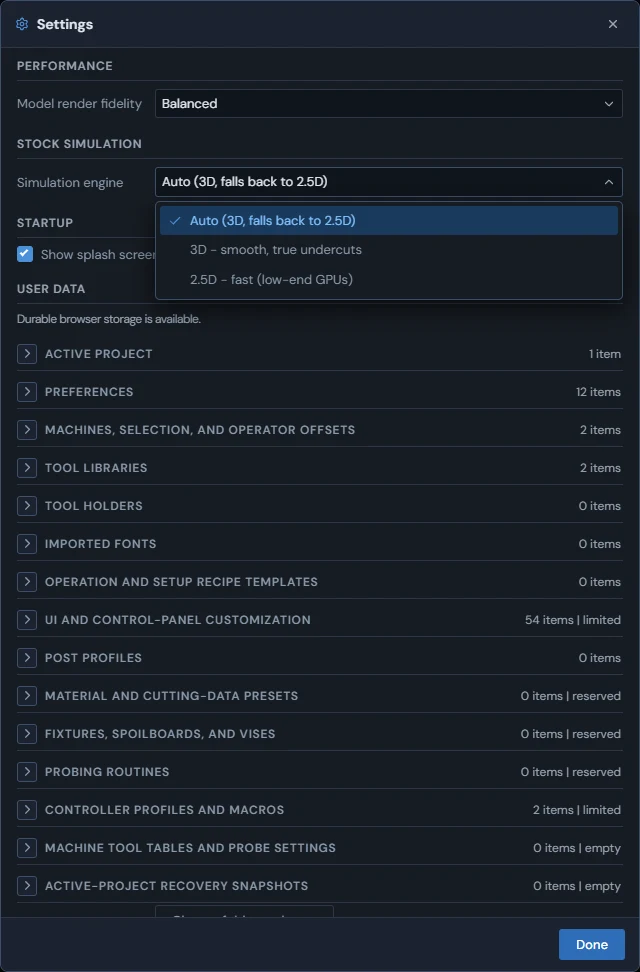
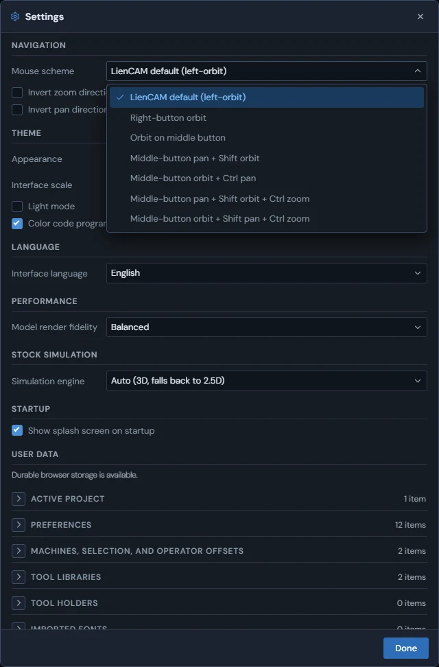
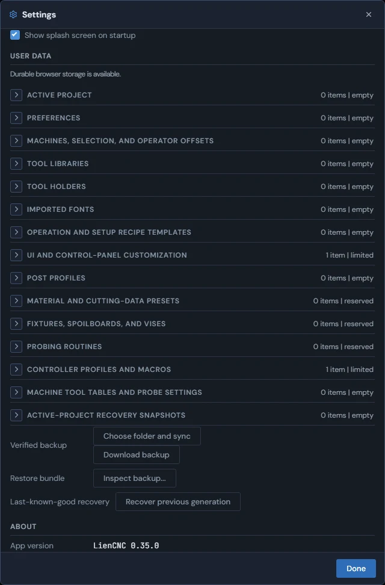
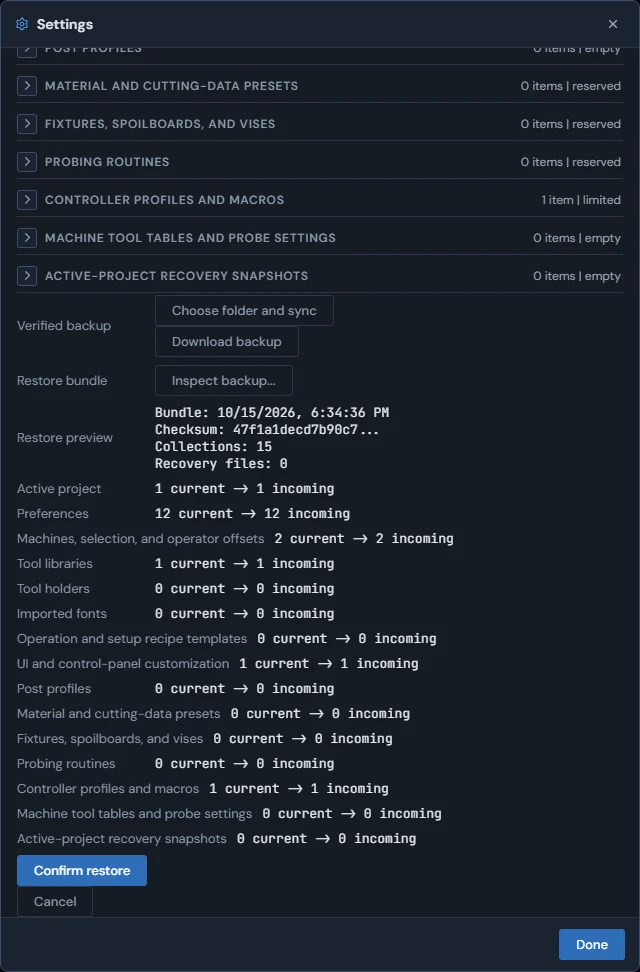
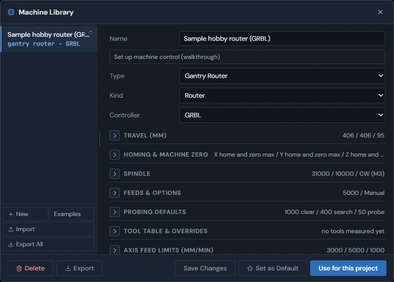

<!-- Generated from the in-app Help by tools/release/help-to-wiki.mjs. Do not edit by hand. -->

# Settings

- [The Settings window](#settings-tour)
- [Theme, interface scale, and light mode](#settings-display)
- [Performance and simulation engine](#settings-performance)
- [Projection, DXF import, nesting, and navigation](#settings-defaults)
- [Backing up your data](#settings-user-data)
- [Machine library](#machine-library)

## The Settings window

Settings holds app-wide preferences in one scrolling window of titled sections - kept on this computer, not in your project file.

Click Settings in the header to open it, and Done (or the X) to close it. Every choice applies to every project you open on this computer and is never written into a .camproject file, so sharing a project never carries your preferences along.

The window is one scrolling list of titled sections: Opening projects, STL Projection, Units, DXF Import, Nesting, Navigation, Theme, Performance, Stock Simulation, Startup, User Data, and About. Opening projects holds Always go straight to the file browser, which skips the project picker when you click Open. Startup holds one checkbox, Show splash screen on startup. User Data lists what LienCAM keeps on this computer and backs it up (see "Backing up your data"). About shows the App version, the Project file format, and the exact Build (commit, branch, and date).

When a GRBL machine is connected over USB, two more sections appear above User Data. GRBL Controller Settings lists the controller's $ settings as it reported them; type a new value and click Apply (or press Enter), and the app writes it and shows what the controller read back. Software-side Machine Capabilities lists what LienCAM itself handles for that machine, such as probing routines and per-axis soft limits.

> **Tip:** When reporting a problem, copy the App version and Build lines from the About section - they identify exactly which build you are running.

About in the header opens About LienCAM, with the version, build information, credits and licenses, plus GitHub project and Releases links. The desktop app checks for a newer published release shortly after launch and posts a notice with its link in the Console if one is available. Download and install the update yourself; the check does not install it. Offline or unavailable checks stay silent.

See also: [Theme, interface scale, and light mode](Settings#settings-display), [Performance and simulation engine](Settings#settings-performance), [Projection, DXF import, nesting, and navigation](Settings#settings-defaults), [Backing up your data](Settings#settings-user-data), [mm and inch](Getting-around#units).

## Theme, interface scale, and light mode

The Theme section picks the accent colors, how large the interface is drawn, and light or dark panels - all three apply immediately.

1. Appearance: Default keeps the standard blue look; Amber recolors the accent colors - panels, the design tree, menus, and selection highlights - in a warm amber.
2. Interface scale: Auto, 100%, 125%, or 150% sets how large the text and controls are drawn. Auto uses 150% on a very wide screen (3200 pixels or more at normal Windows scaling) and 100% everywhere else.
3. Light mode: tick it to switch the whole window - panels, menus, windows, and the 3D view - to a light background. It works with either Appearance choice.

> **Tip:** All three apply as soon as you change them, so you can try each one with a part on screen and keep whichever reads best on your monitor.

Color code program moves is on by default. It gives rapid, feed, arc, tool-change and M-code rows distinct colors in the Control listing and dims comments. Turn it off here to remove move colors; comments stay dimmed and your choice is remembered. These are display colors only and do not change the program or authorize motion.

See also: [The Settings window](Settings#settings-tour), [Performance and simulation engine](Settings#settings-performance).

## Performance and simulation engine

Two sections trade looks against speed: how smoothly STEP parts are drawn, and which stock simulation engine runs.

The Performance section holds Model render fidelity: Performance, Balanced, or High. Higher fidelity draws curved surfaces of STEP parts more smoothly but uses more memory and takes longer. Changing it redraws the STEP parts already on screen at the new fidelity; STL parts are not affected.

The Stock Simulation section holds the Simulation engine: Auto (3D, falls back to 2.5D), 3D - smooth, true undercuts, or 2.5D - fast (low-end GPUs). The 3D engine shows true material removal including undercuts but needs a graphics card that supports it; the 2.5D engine only tracks the top surface and runs almost anywhere. When 3D is chosen (or Auto) and the graphics card cannot run it, the simulation uses 2.5D and says so in the console.

> **Tip:** The dropdown marks 2.5D as the fast choice for low-end graphics cards. For most 2D work the top-surface view shows everything that matters.

See also: [Stock simulation](Simulate#stock-simulation), [GPU capability fallbacks](Getting-around#gpu-limits), [Importing STEP and IGES solids](Importing-files#import-step), [The Settings window](Settings#settings-tour).

## Projection, DXF import, nesting, and navigation

Four sections set working defaults: STL projection tolerance, where an imported DXF lands, new nest thickness, and how the mouse drives the 3D view.

1. STL Projection: the Quality preset (Draft, Standard, Fine, or Custom) sets the tolerance used when slicing an STL mesh into 2D outlines. Draft (0.1 mm) is fastest, Standard (0.02 mm) is the default, and Fine (0.005 mm) keeps the most detail. Typing any other value in the STL projection tolerance box selects Custom.
2. DXF Import: Keep drawing origin places an imported DXF where its own drawing coordinates put it, so several DXFs drawn around one origin line up. Left off, each imported drawing is centered.
3. Nesting: Default stock thickness (Z) is the sheet thickness the New Nest window starts with (after your first nest, it remembers the last thickness you used). Default stock padding (XY) is saved with your settings, but no part of the app uses it yet.
4. Navigation: the Mouse scheme dropdown picks how the mouse orbits, pans, and zooms the 3D view. LienCAM default (left-orbit) orbits with the left button; Right-button orbit, Orbit on middle button, and the four Middle-button schemes keep the left button free for selecting and put orbit, pan, and zoom on the middle or right button, some with Shift or Ctrl held. Invert zoom direction and Invert pan direction reverse those two moves.

> **Tip:** If you are used to another CAD program, pick the scheme that matches its mouse buttons - the scheme names say which button orbits and which pans.

See also: [Importing STL and OBJ meshes](Importing-files#import-stl), [Importing DXF and SVG](Importing-files#import-dxf-svg), [The Settings window](Settings#settings-tour), [Orbit, pan, zoom, view cube](Getting-around#viewport-navigation).

## Backing up your data

The User Data section of Settings lists what LienCAM keeps on this computer, backs it up to a file or folder, and restores it.

Your machines, tool libraries, holders, preferences, fonts, post profiles, work offsets, macros and parks, and probe routines live on this computer, not in project files. A backup also carries any saved recipe templates, cutting data and fixtures, plus the desktop machine-connection settings. The User Data section of Settings lists each kind with how many items it holds; click a row to see its size and when it was last written. The line above the list says whether the browser offers durable storage.

1. Download backup saves everything as one backup file in your download folder. Move it somewhere safe, such as another drive.
2. Choose folder and sync (in browsers that allow it) writes the backup straight into a folder you pick and checks it; after that, Sync now writes it there again.
3. To restore, click Inspect backup... and pick a backup file. The app checks it and lists what would change; click Confirm restore to replace your data with the backup (LienCAM reloads), or Cancel to change nothing. After the reload finishes loading, the restored machines, active machine, tools, settings and offsets are ready, including on a fresh install before its first save. Saved templates, cutting data and fixtures stay in later backups too.
4. Recover previous generation goes back to the copy of your data stored just before the most recent change. It asks first, keeps the current data as the backup copy, and reloads LienCAM.

On Windows, updating means closing LienCAM and running the newer installer over the existing installation, then opening it from its shortcut. Your setup stays in place; you do not need to restore a backup for a normal upgrade. Download a backup before updating. For a new or rebuilt PC, follow "Moving LienCAM to a new or rebuilt PC" for the controller software and profile steps as well as restoring your data.

A change still being saved when you close the app is kept for the next launch. If saved data cannot be loaded, LienCAM starts with defaults for the affected data and holds back saves so it does not overwrite your stored copy. The console names the load failure; reload to try again.

See also: [The Settings window](Settings#settings-tour), [Saving and opening projects](Getting-around#projects-save-open), [Moving LienCAM to a new or rebuilt PC](Control#moving-to-a-new-pc).

## Machine library

The Machine Library stores your machine definitions - type, controller, travel, spindle, feeds, and probing defaults - and picks the one this project uses.

1. Click the machine name in the top-right corner of the 3D view to open the Machine Library.
2. Pick a machine in the list on the left, or click New to add one. Import brings in machines from a JSON file, and Export All saves the whole list as one. At the bottom, Export saves the selected machine as a file (a UCCNC machine also has Export .pro, which writes it as a UCCNC profile) and Delete removes it.
3. Fill in the definition on the right: Name, Type, Kind (Router, Plasma, Laser, or Knife), and Controller, then open each group - Travel, Homing & Machine Zero, Spindle, Feeds & Options, Probing Defaults, Tool Table & Overrides, Axis Feed Limits, and Notes. Each closed group shows a one-line summary of its values.
4. Click "Use for this project" to make it this project's machine, and "Set as Default" to use it for every new project. In the list, Active marks this project's machine and Default marks the one new projects use.

The Controller field (UCCNC, GRBL, grblHAL, LinuxCNC, Generic, or a post you imported) decides which G-code dialect Post Process writes, so changing the project's machine changes the G-code. Axis Feed Limits hold the fastest cutting and rapid feed for each axis; cycle-time estimates use these rapid speeds when the machine's control setup states none of its own. "Set up machine control (walkthrough)" starts the guided setup for driving this machine from the Control tab, or opens its machine settings there once it has been set up.

For a UCCNC machine, Import also accepts a UCCNC .pro profile. A review opens before anything is written. It lists every pin and setting the profile would write, with its value now, its value after, and a Status: same (no change), changes (a different value would be written), new (the machine has no value for it yet), or "you set this - will be replaced". Hover over or focus a status word for the exact explanation for that row. Click Import these values to apply them, or Cancel to leave the machine unchanged. A file that cannot be read shows why, and nothing is changed.

> **Tip:** Save Changes stores your edits; switching to another machine or closing the window also keeps them, so you never lose a half-finished definition.

Examples adds an editable machine from published specifications, without a controller connection. Each example includes three hidden macros: Example - Part swap (M300), Example - Spindle warm-up (M301), and Example - Part trace (M302). Hidden means off: review the body and show it in Edit macros before calling its M-code. Part swap asks for a safe machine Z and a back-of-travel park before M0; warm-up asks for starting and final RPM; part trace asks for a safe machine Z and the work-coordinate rectangle. The examples do not invent a home position or stock size.

See also: [Posting G-code](Post-Process#post-basics), [The Settings window](Settings#settings-tour), [The machine prompt when opening a project](Control#machine-choice).
