<!-- Generated from the in-app Help by tools/release/help-to-wiki.mjs. Do not edit by hand. -->

# Setup Stock and Workholding

- [Setup and WCS](#setup-wcs)
- [Fixture stack and CAM grid](#fixture-stack-cam-grid)
- [Placing the work origin](#wcs-origin-placement)
- [Work offsets G54-G59](#work-offsets)
- [Auto and fixed stocks](#stocks-auto-fixed)
- [Which stock owns a part](#stock-membership)
- [Workholding: vises and clamps](#workholding)
- [Heights explained](#height-references)
- [Generated-plane truth](#height-truthfulness)
- [Seeing height planes](#height-planes-viewport)

## Setup and WCS

A Setup names the stock you machine, its work offset and work origin, the fixture stack under it, and the default heights its operations start from.

1. Press + on the SETUPS header to open New Setup. To change a setup later, press the Edit setup button on its row in the design tree.
2. The left column holds the Name, the Fixture Stack and CAM Grid (see "Fixture stack and CAM grid") and the Default Operation Heights that new operations in this setup start from.
3. The right column is the Work Coordinate System: choose the Setup work offset (G54-G59) and place the work origin with one of the five tabs (see "Placing the work origin"). The Origin line at the bottom shows the X, Y and Z it landed on.
4. Press Create Setup (Save Setup when editing).

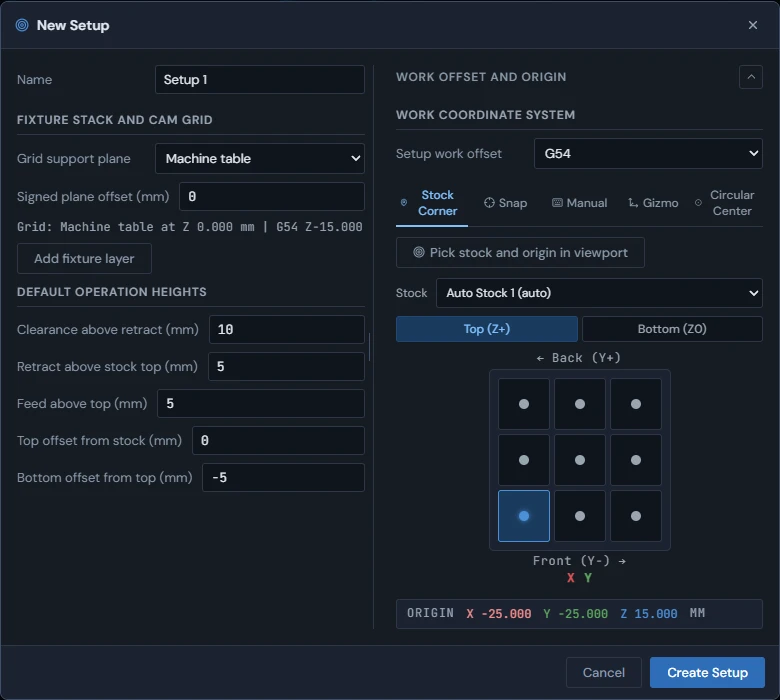

When you save a change to the work offset or the work origin of a setup that already has computed operations, those operations are marked Outdated and the console says how many must be regenerated. Changing the Default Operation Heights sends the operations that follow them back to be generated again.

### Second side

When the project already has a setup, New Setup also shows a Second Side section. Pick the first setup in "Second side of" and how the block was turned in "Turned about" (X - front and back swap, or Y - left and right swap). The stock, the corner, the work offset and the origin tabs then follow from the first side and are held until you set "Second side of" back to "Not a second side". If the first side cannot be turned that way, the section says why and Create Setup stays off.

See also: [Operation generation failures](Toolpaths-2.5D#generation-failures), [Model-to-CAM flow](Model#model-to-cam), [Placing the work origin](Setup-Stock-and-Workholding#wcs-origin-placement), [Work offsets G54-G59](Setup-Stock-and-Workholding#work-offsets).

## Fixture stack and CAM grid

The Fixture Stack and CAM Grid section models what sits under your stock and picks the surface the reference grid draws at - for planning only, never for the WCS origin or a toolpath's Z.

The Fixture Stack and CAM Grid section of the Setup modal models what physically sits under your stock - one or more named layers stacked on the machine table - and picks which surface in that stack the viewport's reference grid is drawn at. It helps you see where your spoilboard, vise, or jaws actually sit relative to your stock before you cut.

1. Add a layer with "Add fixture layer". Each layer gets a name, a type - Spoilboard, Vise, Fixed jaw, Soft jaw, or Custom riser - and a height in your display units. A new layer starts as a Spoilboard with height 0.
2. Layers are ordered from the machine table upward: the first layer in the list sits directly on the table, and each later layer stacks on top of the one before it. Up and Down on a layer move it in that order, Show toggles its visibility (a hidden layer still counts toward the stack height), and Remove deletes it.
3. Pick where the reference grid itself is drawn from the "Grid support plane" dropdown: Machine table, Spoilboard top, Vise bed, Fixed-jaw shelf, or Soft-jaw step (each reads the top of the matching layer type in your stack), Stock bottom (the bottom face of the setup's bound stock), or Custom plane (a Z you type directly). "Signed plane offset" then nudges the drawn grid up or down from whichever plane you picked.
4. The readout beneath the controls shows the selected reference plane and Z, and its offset from this setup's work offset (for example "Grid: Spoilboard top at Z 19.000 mm \| G54 Z+4.000"). If the chosen plane has no matching layer, or Stock bottom has no bound stock, the readout says "Grid: machine table (plane unavailable)." You can still Create Setup or Save Setup. Your selected reference is saved, so adding its matching layer later resolves it; the planning grid never blocks a setup.

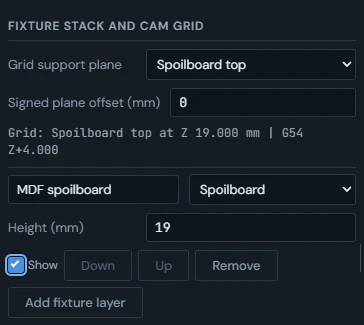

The fixture stack and grid support plane never move anything. They do not set the WCS origin, and they do not change where any operation cuts. A setup's real Z zero comes only from how you placed the work origin (see "Placing the work origin") and each operation's own height planes (see "Heights explained"). Choosing "Spoilboard top" as the grid support plane draws a reference grid at your spoilboard's top surface so you can eyeball the relationship - it does not move your program's Z0 there.

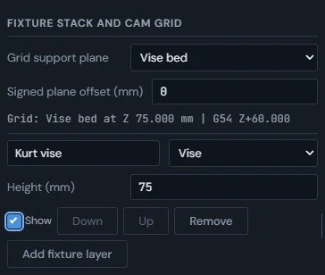

> **Warning:** Planning/reference only. Visibility and support-plane display do not change toolpaths or provide collision avoidance.

No - the fixture stack does not accept an imported 3D model of your vise, clamps, or other fixture. A layer is a named type (Spoilboard, Vise, Fixed jaw, Soft jaw, Custom riser) with a height, not a shape, and the layers are never checked against your toolpaths. To bring in the real shape of a vise or clamp, import it as a part and turn on Workholding for it (see "Workholding: vises and clamps").

See also: [Setup and WCS](Setup-Stock-and-Workholding#setup-wcs), [Placing the work origin](Setup-Stock-and-Workholding#wcs-origin-placement), [Heights explained](Setup-Stock-and-Workholding#height-references), [Workholding: vises and clamps](Setup-Stock-and-Workholding#workholding).

## Placing the work origin

The Setup modal offers five ways to place the work origin: a stock corner, a snapped model vertex, typed coordinates, a draggable viewport gizmo, or the center of a circular feature.

The work origin is the zero point all of a setup's toolpaths are measured from. In the Setup modal, five tabs pick how it is placed: Stock Corner, Snap, Manual, Gizmo, and Circular Center. Whichever method you use, the Origin line at the bottom of the modal shows the current X, Y, and Z in your display units.

1. Stock Corner: choose the stock from the Stock dropdown, toggle Top (Z+) or Bottom (Z0), then click one of the nine points on the 3x3 grid (corners, edge midpoints, or center). Or press "Pick stock and origin in viewport" and click the stock directly - the nearest top or bottom grid point highlights before you click, and Cancel (Esc) backs out.
2. Snap: press Pick Vertex, then click a vertex on the model in the viewport. The tab then names what you picked and the point it landed on; Re-pick Vertex picks again.
3. Manual: type the X, Y, and Z coordinates directly.
4. Gizmo: drag the gold sphere in the viewport to any position, then press Exit Gizmo.
5. Circular Center: choose the stock under "Stock containing this feature", press Pick Circle / Cylinder, then click a circular edge (its center becomes the origin) or a bore or boss wall and choose TOP or BOTTOM in the viewport. X0 Y0 lands on the center; for a bore or boss, Top and Bottom buttons switch which end is Z0.

> **Tip:** Corner, vertex and circular-center origins track their source: a stock-corner origin moves with its stock, and a snapped vertex or circular center follows the geometry it was picked on. Manual and gizmo origins stay where you put them.

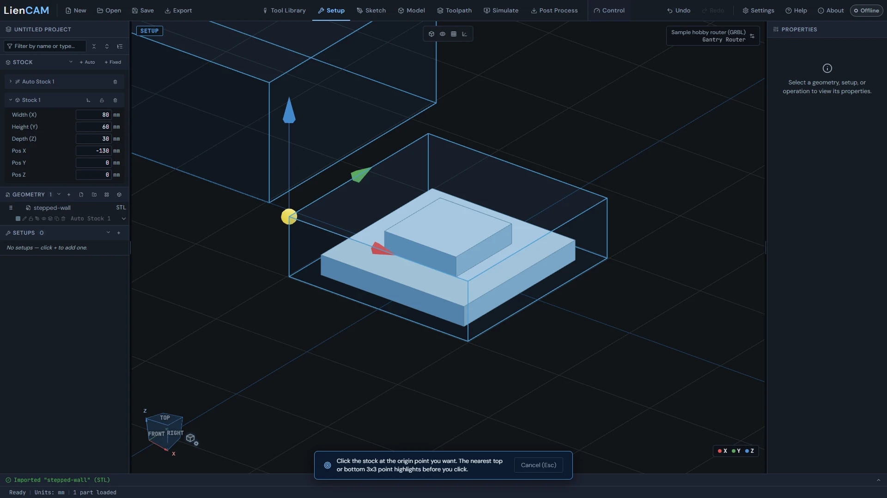

See also: [Setup and WCS](Setup-Stock-and-Workholding#setup-wcs), [Work offsets G54-G59](Setup-Stock-and-Workholding#work-offsets), [Auto and fixed stocks](Setup-Stock-and-Workholding#stocks-auto-fixed).

## Work offsets G54-G59

Each setup posts under one of six work offsets, G54 through G59, chosen in the Setup modal; setups on the same stock may share one.

1. In the Setup modal, choose the offset from the "Setup work offset" dropdown. The design tree shows each setup's offset on its row.
2. Setups that machine the same stock may use the same offset. An offset already used by a setup on a different stock shows as "in use" with that owner's name (for example "G54 - in use (stock Auto Stock 1)") and cannot be selected.
3. If all six offsets are owned by other stocks or setups, the modal says so and Create Setup stays off until one is freed.

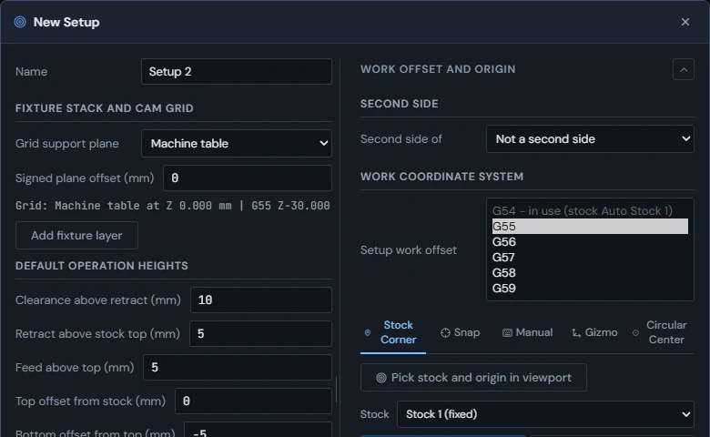

The post writes each setup under its offset. With "Separate files (one per setup)" in Post Process, each file is named with its offset (for example part-G54.nc, part-G55.nc). Before export, the post checks that no offset is shared by two different stocks; a conflict stops the export with a message naming the setups involved.

See also: [Setup and WCS](Setup-Stock-and-Workholding#setup-wcs), [Placing the work origin](Setup-Stock-and-Workholding#wcs-origin-placement), [Posting G-code](Post-Process#post-basics).

## Auto and fixed stocks

A project can carry any number of named stocks: auto stocks that size themselves around their member parts, and fixed stocks you size and place yourself.

Stocks live in the Stock section of the design tree. The + Auto and + Fixed buttons on the section header add new ones, and both kinds coexist - every project starts with one auto stock. Double-click a stock name to rename it; the trash button on its row removes it.

1. Auto stock: expand its node with the arrow to set the XY offset, Z top and Z bottom margins. Its box is derived from its member parts, so it re-wraps automatically when parts move or change. The expanded node lists the Member parts; assign parts with the stock dropdown on each part row.
2. Fixed stock: expand its node to type Width (X), Height (Y), Depth (Z) and the Pos X/Y/Z position. The same fields also appear in the Properties panel when the stock is selected.
3. To move a fixed stock in the viewport, press its "Move with gizmo" button and drag - the parts assigned to it ride along, so a fixed stock behaves like a rigid fixture. Press the button again to exit.
4. The padlock button ("Lock in place") locks a fixed stock where it is: a locked stock cannot be moved by the gizmo or by typed position until you unlock it.

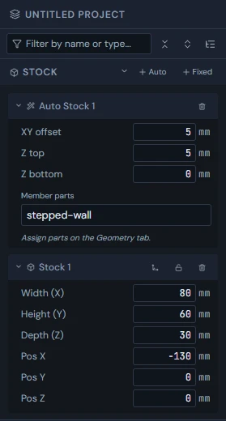

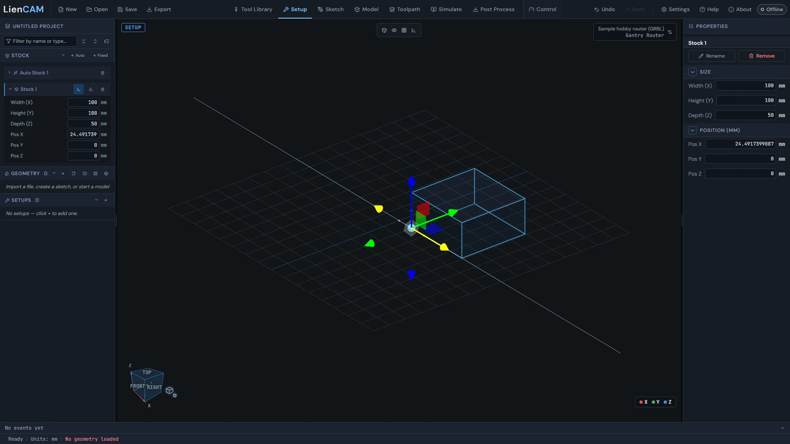

See also: [Which stock owns a part](Setup-Stock-and-Workholding#stock-membership), [Setup and WCS](Setup-Stock-and-Workholding#setup-wcs), [Workholding: vises and clamps](Setup-Stock-and-Workholding#workholding).

## Which stock owns a part

Every part row in the design tree shows the stock that owns it, and a dropdown on the row reassigns or excludes it.

Each part row in the Geometry section carries a stock dropdown showing its resolved owner. Parts you have not assigned fall into the default auto stock automatically; a small lock icon marks a part whose assignment was set by hand, which automatic assignment will never move. A part marked as Workholding has no stock dropdown - it is never stock.

When you import a part into a project that has a fixed stock or a second auto stock, the app asks which stock the new part should join: pick a stock by name, Auto (default), or None. Closing the question with X or Escape picks Auto. You can change the choice later from the part row dropdown.

1. Pick a named stock (auto or fixed) from the dropdown to assign the part to it.
2. Pick None to exclude the part from all stock. An operation on an excluded part fails with a clear error instead of guessing a stock.
3. A modeled body can be used as stock the same way: add an auto stock with the + Auto button, then point the body's dropdown at it. The stock's box follows the body's live shape and updates on every model edit.

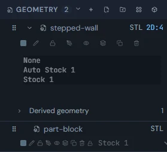

See also: [Auto and fixed stocks](Setup-Stock-and-Workholding#stocks-auto-fixed), [Setup and WCS](Setup-Stock-and-Workholding#setup-wcs), [Workholding: vises and clamps](Setup-Stock-and-Workholding#workholding).

## Workholding: vises and clamps

Import your vise, jaws or clamps as a part and turn on Workholding: the body is drawn as a fixture, is never stock or a cut, toolpaths keep clear of it, and Seat in vise places parts against it.

1. Import the vise or clamp model like any part, then select it and tick Workholding in the Properties panel.
2. The body moves into a Workholding group in the Geometry section, is drawn in its own fixture color, and loses its stock dropdown: a workholding body is never stock and never a cut source.
3. Untick Workholding to make it an ordinary part again.

Toolpaths are kept clear of workholding bodies: the cutter, neck, shank and holder stay the Shank clearance away from them, and where that stops a cut short the operation says so (see "Tool reach: Stopped short"). Simulate also names, in the console, any move where the tool assembly would touch workholding.

### Seat in vise

1. With a workholding body selected, press Seat in vise beside its Workholding checkbox. A Seat in vise strip opens at the bottom of the viewport.
2. Choose the part or fixed stock in "Part or stock", then click a face on the workholding body (a jaw face or the floor) and the face it should touch. If the vise moves, it slides at once. If the part moves, the strip first says which operations will go outdated and waits for Apply. "Move \<name\> instead" swaps which body moves.
3. Pick a second pair of faces the same way; the first contact holds and the body only slides along it. Undo backs out either seat, one step at a time.
4. The strip says which body moves. A locked body never moves; when both are locked the strip offers to unlock one. An auto stock sizes itself to its parts, so the strip offers "Make a fixed stock this size" instead.

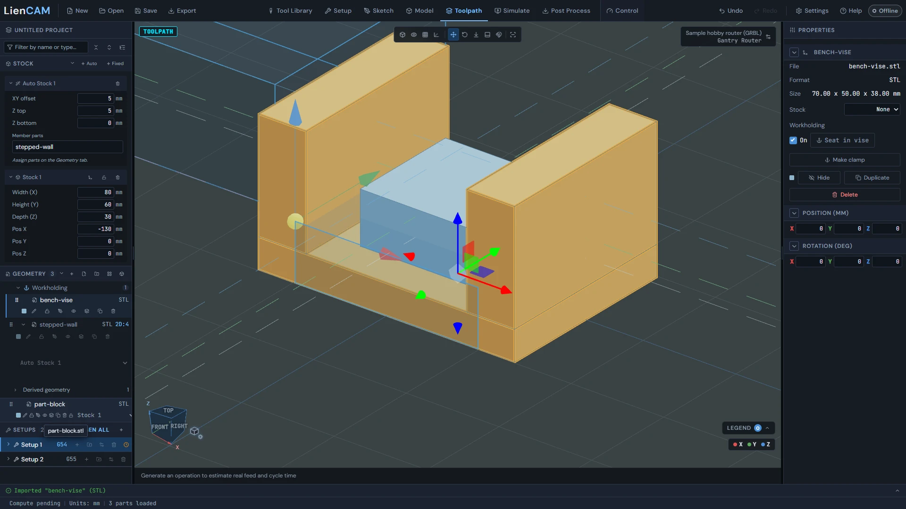

See also: [Fixture stack and CAM grid](Setup-Stock-and-Workholding#fixture-stack-cam-grid), [Auto and fixed stocks](Setup-Stock-and-Workholding#stocks-auto-fixed), [Tool reach: Stopped short](Toolpaths-2.5D#rub-warnings).

## Heights explained

Every operation uses five height planes - clearance, retract, feed, top, and bottom - each measured from a reference you choose, and the Heights tab shows the WCS Z each one lands on.

The five planes, from highest to lowest: Clearance is the safe rapid plane; Retract is the rapid plane between cuts; Feed is where rapid changes to feed before entering material; Top is where material starts; Bottom is where machining ends. The Setup modal's Default Operation Heights (Clearance above retract, Retract above stock top, Feed above top, Top offset from stock, Bottom offset from top) are what new operations in that setup start from.

1. Open the Heights tab of the operation editor. It lists Clearance Height, Retract Height, Feed Height, Top Height and Bottom Height, each with how it is figured (for example "Retract + 10.000 mm"), the WCS Z it lands on, and whether it is Smart (the app works it out) or a User Override.
2. Press the arrow on a row to change it: pick what it is measured from - for example Retract, Stock top, Model top, Stock bottom, Model bottom, Geometry plane, Picked surface or WCS Z (absolute), depending on the row - then + or - and the offset.
3. Top Height and Bottom Height start on the operation's own Smart policy. On 2D Pocket and 2D Adaptive Clearing, opening those rows also shows an End condition: Depth from stock top, To geometry datum, To stock bottom, Through stock, Stop above stock bottom, To selected surface, or Custom reference + offset.
4. The diagram below the rows draws the five planes with their values.

In the Properties panel, an operation's Heights group shows each plane's WCS value and marks it Smart or overridden; the Clearance, Retract and Feed values can be typed over there. When an operation's safety heights no longer follow the setup, a "Reset safety to setup" button puts them back.

> **Tip:** Referenced heights follow their source: a Bottom Height measured from Stock bottom stays correct if you change the stock thickness, where a typed WCS Z (absolute) would not.

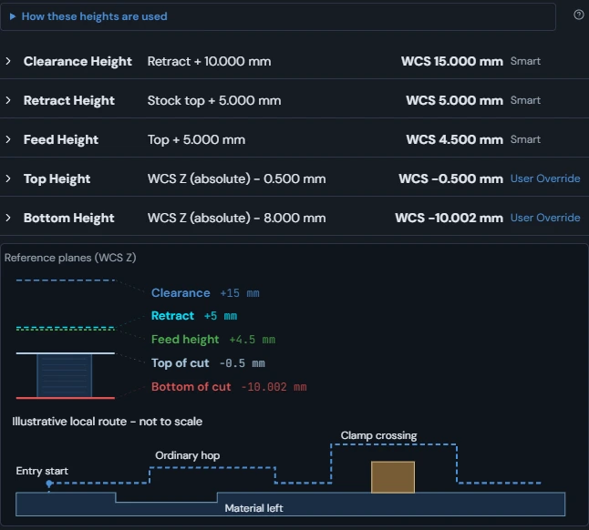

See also: [Setup and WCS](Setup-Stock-and-Workholding#setup-wcs), [Generated-plane truth](Setup-Stock-and-Workholding#height-truthfulness), [Seeing height planes](Setup-Stock-and-Workholding#height-planes-viewport).

## Generated-plane truth

A generated toolpath remembers the height planes it was cut with, and the app never shows a saved path whose inputs no longer match.

When an operation generates, it records what you asked for and the WCS Z and machine Z each plane resolved to. The Properties panel Heights group shows the WCS value of each plane the stored toolpath was cut with.

If anything the toolpath depends on changes afterward - heights, tool, geometry, stock, WCS origin or work offset, or machine - the operation is marked Outdated (amber clock icon on its row) and its saved moves are discarded rather than drawn. The same check runs when a project file is opened, so a stale saved path can never pass as current. Regenerate the operation to cut it again with the current inputs.

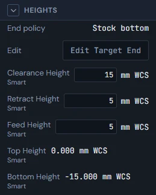

See also: [Heights explained](Setup-Stock-and-Workholding#height-references), [Operation generation failures](Toolpaths-2.5D#generation-failures).

## Seeing height planes

The viewport can draw the five height planes of the selected operation as colored planes, with a master toggle and a per-plane checklist.

1. Select a generated operation in the design tree - the planes drawn are the ones that operation was cut with.
2. Press the Display mode button (the cube with a gear beside the view cube) to open the Display Mode flyout.
3. Check "Height planes" to turn the plane display on. Each plane is drawn as a faint tinted sheet with a dashed outline and center cross in its color.
4. Use the per-plane checkboxes - Clearance, Retract, Feed Height, Top of Stock, Bottom of Cut, each with its color dot - to show only the planes you care about.

> **Tip:** Showing just Top of Stock and Bottom of Cut is a quick way to see where an operation starts and ends.

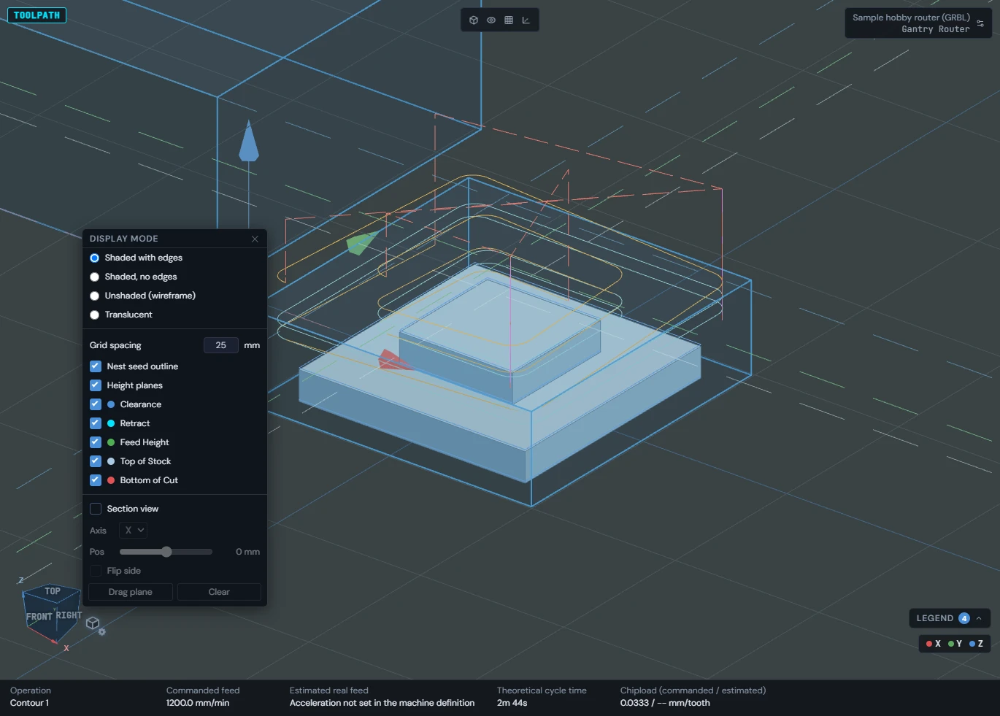

See also: [Heights explained](Setup-Stock-and-Workholding#height-references), [Generated-plane truth](Setup-Stock-and-Workholding#height-truthfulness).
