<!-- Generated from the in-app Help by tools/release/help-to-wiki.mjs. Do not edit by hand. -->

# Sketch

- [Calibrating a reference image](#reference-image-calibration)
- [Starting a sketch](#sketch-entry)
- [Drawing entities](#sketch-draw-tools)
- [Sketch text](#sketch-text)
- [Constraints](#sketch-constraints)
- [Smart dimensions](#sketch-dimensions)
- [Under-defined, fully defined, conflicting](#sketch-definition-states)
- [Trim, split, extend, offset, mirror, patterns, move](#sketch-modify-tools)
- [Sketch fillet and chamfer](#sketch-fillet-chamfer)
- [Construction geometry](#construction-geometry)
- [Snaps and inferred constraints](#sketch-snaps-inference)
- [Blocks](#sketch-blocks)
- [Project / Use](#project-use)
- [The measure readout](#sketch-measure)
- [Finishing a sketch](#finish-and-bake)
- [Sketch size limits](#sketch-limits)
- [Fixing an over-defined sketch](#sketch-conflicts)

## Calibrating a reference image

Calibrate a tracing picture to a real distance using two marks or a selected sketch line, then lock its scale and place it with X, Y, Angle, drag and flips.

Add a picture with Import... \> Reference image (tracing underlay) in the Sketch tab, or Reference image \> Insert... in a Model-tab sketch. To reopen it later, choose it in the Edit image list (Sketch tab) or click its row in the feature tree (Model tab). Choose Calibrate, pick two marks on the picture, type their real distance in your display units, and press Enter. Alternatively, select an ordinary sketch line between the marks before choosing Calibrate. The picture scales uniformly about the first mark; the sketch line stays unchanged. Esc cancels. Lock scale hides Calibrate until you unlock it. X and Y set the picture center in your display units; Angle turns it about that center in degrees. Flip horizontal and Flip vertical mirror the picture in place. While this palette is open, press and drag the picture to move it; X and Y follow the cursor. Release adds one Undo step; Esc cancels the drag. Drag a corner handle to resize evenly about the opposite corner; width updates live, one release is one Undo step, and Lock scale hides the handles. Close the palette to trace through the picture with sketch tools. Placement works with Lock scale on and preserves calibrated distances. Placement, calibration and the lock are saved with the project and can be undone.

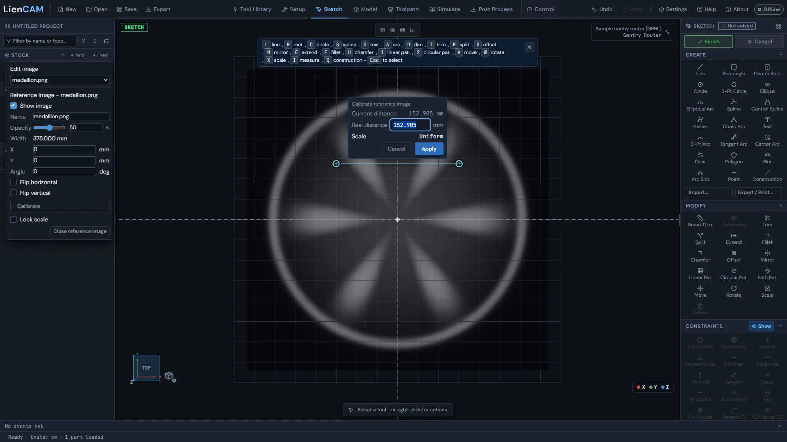

See also: [Starting a sketch](Sketch#sketch-entry).

## Starting a sketch

The Sketch tab opens the Enter Sketch Mode chooser: start a new sketch, pick a part in the viewport, or choose an existing 2D layer to edit.

1. Click the Sketch tab. If the part selected in the design tree has exactly one layer you can edit, that layer opens straight away. If it has several, the chooser opens showing only that part's layers. With nothing selected, the chooser opens (or, if a sketch is already open, the Sketch tab just shows it).
2. In the Enter Sketch Mode chooser, click New sketch to start on a new, empty layer.
3. Or click Pick existing in viewport, then click the part in the viewport - the parts you can pick highlight, and Esc goes back to the chooser. A part with one editable layer opens it; a part with several lists them so you can choose one.
4. Or pick a layer from the list under "Or choose an existing layer". Layers are grouped by part and show their loop count; a layer that already holds a sketch says "parametric".

A layer you cannot sketch on stays in the list, greyed out, with the reason under it: "Layer is locked" (unlock it in the design tree), or an STL projection, which is read-only.

The first time you open an imported DXF or SVG layer, its loops arrive in the sketch as one block: a single rigid object that counts as fully defined, which you place as a whole. Right-click it and choose Explode block when you want to edit the curves themselves. Finishing the sketch stores it on the layer, so the next time you open that layer you get the same sketch back with its constraints and dimensions.

You can also bring a file into the sketch you are in: Import... in the Create section opens the Import window. Choose a DXF / SVG / PNG / JPG file there to add a DXF, SVG, PNG or JPG as ordinary sketch geometry you can edit and constrain. The picture choices in that window apply to PNG / JPG tracing: "Picture width (mm)" sets how wide it lands (the height follows the picture) and "Picture threshold" (1 to 254) sets how dark a pixel must be to become a shape. The console line says how many loops came in.

Export / Print... opens the Export window. Export SVG... there saves the open sketch at true size in millimetres, named after the sketch. Construction geometry is left out. Open the SVG in a laser or drawing program, or print from a browser at 100% scale for a 1:1 template.

Print... in the Export / Print window prints the open sketch. Choose Paper (Letter, Legal, Tabloid, A4 or A3), Orientation and Scale in that window. The choices in both windows are remembered while the sketch stays open. Actual size (1:1) makes a full-size template; choose 100% / "Actual size" in the system print dialog and the matching paper and orientation. Fit to page uses one sheet and records the fitted scale in the title box. Large actual-size drawings span numbered rows and columns with 10 mm overlap: align the crosses in the overlapping strips and tape the sheets together. Each sheet includes the sketch name, date, scale and page number. An empty sketch prints an empty titled page.

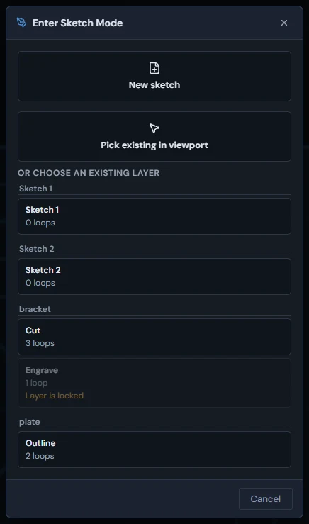

See also: [Drawing entities](Sketch#sketch-draw-tools), [Blocks](Sketch#sketch-blocks), [Finishing a sketch](Sketch#finish-and-bake).

## Drawing entities

The Create section of the sketch toolbox holds every drawing tool: lines, rectangles, circles, ellipses, arcs, splines, a bezier, a conic arc, polygons, spur gears, slots, text and points.

The Create section holds Line, Rectangle, Center Rect, Circle, 3-Pt Circle, Ellipse, Elliptical Arc, Spline, Control Spline, Bezier, Conic Arc, Text, 3-Pt Arc, Tangent Arc, Center Arc, Polygon, Gear, Slot, Arc Slot, Point and Construction. Hover a button to see its key.

1. Click a tool, or press its key: Line (L), Rectangle (R), Circle (C), Spline (S), Text (G), 3-Pt Arc (A). The tool stays armed until you press Esc or click its button again.
2. Follow the prompt bar at the bottom of the viewport. It names the tool, shows "Step N of M", says what to click next, and has Confirm (Enter) and Back or Cancel (Esc) buttons.
3. Click in the viewport to place points. The Line tool keeps going from the last point, so one pass draws a whole outline: click the start point again to close it, or press Enter to finish.
4. While a line or circle follows the cursor, a small box shows its length or radius. Start typing a number to set it exactly and press Enter: the entity is drawn at that size with a dimension that holds it.
5. Hold Shift to lock a line to the nearest 45-degree direction. Esc steps back from the current step; press it again to put the tool away.

Some tools show extra rows under the Create buttons while they are armed: Rectangle and Center Rect have "Rotated (Tab)" to draw a rectangle at any angle (three clicks: corner, edge, width); Polygon has Sides and Mode (Inscribed: click a vertex, Circumscribed: click a side midpoint); Spline, Control Spline and Bezier have Close loop; Conic Arc has Rho (0.5 is a parabola, lower is an ellipse arc, higher is a hyperbola arc). A rectangle also gets a dashed construction diagonal with a center point, which moves with its corners.

Gear: set Teeth (6-200), Module (mm), Pressure angle and Root fillet; click the center, then click to set rotation. The closed involute outline is ordinary lines and arcs. Snap Circle to its construction pitch circle center for a bore. Undo removes the whole gear in one step.

The Bezier tool works by press and drag: press for an anchor, drag out its handle, or release without dragging for a sharp corner. When a bezier is selected, the Modify section shows "Bezier joints" with Smooth (the handles stay in line) and Corner (each handle moves on its own).

Right-click in the viewport for a menu that fits what you are doing: with a tool armed it offers Confirm step, Cancel and Construction mode; with geometry selected it offers the constraints that fit, Copy (Ctrl+C), Paste (Ctrl+V), Delete, Toggle construction, Group into block, and the Modify tools that start from your selection; on empty space it lists the tools. An empty sketch shows a card of the tool keys at the top of the viewport; its X closes it.

> **Tip:** Tool keys are ignored while you are typing in a value field, so typing "15" into a dimension never arms a tool.

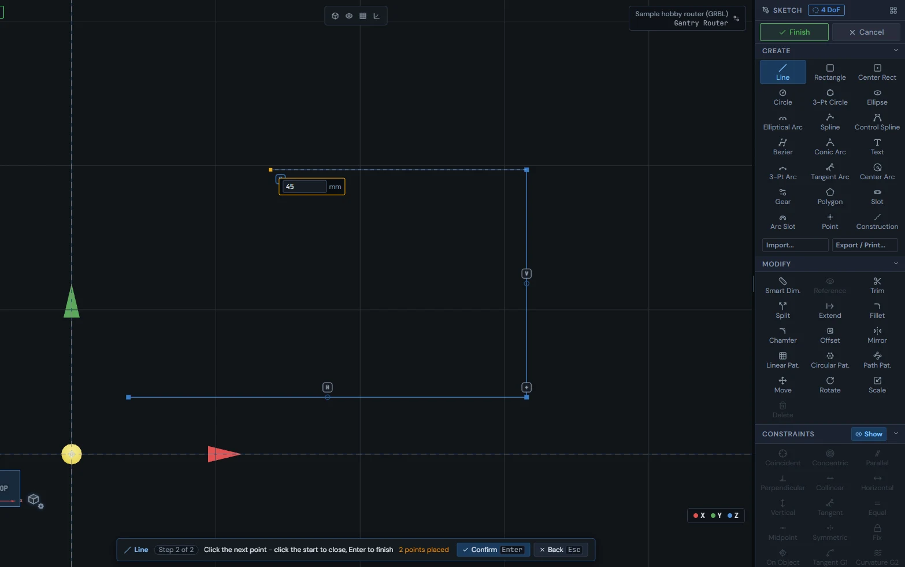

See also: [Snaps and inferred constraints](Sketch#sketch-snaps-inference), [Construction geometry](Sketch#construction-geometry), [Trim, split, extend, offset, mirror, patterns, move](Sketch#sketch-modify-tools).

## Sketch text

The Text tool (G) places engravable text with a choice of single-line and outline fonts, your own imported fonts, and optional placement along a curve.

1. Arm the Text tool (G) and click where the text should start, then type right in the canvas. Enter finishes. Esc on new text keeps what you typed, or removes the text if you typed nothing.
2. Set Height, Angle (deg), Letter spacing (mm) and Mirror in the rows under the Create buttons. They apply to the next text you place, and to the text you are editing as you change them.
3. Pick a font from the Font list. "Hershey (single-line / engrave)" cuts open centerline strokes with the tool tip; every other face is an outline font whose closed letter shapes you can pocket or contour. Import font... adds your own .ttf, .otf or typeface .json - it is converted in the browser and saved with the project.
4. Double-click placed text to edit it. While editing, Esc puts the text back the way it was.

### Text along a curve

With the Text tool armed, click on a line, arc, circle, ellipse or spline and the text is placed along it. For text you already placed, double-click it and press "Attach to path", then click the curve. While attached, the rows show Detach, Flip side and "Position along path". A small bar under the text sets where it sits on the curve: L (start of the curve), C (center), R (end), F (free - slide it anywhere), plus Flip and Mirror.

> **Tip:** Mirror flips the letters themselves; Flip side moves the text to the other side of the curve. The two are separate.

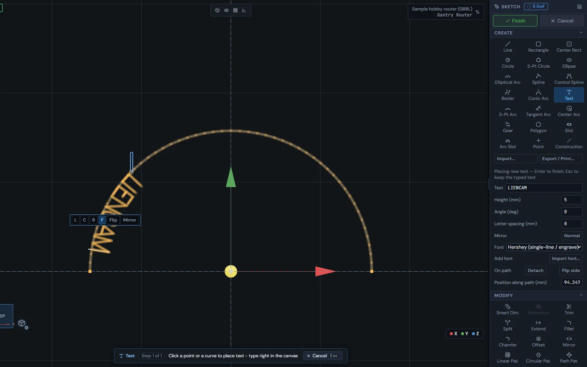

See also: [Engraving](Toolpaths-2.5D#engrave), [Finishing a sketch](Sketch#finish-and-bake).

## Constraints

Fifteen constraint buttons lock geometric relationships - each lights up only when your selection fits it, and a constraint that would conflict is rejected by name instead of breaking the sketch.

The Constraints section holds Coincident, Concentric, Parallel, Perpendicular, Collinear, Horizontal, Vertical, Tangent, Equal, Midpoint, Symmetric, Fix, On Object, Tangent G1 and Curvature G2. Select the geometry first, then click the constraint. A button is enabled only when your selection fits it; hover a greyed-out button and it tells you what it needs.

1. Select the geometry: click entities (Shift adds to the selection). Click an endpoint node to pick the point itself, or the center mark of a circle or arc to pick its center.
2. Click the constraint button, or right-click and pick it from the menu - the menu lists only the constraints that fit. It applies at once and the sketch re-solves.
3. If the new constraint would conflict with the ones already there, it is taken back and the console names the constraints it fights with - the sketch is never left broken.

Tangent G1 and Curvature G2 keep a control spline smooth where it meets a line or an arc.

The Browser section at the bottom of the toolbox lists every constraint and dimension, grouped by kind. Click a row to select it, hover to see it in the viewport, and use its trash button to delete it. The Show button in the Constraints header hides or shows the small constraint badges in the viewport; the constraints themselves are unchanged.

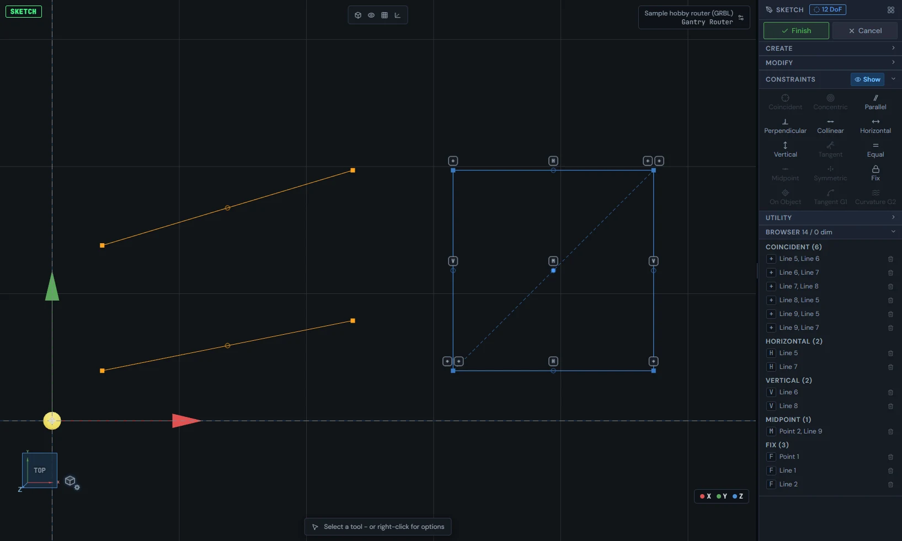

See also: [Smart dimensions](Sketch#sketch-dimensions), [Under-defined, fully defined, conflicting](Sketch#sketch-definition-states).

## Smart dimensions

One Smart Dimension tool (D) reads what you click and makes the right dimension - length, angle, radius, diameter or distance - with driving and reference modes and typed equations.

1. Arm Smart Dim. in the Modify section (or press D), then click what to measure: one line gives its length, two lines give the angle between them (or the distance if they are parallel), a circle gives its diameter, an arc its radius, two points their distance, and a point and a line the distance straight across from the point to the line.
2. Click in open space to place the label. For a length, where you place it decides whether it measures along the line, horizontally or vertically; Tab switches between them. For an arc, Tab switches Radius to Arc length.
3. Type the value and press Enter. The geometry moves to match. Esc keeps the measured value.
4. Double-click any dimension label to change its value later.

A value can be an equation: start with "=" and use + - \* / ^, unit suffixes such as mm and in, and functions such as sin, cos and sqrt. The result shows beside the box as you type, and reopening the box shows the equation you typed, not just the number.

A dimension is driving (it sets the size) or reference (it only reports it). The small button at the left of the value box switches between them, and so does Reference in the Modify section with the dimension selected. A reference dimension is shown in parentheses, updates itself after every change, and never moves the geometry. Switching a reference back to driving is refused, with the conflict named, if it would fight the sketch.

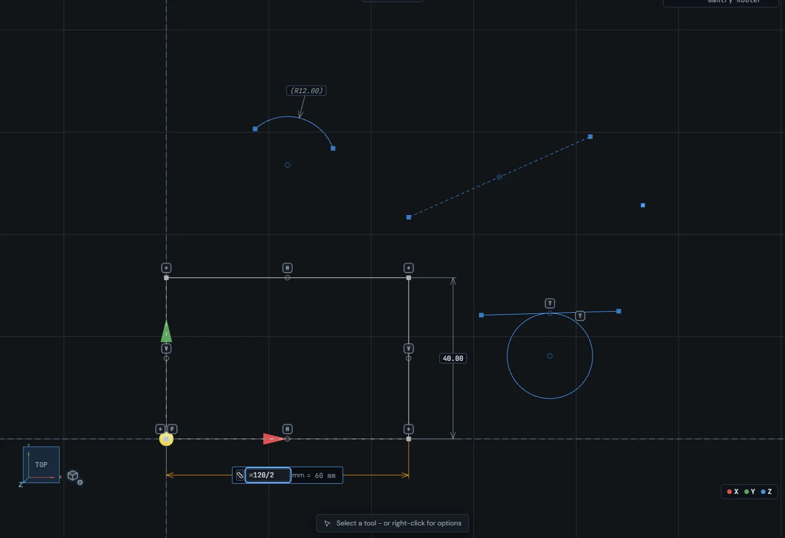

See also: [Constraints](Sketch#sketch-constraints), [The measure readout](Sketch#sketch-measure), [Under-defined, fully defined, conflicting](Sketch#sketch-definition-states).

## Under-defined, fully defined, conflicting

Entity colors and the chip beside the Sketch title tell you how locked-down the sketch is: blue can still move, near-white is fully defined, and red is caught in a conflict.

Every entity is colored by its state: blue means under-defined (it can still move, and you can drag it), near-white means fully defined (every size and position is held by constraints and dimensions; dark on the light theme), and red marks entities caught in a conflict. Selected geometry shows in amber, and the entity under the cursor gets a cyan glow.

The chip beside the Sketch title reads "N DoF" while N degrees of freedom are left, "Fully defined" at zero, "Not solved" before the sketch has been solved at all (a new, empty sketch), and "Solve failed" when the solve gave no answer - hover it for the reason.

1. When constraints conflict, a red "Over-defined: N conflicting" banner appears under the Finish button, naming the first few. Click Resolve... to list the whole conflicting set and remove one of them.
2. Constraints that repeat something already held (redundant) get an amber "N redundant (advisory)" row with a Review... button. Removing them is up to you; the sketch still solves.

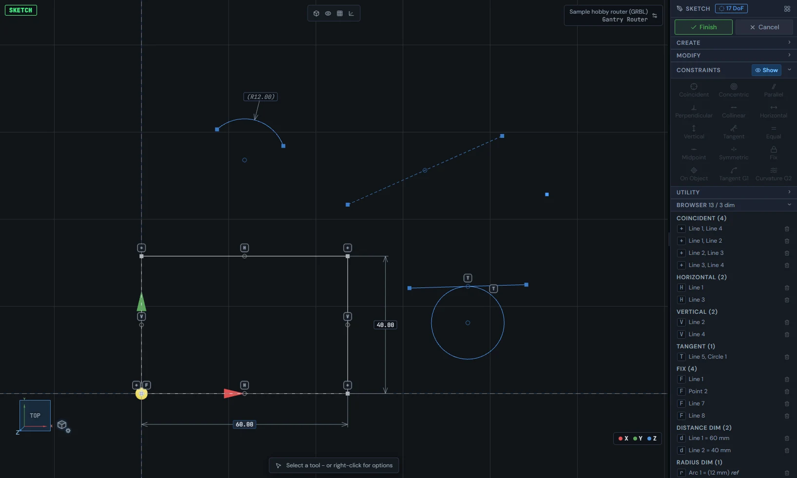

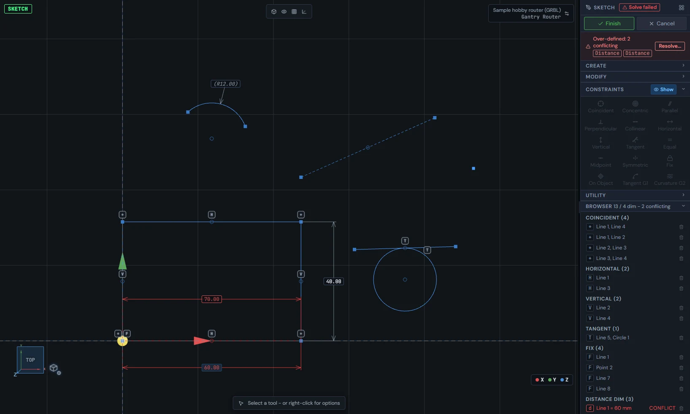

See also: [Constraints](Sketch#sketch-constraints), [Smart dimensions](Sketch#sketch-dimensions), [Sketch size limits](Sketch#sketch-limits).

## Trim, split, extend, offset, mirror, patterns, move

The Modify section reshapes existing geometry: trim, split, extend, offset, mirror, linear, circular and path patterns, move, rotate, scale and delete.

The Modify section holds Smart Dim., Reference, Trim, Split, Extend, Fillet, Chamfer, Offset, Mirror, Linear Pat., Circular Pat., Path Pat., Move, Rotate, Scale and Delete. The tools that end with a value (offset, patterns, move, rotate, scale) show a strip at the bottom of the viewport where you type it; OK (Enter) applies and Cancel (Esc) backs out.

1. Trim (T): hover a curve to see what a click removes, then click it, or drag across several to trim them in one sweep. The piece between the nearest crossings goes; a curve that crosses nothing is deleted whole. New cut ends stay on the curve they were cut against.
2. Split (K): click a line or arc to break it in two at that point - nothing is removed and the two pieces stay joined. A circle needs a second click.
3. Extend (E): click the line or arc, then move toward the boundary you want it to reach - a ghost shows the result - and click.
4. Offset (O): click a curve or chain, move the cursor to the side you want and click to lock that side (click again to flip it), set Distance in the strip, and press OK.
5. Mirror (M): click the entities to mirror, then click a construction line to mirror about it. To use any other line as the axis, press Confirm (Enter) first, then click the line. The copies are tied to the originals with symmetric constraints.
6. Linear Pattern (1): click the entities, Confirm, then click the start and end of one step. Set Count in the strip and press OK.
7. Circular Pattern (2): click the entities, Confirm, then click the center. Set Count and Step (the angle between copies) in the strip.
8. Path Pattern (3): click the entities, Confirm, then click the line, arc, spline, elliptical arc or chain to follow. Set Count, choose Equal spacing or Fixed distance, and tick Follow tangent to turn each copy with the path.
9. Move (V), Rotate (W), Scale (X): click the entities and Confirm. Move: click a base point and a destination. Rotate: click the center, a point on the reference direction and a point on the target direction. Scale: click the base point, then type the factor or click a reference point and a target point. The strip shows dX / dY, Angle or Factor to adjust; tick Keep original to make a copy instead.

Right-click a selection and the menu offers Mirror, Linear Pattern, Circular Pattern, Path Pattern, Fillet, Chamfer, Offset, Move, Rotate and Scale "with selection": the tool starts with those entities already picked.

Delete removes the selection (Del or Backspace does the same), together with any constraints and dimensions that referred to it. Copy (Ctrl+C) and Paste (Ctrl+V) are on the right-click menu.

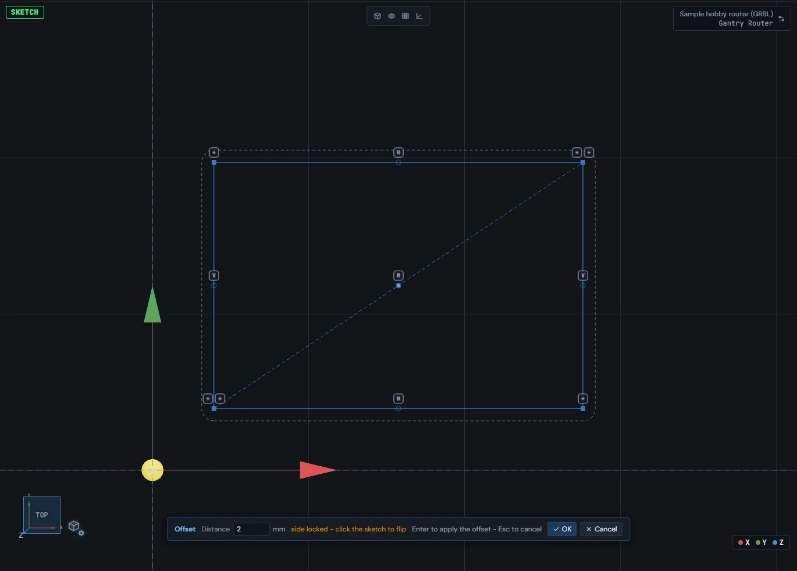

See also: [Sketch fillet and chamfer](Sketch#sketch-fillet-chamfer), [Drawing entities](Sketch#sketch-draw-tools).

## Sketch fillet and chamfer

Fillet (F) rounds corners with true tangent arcs and Chamfer (H) cuts them with a flat - both stage several corners with ghost previews and apply them all at once.

1. Arm Fillet (F) or Chamfer (H).
2. Click a corner point, or click two lines that meet. The corner is staged and a ghost shows the result. Keep clicking to stage more corners; click a staged corner again to remove it.
3. Set the size in the strip at the bottom of the viewport, or type it into the box beside the first staged corner. The ghosts follow the value.
4. Press Apply (or Enter) to add them all as one step; Cancel (or Esc) drops the staged set. The first fillet added gets a driving radius dimension; the others are tied to it as equal, so changing that one dimension later resizes the whole set.

The Chamfer strip offers three ways to size it: Equal distance (one Setback on both legs), Two distances (d1 and d2), or Distance and angle.

A radius too big for a corner is refused with a console line giving the largest radius that fits.

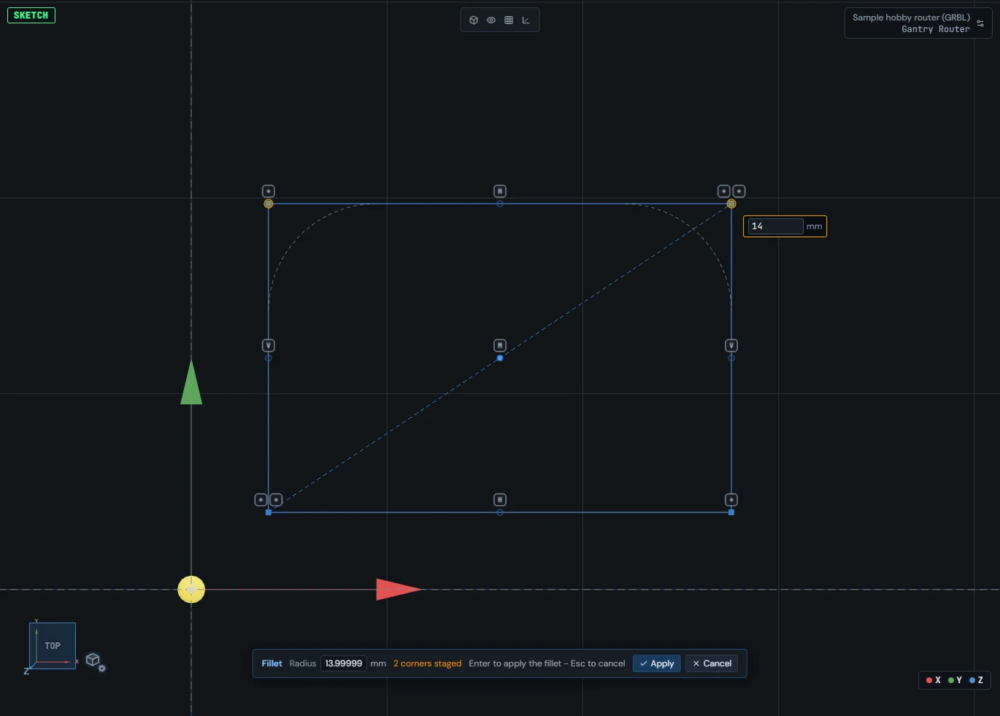

See also: [Trim, split, extend, offset, mirror, patterns, move](Sketch#sketch-modify-tools), [Constraints](Sketch#sketch-constraints).

## Construction geometry

Construction entities are layout lines: they draw dashed, take part in constraints and dimensions like any other geometry, and are never baked into cutting geometry.

1. With entities selected, press Q (or click Construction in the Create section, or right-click \> Toggle construction) to switch them between normal and construction.
2. With nothing selected, Q (or the Construction button) turns construction mode on: everything you draw arrives as construction until you turn it off. The console says when it is on.
3. Use construction lines as mirror axes, symmetry lines and layout guides - constraints and dimensions treat them like any other geometry. Mirror accepts a construction line as its axis with a single click.

When the sketch is finished, construction entities and lone points are left out of the bake, so they never become a toolpath source. They stay in the sketch and are there when you open it again.

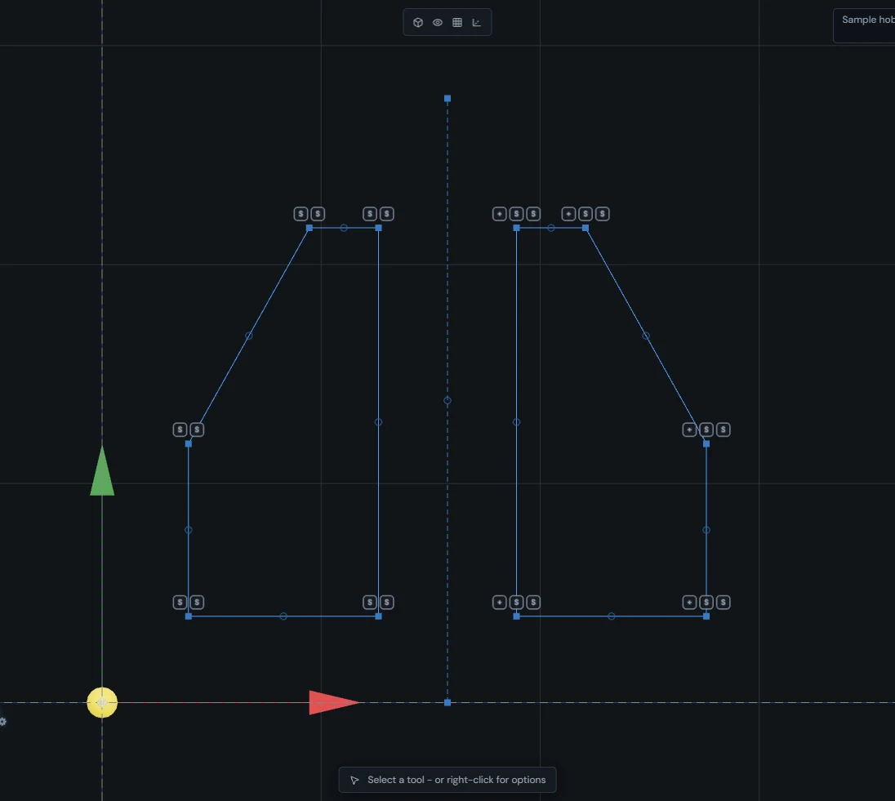

See also: [Drawing entities](Sketch#sketch-draw-tools), [Finishing a sketch](Sketch#finish-and-bake).

## Snaps and inferred constraints

Three snap toggles - Entity snaps, Grid snap and Inference - guide the cursor while drawing, and Inference turns snapped clicks into real constraints when you commit.

1. Entity snaps pulls the cursor to endpoints, midpoints, centers and intersections of existing geometry.
2. Grid snap pulls to grid points. "Grid spacing" under the toggles is the same value the viewport grid uses, so the snap and the drawn grid always agree.
3. Inference shows horizontal and vertical alignment guides while you draw and remembers each snapped click. When the entity is drawn, those snaps become real constraints: a click on an endpoint becomes a coincident, a level or upright segment becomes horizontal or vertical.
4. Hold Shift to lock the current segment to the nearest of the eight 45-degree directions; the lock wins over the alignment guides.

The three toggles and Grid spacing are in the Utility section of the toolbox. A lit toggle is on.

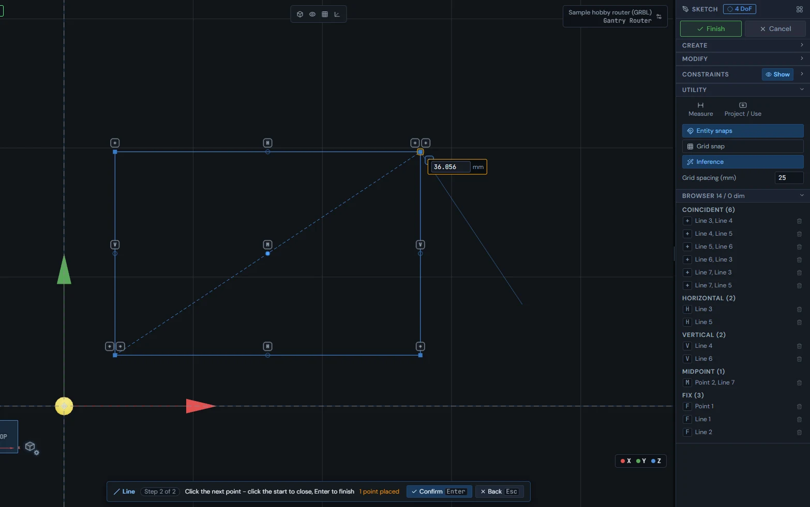

See also: [Drawing entities](Sketch#sketch-draw-tools), [Constraints](Sketch#sketch-constraints).

## Blocks

A block groups entities into one rigid object you place, scale and rotate as a unit - copies can share one definition, and Edit block changes the contents in place.

1. Select entities and right-click \> Group into block. The block moves as one rigid shape. With one block selected, a "Block" row in the toolbox sets Scale (x) and Rotation (deg).
2. Right-click a block \> Edit block, or double-click it, to edit it in place: an "Editing block" row with Finish and Cancel appears under the Finish button at the top of the sketch tools and the rest of the sketch dims. Finish (or Enter) freezes it again; Cancel (or Esc) throws the edit away.
3. Right-click a block \> Place another instance to add a copy that shares its definition - editing the definition once changes every copy.
4. Right-click a block \> Explode block to turn it back into ordinary entities.

A block's rotation can be constrained: Horizontal, Vertical, Parallel and Perpendicular accept a block and turn it like a line. An imported DXF or SVG layer opens in the sketch as one block - a single rigid object that counts as fully defined - so a large import is something you place rather than hundreds of loose lines. Explode it to edit the imported curves.

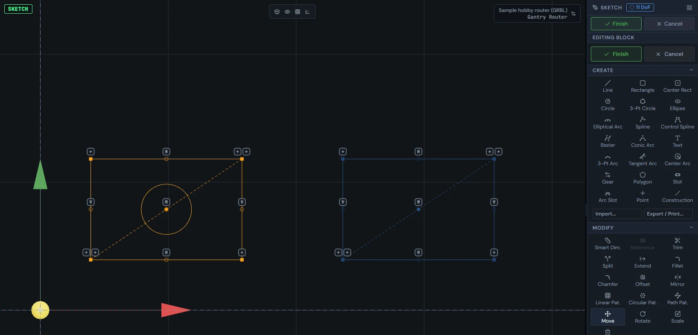

See also: [Project / Use](Sketch#project-use), [Starting a sketch](Sketch#sketch-entry).

## Project / Use

The Project / Use tool copies a loop from another 2D layer into your sketch as fixed geometry you can dimension and constrain against.

1. Click Project / Use in the Utility section.
2. Hover a loop on another visible 2D layer (a locked layer works too) and click it.
3. The loop arrives as fixed geometry, so it is a steady reference to dimension and constrain against. The Browser lists the copies under References, and the console says how many entities came in.

A copy from a layer is static: it does not change if that layer changes later. With construction mode on (Q), the copy comes in as construction, so it guides your drawing without ever being baked. A click that misses says so in the console.

In a sketch in the Model workspace, the same tool also takes a model face (its outline and holes come in together), a model edge or a model point, and those copies stay linked to the model and follow it when it changes.

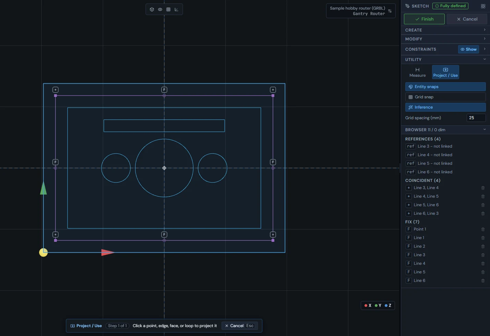

See also: [Blocks](Sketch#sketch-blocks), [Constraints](Sketch#sketch-constraints).

## The measure readout

Measure (I) shows the size of what you select - lengths, radii, angles and spacing - without adding a dimension.

1. Press I or click Measure in the Utility section to open the readout.
2. Select one entity to see its size: a line shows Length, dX, dY and Angle; a circle Radius, Diameter and Circumference; an arc Radius, Arc length and Sweep; a point its X and Y.
3. Select two entities to see the spacing between them: the readout names the two points it measured between (for example line midpoint to line midpoint) and shows Distance, dX, dY and the Angle of that spacing.
4. Press I or click Measure again to close it. Measure never adds anything to the sketch.

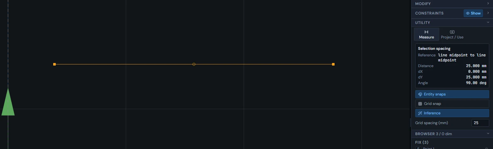

See also: [Smart dimensions](Sketch#sketch-dimensions).

## Finishing a sketch

Finish (at the top of the sketch tools) bakes the sketch onto its layer as cutting loops and keeps the sketch itself, so you can open it again later with everything intact.

1. Click Finish at the top of the toolbox. Connected entities chain into loops, sorted into outlines and holes, and land on the layer the same way imported DXF loops do - ready for operations. The console says how many loops were baked and how many are closed. You return to the tab you came from.
2. Clicking another tab at the top does the same bake, so leaving the Sketch tab never throws work away.
3. Cancel throws away everything done since you opened the sketch and puts it back the way it was.
4. Opening the layer again brings back the sketch with all its constraints and dimensions.

Finishing an empty sketch removes the layer it made, so trying things out never leaves empty layers in the design tree. Construction entities and lone points are left out of the bake.

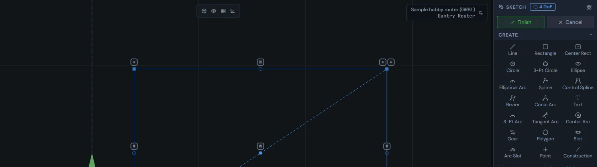

See also: [Starting a sketch](Sketch#sketch-entry), [Construction geometry](Sketch#construction-geometry).

## Sketch size limits

The constraint solver works in a fixed amount of memory: large sketches are solved piece by piece, and a single connected piece that is too big fails with an error instead of guessing.

The sketch solver runs in a fixed 16 MB of memory. Above 150 entities, the sketch is split into its separate connected pieces and each piece is solved on its own - the answer is the same as one big solve, because geometry that is not connected cannot affect other geometry.

The split cannot help a single piece where hundreds of entities are all tied together by constraints. If such a piece is too big, the solve fails with an error rather than giving wrong geometry. A block enters the solver as one piece no matter how many curves it holds, which is why an imported layer, which opens as one locked block, stays small to solve.

See also: [Blocks](Sketch#sketch-blocks), [Under-defined, fully defined, conflicting](Sketch#sketch-definition-states).

## Fixing an over-defined sketch

A constraint or dimension that would contradict the sketch is taken back at once and named in the status bar; a sketch that already holds a contradiction shows a red Over-defined banner with a Resolve list.

When you add a constraint or a dimension, change a dimension's value, or switch a reference dimension to driving, and the result would contradict the rest of the sketch, the app does not keep it. It is removed straight away, the sketch stays as it was, and the status bar and console name what it conflicts with, for example: "Parallel rejected: conflicts with Coincident(Line 1, Line 4), Coincident(Line 1, Line 2), ... Distance(Line 2 = 40)".

The chip beside the Sketch title shows the solver's verdict: "N DoF" (that many degrees of freedom remain), "Fully defined", "Not solved" (no verdict yet) or "Solve failed". If a sketch already holds a contradiction when it is opened, the chip reads "Solve failed" and a red banner reads "Over-defined: N conflicting" with the names of the first members of the conflicting set.

1. Press Resolve... on the red banner.
2. The list "Conflicting set (N) - remove one to resolve" shows each member with its value, for example "Line 1 = 70 mm", marked CONFLICT. Hover a row to highlight what it binds in the sketch.
3. Click the trash button on the member to remove (its tooltip reads "Remove this constraint/dimension to resolve the conflict"). The list refreshes with whatever conflict remains.
4. The list closes by itself when nothing is left to resolve; Close hides it sooner.

Redundant is different from conflicting: a redundant constraint adds nothing new but does not break the sketch. It shows as an amber row "N redundant (advisory)" with a Review... button, and its list reads "Redundant (N) - advisory, removal optional".

See also: [Keyboard shortcuts](Getting-around#keyboard-shortcuts).
