<!-- Generated from the in-app Help by tools/release/help-to-wiki.mjs. Do not edit by hand. -->

# Toolpaths 2.5D

- [Operation generation failures](#generation-failures)
- [Creating an operation](#creating-operations)
- [What an operation cuts](#operation-sources)
- [2D contour](#contour)
- [2D pocket](#pocket)
- [Drilling](#drill)
- [Bore milling](#bore)
- [Thread milling](#thread-milling)
- [2D chamfer](#chamfer-op)
- [Engraving](#engrave)
- [V-carving](#vcarve)
- [2D facing](#face-op)
- [Adaptive clearing](#adaptive-clearing)
- [Adaptive linking and stay-down](#adaptive-linking)
- [Feeds and speeds hierarchy](#feeds-speeds)
- [Operation folders and suppression](#operation-folders)
- [Cut-time estimates](#cut-time)
- [The tool library](#tool-library)
- [Tool shapes](#tool-geometry)
- [Tool holders](#tool-holders)
- [Importing and exporting tools](#tools-import-export)
- [Tool reach: Stopped short](#rub-warnings)
- [Thread mill tools](#thread-mill-tool)
- [Probe tools](#probe-tool)
- [Everything says outdated after opening](#outdated-after-open)
- [A toolpath vanished](#missing-toolpath)

## Operation generation failures

When an operation cannot make its toolpath, it keeps the reason and shows it on the operation instead of making a path.

1. Look at the status icon on the operation row in the design tree: a green tick is ready, an amber clock needs recomputing, a red circle failed, and a red triangle means the model geometry it cut is gone. Hover the icon for the reason.
2. Select the operation. The Summary group in the Properties panel shows its Status and, when it failed, the Error message. An outdated operation also gives its reason on the amber badge hover and in Summary Status, such as its tool changed or an earlier named operation changed after it was computed. Regenerate to update. The same error message is written to the console at the bottom of the screen.
3. Fix what the message names, then click Regenerate in the Properties panel, click the play button on the row (Compute toolpath), or press G.
4. A red triangle does not clear by regenerating. Open the operation with Edit operation and pick its geometry again.

A collapsed setup or folder shows a badge when something inside it needs you: red for an error, an amber clock for an operation that needs recomputing.

When the tool cannot reach the full depth, the operation still makes its toolpath and says so: the row shows an amber arrow, and the Properties panel shows a Reach row marked Stopped short with the depth it reached and how much path was left uncut.

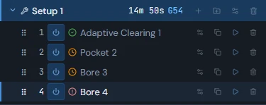

See also: [Where error details live](Getting-around#error-details), [Setup and WCS](Setup-Stock-and-Workholding#setup-wcs).

## Creating an operation

The New Operation dialog takes you through type, tool, geometry, passes, heights, linking and feedrate on one set of tabs.

1. In the CAM workspace, click the + (Add operation) button on a setup row, or right-click the setup and choose Add operation, or select a setup and press N. An empty setup also shows an Add Operation button.
2. On the Type & Name tab, click an operation card under Operation type. Type a name under Operation name, or leave it blank for the default name.
3. Work through the tabs: Tool, Geometry, Passes, Heights, Linking and Feedrate. The six 3D operations, V-Carve and Thread Mill have no Linking tab.
4. Click Create Operation. The toolpath starts computing straight away. If the button is greyed out, hover over it to see what is still missing, for example "Go to the Tool tab and select a tool first".
5. To change an operation later, double-click its row, click its Edit operation button, or right-click it and choose Edit operation. The same dialog opens as Edit Operation, and its button reads Save & Recompute.

Press G to recompute the selected operation. Press Shift+G, or click REGEN ALL at the top of the design tree, to recompute every operation that is not suppressed.

Each operation cuts from the material that the earlier operations in its setup left, counting only operations that are switched on. When an earlier operation is changed, moved or suppressed, the operations after it are marked for recomputing.

> **Tip:** The Feedrate tab already reads the feeds and speeds saved with the tool in the Tool Library. The Passes tab of the 2D and hole operations also has Shank clearance under Tool assembly: the gap kept between the neck, shank or holder and the part or remaining stock.

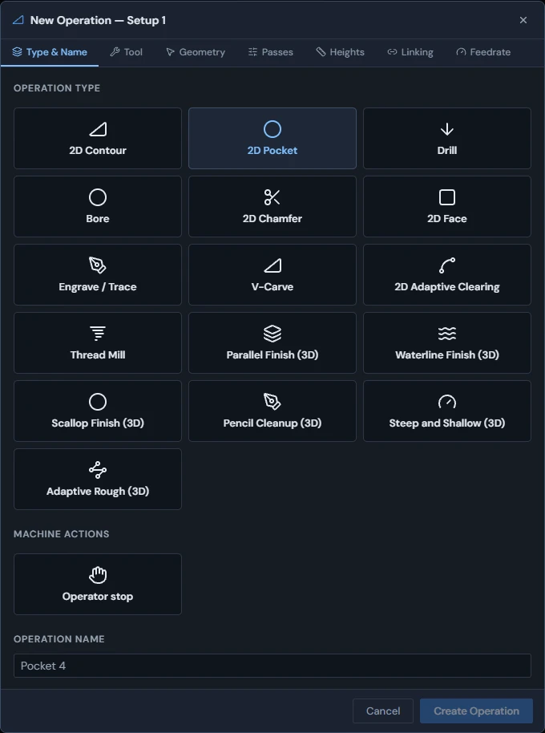

See also: [What an operation cuts](Toolpaths-2.5D#operation-sources), [Operation generation failures](Toolpaths-2.5D#generation-failures), [Feeds and speeds hierarchy](Toolpaths-2.5D#feeds-speeds).

## What an operation cuts

The Geometry tab is where you tell an operation what to cut: loops from a drawing, edges or faces of a model, holes, the stock, or a whole solid.

Every operation reads what it cuts from the Geometry tab of the operation dialog. What the tab offers depends on the operation and on the part you choose.

1. Choose the part from the list, or click Pick source part in viewport and click it. All Parts combines the loops of every part.
2. Under Loops to machine, click All loops, tick loops in the list, or click Pick from viewport and click loops in the 3D view. The dialog stays open while you pick; click Done, or press Esc, when you have them.
3. For a STEP model or a body built in the Model workspace, the From 3D model buttons pick straight from the part, for example Pick edges (a chain of model edges), Pick face (a hole or boss wall), Section at Z (the outline at one height), and, for Drill, Detect holes.
4. 2D Pocket and 2D Adaptive Clearing can clear the whole stock instead: set Boundary source to Stock. 2D Face offers Stock, Contour, or Rest (only what earlier pocket operations left behind).
5. For a modeled body, 2D Face, 2D Contour, 2D Pocket and 2D Adaptive Clearing also show Machining boundary: click Pick face on model and that face outline limits where the operation cuts.
6. The 3D operations take a whole solid under Source solid: an STL, a STEP model, or a body modeled in the Model workspace. The 3D finishes can also be limited to chosen faces of a STEP part under Faces to machine.

With Boundary source set to Stock and a STEP model in the project, 2D Pocket and 2D Adaptive Clearing show a green Auto from 3D model chip for what the software worked out from the model. Click Set manually to choose it yourself.

> **Tip:** If Create Operation is greyed out, hover over it: it names the missing pick.

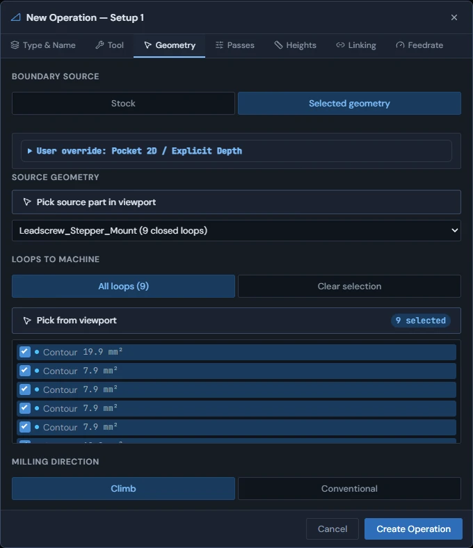

See also: [Creating an operation](Toolpaths-2.5D#creating-operations), [Drilling](Toolpaths-2.5D#drill), [3D parallel finish](Toolpaths-3D#parallel-3d).

## 2D contour

2D Contour cuts along a profile at one or more depths, with four cutting strategies, open paths, holding tabs and ramped entry.

1. On the Geometry tab, pick the profile loops. Under Tool position choose Outside profile or Inside profile, and choose the Milling direction (Climb or Conventional).
2. For a line that does not close, set Path type to Open contour and choose Left of drawn path or Right of drawn path. An open contour runs its ends out past the stock, so it starts and ends outside the material.
3. On the Passes tab, set the Stepdown and pick a Cutting strategy: Cut at the geometry (no roughing), Roughing only (leave stock on the wall), Rough + finish each stepdown, or Rough + finish at final depth. The roughing choices show Stock to Leave - Radial and Axial; the two Rough + finish choices also show Finish passes.
4. On the Linking tab, choose Plunge or Ramp (linear) and the Ramp angle. An open contour always plunges, outside the stock.
5. To keep the part attached, tick Hold the part with tabs on the Linking tab and set Tab width, Tab height, Tab count and Tab shape (Box or Triangular (ramped)). Tab height is measured up from the stock bottom.

Passes \> Advanced has Spring passes, Contour overlap and, for a closed contour, Corner relief. On the Heights tab, click the Top Height or Bottom Height row open to reach Target End, which sets where the cut stops; a flat drawn profile cuts down to the stock bottom. Passes that would only cut air that earlier operations already removed are left out.

A closed contour with roughing has a Roughing style: Offset (one loop per stepdown, the default) or Trochoidal, which cuts a channel wider than the tool in overlapping orbits so a deep stepdown takes a light side load. Trochoidal shows Channel width (1.15 to 2.5 x the tool diameter) and Advance per orbit; tabs, entry, stock to leave and the finish pass work as with Offset, and a hole too small for the channel is roughed with Offset.

The operation refuses tabs with Roughing only, triangular tabs narrower than twice their height, and tabs when the setup has no stock.

| Corner relief | What it cuts |
| --- | --- |
| None | Nothing: the inside corners keep the rounded fillet a round cutter leaves, with a radius equal to the tool radius (the default). |
| Dogbone | Out along the bisector of each inside corner until the cutter just touches the corner point. |
| T-bone | Along the corner edge nearer parallel to X until the cutter just touches the corner point. |
| Longest edge | Like T-bone, along the longer corner edge. |

The relief is sized to the tool of this operation and runs after the profile at the same stepdowns, so a square tenon or slot-together part seats fully: rough with a big tool and no relief, then finish with the small tool and relief on.

> **Tip:** Tabs can be placed by hand. After the toolpath is computed, select the operation and click Edit tab locations in the Properties panel: click the contour to add a tab, drag a tab to slide it, double-click a tab to remove it, then click Done placing tabs or press Esc. Reset to even spacing puts them back.

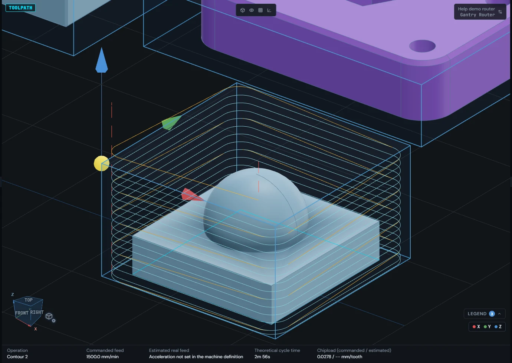

See also: [Creating an operation](Toolpaths-2.5D#creating-operations), [2D pocket](Toolpaths-2.5D#pocket), [2D chamfer](Toolpaths-2.5D#chamfer-op).

## 2D pocket

2D Pocket clears a closed region in rings, leaves islands standing, enters by helix, ramp or plunge, and finishes the wall.

1. On the Geometry tab, set Boundary source: Selected geometry (pick the pocket loops) or Stock (clear the whole stock footprint). Loops inside the boundary are islands and are left standing.
2. On the Passes tab, set the Stepdown and the Stepover. The Stepover is a length and starts at 35% of the tool diameter.
3. Stock to Leave - Radial is for the walls and Stock to Leave - Axial for the floor. With Finish contour pass on pocket wall ticked, the walls are cut to size at the end; untick it to leave the radial stock standing. An axial value makes the last clearing level cut the floor to size on its own.
4. Under Advanced, choose the Fill strategy (Outside-in or Inside-out), Ring overlap, Stepover lead-in (Direct or Arc), Rounded ring corners, Multiple pocket order (By region or By depth), Corner relief, and the wall finish with its Finish passes and Spring passes.
5. On the Linking tab, choose the entry. With Inside-out it is Helix or Plunge; with Outside-in it is Profile Ramp or Plunge. Set the Helix diameter (% of tool diameter), the Ramp angle, and Helix start above material - how far above the remaining material the helix starts.

Stay down to finish contour, under Advanced with the wall finish, lifts the tool only by the Stay-down lift and ramps into the finishing contour instead of retracting. Switching the Fill strategy turns it on for Outside-in and off for Inside-out. Passes that would only cut air that earlier operations already removed are left out.

Slot feed, under Advanced, is the feed where the cutter cuts full width, as a percent of the cutting feed: the first ring into fresh stock runs at it, and wherever a later ring cuts wider than the stepover (into an inside corner, beside an island) the feed eases down toward it and back up as the cut narrows. 100% keeps every cut at the cutting feed; the posted program, the cut time and the simulation all use the slower feeds.

Rounded ring corners, under Advanced, takes the corners of each clearing ring as arcs instead of points, so the machine keeps its speed through them; the ring outside already cuts what the arc skips, so the floor and walls come out the same. The wall ring keeps its corners, and so does any corner where the next ring out does not reach.

| Corner relief | What it cuts |
| --- | --- |
| None | Nothing: the inside corners of the wall and of an L-shaped island keep the rounded fillet a round cutter leaves, with a radius equal to the tool radius (the default). |
| Dogbone | Out along the bisector of each inside corner until the cutter just touches the corner point. |
| T-bone | Along the corner edge nearer parallel to X until the cutter just touches the corner point. |
| Longest edge | Like T-bone, along the longer corner edge. |

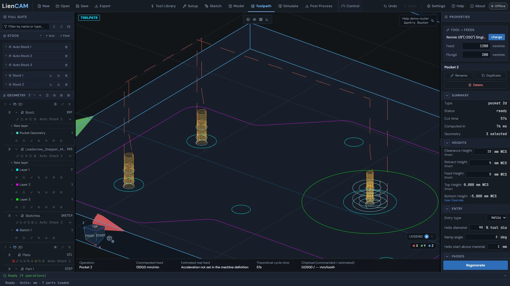

See also: [Adaptive clearing](Toolpaths-2.5D#adaptive-clearing), [2D contour](Toolpaths-2.5D#contour), [What an operation cuts](Toolpaths-2.5D#operation-sources).

## Drilling

Drill drills at the centre of each picked or detected hole, with four drilling cycles and a depth for every hole.

1. On the Geometry tab, tick hole loops under Loops to machine (a closed loop is drilled at its centre). For a STEP model or a modeled body, click Detect holes under From 3D model, or Pick face and click the hole walls.
2. On the Passes tab, under Drilling cycle, pick Simple (G81), Peck (G83), Chip break (G73) or Dwell (G82), and set the Peck depth, Chip-break retract or Dwell time the cycle uses.
3. Under Advanced, set Hole ordering: Nearest neighbour, By X, By Y, or As selected.
4. On the Heights tab, click the Top Height or Bottom Height row open to reach Depth policy. Detected physical floors (recommended) takes each hole's floor from the model. A detected blind floor gets no extra drill-point depth; a through hole keeps point compensation and Breakthrough past floor. Explicit Material Start and Target End uses the two WCS heights you type; typing a WCS height into the Top Height or Bottom Height row also switches to it.
5. On the Linking tab, Between-hole retract chooses Clearance height or Retract height for the moves between holes.

With Break through off, the drill tip stops at a detected blind flat floor; the cone above the tip remains above that floor. Break through remains your setting. If the hole cannot be identified as blind or through, the existing point compensation is kept. An explicit Target End remains the tip height; with Break through on, point length is added so the full diameter clears that end.

The Per-hole depths table on the Passes tab lists every hole. Type a bottom Z to change one hole, or leave it on auto to keep its depth. Click #1, #2 and so on to highlight that hole in the view.

Circles from a DXF, SVG or sketch have no floor to detect. With Detected physical floors, the operation refuses them by name and asks for explicit Material Start and Target End - set Depth policy to that.

Posts that support canned cycles get G81, G82 and G83 blocks. Chip break, and pecks that shrink, are written out as plain moves. In the Properties panel, Peck decrement makes each peck shorter than the one before, down to Min peck depth.

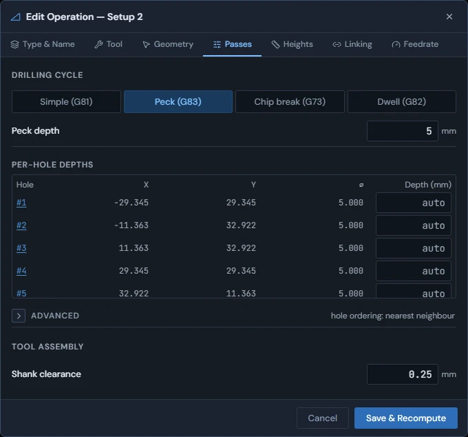

See also: [Thread milling](Toolpaths-2.5D#thread-milling), [What an operation cuts](Toolpaths-2.5D#operation-sources), [Creating an operation](Toolpaths-2.5D#creating-operations).

## Bore milling

Bore mills holes larger than the tool in circles, with roughing orbits, finish and spring passes, and a depth for each hole.

1. On the Geometry tab, tick circular loops, or for a STEP model or modeled body click Pick face and click the inside wall of each hole. Each hole is bored on its own.
2. On the Passes tab, under Bore milling, leave Target diameter on auto to bore each hole at its own size, or type one size for every hole. It cannot be larger than any picked hole.
3. Set Maximum stepdown and Radial stepover, then Radial stock to leave, Finish passes, Spring passes and Overlap (how far each circle runs past its seam).
4. Choose the Milling direction (Climb or Conventional) and the Bore ordering: Nearest neighbor, By X, By Y, or As selected.
5. On the Heights tab, the Top Height and Bottom Height rows open to the same Depth policy as Drill: detected floors from the model, or explicit WCS heights. Circles from a drawing need the explicit choice.
6. On the Linking tab, choose the Entry type (Helix or Plunge) and the Ramp angle.

The operation refuses, and names the hole, when a hole is too small for the tool, when the Target diameter is larger than a picked hole, when a loop is not round enough, when a picked cylinder is a boss instead of a hole, and when the tool is a drill, V-bit or ball mill.

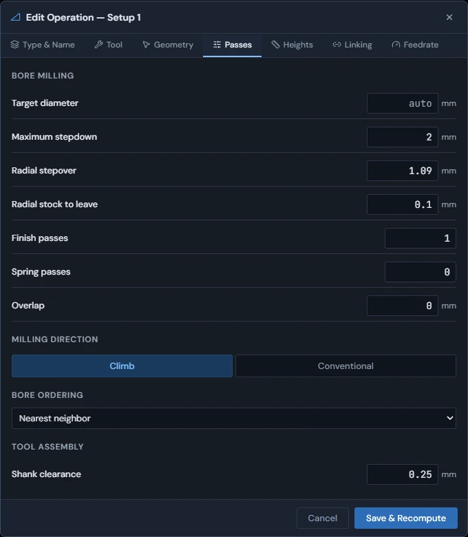

See also: [Drilling](Toolpaths-2.5D#drill), [Thread milling](Toolpaths-2.5D#thread-milling), [What an operation cuts](Toolpaths-2.5D#operation-sources).

## Thread milling

Thread Mill cuts internal or external threads with a helix, with size presets and a cylinder pick that fills in the thread for you.

1. Pick the hole or boss. On a STEP model or a modeled body, click Pick face and click the cylinder wall: the operation reads whether it is a hole or a boss, sets the nearest standard thread size, and takes the top and the thread depth from the cylinder. A 2D circle also works; then set the Thread kind (Internal or External) yourself.
2. On the Passes tab, pick a Thread size preset (metric coarse M3 to M24 and common UNC and UNF sizes), or leave it on Custom and type the Major diameter and Pitch, or TPI.
3. Set the Radial stepover and Spring passes. Advanced holds Handedness (Right-hand or Left-hand), Lead in / out, and Cut direction (Climb or Conventional).
4. On the Heights tab, click the Top Height or Bottom Height row open to set the thread datum and the Thread depth. For a picked boss, Thread reference chooses Top of cylinder (down) or Base (up).

There is no Z stepdown and no Linking tab. Each pass is one continuous helix that moves one pitch per turn over the full thread depth. An internal thread steps its orbit outward pass by pass, and an external thread steps inward. An internal thread is milled in a hole that is already there: the operation checks the hole diameter, not its depth.

The operation refuses by name when the tool is too large for the major diameter, when the tool does not fit the hole, and when the hole is already as large as the thread.

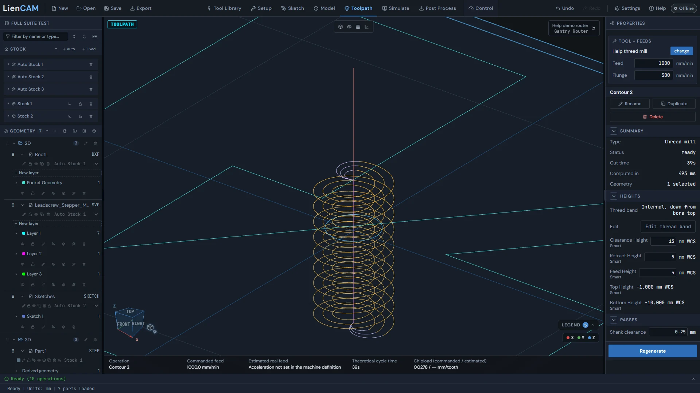

See also: [Drilling](Toolpaths-2.5D#drill), [What an operation cuts](Toolpaths-2.5D#operation-sources).

## 2D chamfer

2D Chamfer runs a V-bit or chamfer mill along closed profile edges and cuts a bevel to the depth you set.

1. Choose a tool with a tip angle (a V-bit or chamfer mill). If the tool has no angle, the operation refuses and asks you to set it in the Tool Library.
2. On the Geometry tab, pick the closed loops, or on a modeled body click Pick edges and pick a closed loop of edges. Set each loop to Outside or Inside (holes start as Inside), and choose the Milling direction.
3. On the Passes tab, set the Chamfer width: the depth of the chamfer below the reference plane. Tip offset takes the tool deeper so it cuts higher up the flute, and moves the path out so the bevel stays the same size.
4. The line under the fields shows the tool angle, the depth and the total Z drop.
5. On the Heights tab, click the Top Height or Bottom Height row open: Reference plane sets where the depth is measured from. On the Linking tab, choose Plunge or Ramp (linear).

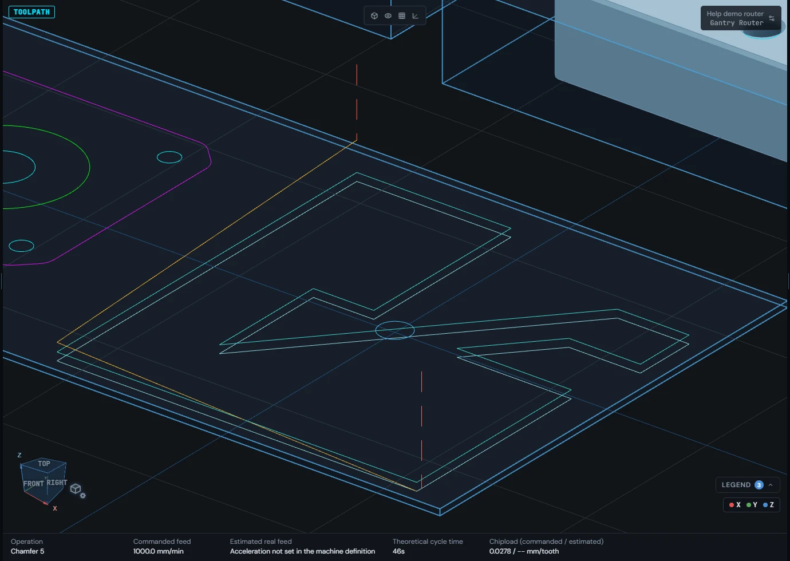

See also: [2D contour](Toolpaths-2.5D#contour), [Engraving](Toolpaths-2.5D#engrave), [Creating an operation](Toolpaths-2.5D#creating-operations).

## Engraving

Engrave rides the tool along open or closed curves, at a depth you set or at a depth worked out from a line width, flat or following a curved surface.

1. Pick the curves to follow. Open paths (such as single-stroke text) and closed loops both work. On a modeled body, click Pick edges to follow model edges. Curves to follow, under Advanced on the Passes tab, sets whether Open paths, Closed loops or both are cut.
2. On the Passes tab, choose the Mode: V-engrave or Trace.
3. In V-engrave, click Depth from line width and type the Target line width: the depth is worked out from the tool tip angle. Otherwise the depth is the Engraving depth on the Heights tab.
4. On the Heights tab, click the Top Height or Bottom Height row open and enter the Engraving depth. That is the depth the operation uses; Create Operation becomes available once the height preview resolves. Choose Flat depth, or Follow the surface to cut the same depth below a curved part surface.
5. Stepdown splits the depth into passes, and Axial offset moves the cut up or down.

Advanced also has the tool position (On the line, Left or Right, with a Side offset), the direction (As drawn, Climb or Conventional), and Lead-in radius and Lead-out radius. With Follow the surface, a path that runs off the part stays at the last surface height there.

Trace with the tool on the line has a Style: Plain (one pass along the line, the default) or Trochoidal, which cuts a slot wider than the tool, centred on the line, in overlapping orbits so a deep slot or keyway takes a light side load. Trochoidal shows Slot width (1.15 to 2.5 x the tool diameter) and Advance per orbit. The slot along an open line ends round at the end points of the line, around a closed loop it closes with no ridge, and a curve too short for one orbit is cut Plain.

See also: [2D chamfer](Toolpaths-2.5D#chamfer-op), [What an operation cuts](Toolpaths-2.5D#operation-sources).

## V-carving

V-carve follows the centre line of letters and shapes with a V-bit, going deeper where the outline is wide and rising to a sharp point at every corner.

1. Pick the closed outlines to carve: outline text, logos, shapes from a DXF or SVG, or on a modeled body click Pick edges and pick a closed chain of edges. Letter counters (the hole in an O) are handled for you; a rectangle drawn around text carves the field and leaves the letters standing. Overlapping outlines are joined.
2. Choose a V-Bit / Chamfer or Chamfer Mill tool on the Tool tab. Its tip angle sets how depth follows width: the wider the outline at a point, the deeper the bit goes.
3. On the Passes tab, choose the Carve depth. "Bit's own limit" carves as deep as the bit reaches at its full diameter, or its flute length if that is shorter. "Flat depth" stops at a depth you set and clears the wider areas as a flat floor.
4. Under Flat areas, choose who clears the flat floors: Clear with this bit (Floor stepover sets the spacing), Separate end mill (pick it under Clearing tool; a second operation named after the carve, ending in "- flat clearing", is made and kept just before it), or Leave floors.
5. Start depth carves below the surface, for carving inside a pocket. Allowance, under Outline, grows or shrinks the outlines. Stepdown splits a deep carve into passes (0 is one pass). Tolerance sets how closely the path follows the outline.

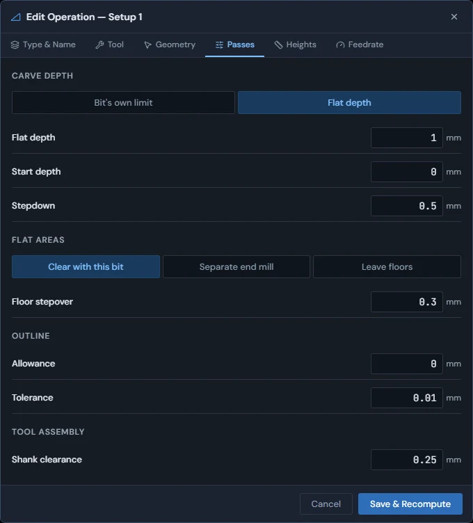

V-Carve has no Linking tab. It refuses by name when the tool has no usable tip angle, and when a Flat depth is deeper than the bit can cut.

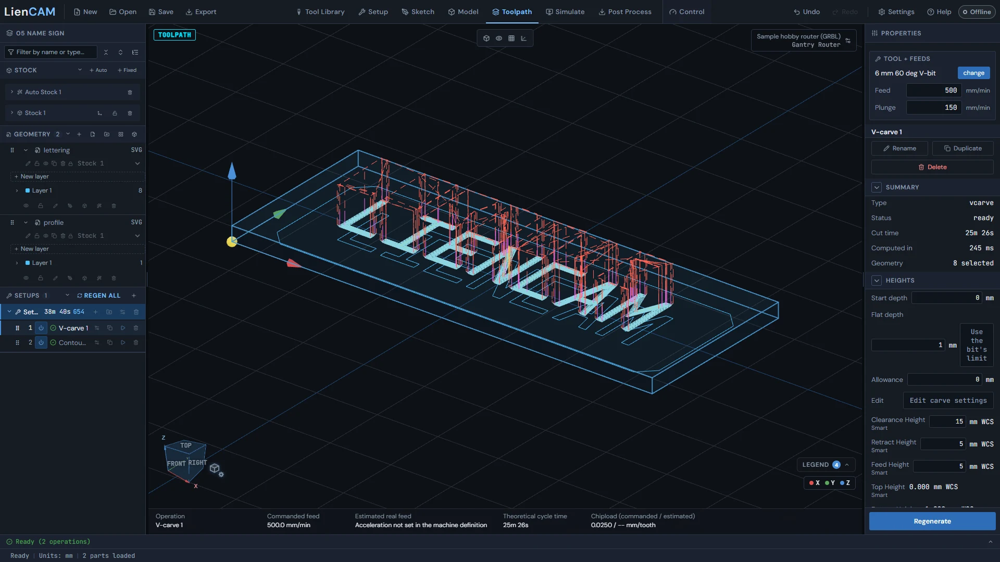

See also: [Engraving](Toolpaths-2.5D#engrave), [2D chamfer](Toolpaths-2.5D#chamfer-op), [What an operation cuts](Toolpaths-2.5D#operation-sources).

## 2D facing

2D Face surfaces the top of the stock with passes that run past the edges so the cutter fully clears it.

1. On the Geometry tab, set Boundary source: Stock faces the whole stock top with no pick, Contour faces inside a loop you pick, and Rest faces only what earlier pocket operations left behind.
2. On the Passes tab, pick the Strategy: Zigzag, One-way climb, One-way conv., or Offset (rings from the outside in). Set the Stepover (it starts at 70% of the tool diameter) and the Stepdown for more than one level.
3. Under Advanced, set Pass extension (how far each pass runs past the edge; auto is half the tool diameter), Pass angle, Stock offset, Boundary containment (Outside, Centre or Inside the boundary), and Alternate direction each level (on at first).
4. On the Heights tab, Finished face starts at Model top (recommended) when the setup stock holds a model. You can choose Selected model face (click Pick finished face in workspace) or Explicit WCS plane (type the Z) instead. Without a model top, choose a finished face or type the plane before creating the operation.

In Properties, the Model top row shows the smart bottom in WCS units. Typing a Z replaces it with your own plane; Use model top restores the smart choice. The bottom follows the model top, so facing removes the stock above the part rather than cutting down to the stock bottom.

Stock to Leave - Axial stops the upper levels short of the face; the last level still cuts to the finished face. Rest cannot be combined with the Offset strategy.

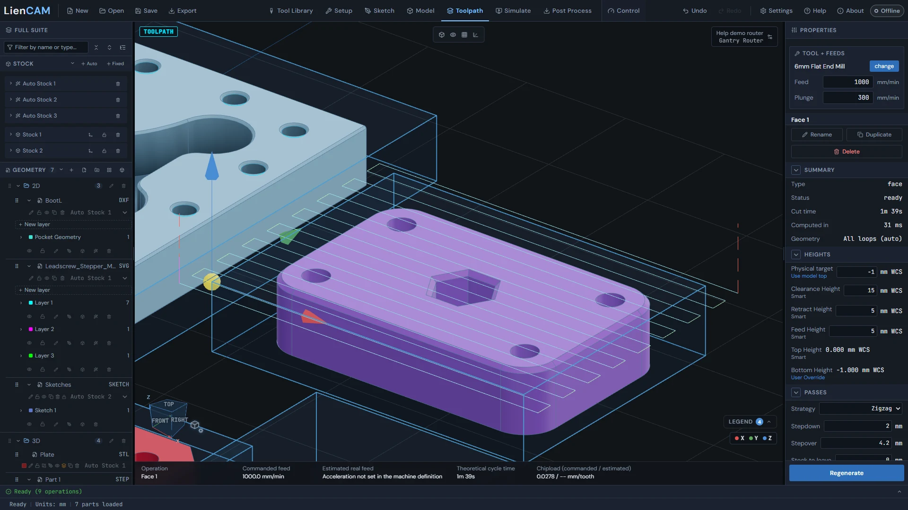

See also: [2D pocket](Toolpaths-2.5D#pocket), [Creating an operation](Toolpaths-2.5D#creating-operations).

## Adaptive clearing

2D Adaptive Clearing roughs a region while holding the side load on the tool near the value you set.

A pocket follows fixed rings. Adaptive clearing steers the path instead, so the width of cut stays near the Optimal load in corners and slots too.

1. On the Geometry tab, set Boundary source: Selected geometry (pick the loops, or on a modeled body click Pick edges) or Stock. Choose the Milling direction; a new adaptive starts on Conventional.
2. On the Passes tab, set the Optimal load (stepover) - a length that starts at 25% of the tool diameter - the Tolerance, and the Maximum stepdown. The path is cut again at each level down to the bottom.
3. Set Stock to Leave - Radial and Axial for later finishing. With an axial stock to leave, Floor finish pass runs the clearing once more at the true floor at the finish feed; with no axial stock it does nothing.
4. On the Linking tab, choose the Entry type (Helix or Plunge), then the Helix diameter (% of tool diameter), the Ramp angle and the Minimum helix radius. Where a helix would have to be smaller than that, the tool plunges instead.

> **Tip:** The Tolerance field trades path accuracy against compute time.

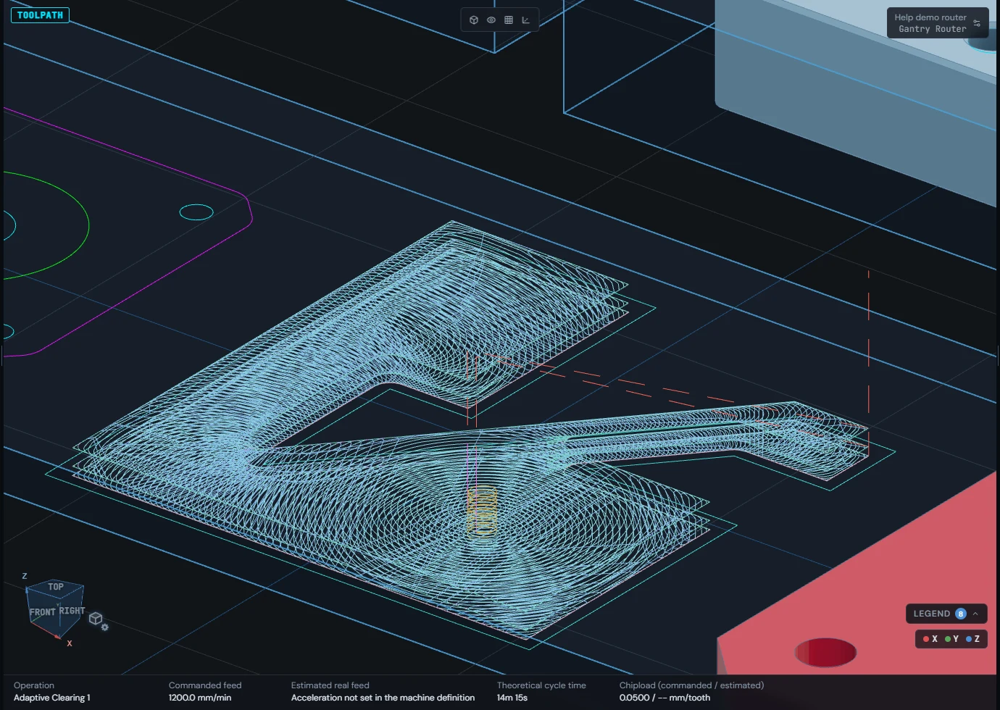

See also: [Adaptive linking and stay-down](Toolpaths-2.5D#adaptive-linking), [2D pocket](Toolpaths-2.5D#pocket), [3D adaptive roughing](Toolpaths-3D#adaptive-3d).

## Adaptive linking and stay-down

The Stay-down options keep the adaptive cutter down between passes instead of retracting, moving over and plunging again.

The Stay-down section of the Linking tab replaces retract-and-plunge moves with rides along a wall that is already cut. The tool rides only when both ends of the move are on the same wall and the ride is short enough; otherwise it lifts.

1. Integral wall-follow (on at first) rides the wall at depth instead of retracting.
2. Maximum direct wall ride sets how long that ride may be, as a percent of the straight-line distance (200% at first).
3. Wall cleanup as we go (integrated finishing) rides the wall out of each pass and back into the next, cleaning the wall every pass. Loopback fillet (% of tool radius) sets how tight the turn-arounds are.
4. Final wall cleanup contours the walls and islands at the end. Wall finish depth chooses At final depth (leaves stock to leave standing), At each stepdown (leaves stock to leave standing), or Finish pass at final depth (cuts to size). Wall finish lead-in radius and lead-out radius add arcs on and off the wall.

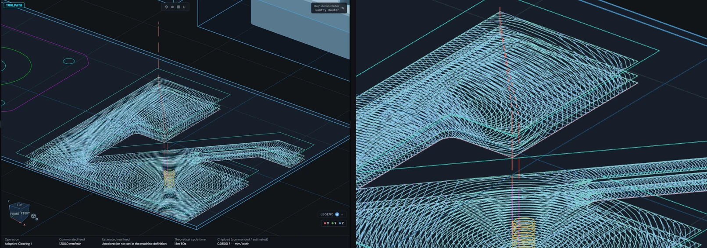

See also: [Adaptive clearing](Toolpaths-2.5D#adaptive-clearing), [2D pocket](Toolpaths-2.5D#pocket).

## Feeds and speeds hierarchy

Operations take feeds and speeds from the tool library unless you override them for one operation, inside the machine's limits.

The Feedrate tab of the operation dialog shows where the numbers come from. With the override off, it shows the selected tool's saved values, read-only: Spindle speed, Cutting feed, Plunge feed, Ramp feed, Lead-in feed, Lead-out feed, Fast traverse feed and Finish feed. Change them in the Tool Library and every operation using the tool follows.

1. To use different values for one operation, tick "Override tool feeds & speeds for this operation" on the Feedrate tab. The fields fill in from the tool, with the spindle speed kept inside the machine's range.
2. Type the spindle speed and feeds. Hover over a field to see its allowed range. A value outside it is set to the nearest limit, and the console says what it changed.
3. The limits come from the machine: its spindle range for Spindle speed, its X axis cutting speed for the cutting feeds, its Z axis for Plunge feed, and its rapid rate for Fast traverse feed.

Fast traverse - the speed for repositioning moves inside areas already cut - is never faster than the machine rapid rate. In the Properties panel, the Tool + Feeds card has a "change" button to swap the tool, and its Feed and Plunge fields set an override for that operation.

> **Tip:** If the tab says the tool has no saved feed and speed defaults, add them in the Tool Library once instead of overriding every operation.

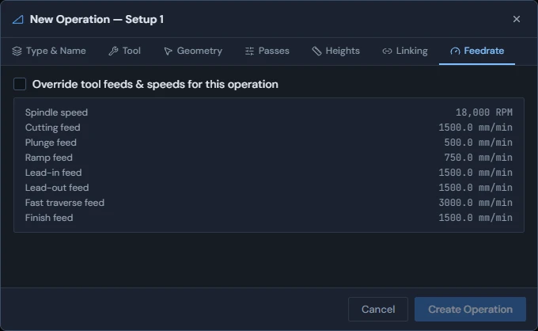

See also: [Creating an operation](Toolpaths-2.5D#creating-operations), [Cut-time estimates](Toolpaths-2.5D#cut-time).

## Operation folders and suppression

Group operations into folders in the design tree, and suppress the ones you want skipped by regeneration, simulation and posting.

1. Click the New operation folder button on a setup row, name the folder, then drag operations into it by their handle. Drag one back to the setup to take it out. Folders can be renamed and collapsed.
2. Click an operation's power button (Suppress operation), or right-click it and choose Suppress. A suppressed operation is dimmed and is skipped by REGEN ALL, the post processor and simulation; it keeps its settings.
3. Click a folder's power button to suppress or enable every operation in it at once. A folder with some of each shows a mixed state; clicking it enables them all.
4. A suppressed operation cannot be computed: its compute button is greyed out until you unsuppress it.

Right-click a folder to Rename it, Suppress all or Enable all, or Delete it. Delete folder and keep operations removes the folder and leaves its operations in the setup. Suppressing or enabling an operation marks the operations after it for recomputing, because they cut from what it leaves.

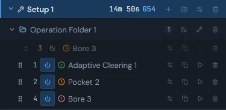

See also: [Creating an operation](Toolpaths-2.5D#creating-operations), [Operation generation failures](Toolpaths-2.5D#generation-failures).

## Cut-time estimates

Every ready operation shows an estimated machine run time, and each setup adds up its switched-on operations.

1. Select a ready operation and read Cut time in the Summary group of the Properties panel.
2. The setup row in the design tree shows the total for its ready operations that are switched on; suppressed operations are left out.
3. For a nest, select the nest: Est. cut time in the Properties panel covers every copy, including the travel between copies.

The estimate follows the toolpath at its programmed feeds, with rapids at the machine rapid rate. When the machine definition gives acceleration for X, Y and Z, the estimate also slows down for acceleration and corners. Feed override at the controller is not included.

If an operation shows "Unavailable (recompute to fix)", or the setup total shows Unavailable, regenerate the operation to bring it back.

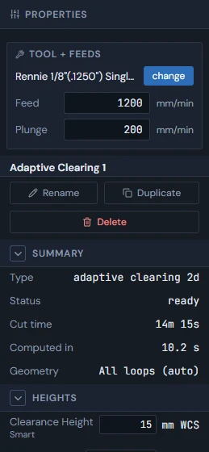

See also: [Feeds and speeds hierarchy](Toolpaths-2.5D#feeds-speeds), [Operation generation failures](Toolpaths-2.5D#generation-failures).

## The tool library

The Tool Library window holds every cutter in named libraries, with search, filters, and a tabbed editor with a live tool diagram.

Open it with Tool Library in the top toolbar. The window has two views, switched by the Tools / Holders toggle in the header. The Tools view shows a list pane on the left and an editor on the right. Tools live in named libraries: the dropdown at the top of the list scopes it to one library (with its tool count) or to All libraries, the + button creates a new library, and the pencil and trash buttons rename or delete the selected library (deleting a library asks first and deletes its tools too).

1. Find a tool with the search box (matches name, type, and T number), or narrow the list with the material filter. While a search or filter is on, the list says how many tools it shows and Clear resets it.
2. The type dropdown is a focus control: choosing a type expands that group and folds the others shut, without hiding any tools. Sort by Type, Name, Diameter, or Tool # - the Type sort groups the list into collapsible sections. Each row shows the diameter, flute count (a probe shows "probe" instead), the library (in All libraries) and the tool number badge.
3. Below the list, New starts a blank tool in the selected library, Dup copies the selected one, Import brings in a tool file as a new library, and the export button saves All tools or just the selected library (Lib).
4. Edit the selected tool in the four editor tabs while the diagram on the right redraws live from your values: General (name, type, material, coating, holder, vendor, product ID, notes), Cutter (the dimensions and shape), Cutting Data (spindle speed, feeds and coolant, with a "? Material guide" table), and Post (tool number and cutting hand).

Edits are a draft until you press Save Changes in the footer; switching tools or libraries, or closing the window, with unsaved edits asks "Discard unsaved changes?" first. The footer also holds Delete and a per-tool Export. Operations pick their cutter from this library, and each tool's Cutting Data supplies the default feeds and speeds an operation starts from.

### Tool numbers

The Post tab's Tool number is the T word the program calls the tool by; it shows as the T badge in the list. Left blank ("Auto-post"), the post gives the tool the lowest number no other library tool uses and says so, for example "Tool "60deg V-Bit" has no tool number, so it posts as T7." Two different tools with the same number in one program stop the post with a message naming both. Resolve the conflict in Post Process \> Properties \> Tool numbers: give one tool a number for this program and press Enter or click away. The choice is saved with the project, while the tool library keeps its own number. Cutting hand picks the spindle direction: Right-hand cutting (standard) keeps the machine direction; Left-hand cutting (reverse spindle) reverses it.

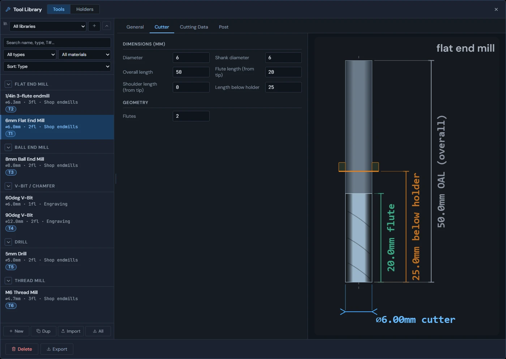

See also: [Tool shapes](Toolpaths-2.5D#tool-geometry), [Probe tools](Toolpaths-2.5D#probe-tool), [Importing and exporting tools](Toolpaths-2.5D#tools-import-export), [Tool holders](Toolpaths-2.5D#tool-holders), [Feeds and speeds hierarchy](Toolpaths-2.5D#feeds-speeds).

## Tool shapes

All 19 tool types share one geometry model - a profile revolved around the tool axis - and that same profile drives the 2D diagram, the 3D tool in the viewport, and stock-removal simulation.

Every tool is described as a solid of revolution: a radius-versus-height outline from the tip upward, mirrored across the centerline. The 2D diagram in the editor, the 3D tool drawn in the viewport, and the shape the simulation carves with all read this one profile, so what you see in the editor is what cuts in simulation. The 19 types are grouped as milling (flat, ball, bull nose, face mill, chamfer mill, tapered endmill, dovetail, lollipop, slitting saw), hole-making (drill, spot drill, center drill, countersink, reamer, boring bar), threading (tap, thread mill), engraving (V-bit), and probing (probe).

The Cutter tab shows only the fields the selected type actually uses. Every type has Diameter, Shank diameter, Overall length, Flute length (from tip), Shoulder length (from tip), Length below holder, and Flutes - except the probe, which has no Flutes, and whose Diameter and Flute length read "Ball (tip) diameter" and "Stylus length (from tip)" (see "Probe tools"). A bull nose adds Corner radius; undercut families (dovetail, lollipop, slitting saw, thread mill) add Neck diameter and "Relief / shoulder length" for the narrowed section above the cutting form. The diagram labels the cutter diameter, flute length, length below holder and overall length as you type.

1. Pointed tools - V-bit, chamfer mill, drill, spot drill, center drill, countersink, and dovetail - take the "Included tip angle", and an echo line shows the equivalent per-side angle.
2. The tapered endmill takes the "Taper angle (per side)" instead, with the included total echoed below.
3. Press the ? button beside any angle field for a live diagram that draws both conventions at your current value and highlights the one you should enter.

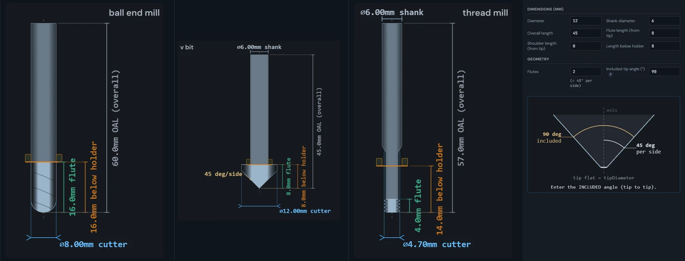

See also: [The tool library](Toolpaths-2.5D#tool-library), [Thread mill tools](Toolpaths-2.5D#thread-mill-tool), [Probe tools](Toolpaths-2.5D#probe-tool), [Stock simulation](Simulate#stock-simulation).

## Tool holders

Holders are a stack of cone or cylinder segments kept in their own list; assign one to a tool and the viewport draws the full tool-plus-holder assembly above the stickout.

Switch the Tool Library header toggle to Holders to open the holder editor. A holder is defined by a segment table: each row is one slice with a Height, a Lower OD, and an Upper OD, stacked from the tool side upward ("Segments (bottom = tool side, up)"). Cylinders have equal lower and upper diameters; cones taper between them. Add segment adds a row, the arrows reorder rows and the trash button removes one. The Identity fields above the table are Name, Vendor, Product ID and Gauge length.

1. In the Holders view, press New to create a holder, then edit its segment rows - every change is kept immediately (holders have no Save button) and redraws the silhouette preview at true proportions.
2. On a tool's General tab, pick the holder from the Holder dropdown (or None), then Save Changes.
3. Set "Length below holder" on the Cutter tab - the stickout. The General tab shows it read-only. The holder is drawn starting that far above the tool tip, so the viewport shows the real assembly.

The holder also counts when a toolpath is generated: the path is kept so the holder stays clear of the part and stock (see "Tool reach: Stopped short"). Delete asks first; tools that used the deleted holder fall back to no holder.

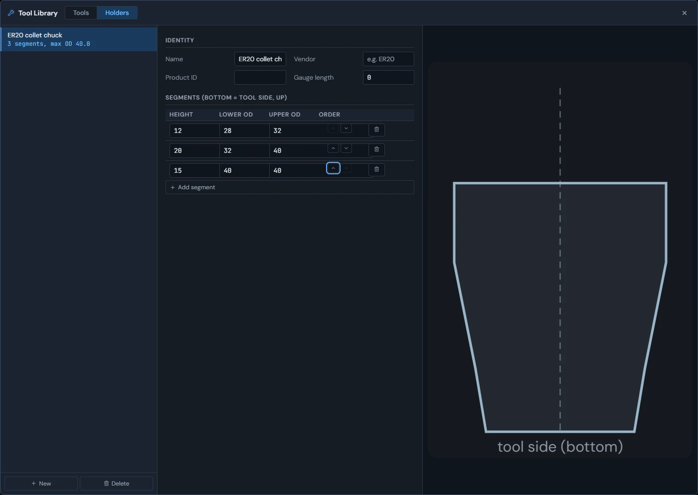

See also: [The tool library](Toolpaths-2.5D#tool-library), [Tool reach: Stopped short](Toolpaths-2.5D#rub-warnings).

## Importing and exporting tools

Tools travel as JSON files or industry-standard .tools archives; every import lands as its own new library named after the file.

1. Press Import below the tool list and pick a .tools file (a zipped tool library, as exported by common CAM tools) or a .json export from this app.
2. The file arrives as a NEW library named after the file, and the list jumps to it - imports never mix into your existing libraries.
3. Holders embedded in the file are imported too, and each tool keeps its link to its holder.

Exporting goes three ways: the Export button in the footer saves the selected tool as a single .tool.json file (with its holder embedded), and the export button below the list saves either every tool (All, when the scope is All libraries) or just the selected library (Lib) as one .json file. All of these re-import.

After an import, a line below the buttons says how it went (for example "Imported 5 tools into library "Shop endmills"") and the bottom console keeps the full message. A record the app cannot read is skipped and named in the console with the reason; the rest of the file still imports. A file that yields no tools at all leaves no empty library behind.

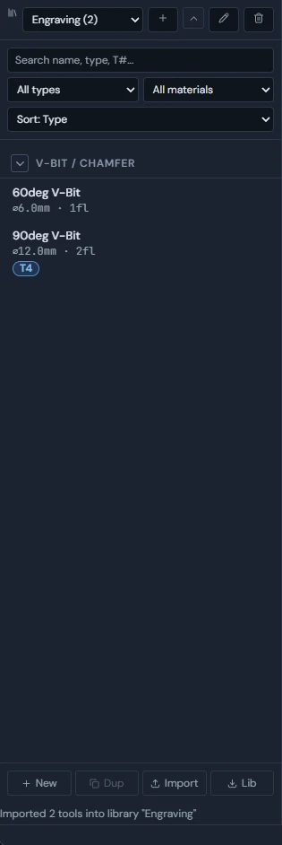

See also: [The tool library](Toolpaths-2.5D#tool-library).

## Tool reach: Stopped short

Every toolpath is kept to what the tool can reach - the neck, shank and holder stay clear of the part, the stock and any workholding - and an operation that could not reach full depth says "Stopped short".

When an operation generates, the app checks the whole tool assembly along the path: the cutter, the neck, the shank above the flutes, and the holder above the Length below holder. Where the neck, shank or holder would come closer than the Shank clearance to the part, the stock (what earlier operations left, when that is known) or a workholding body, the cut is stopped there and picks up again where it is clear. The rest of the toolpath is kept, and the operation stays ready to post.

An operation that was stopped short shows it in three places: an amber arrow icon on its row in the design tree, a Reach row with a "Stopped short" badge in the Summary group of its Properties panel (hover it for the whole message, for example "Stopped short: reached Z 9.25 of Z 0 asked - 4263.4 mm of cutting path left uncut; a tool with a longer reach cuts the rest."), and one console line naming where the first stop happened and what would have touched.

1. The Shank clearance field (0.25 mm unless you change it) is in the operation's Properties panel, Passes group, on 2D Contour, 2D Pocket, 2D Adaptive Clearing, Drill, Bore, 2D Chamfer, 2D Face, Engrave / Trace, V-Carve and Thread Mill. Other operations use 0.25 mm.
2. The limits come from the tool: Flute length and Length below holder on the Cutter tab, the neck fields on undercut tools, and the holder assigned on the General tab.

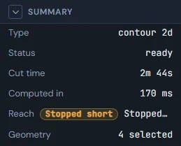

See also: [Tool holders](Toolpaths-2.5D#tool-holders), [Operation generation failures](Toolpaths-2.5D#generation-failures), [Workholding: vises and clamps](Setup-Stock-and-Workholding#workholding).

## Thread mill tools

A thread mill adds a Thread form section to the Cutter tab - tooth count, form angle, and pitch - and the diagram draws the toothed cutter live.

Choose the Thread Mill type and the Cutter tab gains a Thread form section. Thread teeth (vertical) sets how many cutting teeth stack up the flute: 1 is a single-point cutter, more makes a full-form cutter. Thread form angle (degrees included) is the included angle of the tooth V (60 degrees for standard metric and unified forms), and Thread pitch is the spacing between teeth - leave it blank to draw a plain cylinder.

Because thread mills are relieved above the cutting form, the type also shows Neck diameter and "Relief / shoulder length", plus a Neck transition angle (measured from the tool axis) that shapes the blend from neck to shank - 90 is a sharp step, smaller values a gentler taper. All of these draw live in the editor diagram, teeth included, and shape the 3D tool shown in the viewport and the cutter the simulation carves with.

> **Tip:** The Thread Mill operation cuts the pitch set in its own Pitch field; the tool's pitch describes the cutter's teeth.

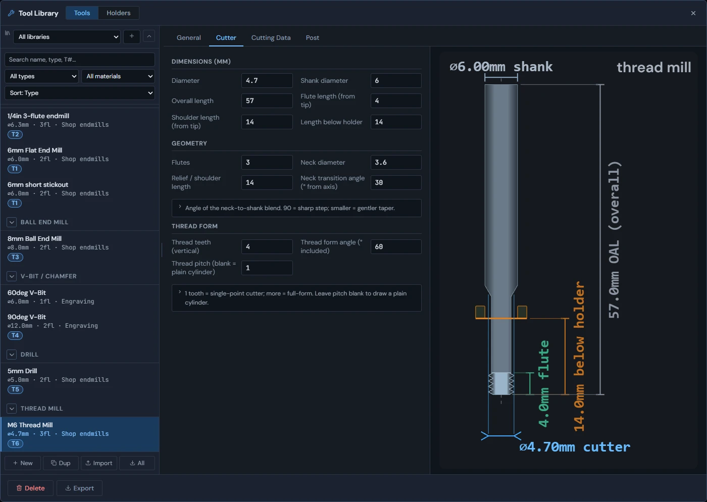

See also: [Tool shapes](Toolpaths-2.5D#tool-geometry), [Thread milling](Toolpaths-2.5D#thread-milling).

## Probe tools

The Probe tool type keeps a touch probe in the tool library: its ball, stylus and stem sizes, which probe input it is wired to, and whether its contact is normally open or normally closed.

To add a probe, press New below the tool list, choose Probe in the Type dropdown on the General tab, fill in the Cutter tab, then press Save Changes. A probe has no Flutes field. Its row in the list shows "probe" where other tools show the flute count, and the Type sort gathers probes in their own Probe group.

1. Ball (tip) diameter is the diameter of the ball on the end of the stylus. The diagram labels it "ball".
2. Stylus length (from tip) is the length of the stylus from the ball tip up to the probe body. The diagram labels it "stylus".
3. Shank diameter is the diameter of the probe body above the stylus. Overall length, Shoulder length (from tip) and Length below holder are the same fields every tool has (see "Tool shapes" and "Tool holders").
4. Stem diameter, under Geometry, is the thin stem that carries the ball. It shows "auto" until you type a value, and on auto the diagram draws a stem thinner than the ball. Empty the box to go back to auto.

The Probe section says how the probe is connected and what radius to use for it:

1. Probe input is the controller probe input the probe is wired to: Probe 1 or Probe 2. A new probe starts on Probe 1.
2. Contact is Open (NO) for a normally open probe or Closed (NC) for a normally closed one. A new probe starts on Open (NO).
3. Calibrated radius X and Calibrated radius Y are the probe radius along X and along Y. Left blank, each box shows the ball radius (for example "ball 1.000" for a 2 mm ball) and the note below them reads "Blank calibrated radius = the ball radius is used." Type a value to set one; empty the box to go back to the ball radius.

See also: [The tool library](Toolpaths-2.5D#tool-library), [Tool shapes](Toolpaths-2.5D#tool-geometry), [Tool holders](Toolpaths-2.5D#tool-holders).

## Everything says outdated after opening

Operations reopen with an amber clock badge when their toolpath could not come back with them - every setting is kept, and regenerating rebuilds the toolpath.

An amber clock badge on an operation means "outdated": the operation and all of its settings are kept, but it has no current toolpath. A project saved to a .camproject file keeps its toolpaths, so it reopens ready. An operation reopens outdated when the browser page was reloaded (the copy of the project the browser keeps does not hold toolpath moves), when it was still computing as the app closed, or when a toolpath saved in the file cannot be matched to the operation's current inputs - that saved toolpath is dropped rather than shown.

1. After a reload, the bottom console says how many need it, for example: "2 operations need regeneration (toolpaths are not saved to browser storage). Use Regen All to recompute."
2. Press Shift+G, or click REGEN ALL on the Setups header of the design tree (its tooltip reads "Regenerate all toolpaths (Shift+G)"), to recompute every operation.
3. To recompute one operation, select its row and press G, or right-click the row and choose Regenerate.

Post Process and sending a program to the machine recompute any outdated operation first, and the console names each one: "Recomputed "\<name\>": it was out of date, so it was recalculated before the program left the app."

> **Tip:** Outdated is also the normal state in a session after something an operation depends on changes - for example its geometry, the stock, or the WCS origin.

See also: [Operation generation failures](Toolpaths-2.5D#generation-failures), [Saving and opening projects](Getting-around#projects-save-open), [Generated-plane truth](Setup-Stock-and-Workholding#height-truthfulness).

## A toolpath vanished

If an operation points at a loop, hole or face that is no longer in its geometry, it turns red and names what is missing instead of drawing nothing.

An operation remembers exactly which loops, holes or edges it cuts. If the geometry it points at is rebuilt or removed so that a picked item is gone, generating the operation fails: its row gets a red badge, and the badge and the bottom console name what is missing, for example "Contour loop '\<id\>' no longer exists in the selected geometry scope." The console also shows "1 operation failed".

1. Hover the red badge on the operation row, or open the bottom console, to read which item is missing.
2. Open the operation and go to its Geometry tab.
3. Pick the loops, holes or faces again on the current geometry, then generate it (G).

Operations on a body built on the Model tab react when the model changes: if a face or body they use moved, they turn amber (outdated) with a note on the badge saying what moved; if the geometry is gone, they turn red (degraded) and the badge shows a note, or "Degraded - referenced model geometry is gone; re-select geometry.". A degraded operation keeps showing its last toolpath, and Post Process refuses it with "Operation "\<name\>" is degraded - its model geometry changed; re-select geometry and recompute before posting."

See also: [Operation generation failures](Toolpaths-2.5D#generation-failures), [What an operation cuts](Toolpaths-2.5D#operation-sources), [Everything says outdated after opening](Toolpaths-2.5D#outdated-after-open).
