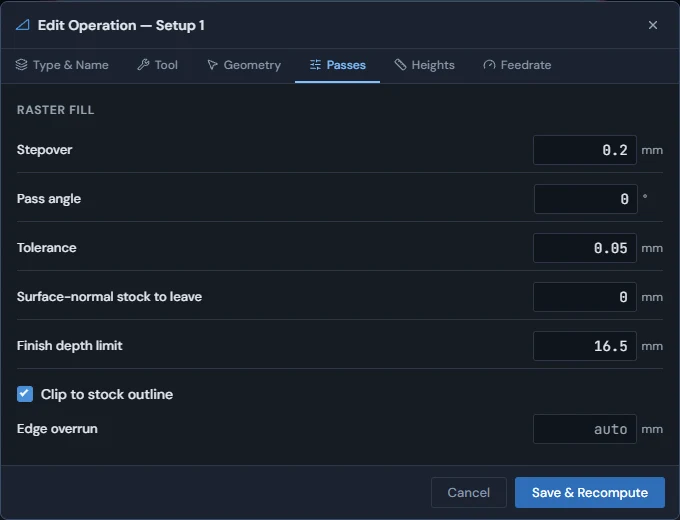
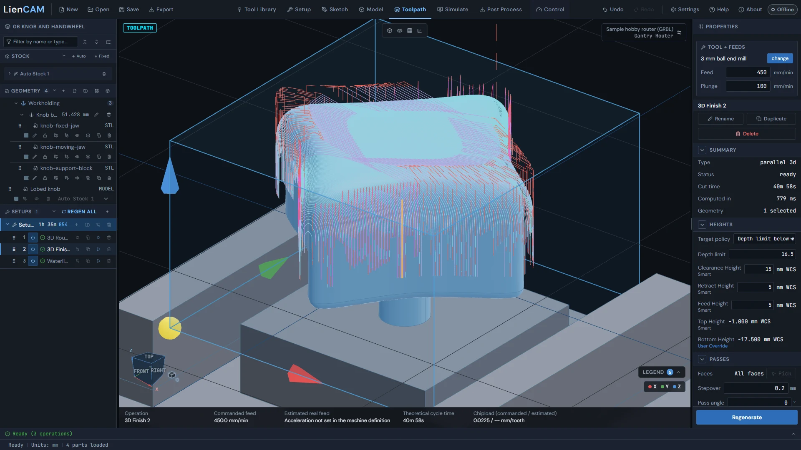
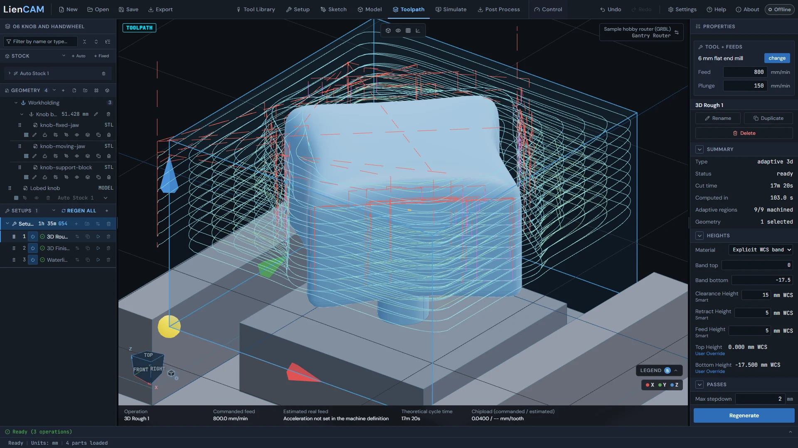

<!-- Generated from the in-app Help by tools/release/help-to-wiki.mjs. Do not edit by hand. -->

# Toolpaths 3D

- [3D parallel finish](#parallel-3d)
- [3D waterline finish](#waterline-3d)
- [3D adaptive roughing](#adaptive-3d)
- [3D constant scallop finish](#scallop-3d)
- [3D steep and shallow finish](#steep-shallow-3d)
- [3D pencil cleanup](#pencil-3d)

## 3D parallel finish

Parallel Finish (3D) lays parallel passes over the surface of a solid part.

1. On the Geometry tab, pick the part under Source solid: an STL, a STEP model, or a body modeled in the Model workspace. On a STEP part, Faces to machine can limit the finish to faces you pick.
2. Use a flat, ball or bull-nose end mill, or a V-bit. Create Operation stays greyed out for other cutters.
3. On the Passes tab, set the Stepover between passes, the Pass angle across the part, and the Tolerance.
4. If you need to, set Surface-normal stock to leave for a later pass, a Finish depth limit below the model top (blank finishes the full surface), and Clip to stock outline.

Clip to stock outline chooses the outline that holds the passes: the stock outline when ticked, the rectangle around the part when not. The tool may travel anywhere inside it, and cuts only where there is part to cut. Edge overrun lets the round cutter finish the edge instead of stopping with its centre on it: auto is the tool radius, and 0 leaves one radius of material standing as thin fins.

The passes follow the surface, so there is no Linking tab and no stepdown. The Heights tab takes the top and bottom from the part; Clearance, Retract and Feed come from the setup and, when the stock is known, are measured from the stock top.

See also: [3D adaptive roughing](Toolpaths-3D#adaptive-3d), [3D waterline finish](Toolpaths-3D#waterline-3d), [What an operation cuts](Toolpaths-2.5D#operation-sources).

## 3D waterline finish

Waterline Finish (3D) follows the part at one height, steps down, and follows it again - a finish for steep walls.

1. On the Geometry tab, pick the part under Source solid: an STL, a STEP model, or a body modeled in the Model workspace. On a STEP part, Faces to machine can limit it to faces you pick.
2. Use a flat, ball or bull-nose end mill. The Stepdown starts at 10% of the cutter diameter; the last step may be shorter so the bottom of the band is always cut.
3. Leave "Steep areas only, above" at 0 to finish the whole part, or set an angle to cut only the walls steeper than it.
4. Choose the Order: Region by region (the starting choice) finishes one pocket or boss to its bottom before moving on; Level by level cuts every wall at one height before stepping down.
5. Keep Flat area detection on so a floor that meets a wall gets a pass of its own. Stock to leave (walls) holds a wall allowance for a later pass. Also on the Passes tab: Tolerance, Finish depth limit, Direction (Climb or Conventional) and Clip to stock outline.

When the next level starts close to where the last one ended, the tool stays down: it feeds along the next loop and ramps onto it. Otherwise it retracts and comes back down. Finer tolerance follows the surface more closely but takes longer. A part too large for the slicer to take in one piece at your tolerance is sliced in tiles at that same tolerance and joined at the seams; the console says how many tiles it used. If the cutter itself is too wide for a tile at that spacing, the slicer uses a coarser spacing and the console reports the effective spacing.

See also: [3D parallel finish](Toolpaths-3D#parallel-3d), [3D steep and shallow finish](Toolpaths-3D#steep-shallow-3d), [What an operation cuts](Toolpaths-2.5D#operation-sources).

## 3D adaptive roughing

Adaptive Rough (3D) clears stock level by level with light adaptive passes, down to the shape of the part.

1. On the Geometry tab, pick the part to rough: an STL, a STEP model, or a solid made in the Model workspace. The operation plans against the part and the stock.
2. Use a flat, ball or bull-nose end mill. On the Passes tab set the Max stepdown, the Stepover (fraction of tool dia) - 0.4 is 40% of the diameter - and the Milling direction.
3. Choose the Roughing scope: Clear around part, or Clear all stock (everything that is not the part). With Clear all stock, Edge overshoot pushes passes past the stock edge (auto is the tool radius).
4. Entry is a helix: set the Entry helix diameter and the Helix angle. With Clear all stock, the tool comes in from the side instead when the software can prove the whole stock is clear around the part.
5. Set Radial stock to leave and Axial stock to leave for the finishing operations.

Reduce stair steps adds roughing cuts between full stepdowns so curved and sloped walls are left closer to shape. Wall transitions holds Wall lead-in radius, Wall lead-out radius, Loopback fillet, Integral wall-follow and Maximum direct wall ride. Tolerance and Auto grid resolution (untick it to set a Grid cell size) trade accuracy against planning time.

On the Heights tab, the Top Height and Bottom Height rows open to Material source, which chooses Current material (recommended), what the earlier operations left; Initial stock; or Explicit WCS band, between a Band top and Band bottom you type. The roughing path finishes with a vertical lift to its clearance plane, so the tool is raised before the posted tool change or program end stops the spindle.

See also: [Adaptive clearing](Toolpaths-2.5D#adaptive-clearing), [3D parallel finish](Toolpaths-3D#parallel-3d), [Stock simulation](Simulate#stock-simulation).

## 3D constant scallop finish

Scallop Finish (3D) spaces its passes along the surface to hold the Scallop height you set, so steep areas get passes closer together than flat ones.

Parallel Finish keeps the same stepover seen from above. Scallop measures its stepover along the surface instead: it works out one stepover from the Scallop height and the cutter, and spaces every pass by it. On a steep wall that puts the passes closer together seen from above, so the ridge left between passes stays the same height everywhere.

| Field | What it does |
| --- | --- |
| Scallop height | The ridge height the passes hold, everywhere on the surface. Lower is a smoother finish and more passes. It must be smaller than the cutter radius, or the corner radius for a bull-nose cutter. |
| Tolerance | How far the path may stray from the true surface. Lower follows it more closely and takes longer to compute. |
| Stock to leave | Material left along the surface - a positive value keeps stock for a later, finer finish. |
| Finish depth limit | How far below the model top to finish. Leave it blank to finish the whole surface. |
| Direction | Climb or Conventional for every pass. |
| Clip to stock outline | Off keeps the passes inside the rectangle around the part; on keeps them inside the stock outline. |
| Edge overrun | There is no field for it. With Clip to stock outline off, the tool centre runs one tool radius past the part edge, so the round cutter finishes the edge. With it on, there is no overrun, and the console says a fin may be left at the edge. |

Use a flat, ball or bull-nose end mill. The part is picked on the Geometry tab like the other 3D finishes, and Faces to machine can limit it to faces of a STEP part.

See also: [3D parallel finish](Toolpaths-3D#parallel-3d), [3D waterline finish](Toolpaths-3D#waterline-3d), [3D adaptive roughing](Toolpaths-3D#adaptive-3d).

## 3D steep and shallow finish

Steep and Shallow (3D) finishes a part in one operation: waterline levels on the steep walls, parallel passes on the flatter areas.

1. On the Geometry tab, pick the part under Source solid: an STL, a STEP model, or a body modeled in the Model workspace. On a STEP part, Faces to machine can limit it to faces you pick.
2. Use a flat, ball or bull-nose end mill.
3. On the Passes tab, set the Threshold (0 to 90 degrees). Walls steeper than it get waterline levels; areas flatter than it get parallel passes. The two overlap by a degree on each side so no strip is left between them.
4. Set the Steep stepdown for the levels, and the Shallow stepover and Shallow pass angle for the parallel passes.
5. Set the Tolerance, Stock to leave, Finish depth limit (blank finishes the full surface) and Clip to stock outline.

The steep walls are cut first, region by region, then the flatter areas. A Threshold of 0 gives a plain waterline finish and 90 gives a plain parallel finish. If one of the two has nothing to cut it is left out; if both are empty, the operation says so.

See also: [3D waterline finish](Toolpaths-3D#waterline-3d), [3D parallel finish](Toolpaths-3D#parallel-3d), [3D pencil cleanup](Toolpaths-3D#pencil-3d).

## 3D pencil cleanup

Pencil Cleanup (3D) runs along the inside corners of a part to clean out the material a larger finishing tool could not reach.

1. On the Geometry tab, pick the part under Source solid: an STL, a STEP model, or a body modeled in the Model workspace. On a STEP part, Faces to machine can limit it to faces you pick.
2. Use a ball or bull-nose end mill. Create Operation stays greyed out for a flat end mill or V-bit.
3. On the Passes tab, set the Tolerance, Stock to leave, Finish depth limit (blank finishes the full surface), Direction (Climb or Conventional) and Clip to stock outline.

The operation finds the inside corners where the rounded end of the tool touches both sides at once, and makes one pass along each corner. There is no stepover or stepdown. A finer Tolerance also looks for corners more finely, so it takes longer. When the part has no inside corner to clean, the operation says no concave corner may be present.

See also: [3D steep and shallow finish](Toolpaths-3D#steep-shallow-3d), [3D parallel finish](Toolpaths-3D#parallel-3d), [3D constant scallop finish](Toolpaths-3D#scallop-3d).
