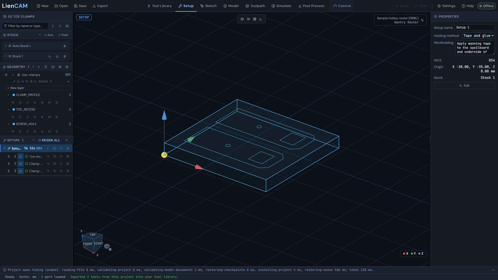
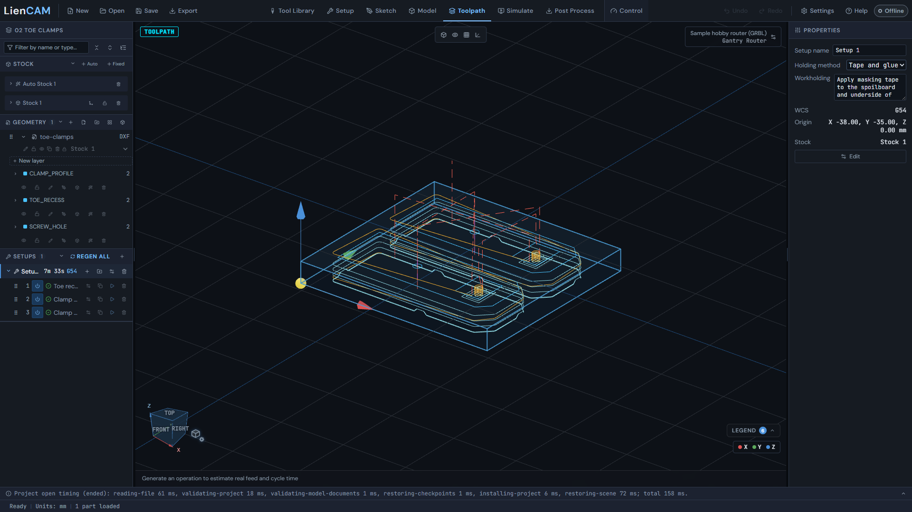
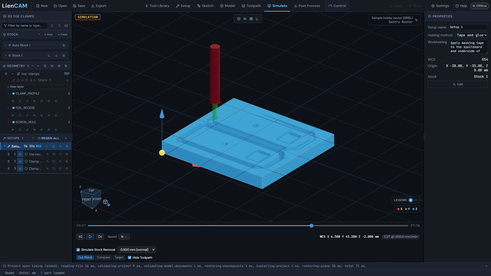
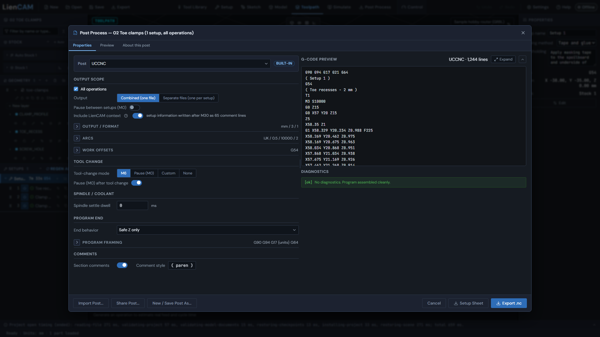

# DXF to pocket and profile

Make two toe clamps from a layered DXF: pocket the toe recesses, drill the screw holes, then profile the outlines with tabs. The current kit uses 76 x 70 x 8 mm stock and two tools. The blank is taped and glued to the spoilboard (see the setup note in the recipe): the screw holes and the outlines go through the 8 mm blank, and four tabs per clamp keep the parts in place.

Get the repository ZIP and unzip it. The drawing is `examples/02-toe-clamps/toe-clamps.dxf`; the complete recipe is `examples/02-toe-clamps/toe-clamps.camproject`. All dimensions below are mm. Open the recipe to inspect the settings first, then build from the DXF if you want to practice.

## Import and stock

1. Click **Open** in the header and choose the toe-clamps.camproject recipe. Inspect its three operations, then click New to start an empty project and rebuild it. Import the drawing with **Import geometry** on the Geometry header. The six closed loops are on CLAMP_PROFILE, TOE_RECESS and SCREW_HOLE, two per layer. See [Importing files](Importing-files).
2. Click **+ Fixed** on the Stock header. Expand the stock and set **Width (X)** to 76, Height (Y) to 70, Depth (Z) to 8, and Pos X/Y/Z to -38, -35, -8. Assign the toe-clamps geometry to this fixed stock with its stock dropdown.
3. Click **Add setup** on the Setups header. Choose that stock, set **Setup work offset** to G54 and pick its top, front-left corner on the Stock Corner tab: the recipe origin is X -38, Y -35, Z 0. Press **Create Setup**. This zero is on the uncut stock top, not the pocket floor.



## Pocket, drill and profile

4. Click **Add operation (N)** on the setup row and choose 2D Pocket. Use the 3 mm flat end mill and the two TOE_RECESS loops. In **Heights**, set the bottom 2 mm below stock top. Press **Create Operation**. This matches "Toe recesses - 2 mm" in the recipe.
5. Click **Add operation (N)** again and choose Drill. Use the 3 mm drill and only the two SCREW_HOLE loops; keep the simple cycle and the recipe's depth, Z -8: through the 8 mm blank. Press **Create Operation**. This is "Clamp screw holes - 3 mm".
6. Click **Add operation (N)** and choose 2D Contour with the 3 mm flat end mill. Select only the two CLAMP_PROFILE loops, outside/climb; a flat drawn profile cuts down to the stock bottom, Z -8, as in the recipe. Enable tabs: four per outline, 5 mm wide and 1 mm high. Press **Create Operation**. This is "Clamp profiles - four tabs each". The tabs and the taped-and-glued blank hold the clamps once the outlines are cut through.
7. Click **Toolpath**, then **REGEN ALL** after any edits. Check that the pocket cuts only the recesses, the drill visits the two holes, and the outside profiles retain their tabs. Compare with the saved recipe if a loop selection differs. See [Toolpaths 2.5D](Toolpaths-2.5D).



## Simulate and post

8. Click **Simulate** with no operation selected, then press play. Watch the whole setup, including the final profile. Confirm the recess depth, the through-cut outlines and the tabs. See [Simulate](Simulate).



9. Click **Post Process**. Choose UCCNC in Post, **All operations**, Combined (one file), and mm under Export units. Leave the built-in options at their defaults. Read the G-code and Diagnostics, then press **Export**. On another controller choose its matching post instead. See [Post Process](Post-Process).



## First lines of the posted program

The UCCNC output of the saved recipe starts here. A file built from scratch will differ if you change the operation names or settings.

```gcode
G90 G94 G17 G21 G64
( Setup 1 )
G54
( Toe recesses - 2 mm )
T1
M3 S10000
G0 Z15
G0 X57 Y20 Z15
Z5
X58.35 Z1
```

G21 selects mm, G54 selects the first setup's work offset, and the T word selects the tool. Check the entire program before running it. For a real machine, establish the same physical zero and verify the chosen tools and holding arrangement; see [Control](Control).
