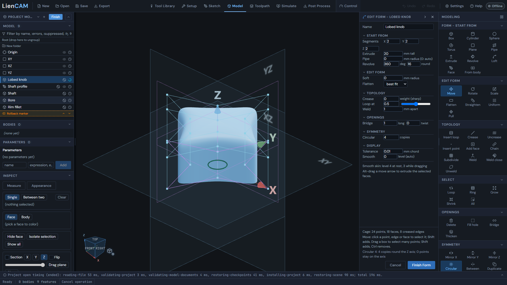

# Form a knob

Shape a four-lobed knob in the Model workspace, then add its shaft, bore and rim fillet with standard features.

## Files and result

Open [the finished tutorial project](../blob/main/docs/examples/form/lobed-knob.camproject). Watch [the continuous tutorial video](../blob/main/public/help/form-walkthrough-lobed-knob/lobed-knob.mp4) and compare [the recorded steps](../blob/main/docs/examples/form/lobed-knob-steps.json). In the app, open Help and search for "Form example: lobed knob".

The release kit maps this tutorial to example 06, knob and handwheel. Its [Form source](../blob/main/examples/06-knob-handwheel/lobed-knob-source.camproject) is the same tutorial project. The [machining companion](../blob/main/examples/06-knob-handwheel/knob-handwheel.camproject) adds CAM operations; the tutorial itself creates a model and has no posted program. For the companion, use the UCCNC post after reviewing its setup and tools.

<!-- scene: W7-1; project: examples/06-knob-handwheel/lobed-knob-source.camproject -->

## Make the knob

Start with an empty project to follow the video, or open the finished project to inspect and edit it. Use millimeters for these dimensions.

1. In the Model tab, click **Form**, then **Start from: Cylinder**. The cage surrounds the smooth skin.
2. Set **Symmetry** to **Circular**, with 4 copies. Edits to one lobe repeat around the knob.
3. Click a middle-ring point, then **Shift+click** the points above and below it. Drag the red X arrow out 10 mm.
4. Click empty space to clear the selection, then select the column between two lobes the same way (click, then **Shift+click**). Drag X in 6 mm, then Y in 6 mm to make the finger valleys.
5. **Left-drag** on empty space to orbit above the knob, click its top face and drag the blue Z arrow down 8 mm.
6. Orbit underneath, click the bottom face and click **Crease** in Topology to flatten the base.
7. Choose **Display: Smooth**, type a name and press **Finish Form**. The Form row becomes an exact solid in the design tree.
8. Click **New sketch**, pick XY and draw a 4 mm diameter circle. **Extrude** it 10 mm, Direction Down, with Result **Add** for the shaft.
9. Add a **Hole**, 3 mm diameter and 12 mm deep, in the shaft end.
10. Apply **Fillet**, 1.5 mm, to the base rim.
11. Orbit above the part, open **Display Mode** and tick **Zebra stripes** to inspect the surface continuity.

## Check and edit

The tree contains Lobed knob (Form), Shaft profile (sketch), Shaft (extrude), Bore (hole) and Rim fillet. On the finished project's Lobed knob row, choose Edit to reopen the cage shown in W7-1. Move a point and Finish Form; the later features rebuild on the new shape. Save your edited project under a new name if you want to keep the original tutorial.

To turn a cage selection while editing, choose Rotate and use Selection centre with X, Y or Z, or pick a cage edge or an axis through a point. The [Form rotation controls](Form#form-workspace-edit-form) let you type an angle and Apply; the knob tutorial above does not require this step.

Continue with [Form](Form), [Model](Model), [3D toolpaths](Toolpaths-3D) and [Post Process](Post-Process) when you are ready to machine a model.
