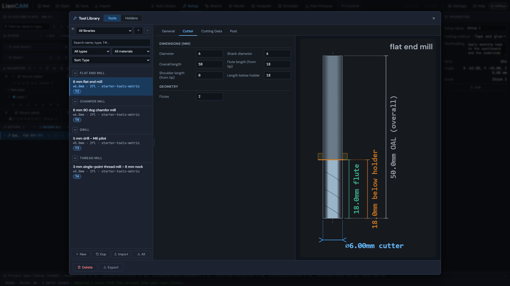
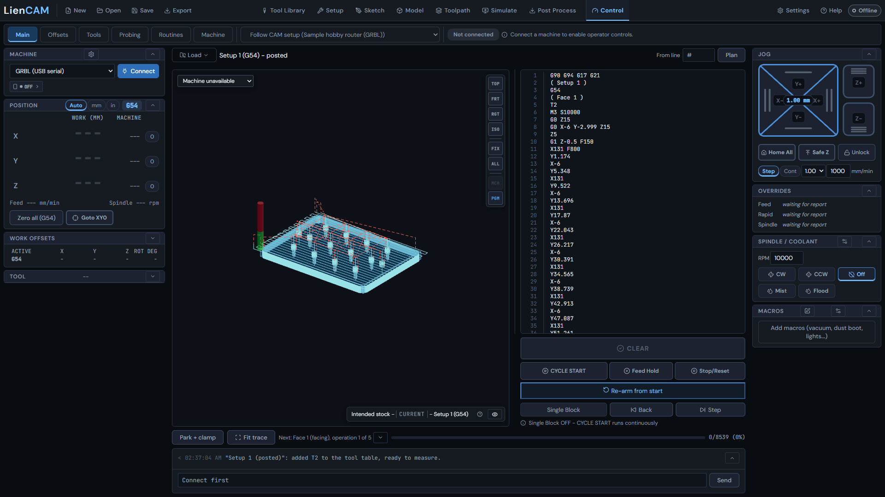

# Multi-tool job in one program

The fixture plate combines face, contour, drill, thread mill and chamfer operations using four tools in one file. The current recipe orders them face, drill, thread mill, contour, chamfer: face and contour share T2, so T2 is selected twice. The contour cuts through the 8 mm plate.

Open `examples/01-fixture-plate/fixture-plate.camproject` from the repository ZIP. Its source drawing is `examples/01-fixture-plate/fixture-plate.svg`; its model is `examples/01-fixture-plate/fixture-plate.stl`. The project already includes both, the 125 x 90 x 8 mm stock, the setup and all tools.

## Check the setup and tools

1. Click **Open** and select fixture-plate.camproject. Click **Edit setup** on Setup 1: the stock is 125 x 90 x 8 mm, the **Setup work offset** is G54, and the origin is the top front-left corner at X -62.5, Y -45, Z 0. Close without changing it.
2. Click **Tool Library** and check the four tool numbers: T2 is the 6 mm flat end mill, T3 the 5 mm drill for M6 pilots, T4 the 3 mm single-point thread mill, and T6 the 6 mm 90 deg chamfer mill. T numbers identify library tools; they need not be consecutive. See [Tool Library](Tool-Library).



## Generate and simulate

3. Click **Toolpath** and inspect each operation in tree order: Face 1, Drill 2, Thread Mill 3, Contour 4, Chamfer 5. Face removes 0.5 mm; Drill selects fourteen holes, while Thread Mill selects only the twelve M6 x 1 holes, to 7.5 mm thread depth. Contour 4 cuts the outline through the plate, to Z -8.2. The two locating-pin seats are not thread-milled.
4. Click **REGEN ALL** to recompute. Wait for Ready and inspect all five paths. Keep the shipped operation order: T2 faces, the drill and thread mill run, T2 comes back for the outline, and the chamfer mill finishes.


5. Click **Simulate** with no operation selected and press play. Watch all five operations and the tool changes in the active setup. Check the face, pilot holes, threads and chamfers. See [Simulate](Simulate).


## One file and its tool changes

6. Click **Post Process**, choose UCCNC in Post, then **All operations** and Combined (one file). Set Export units to mm. Keep Tool-change mode at M6. No extra pause is written after an M6, because the M6 is the tool-change stop. See [Post Process](Post-Process).
7. Inspect the preview, then press **Export**. The tool selections are T2, T3, T4, T2 and T6 in that order. T2 is selected at the start; the later selections are T3 M6, T4 M6, T2 M6 and T6 M6, and the M6 is the stop. There is one program end, M30. Do not split the setup into a file per tool.


8. Open **Control** only when preparing to use a configured machine. Load the exported program and establish G54 with the first tool. During an M6, the guided change parks, asks for the next tool, measures its length on the configured setter, and re-arms the program. Follow the on-screen card. A controller-owned M6 can use its own macro; see [Control](Control) and [Probing](Probing).



The current Control card calls the actions "Guided change", "Retry measure" if measuring fails, and "Continue from the M6" after a successful measurement. Fit the named tool only when the card asks. The starter machine is a CAM definition, not a connected machine. LinuxCNC owns its own M6, and GRBL-family posts use a pause instead.

## First lines of the posted program

The saved recipe, UCCNC, mm and built-in default options produce:

```gcode
G90 G94 G17 G21 G64
( Setup 1 )
G54
( Face 1 )
T2
M3 S10000
G0 Z15
G0 X-6 Y-2.999 Z15
Z5
G1 Z-0.5 F150
```

G21 means mm; G54 is the setup zero; T2 is the facing/profile cutter; M3 starts its spindle. Read the whole file and match all four tools before running it on a machine.
