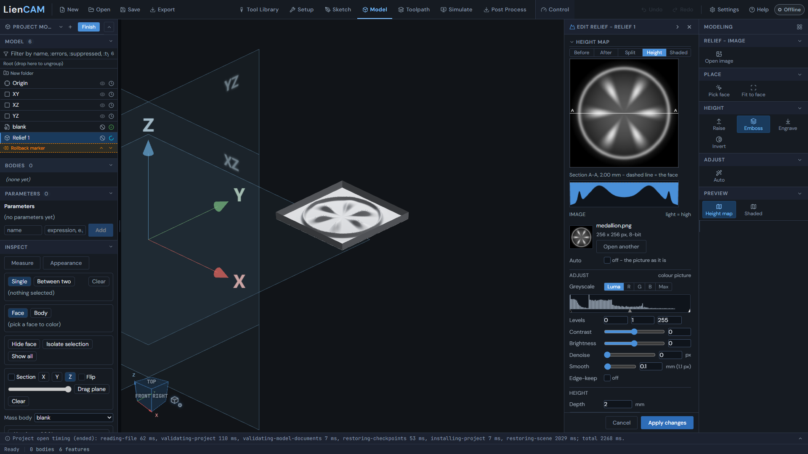
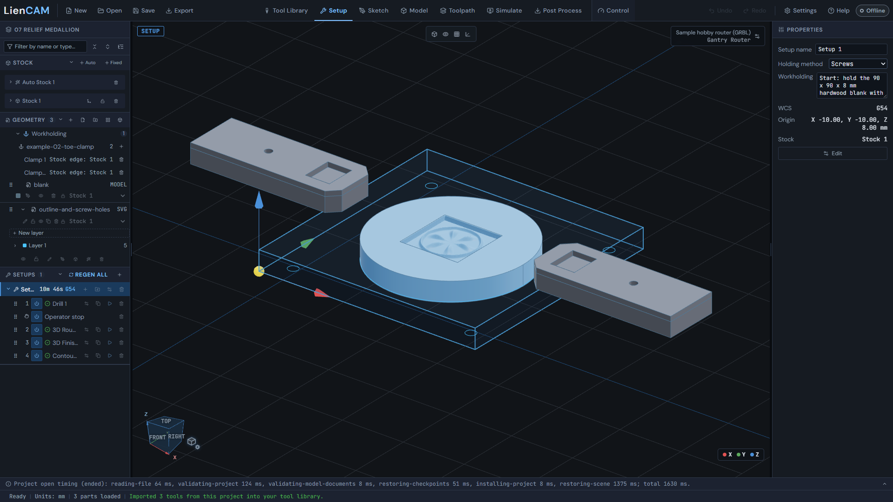
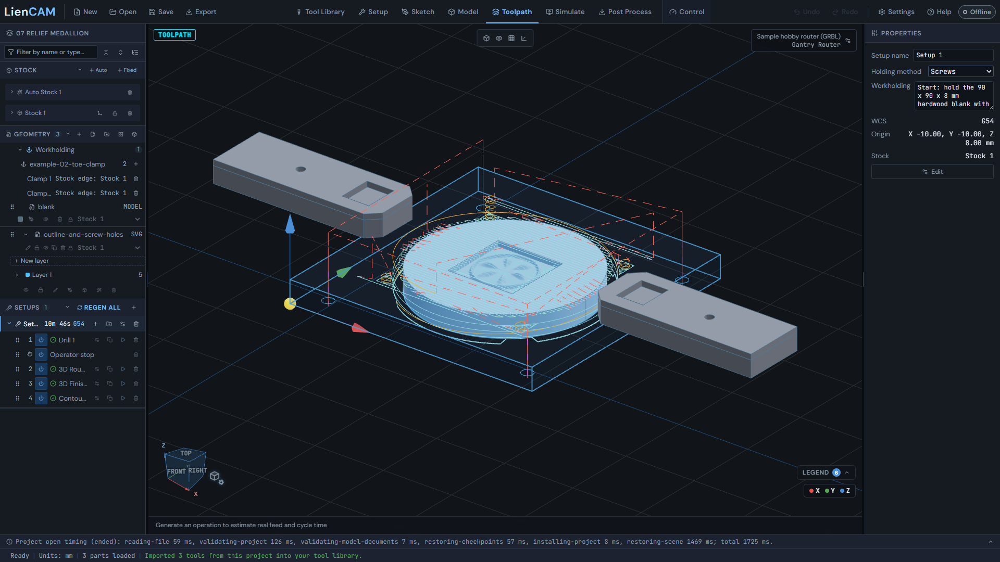
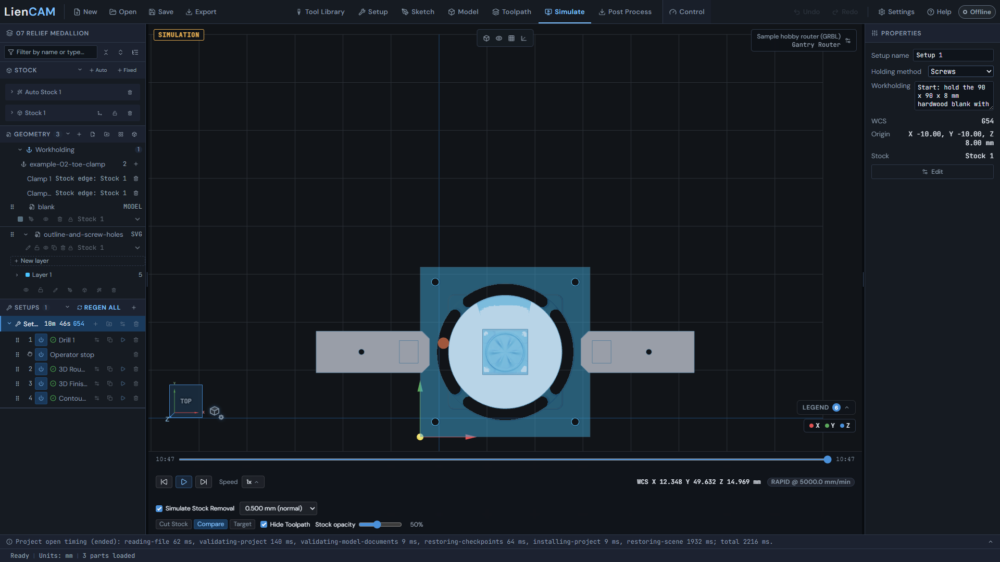
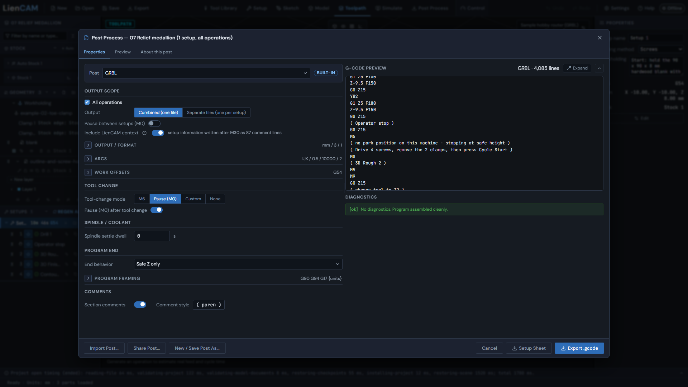

# Picture to relief

Open [07 relief medallion](../blob/main/examples/07-relief-medallion/relief-medallion.camproject).
The saved job turns a 256 x 256 picture, [medallion.png](../blob/main/examples/07-relief-medallion/medallion.png), into a
2 mm embossed relief on a 60 mm disc. The disc sits in a 90 x 90 x 8 mm hardwood blank. The job drills four screw
holes, stops so you can swap clamps for screws, cuts the relief, then cuts the outline with four tabs.

## Put the picture on the part

1. In Model, use **Import** for the round blank ([blank.step](../blob/main/examples/07-relief-medallion/blank.step)), then click **Relief** in the Create group of the rail. <!-- help:model-relief -->
2. Click the flat top face of the disc, then use **Open image** and pick medallion.png. Light is high. <!-- help:model-relief -->
3. Turn **Auto** off to keep the picture as it is, choose **Emboss**, and set Relief depth 2 mm and Relief width 24 mm. Check the **Height map** and the section A-A under it. <!-- help:model-relief-height -->
4. Click **Apply Relief** (it reads Apply changes when you are editing an existing relief). The relief becomes one row in the design tree, `Relief 1`. <!-- help:model-relief -->



To see this on the saved job, open the project, go to Model, right-click `Relief 1` and choose Edit. The palette
comes back with the picture, Emboss and the 2 mm depth. Raise stands the picture proud of the face by the Depth.
Emboss keeps it at the face and cuts everything around it down. Engrave cuts only the picture into the face.
See [Relief](Relief#model-relief-height) for all three, Invert and the picture adjustments.

## How it is held

5. Open the Setup tab. The blank is a fixed 90 x 90 x 8 mm stock with its G54 origin at X -10, Y -10, Z 8 mm. The two example 02 toe clamps hold it on the left and right side midpoints, and Holding method is Screws. <!-- help:welcome-overview -->



The holding note in the setup says the same in order: the clamps hold the blank to start, Drill 1 puts a 4 mm
screw hole in each frame corner, and the job then stops. At the stop you drive four screws, take off the two
clamps and press Cycle Start. The relief and the outline are cut with the screws holding the frame. Use 4 mm
wood screws with heads of 8 mm or less.

## Cut it

6. Open Toolpath. The setup has five rows in order: Drill 1, Operator stop, 3D Rough 2 (6 mm flat end mill), 3D Finish 3 (3 mm flat end mill) and Contour 4 (6 mm flat end mill). <!-- help:first-toolpath -->
7. Contour 4 keeps four triangular tabs, 11 mm wide and 1.5 mm high at the cutter centre, which leave bridges about 5 mm wide, so the disc stays joined to the screwed-down frame. <!-- help:contour -->



## Simulate and post

8. Click **Simulate**, turn on Simulate Stock Removal and drag the position to the end. Look for the four screw holes, the relief inside the disc, and the four tabs left in the dark outline groove. <!-- help:welcome-overview -->



9. Click **Post Process**, choose GRBL and Combined (one file), and leave All operations checked. Scroll the preview to the operator stop. <!-- help:post-basics -->



The posted baseline is `examples/gcode/07-relief-medallion-grbl.nc`. The operator stop in it reads:

```gcode
( Operator stop )
G0 Z15
M5
( no park position on this machine - stopping at safe height )
( Drive 4 screws, remove the 2 clamps, then press Cycle Start )
M0
( 3D Rough 2 )
```

The spindle stops, the tool is at the safe height, and the message tells you what to do before Cycle Start. The
machine's own park position is used when the machine definition has one. The tool numbers and feeds are the
example's; adapt them to your machine and wood. After the program, cut the four tabs, sand the stubs and unscrew
the frame.

Further reference: [Relief](Relief), [3D toolpaths](Toolpaths-3D), [Setup, stock and workholding](Setup-Stock-and-Workholding),
[Posting](Post-Process).
