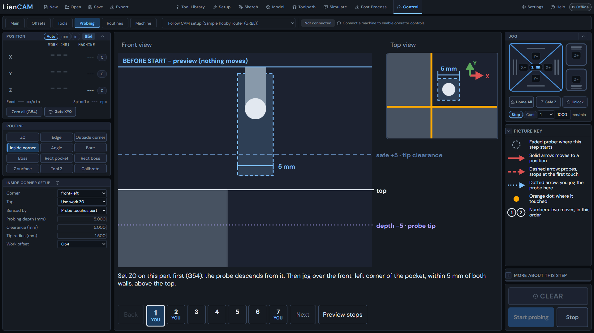

# Probe and zero your stock

Use the built-in simulator to learn the probing station: corner, bore, surface Z and tool setter. These exercises do not move a physical machine.

## Example and simulator

Open [example 01, the fixture plate](../blob/main/examples/01-fixture-plate/fixture-plate.camproject) for the machine and setup context. The simulator's virtual block is a separate contact surface; it is not the fixture plate's CAD model. Its Diagnostics card gives the actual position, size, bore and surface bow used for simulated touches.

> **What has been tested on real hardware.** I've tested LienCAM on my own router, which runs UCCNC with an
> AXBB-E controller. I don't own a GRBL, grblHAL or LinuxCNC machine, so those routes have only been tested
> against simulators (grbl-sim and the LinuxCNC simulator), not on real hardware yet. If you run one of those
> machines, your test reports are exactly what we need - and once people have confirmed them on real machines,
> this note comes off.

This walkthrough is simulator practice, including Tool Z; see [Known limitations](Known-Limitations) for hardware status. Enter the effective tip radius for your actual probe and direction; a probe tip need not be a ball.

<!-- scene: S12; project: examples/01-fixture-plate/fixture-plate.camproject -->

## Connect and inspect

1. Open **Control**, choose "Simulate <your machine name>" in the connection selector and press **Connect**. Clear the software stop if shown, then **Home**. Check that the machine is homed and idle.
2. In **Control**, open Machine, then Diagnostics, and read the Simulated part card. Use Place under probe to put its bore center under the current XY position, or Reset to restore the default placement. Read the displayed top Z and bore diameter before choosing a start position.
3. Open **Probing**. Pick a routine in the **Routine** panel; in its setup panel below, review the active work offset, probe sensing and tip radius. Jog to the start indicated by the picture; inspect the whole path and the search distances before running.

## Corner and bore

4. Choose **Outside corner** or **Inside corner** in the **Routine** panel and fill in its setup panel (for example "Outside corner setup"). For an outside corner, start outside both selected faces of the virtual block. For an inside corner, use a matching pocket; the default round bore is not an inside-corner fixture. Read the diagram's approach, top touch and two side touches. Run only when the chosen fixture matches the plan.
5. Review each step in the picture, check that the path is clear, and press **Start probing** - it moves straight away. After a successful corner measurement, inspect the proposed XY values and press **Confirm** G54 offset (or the offset you chose) to set it. An unsuccessful touch is a stop, not a measurement.
6. Choose **Bore** in the **Routine** panel. Jog over the virtual bore center, set its displayed diameter as the approximate size, and establish work Z0 at the stock top first. The bore plan uses work Z0 as its top reference, lowers into the hole and touches four sides. Review the plan, press Start probing, then **Confirm** the proposed center. Check the work-coordinate readout after confirmation.

## Surface Z and tool setter

7. Choose **Z0** in the **Routine** panel to touch the stock top with the selected probe or plate; enter plate thickness if using one. A successful Z0 cycle writes work Z0 immediately and reports what it set. There is no separate Confirm for Z0.
8. Load the example's setup into **Control** so the station can derive its cutting area. Choose **Z surface** in the **Routine** panel. Inspect the cutting-area bounds, point spacing and approach clearance, keeping all samples on solid stock rather than over the bore. The virtual stock must cover the entire cutting area. Run the planned grid. Inspect the measured heights, then **Confirm** to apply the surface compensation. The **Mesh** viewer shows the measured flatness; this grid does not replace the initial Z0 touch.
9. Choose **Tool Z** in the **Routine** panel to measure tool length. Review the active tool, sensing method and setter or plate parameters shown for this connection. On the simulator, use its simulated contact surface. A successful Tool Z cycle records the active tool length immediately and reports the result; there is no separate Confirm. A real UCCNC bridge uses its configured tool-setter routine and location.
10. Return to **Control** and inspect the work-coordinate and tool-length readouts. Keep the corner/bore offset, Z0 and tool length distinct: they answer different questions. Save the CAM project separately from the controller's live offsets.

Corner, bore, Z0 and Tool Z need no posted cutting program. Surface mapping uses the loaded program's cutting bounds, while the station plans and executes its own probe moves. See [Probing](Probing), [Control](Control) and [Work offsets](Setup-Stock-and-Workholding#work-offsets) for the controls and reference frames.
