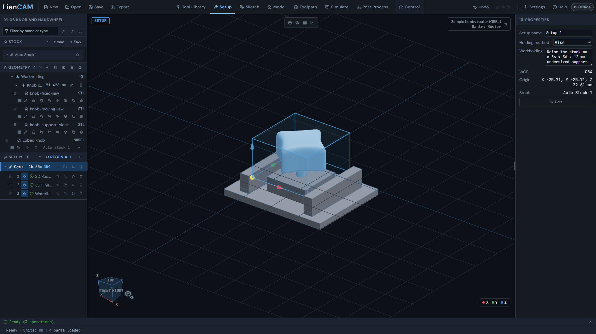
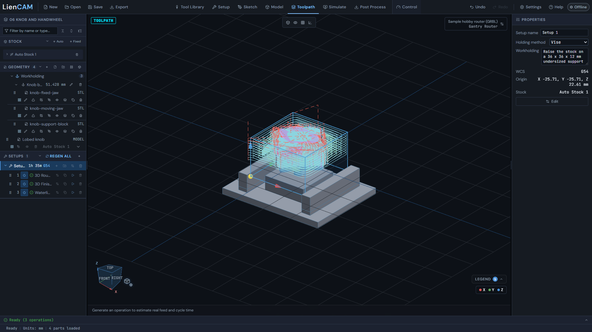
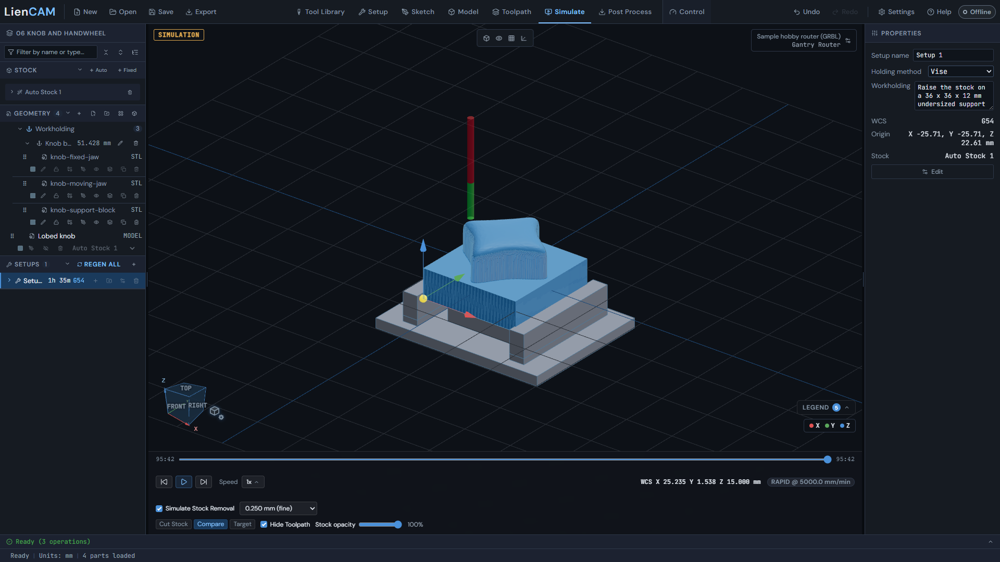
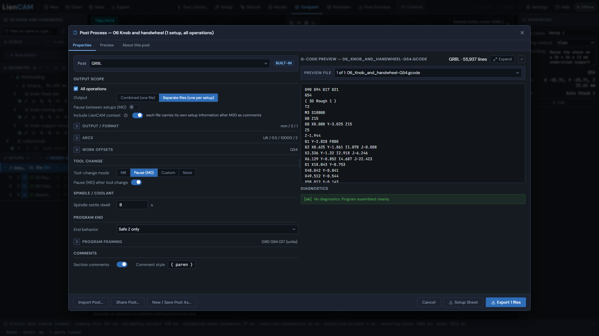

# STEP part to 3D toolpaths

Open [06 knob and handwheel](../blob/main/examples/06-knob-handwheel/knob-handwheel.camproject)
to follow the completed job. Its original solid is also shipped as
[knob.step](../blob/main/examples/06-knob-handwheel/knob.step). This example is the lobed
knob: one setup and three operations. A 6 mm flat end mill roughs the blank;
an embedded 3 mm ball end mill finishes the dome, followed by a 3 mm flat
end mill for the lobed walls.
Use the saved project first to inspect the exact stock and depths.

## Open and import

1. Click **Open** and choose the project above. Inspect the three operations under Setup 1. <!-- help:projects-save-open -->
2. To practise the STEP route separately, click **New**, then use Import geometry to load knob.step. Keep the completed project as your reference. <!-- help:projects-save-open -->
3. Use **Add setup** and choose the stock and work origin in New Setup. The reference project uses G54, with the origin on the stock's top corner. Check your blank and cutter reach before copying its dimensions. <!-- help:first-toolpath -->



The knob setup shows its stock and model. STEP import and stock controls are
described in [Importing files](Importing-files#import-step) and
[Setup, stock and workholding](Setup-Stock-and-Workholding#setup-wcs).

## Rough and finish

4. Click **Add operation (N)** on Setup 1, choose Adaptive Rough (3D), pick the imported knob and the 6 mm flat end mill, and press **Create Operation**. In the completed project this is 3D Rough 1. <!-- help:first-toolpath -->
5. In its Passes tab set **Max stepdown** to 2 mm, Stepover (fraction of tool dia) to 0.4, and Roughing scope to Clear all stock. The example's radial and axial stock to leave are both 0 mm and Tolerance is 0.1 mm. <!-- help:adaptive-3d -->
6. Import [finish-tools.json](../blob/main/examples/06-knob-handwheel/finish-tools.json) into Tool Library, or specify the same 3 mm ball end mill with 18 mm cutting reach and a 3 mm shank. Add Parallel Finish (3D) with that tool. Set **Stepover** to 0.2 mm, Pass angle to 0 deg, Tolerance to 0.05 mm, and Finish depth limit to 16.5 mm. Keep Clip to stock outline on, as in 3D Finish 2. <!-- help:parallel-3d -->
7. Add Waterline Finish (3D) with the imported **3 mm wall-finishing end mill** (flat end, 3 mm shank, 18 mm cutting reach). Set **Stepdown** to 0.2 mm, Tolerance to 0.025 mm, Steep areas only to 0 deg, Finish depth limit to 16.5 mm, and Order to Region by region. Turn Flat area detection off (parallel already finishes shallow areas), and keep Clip to stock outline off, as in Waterline Finish 3. <!-- help:waterline-3d -->



Both finishes reach 16.5 mm below the model top, stopping at WCS Z -17.5.
Parallel passes cover the rounded top; close waterline levels finish the steep
lobed walls. The ball cutter follows the curved dome between passes; the small
flat cutter reaches the wall's foot without the rounded edge a ball cutter leaves
when its tip stops at the same floor.
The 0 deg slope setting keeps the complete contours through the lower lobe
blends, and the finer waterline tolerance resolves those contours closely.
The square base remains for the vise to grip. Remove it in a second setup or
with a saw; this top-side job does not machine the underside or shaft.

## Remaining material, simulation and output

8. For a separate rest-machining exercise, add another Adaptive Rough (3D) after the first rough with a smaller suitable cutter. In Heights, leave **Material source** at Current material (recommended), so it plans against what earlier operations left. Recompute following finishes after changing the sequence. This extra operation is not in the shipped three-operation program. <!-- help:adaptive-3d -->
9. Click **REGEN ALL** so every operation in the setup is computed. <!-- help:first-toolpath -->
10. Select the complete setup and **Simulate**. Enable **Simulate Stock Removal**, choose 0.250 mm (fine) and hide the toolpath. <!-- help:stock-simulation -->
11. Use **Skip to end**, then inspect the completed stock after both finishes, including remaining material and holder clearance. Keep the reference job's three operations in order for the program below. <!-- help:simulation-playback -->



The picture shows the completed cut. Pausing during roughing shows horizontal
step-down terraces that the following finish passes remove.

12. Click **Post Process**, choose GRBL in Post, export units mm, Separate files (one per setup) and only Setup 1. Review Diagnostics and the preview, then Export. Match the chosen post to your controller before machining. <!-- help:post-basics -->



The opening lines of the reference GRBL program are:

```gcode
G90 G94 G17 G21
G54
( 3D Rough 1 )
T2
M3 S10000
G0 Z15
```

These set absolute positioning, feed per minute, XY plane and millimetres,
select G54, identify the first operation and start its spindle before retracting.
Tool numbers, speeds and feeds belong to this example. Check them for your
machine, material and workholding. The complete program baseline is
`examples/gcode/06-knob-and-handwheel-grbl.nc`. The shipped baseline includes
the project header and setup label; the excerpt shows the opening operation
lines shared with the separate setup export.

Further reference: [3D toolpaths](Toolpaths-3D), [Simulation](Simulate),
[Posting](Post-Process).
