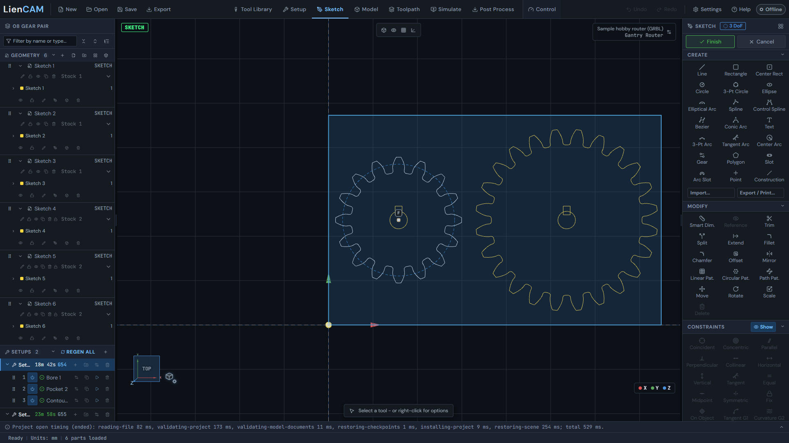
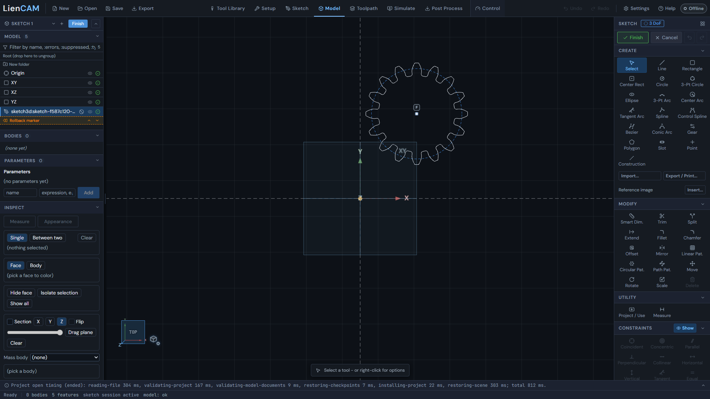
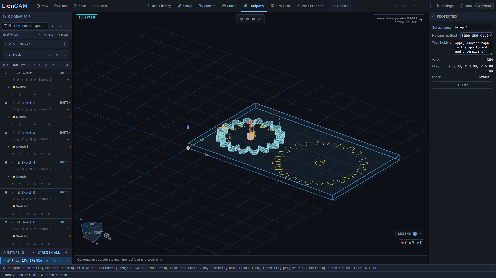
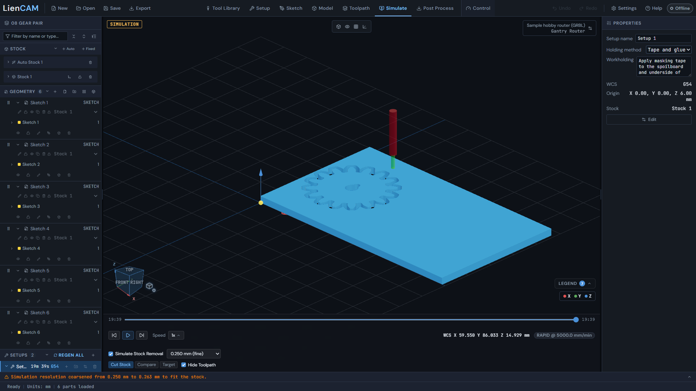
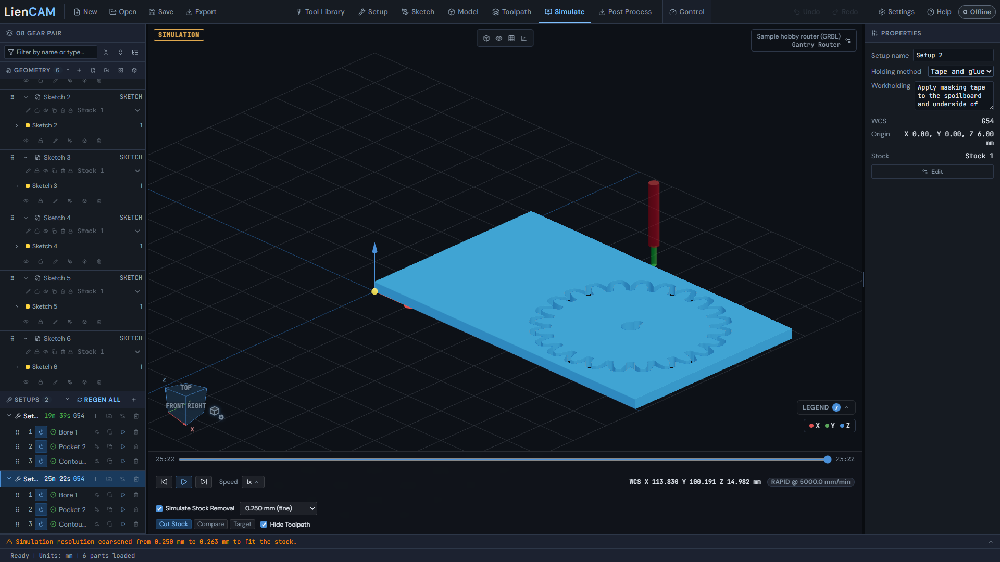
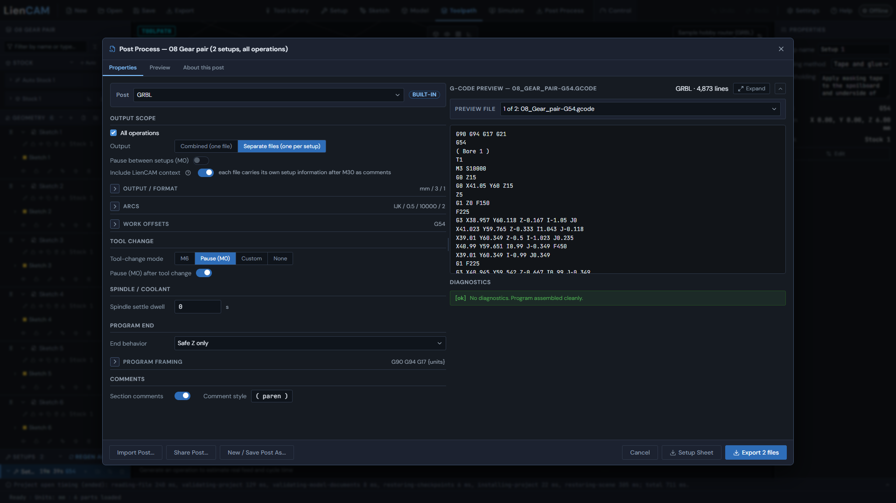

# Sketch to finished part

Open [08 gear pair](../blob/main/examples/08-gear-pair/gear-pair.camproject).
Read its [machining notes](../blob/main/examples/08-gear-pair/README.md) before cutting.
The current kit contains native 2D gear sketches, bore and keyway geometry,
and six computed CAM operations. Each gear has its own setup on one taped and glued
200 x 120 x 6 mm sheet. The solid-model exercise below makes a new variation;
the shipped program is for the saved 2D job.

## Inspect and constrain a gear sketch

1. Click **Open** and select the project. The embedded cutter is the 3 mm flat end mill; inspect Setup 1 (G54) and Setup 2 (G55) separately. <!-- help:projects-save-open -->
2. Click **Sketch** and choose the gear's existing parametric layer. The sketches use module 4 mm, 16 and 24 teeth, pressure angle 20 deg and root fillet 1.5 mm. <!-- help:sketch-entry -->
3. To draw a variation, use **Gear** with those Teeth, Module (mm), Pressure angle and Root fillet values; click its centre and then its rotation. Its construction pitch circle guides a concentric bore. <!-- help:sketch-draw-tools -->
4. Select the gear block and apply **Fix** to hold its placement for this exercise. Use dimensions and Concentric on editable bore circles to hold their diameter and centre. Inspect the definition-state chip instead of assuming every entity is fully defined. <!-- help:sketch-constraints -->



The gear project retains an
80 mm pitch-centre spacing for the meshing design, but its second cutting part
is moved 16 mm along X: cutting centres are 96 mm apart, leaving 8 mm between
the tip envelopes. Keep the gear, bore and keyway together when moving a part.

## Make a solid variation

5. For a new solid version, enter Model and choose **New sketch** on XY. Draw one gear with the same Gear values, then finish the sketch. Keep this work separate from the reference CAM job. <!-- help:model-sketch-plane-face -->
6. Select that sketch and click **Extrude**. Pick the gear area, choose End Blind, Distance 6 mm, Direction Up and Result New body, then Apply. <!-- help:extrude -->
7. Click **Hole** and pick the top flat face. Set its Seed point at the gear centre, Style Simple, Diameter 10 mm and Depth Through all. Review the preview before applying. <!-- help:shell-draft-hole -->
8. Click **Fillet**, select the intended rim edges and set a small Radius that fits the preview, then Apply. This is a solid edge fillet; the Gear tool's 1.5 mm Root fillet shapes the tooth roots in the sketch. <!-- help:fillet-chamfer-3d -->
9. Press **Finish** to return to Setup. The body appears as a MODEL part; make its own stock, setup and toolpaths. The solid variation is not part of the quoted reference program. <!-- help:model-to-cam -->



Use [Model](Model#extrude) for profile picking and [Sketch](Sketch#sketch-constraints)
for dimension and constraint details.

## Machine the saved job

10. Reopen the reference project and select **Toolpath**. Each setup runs Bore 1, Pocket 2, then Contour 3 at 0.5 mm stepdown. Both outside contours cut 0.5 mm below the stock bottom, through the tape and slightly into the sacrificial spoilboard. Tabs are off to avoid nubs on the tooth flanks; the cured tape and glue retain both gears. Run both setups on the same sheet without moving it. <!-- help:first-toolpath -->



11. Select **Simulate** for each setup separately; the app simulates one setup at a time. <!-- help:stock-simulation -->
12. Use **Skip to end**, then check the open tooth perimeter, bore and keyway; the gear remains glued in its original position. Set feeds and speeds for your material. <!-- help:simulation-playback -->





After both programs finish, pry off both gears and deburr.

13. Click **Post Process**, choose GRBL, mm and Separate files (one per setup). Export the two programs and run both on the unmoved sheet with their matching G54 and G55 offsets. <!-- help:post-basics -->



The first setup's GRBL program starts with:

```gcode
G90 G94 G17 G21
G54
( Bore 1 )
T1
M3 S10000
```

The second file uses G55. The prefix selects absolute positioning, feed per
minute, XY plane and millimetres, then the first setup's work offset and bore.
The complete baseline is `examples/gcode/08-gear-pair-grbl.nc`. That shipped
file combines Setup 1 (G54) and Setup 2 (G55), including a project header and
setup labels omitted from this excerpt. Separate files exports the two
setups individually as instructed above; both use the same taped and glued sheet.

Further reference: [2.5D toolpaths](Toolpaths-2.5D), [Posting](Post-Process).
