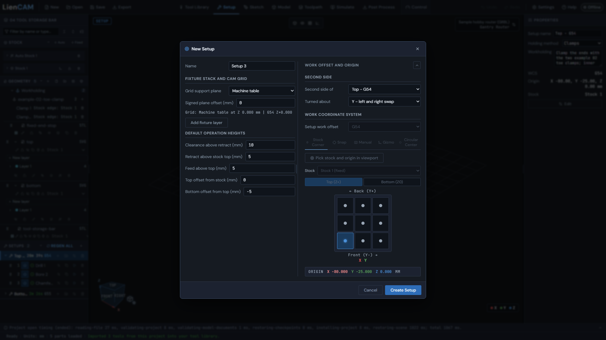
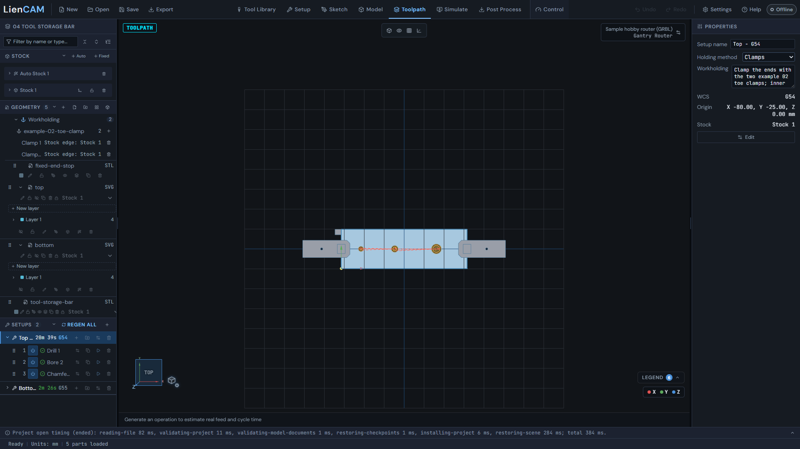
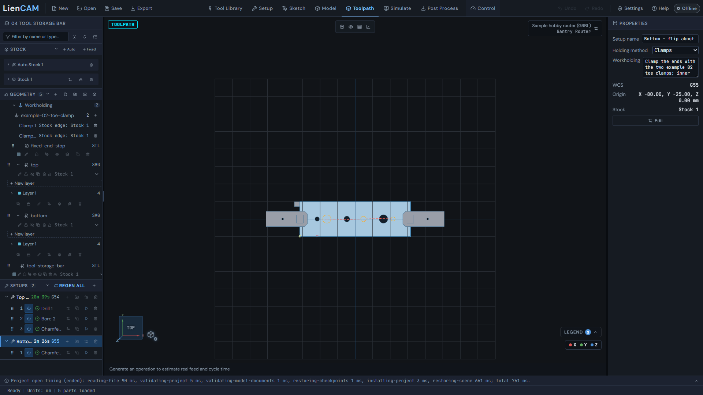
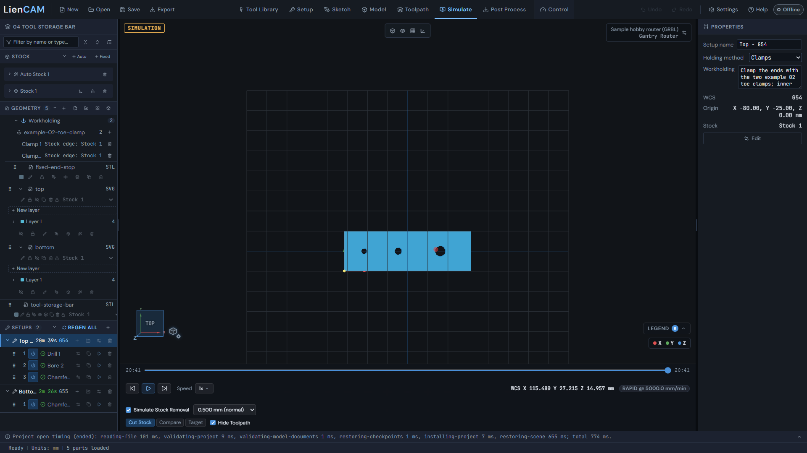
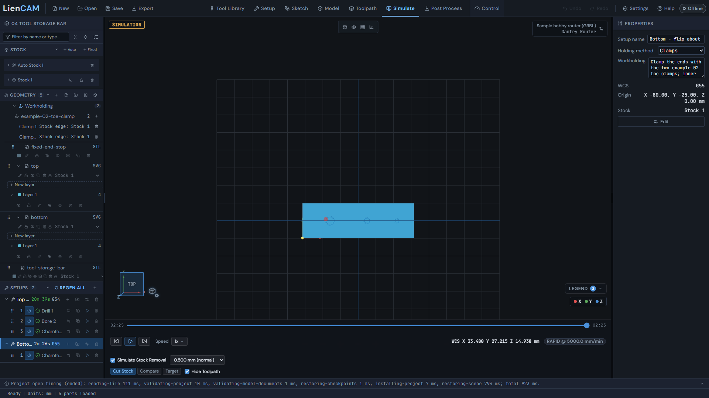
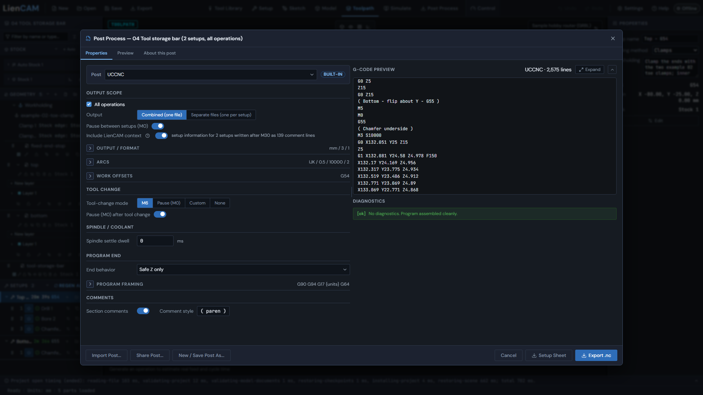
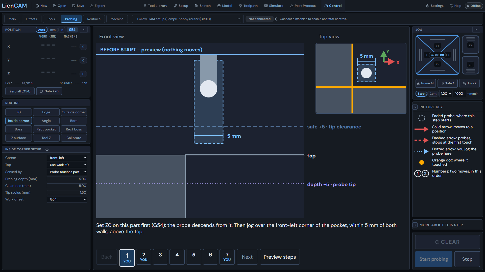

# Two-sided part with a flip

Use the current tool-storage bar to practice two setups on one 160 x 50 x 12 mm stock. The top uses G54, the bottom G55. G54 drills and bores all three holes through, then chamfers their top rims. G55 only chamfers the underside rims; it never drills or bores those holes again. The saved second setup records a turn about Y, so left and right swap.

Open `examples/04-tool-storage-bar/tool-storage-bar.camproject` from the repository ZIP. It contains the stock, tools and both setups. The side drawings are `examples/04-tool-storage-bar/top.svg` and `examples/04-tool-storage-bar/bottom.svg`; the model is `examples/04-tool-storage-bar/tool-storage-bar.stl`.

## First side and second-side relationship

1. Click **Open** and choose tool-storage-bar.camproject. In the Stock tree check Width (X) 160, Height (Y) 50 and Depth (Z) 12. The tools are a 3 mm drill, a 3 mm flat end mill for the bores and a 6 mm 90 deg chamfer mill.
2. Click **Edit setup** on "Top - G54". Check **Setup work offset** G54 and the top front-left stock-corner origin. Keep the stock binding. The top drawing's hole centres are X -55, -12 and 41, all at Y 0 in the model. See [Setup and stock](Setup-Stock-and-Workholding).
3. To see how a second side is created, open **New Setup** with the + button on the Setups header. Choose Top - G54 in **Second side of**, then Y in **Turned about**. The proposed stock, work offset and corner follow from the first side. Close without creating a third setup: "Bottom - flip about Y - G55" is already present in this recipe. When building your own part, press Create Setup here to save the relationship.



New Setup starts a second side on its parent's offset. To reproduce this kit's separate G55 zero when building from scratch, create the second side, reopen Edit setup, change Setup work offset to G55 and press Save Setup. The shipped recipe has already made that change; the physical stock and corner remain the same.

The relationship describes the physical flip; it does not automatically mirror imported CAM drawing loops. This kit supplies a separate bottom drawing whose X centres are -41, 12 and 55. Keep the top operations on top.svg and the bottom operations on bottom.svg. Do not select both drawings for either side.

## Cut and simulate both setups

4. Click **Toolpath**, select Top - G54 and click **REGEN ALL**. Inspect Drill 1, Bore 2 and Chamfer 3. Drill 1 uses Peck (G83) with 3 mm pecks; the drill tip ends at Z-13, clearing the 12 mm bar into the sacrificial spoilboard. Bore 2 ends at Z-12.5, breaking through the bottom face by 0.5 mm, with the same 3 mm end mill specified with 15 mm flutes and the default 0.25 mm Shank clearance allowance, making the full 6.5, 8.5 and 12.5 mm diameters from G54. Then select Bottom - flip about Y - G55: its only operation is Chamfer underside, selecting the three mirrored hole rims. Keeping the complete bores on G54 prevents a step caused by flip mismatch; only the underside edge break requires G55.





5. Click **Simulate** with Top - G54 active and no operation selected, then press play. Repeat with Bottom - flip about Y - G55 active. Simulation covers the active setup with fresh stock; check each side separately rather than expecting a physical flip animation or accumulated stock from G54. G54 must show full-depth holes. G55 shows only shallow underside edge cuts in its fresh-stock simulation, because the holes already exist on the real part. Do not add a second drilling or boring operation to make this isolated simulation look like the finished part. See [Simulate](Simulate).





## Post, flip and work offsets

6. Click **Post Process**, select UCCNC in Post, **All operations**, Combined (one file), mm Export units, and **Pause between setups (M0)**. The combined preview selects G54 first, then stops the spindle and pauses before the G55 section. Keep the built-in tool-change defaults. See [Post Process](Post-Process).
7. Press **Export** after checking Diagnostics and the preview. The top drill positions in work coordinates are X25, X68 and X121; the bottom chamfer centres are X135, X92 and X39, all at Y25. These reversed positions are the result of the bottom drawing and its setup origin, not just a change from G54 to G55.



8. Before using **Control** on a real machine, plan repeatable locating and holding for both sides. At the between-setup pause, turn the block 180 deg about Y, secure it and establish the bottom side's physical G55 zero. Recheck clamps and clearance before resuming. Merely selecting G55 does not measure that zero. Keep Write offsets via G10 L2 off so your touch-off values stay in charge. See [Work offsets](Setup-Stock-and-Workholding#work-offsets) and [Probing](Probing).



For separate programs, choose Separate files (one per setup) instead: the files are named with G54 and G55. Run the top file, flip and locate the block, establish G55, then run the bottom file. The combined example below uses the explicit pause; a second setup alone is not a request for a pause.

## First lines of the posted program

The saved recipe, UCCNC, mm, default tool-change options and Pause between setups (M0) produce:

```gcode
G90 G94 G17 G21 G64
( Top - G54 )
G54
( Drill 1 )
T3
M3 S10000
G0 Z15
G98 G83 X25 Y25 Z-13 R5 Q3 F150
X68 Y25
X121 Y25
```

G21 selects mm; G54 is the top-side offset; T3 is the drill. Read the full program, including the pause and G55 section, before running it.
