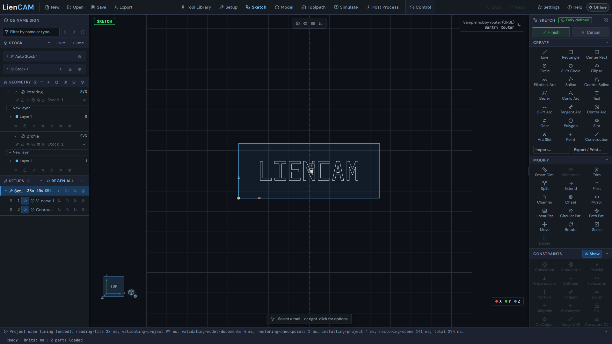
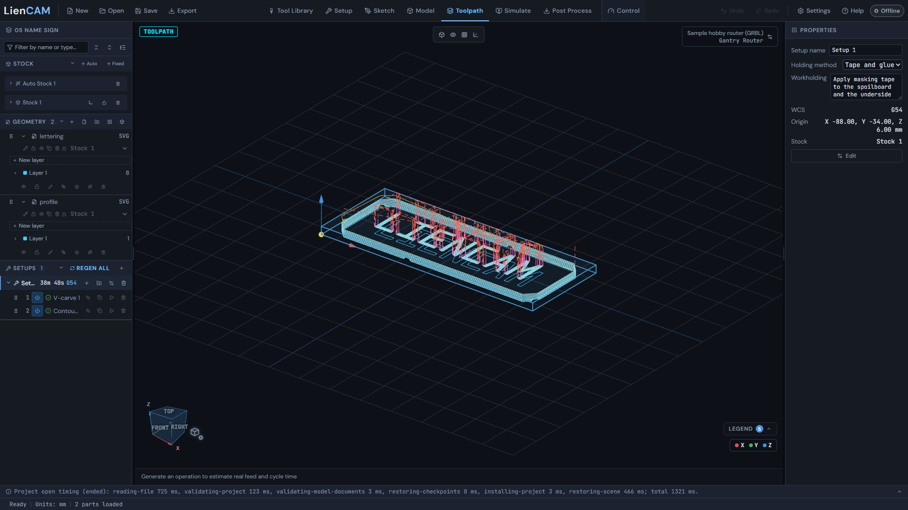
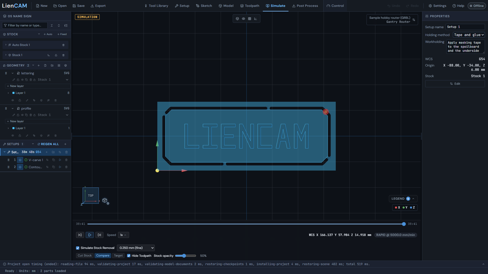
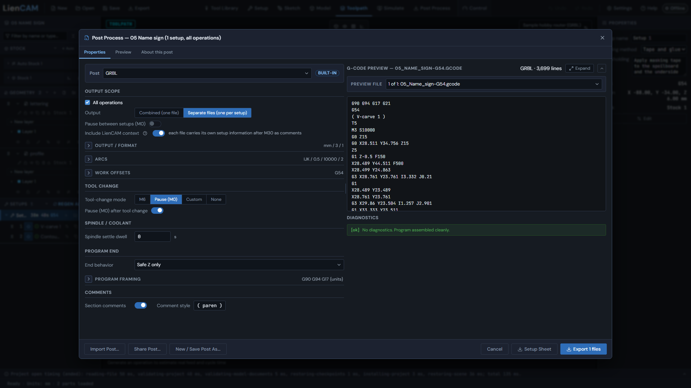

# V-carve a sign

Open [05 name sign](../blob/main/examples/05-name-sign/name-sign.camproject).
The saved job carves outlined lettering with an embedded 6 mm 60 deg V-bit,
then cuts the profile with the 3 mm flat end mill. The blank is 176 x 68 x 6 mm.
The sources are [lettering.svg](../blob/main/examples/05-name-sign/lettering.svg) and
[profile.svg](../blob/main/examples/05-name-sign/profile.svg).

## Open the job or import outlines

1. Click **Open** and select the saved project to inspect the exact setup and ready operations. Its G54 origin is at the stock's top corner. <!-- help:projects-save-open -->
2. To rebuild from SVG, use **Import geometry** for lettering.svg and profile.svg, add the stock and setup, and assign both parts to that stock. Keep the completed project as your reference. <!-- help:first-toolpath -->
3. For your own lettering, enter Sketch and use **Text** with an outline font. Finish the sketch to make cutting geometry. Use closed outlines for this V-carve; the shipped SVG already contains outlines and needs no installed font. <!-- help:sketch-text -->



See [Sketch text](Sketch#sketch-text) for fonts and placement.

## Carve, then cut the outside

4. Click **Add operation (N)** on the setup, choose V-Carve, pick the lettering as its geometry and the 6 mm 60 deg V-bit on Tool, and press **Create Operation**. Its 60 deg included angle is 30 deg from the axis on each side. <!-- help:first-toolpath -->
5. In Passes, set **Carve depth** to Flat depth, 1 mm. Under Flat areas choose Clear with this bit with Floor stepover 0.3 mm. Set Start depth 0 mm, Allowance 0 mm, Stepdown 0.5 mm and Tolerance 0.01 mm. These are the saved V-carve 1 settings. <!-- help:vcarve -->
6. Add a contour on the profile using the 3 mm end mill. Choose **Side** Outside, a 0.5 mm stepdown, and retain four tabs, 6 mm wide and 1.5 mm high. The saved Contour 2 goes 6.2 mm below the stock top; allow for the 0.2 mm breakthrough in your workholding. <!-- help:contour -->



The name-sign paths show carving before the outside profile. Inspect
the V-carve before the contour in your project: wide strokes flatten at the
1 mm limit and corners lift toward the surface. Flat depth is a limit; the
bit's shape still makes the depth vary in narrower strokes.

## Inspect and post

7. Click **Simulate** and run the whole setup. Inspect the lettering floor, profile breakthrough and retained tabs. Check the cutter and holder against your clamps. <!-- help:welcome-overview -->



8. Click **Post Process**, choose GRBL, mm and Separate files (one per setup), and export only Setup 1 with both operations enabled. Review the tool change between the V-bit and end mill and use the handling required by your controller. <!-- help:post-basics -->



The reference GRBL output starts with:

```gcode
G90 G94 G17 G21
G54
( V-carve 1 )
T5
M3 S10000
G0 Z15
```

The prefix selects absolute positioning, feed per minute, XY plane and
millimetres, then G54 and the V-bit operation. These tool numbers and spindle
settings are the example's; adapt them to your machine and material. The full
baseline is `examples/gcode/05-name-sign-grbl.nc`. Its project header and setup
label are omitted from the excerpt, which shows the opening operation lines
shared with the separate setup export.

Further reference: [V-carving](Toolpaths-2.5D#vcarve),
[Tool Library](Tool-Library), [Posting](Post-Process).
